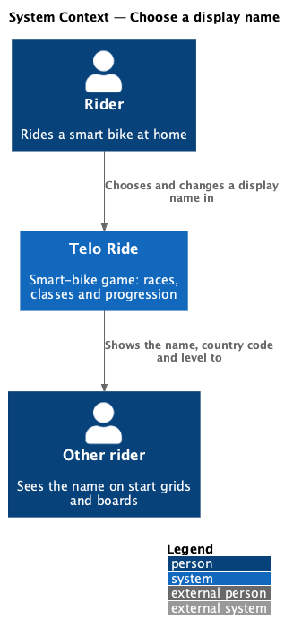
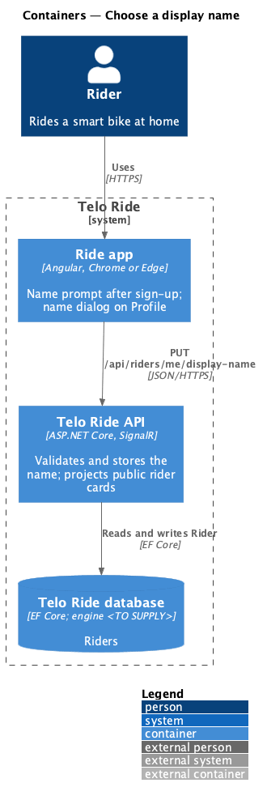
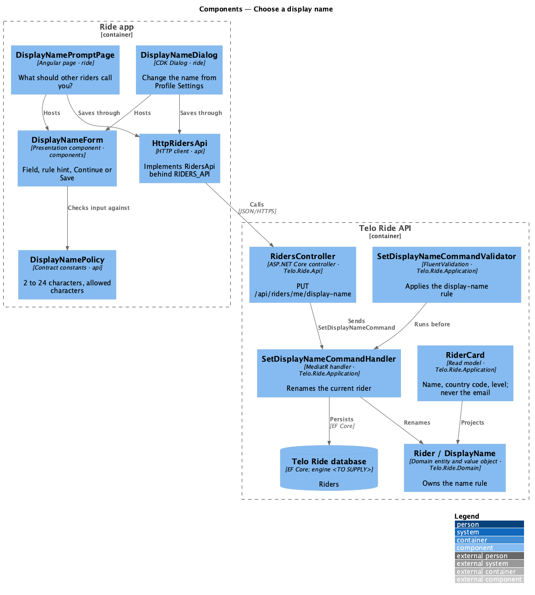
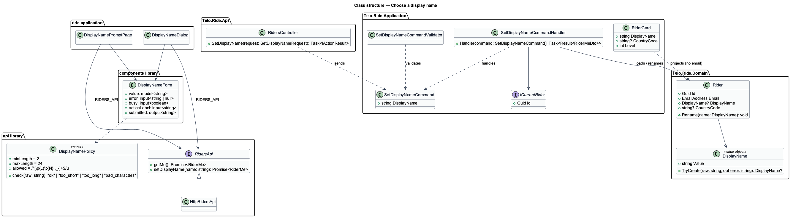
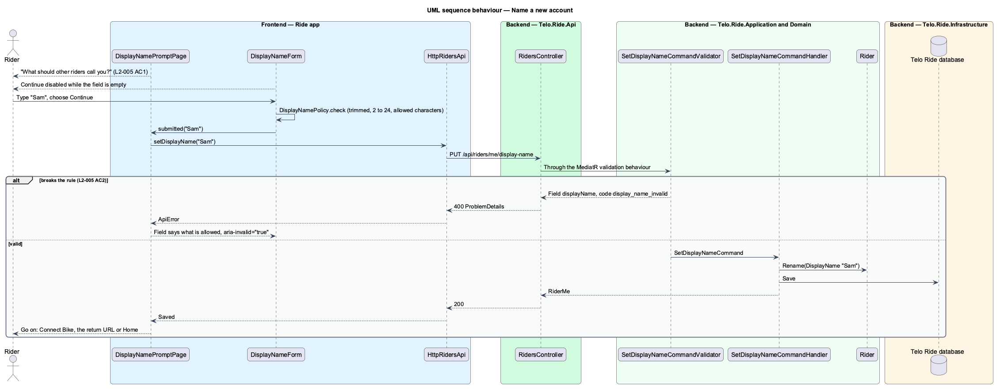
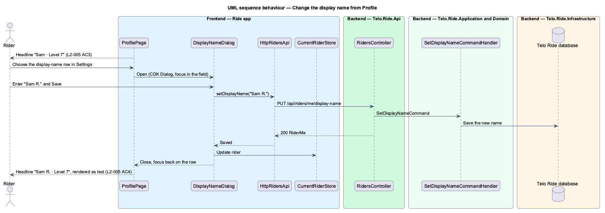

# Choose a display name

## Overview

Telo Ride puts riders side by side: start grids in the race lobby, live standings in a race and
output boards in a group class. Each rider appears there under a name they choose. This feature
lets a rider set that name when the account is created and change it later from Profile.

- **display name** — name of 2 to 24 characters, after trimming, made of letters, digits, spaces,
  `.`, `_` and `-`, that other riders see
- **rider card** — public view of a rider made of the display name, the country code and the rider
  level, and never the email address

A new account has no display name. Straight after the first code is confirmed ([Sign in with an
email code](../sign-in-with-an-email-code/README.md)), the rider is asked "What should other
riders call you?" and cannot go on until a name is entered. Afterwards, the Profile headline uses
the name ("Sam · Level 7"), and the Settings section on Profile offers a row to change it.

A display name is rider-supplied text. Every screen renders it as text, never as HTML, as
[Validate input and encode output](../../security/validate-input-and-encode-output/README.md)
requires for all such text.

The name prompt and the Settings row are a mock gap (the requirement notes "the field on
Profile"); per `AGENTS.md`, their mocks shall exist before they are built.

## Description

### Ride app (frontend)

- **`DisplayNamePromptPage`** (`wz-display-name-prompt-page`, route `/sign-in/name`) — page shown
  after a new account's code is confirmed. It hosts `DisplayNameForm` with the action label
  "Continue". After saving, it goes on to the destination the sign-in flow chose (Connect Bike,
  the return URL or Home). The `authGuard` keeps a signed-in rider with no display name on this
  route.
- **`DisplayNameDialog`** — CDK Dialog in the `ride` application, opened from the display-name row
  of Profile Settings. It hosts `DisplayNameForm` with the current name and the action "Save". On
  success it updates `CurrentRiderStore` and closes, returning focus to the row. Editing never
  happens inline on Profile.
- **`DisplayNameForm`** (`wz-display-name-form`, `components` library) — presentation component
  with one `form-field`, the rule as a hint, and one primary button. The button stays `disabled`
  while the trimmed value is empty. It checks the value against `DisplayNamePolicy` before
  emitting `submitted`, and shows a server `error` under the field with `aria-invalid="true"`.
- **`DisplayNamePolicy`** (`api` library) — the rule as constants and a pure `check` function:
  `minLength` 2, `maxLength` 24, allowed characters `^[\p{L}\p{N} ._-]+$`. The frontend uses it for
  immediate feedback; the backend's rule is authoritative.
- **`RidersApi`** / **`RIDERS_API`** / **`HttpRidersApi`** (`api` library) —
  `setDisplayName(name)` sends `PUT /api/riders/me/display-name`; `getMe()` reads the current rider.

### Telo Ride API (backend)

- **`RidersController`** (`Telo.Ride.Api`) — `PUT /api/riders/me/display-name` sends one
  `SetDisplayNameCommand`.
- **`SetDisplayNameCommandValidator`** (`Telo.Ride.Application`) — FluentValidation rule run by
  the MediatR validation behaviour. A name that breaks the rule is refused with 400 and a
  ProblemDetails body naming the field `displayName` with code `display_name_invalid`.
- **`SetDisplayNameCommandHandler`** — loads the current rider through `ICurrentRider` and
  `IAppDbContext`, calls `Rider.Rename`, and saves.
- **`DisplayName`** (`Telo.Ride.Domain`) — value object that trims the input and enforces the
  rule in `TryCreate`, so no invalid name can reach an entity.
- **`Rider.Rename(DisplayName)`** — replaces the rider's display name.
- **`RiderCard`** (`Telo.Ride.Application`) — read model used wherever another rider is shown
  (rosters, standings). It carries `DisplayName`, `CountryCode` and `Level` and has no email
  field, so no query that builds it can leak one. Where `CountryCode` comes from (rider input,
  browser locale or none) is `<TO SUPPLY>`.

## Requirements

The feature realizes the following level-2 (L2) requirements. Each L2 requirement refines a
level-1 (L1) requirement, cited by identifier.

| L2 ID | Refines (L1) | Requirement |
|-------|--------------|-------------|
| `L2-005` | `L1-001` | When a new account's code is confirmed, the rider shall be asked "What should other riders call you?" before going on, with Continue disabled until a name is entered. A saved display name shall be 2 to 24 characters after trimming, made of letters, digits, spaces, `.`, `_` and `-`; anything else shall be refused with 400 and the field shall say what is allowed. Profile's headline shall use the name ("Sam · Level 7") and the rider shall be able to change it there. A display name shall be rendered as text, never as HTML. Another rider shall see only the name, country code and level, never the email. |

## Diagrams

### System context

The rider chooses a name in Telo Ride; other riders see it, with the country code and level, on
grids and boards.

### Containers

The Ride app sends the name to the Telo Ride API, which validates it and stores it on the rider in
the Telo Ride database.

### Components

Both the prompt page and the Profile dialog host the same `DisplayNameForm` and save through
`HttpRidersApi`. On the backend, the validator runs before `SetDisplayNameCommandHandler`, which
renames the `Rider`; `RiderCard` is the only public projection of a rider.

### Class structure

`DisplayNameForm` checks input against `DisplayNamePolicy`; the backend's `DisplayName` value
object holds the authoritative rule, and `RiderCard` projects a `Rider` without its email.

### Behaviour — name a new account

The prompt keeps Continue disabled until a name is typed (`L2-005` AC1). A name that breaks the
rule returns 400 with the field and code, and the form marks the field invalid (`L2-005` AC2).

### Behaviour — change the display name from Profile

The Settings row opens a dialog; a saved name updates the current rider, and the headline shows it
as text (`L2-005` AC3, AC4).

