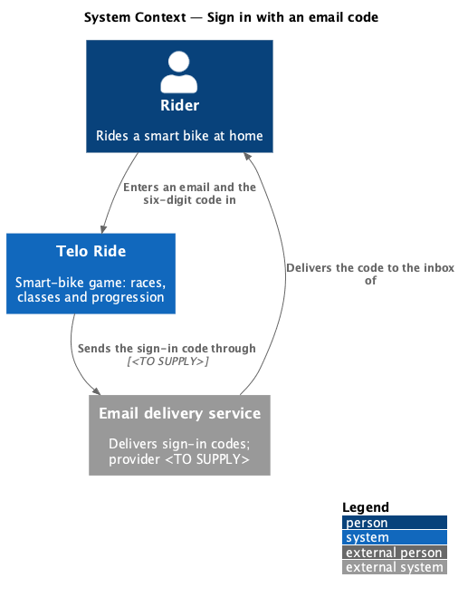
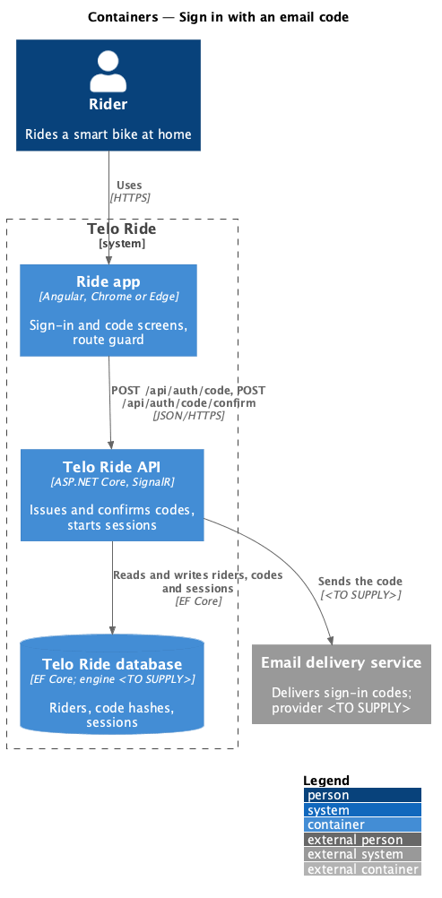
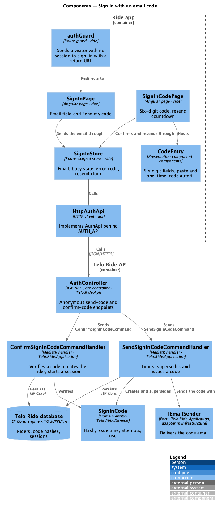
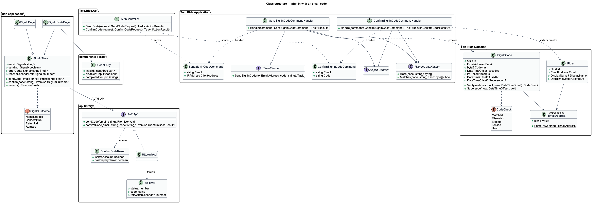
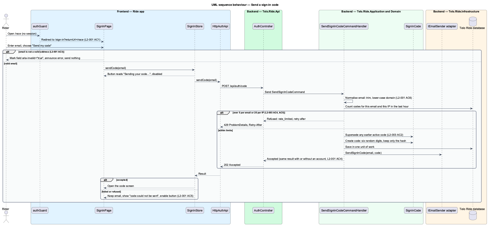
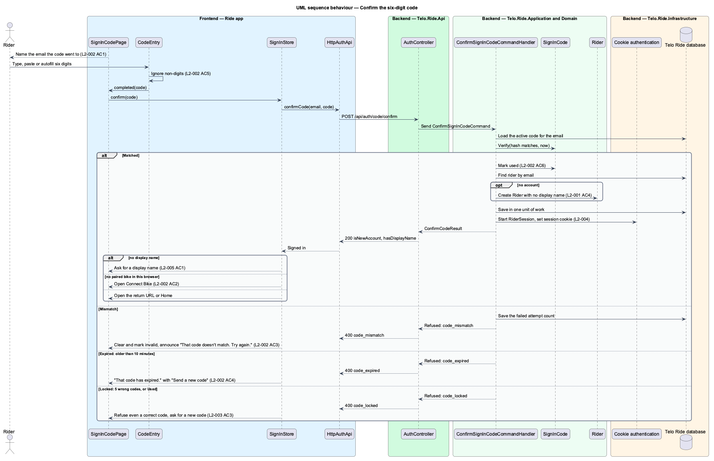
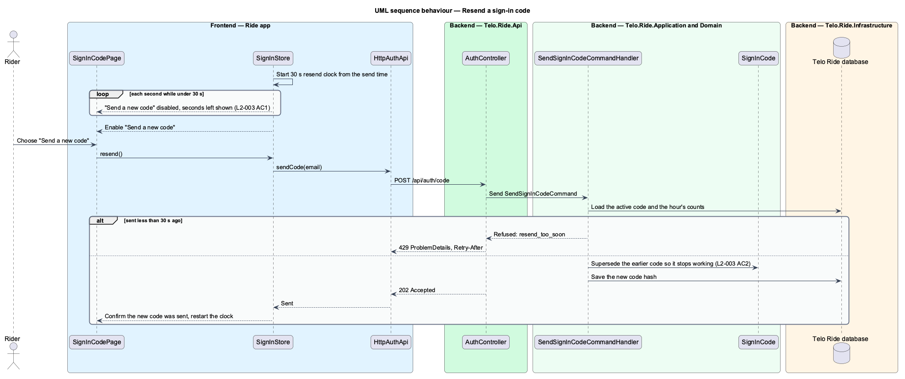

# Sign in with an email code

## Overview

Telo Ride turns a smart bike at home into a game. The progress a rider earns (XP, rider levels,
stars, map unlocks and ride history) lives on the Telo Ride backend, so the rider needs an account
that follows them from device to device. This feature is the only way into that account.

A rider signs up and signs in through one flow. The rider types an email address, the backend
sends a six-digit code to that address, and the rider types the code back. A matching code proves
that the rider owns the address. Telo Ride never asks for or stores a password.

The flow has two screens and one rule set:

- **sign-in screen** — screen with one email field and the action "Send my code"
- **code screen** — screen that names the email the code went to and takes six digits
- **sign-in code** — six random digits, valid for 10 minutes and for one use, stored only as a hash
- **superseded code** — earlier code that stops working once a newer code is sent

The same screens serve new and returning riders, so nobody learns from them whether an address
already has an account. The account is created only when a code for an unknown address is
confirmed. A rider with no session who opens any other screen (except the code screen and
not-found) is sent to the sign-in screen first, and returns to the screen they asked for.

The feature sits at the front of the accounts subsystem. The session it starts is described in
[Stay signed in](../stay-signed-in/README.md), and the display-name prompt for a new account in
[Choose a display name](../choose-a-display-name/README.md). The rate limits it applies are
enforced by the mechanisms in [Limit abuse](../../security/limit-abuse/README.md).

The sign-in, code and display-name screens are a mock gap: `docs/mocks/` has no mock for them
yet, and the copy quoted below comes from the requirements. Per `AGENTS.md`, the mocks shall
exist before the screens are built.

## Description

The slice runs from two routed screens in the Ride app through one controller to the database.

### Ride app (frontend)

- **`authGuard`** — functional route guard in the `ride` application, applied to every route
  except `/sign-in`, `/sign-in/code` and not-found. When the current rider is unknown (no
  session, see [Stay signed in](../stay-signed-in/README.md)), it redirects to
  `/sign-in?returnUrl=<requested path>`.
- **`SignInPage`** (`wz-sign-in-page`, route `/sign-in`) — page with a `form-field` for the email
  and a primary `button` reading "Send my code". It validates the address format before calling
  anything. An invalid address sets `aria-invalid="true"` on the field and shows an announced
  error under it; no request is made. While the request runs, the button reads "Sending your
  code…" and is `disabled`.
- **`SignInCodePage`** (`wz-sign-in-code-page`, route `/sign-in/code`) — page that names the email,
  hosts `CodeEntry`, and offers "Send a new code" with the seconds left until it is enabled.
- **`SignInStore`** — signal store provided on the sign-in routes. It holds the email, the busy
  flag, the last error `code` and the resend clock, and decides where a confirmed rider goes next
  (`SignInOutcome`): the display-name prompt for an account with no name, Connect Bike when no bike
  is paired in this browser, or else the return URL or Home. Its cases are covered by unit tests
  that advance a fake clock.
- **`CodeEntry`** (`wz-code-entry`, `components` library) — presentation component for six digits.
  It uses `inputmode="numeric"` and `autocomplete="one-time-code"`, drops every character that is
  not a digit, accepts a pasted or autofilled code, and emits `completed` once six digits are
  present. It takes `invalid` and `disabled` inputs and injects no service.
- **`AuthApi`** / **`AUTH_API`** / **`HttpAuthApi`** — contract, injection token and HTTP
  implementation in the `api` library. `sendCode(email)` posts to `/api/auth/code`;
  `confirmCode(email, code)` posts to `/api/auth/code/confirm` and returns `ConfirmCodeResult`
  (`isNewAccount`, `hasDisplayName`). A refusal becomes an `ApiError` carrying `status`, `code`
  and, for 429, `retryAfterSeconds`.

The screens branch on these error codes: `invalid_email`, `rate_limited`, `resend_too_soon`,
`code_mismatch`, `code_expired` and `code_locked`. The rider sees the copy the requirements give:
"That code doesn't match. Try again." for `code_mismatch` and "That code has expired." with "Send
a new code" for `code_expired`. The copy for `code_locked`, for a failed send and for a 429 is
`<TO SUPPLY>` until the mock exists.

### Telo Ride API (backend)

- **`AuthController`** (`Telo.Ride.Api`) — exposes `POST /api/auth/code` and
  `POST /api/auth/code/confirm`, both marked `[AllowAnonymous]` against the fallback policy of
  [Authenticate every request](../../security/authenticate-every-request/README.md). Each action
  sends one MediatR request and maps the result to a response or ProblemDetails.
- **`SendSignInCodeCommand`** / **`SendSignInCodeCommandValidator`** — carries the raw email and
  the client IP address. The validator refuses a malformed address with 400 and code
  `invalid_email`.
- **`SendSignInCodeCommandHandler`** — normalises the address into an `EmailAddress`, counts
  codes for that address and that IP address in the last hour, and refuses with `rate_limited`
  above 5 per address or 20 per IP address. It refuses with `resend_too_soon` when the active
  code is less than 30 seconds old. Otherwise it supersedes the active code, creates a new
  `SignInCode`, saves it, and hands the plain code to `IEmailSender`. The handler does the same
  work whether or not an account exists for the address, so the response body, status and timing
  class match in both cases.
- **`ConfirmSignInCodeCommandHandler`** — loads the active code for the address and calls
  `SignInCode.Verify`. On `Matched` it marks the code used, finds or creates the `Rider`, saves,
  and asks the cookie authentication layer to start a `RiderSession`. Every other outcome returns
  400 with the matching code; `Mismatch` saves the incremented attempt count first.
- **`EmailAddress`** (`Telo.Ride.Domain`) — value object holding the trimmed address with a
  lower-cased domain. It is the only form the backend stores.
- **`SignInCode`** (`Telo.Ride.Domain`) — entity holding `Email`, `CodeHash`, `IssuedAt`,
  `FailedAttempts`, `UsedAt` and `SupersededAt`. `Verify(matches, now)` returns `Expired` past
  10 minutes, `Locked` after 5 failed attempts (even when the sixth code is correct), `Used` after
  one use, and otherwise `Matched` or `Mismatch`.
- **`Rider`** (`Telo.Ride.Domain`) — the account: `Id`, `Email`, an optional `DisplayName` and
  `CreatedAt`. It has no password field.
- **`ISignInCodeHasher`** — port whose Infrastructure adapter hashes codes with a keyed hash; see
  [Protect rider data](../../security/protect-rider-data/README.md).
- **`IEmailSender`** — port whose Infrastructure adapter delivers the code email. The provider,
  sender address and message template are `<TO SUPPLY>`.

Times come from an injected `TimeProvider`, so the 10-minute expiry, the 30-second resend gap and
the one-hour windows are tested by advancing `FakeTimeProvider`.

## Requirements

The feature realizes the following level-2 (L2) requirements. Each L2 requirement refines a
level-1 (L1) requirement, cited by identifier.

| L2 ID | Refines (L1) | Requirement |
|-------|--------------|-------------|
| `L2-001` | `L1-001` | A rider shall sign up or sign in with an email address alone, on one screen that does both. A visitor with no session who opens any screen other than sign-in, the code screen or not-found shall be sent to sign-in and returned to the requested screen afterwards. "Send my code" shall read "Sending your code…" and be disabled while the request runs. An invalid address shall send nothing and be marked `aria-invalid="true"` with an announced error. An unknown address shall get the same API response, timing class and screen as an account. A failed send shall keep the email and re-enable the button. The backend shall store the email normalised and shall never store or ask for a password. |
| `L2-002` | `L1-001` | The code screen shall name the email the code went to. Six correct digits shall sign the rider in without a further tap, going to Connect Bike when no bike is paired in this browser and otherwise to Home. Wrong digits shall clear the field, mark it invalid and announce "That code doesn't match. Try again." A code older than 10 minutes shall be refused with "That code has expired." and a "Send a new code" action. A pasted or offered code shall be submitted as typed, ignoring any non-digit. A used code shall not work again. |
| `L2-003` | `L1-001` | "Send a new code" shall be disabled with the seconds left for 30 seconds after a send. A new code shall stop the earlier one working and its sending shall be confirmed. After five wrong codes for one email a sixth shall be refused even if correct. A sixth code request for one email within an hour shall be refused with 429 and a message that says when to try again. More than 20 code requests from one IP address within an hour shall be refused with 429. |

## Diagrams

### System context

The rider uses Telo Ride to request and confirm a code; Telo Ride hands the code to an email
delivery service, which delivers it to the rider's inbox.

### Containers

The Ride app calls two anonymous endpoints on the Telo Ride API, which keeps code hashes,
riders and sessions in the Telo Ride database and sends the code through the email delivery
service.

### Components

In the Ride app, `authGuard` routes a visitor to `SignInPage`; both pages work through the
route-scoped `SignInStore` and `HttpAuthApi`. In the Telo Ride API, `AuthController` sends one
command per endpoint to a handler that works on `SignInCode` and persists through EF Core.

### Class structure

The frontend contract `AuthApi` returns a `ConfirmCodeResult` or throws an `ApiError`. On the
backend, each handler handles one command; `SignInCode.Verify` returns a `CodeCheck` that decides
the response, and `Rider` and `SignInCode` both hold an `EmailAddress`.

### Behaviour — send a sign-in code

The guard sends a visitor with no session to sign-in. A valid address goes to the backend, which
normalises it, applies the per-address and per-IP limits of `L2-003`, supersedes any earlier code
and sends a new one, answering 202 whether or not an account exists (`L2-001` AC4).

### Behaviour — confirm the six-digit code

`CodeEntry` submits as soon as six digits are present. A matched code is marked used, the rider is
found or created, and a session starts; the store then routes to the display-name prompt, Connect
Bike, or the return URL. Mismatched, expired and locked codes each return their own error `code`.

### Behaviour — resend a sign-in code

The store counts down 30 seconds before enabling "Send a new code". A resend supersedes the
earlier code, so only the newest code works (`L2-003` AC2); the backend refuses a resend inside 30
seconds with `resend_too_soon`.

