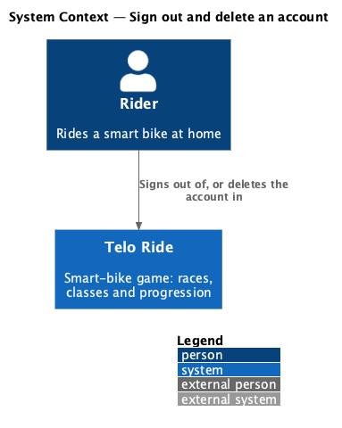
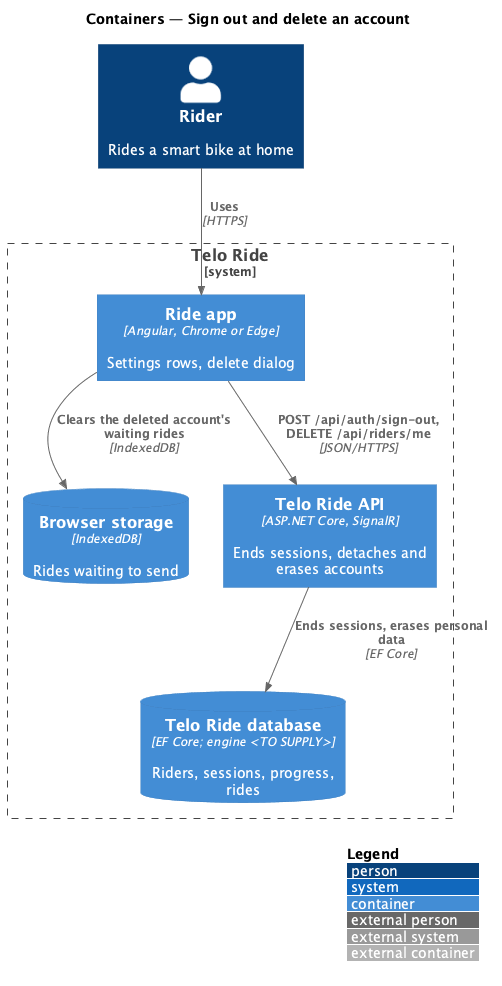
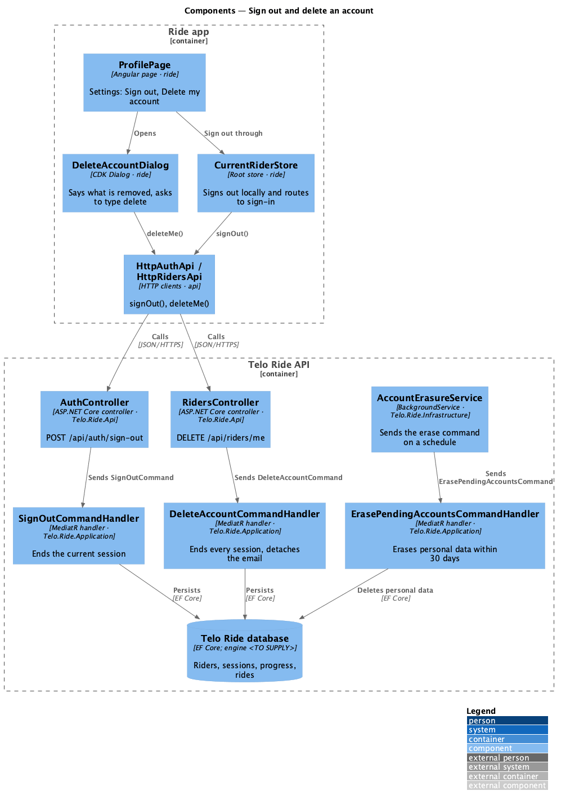
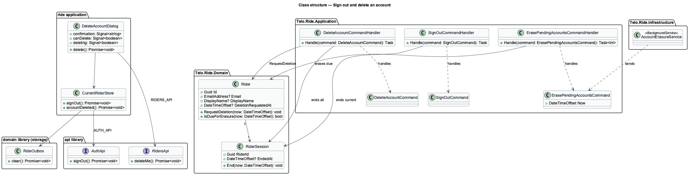
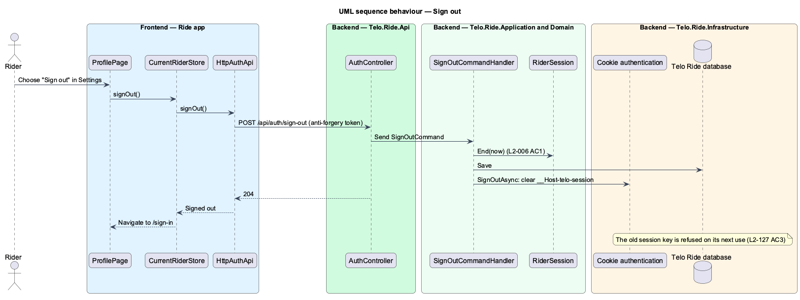
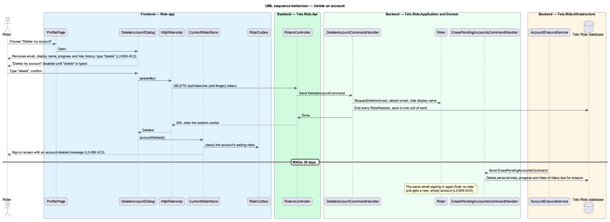

# Sign out and delete an account

## Overview

A Telo Ride account holds an email address, a display name, progress and ride history. A rider
controls that account in two ways from the Settings section of Profile: signing out of the current
device, and deleting the account altogether.

- **sign-out** — action that ends the current device's session on the backend and clears its
  cookie, leaving the account and its progress intact
- **account deletion** — action that ends every session of the account at once and erases its
  personal data (email, display name, progress and ride history) within 30 days
- **detached email** — state of a deleted account whose email is removed at once, so the address
  can start a new, empty account straight away

Sign-out takes effect on the backend immediately: the old session is refused on its next use, as
[Authenticate every request](../../security/authenticate-every-request/README.md) requires.
Deletion is guarded by a dialog that says what is removed and asks the rider to type "delete".

The Settings rows "Sign out" and "Delete my account" and the delete dialog are a mock gap; per
`AGENTS.md`, their mocks shall exist before they are built. The wording of the account-deleted
message on the sign-in screen is `<TO SUPPLY>`.

## Description

### Ride app (frontend)

- **`ProfilePage`** (`wz-profile-page`, owned by [Show the
  profile](../../profile/show-the-profile/README.md)) — its Settings section lists "Sign out" and
  "Delete my account" as `setting-row` entries, each a button reachable by touch and keyboard.
- **`CurrentRiderStore`** — the root store of [Stay signed in](../stay-signed-in/README.md).
  `signOut()` calls `AuthApi.signOut()`, sets the status to `signedOut` and opens `/sign-in`.
  `accountDeleted()` does the same, clears the `RideOutbox` so no ride of the deleted account is
  later submitted, and opens `/sign-in` with the account-deleted message.
- **`DeleteAccountDialog`** — CDK Dialog in the `ride` application. It states that the email,
  display name, progress and ride history are removed, and holds one `form-field` for the
  confirmation. The "Delete my account" button stays `disabled` until the field equals "delete"
  (case and surrounding spaces ignored: `<TO SUPPLY>` whether case matters). While the request
  runs the button is busy; a failure keeps the dialog open with a generic message.
- **`AuthApi.signOut()`** and **`RidersApi.deleteMe()`** (`api` library) — send
  `POST /api/auth/sign-out` and `DELETE /api/riders/me`, each with the anti-forgery header.
- **`RideOutbox.clear()`** (`domain` library, `storage/`) — removes the device's waiting rides.

### Telo Ride API (backend)

- **`AuthController.SignOut`** — sends `SignOutCommand`. **`SignOutCommandHandler`** ends the
  current `RiderSession` and asks cookie authentication to clear `__Host-telo-session`. It answers
  204.
- **`RidersController.DeleteMe`** — sends `DeleteAccountCommand`.
  **`DeleteAccountCommandHandler`** calls `Rider.RequestDeletion(now)`, ends every `RiderSession`
  of the rider, and saves both in one unit of work. It answers 204 and clears the cookie.
- **`Rider.RequestDeletion(now)`** (`Telo.Ride.Domain`) — sets `DeletionRequestedAt`, removes the
  email and hides the display name. With no email on the record, a later sign-in with the same
  address finds no rider and creates a new, empty account.
- **`ErasePendingAccountsCommandHandler`** — deletes the personal data, progress and rides of
  each rider whose deletion was requested, and returns the count. It is idempotent, so a repeated
  run changes nothing more.
- **`AccountErasureService`** (`Telo.Ride.Infrastructure`) — `BackgroundService` that sends
  `ErasePendingAccountsCommand` on a schedule that guarantees erasure within 30 days of the
  request. The schedule interval is `<TO SUPPLY>`; it shall be at most 30 days minus the time one
  run takes. Erasure from database backups follows the backup retention period, which is
  `<TO SUPPLY>`.
- How a deleted rider's past results appear in other riders' stored session results (removed or
  anonymised) is `<TO SUPPLY>`.

## Requirements

The feature realizes the following level-2 (L2) requirements. Each L2 requirement refines a
level-1 (L1) requirement, cited by identifier.

| L2 ID | Refines (L1) | Requirement |
|-------|--------------|-------------|
| `L2-006` | `L1-001` | When a signed-in rider chooses "Sign out" on Profile, the session shall end on the backend at once, its cookie shall be cleared and the sign-in screen shall open. "Delete my account" shall open a dialog that says what is removed (email, display name, progress and ride history) and asks the rider to type "delete", with "Delete my account" disabled until they do. On confirmed deletion, every session shall end, the sign-in screen shall open with a message that the account was deleted, and the rider's personal data shall be erased within 30 days. When a deleted account's email signs in again, a new, empty account shall be created. |

## Diagrams

### System context

Signing out and deleting an account involve only the rider and Telo Ride.

### Containers

The Ride app calls the Telo Ride API to end sessions or delete the account; the API changes the
Telo Ride database. On deletion, the Ride app also clears the rides waiting in browser storage.

### Components

`ProfilePage` signs out through `CurrentRiderStore` and opens `DeleteAccountDialog` for deletion.
On the backend, each endpoint sends one command; `AccountErasureService` sends the erase command
that removes personal data within 30 days.

### Class structure

`DeleteAccountCommandHandler` marks the `Rider` for deletion and ends each of its
`RiderSession` records; `ErasePendingAccountsCommandHandler` erases riders that are due.

### Behaviour — sign out

Sign-out ends the current session in the database and clears the cookie before the sign-in
screen opens, so the old session key is refused at once (`L2-006` AC1).

### Behaviour — delete an account

The dialog enables deletion only once "delete" is typed. The handler detaches the email and ends
every session in one unit of work; the background service erases the remaining personal data
within 30 days, and the email is free for a new account at once (`L2-006` AC2 to AC4).

