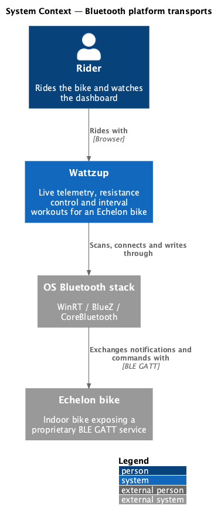
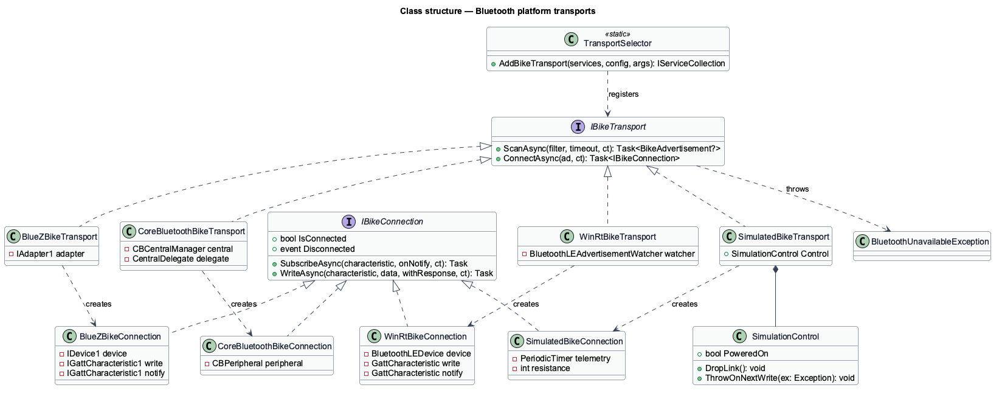

# Bluetooth platform transports

## Overview

The prototype relied on the Python library `bleak`, which hides the differences between the Windows, Linux and macOS Bluetooth stacks. .NET has no single equivalent for all three platforms, so the backend defines its own small Bluetooth abstraction and provides one implementation per platform. A fourth implementation simulates a bike, so the system runs and is tested with no hardware.

**transport** — implementation of `IBikeTransport` for one Bluetooth stack

**app bundle** — macOS directory package (`.app`) carrying an `Info.plist`; macOS grants Bluetooth access only to bundled applications that declare a usage description

**hardware smoke test** — manual or scripted check against a real bike: scan, connect, receive cadence, set resistance

Every other backend feature talks only to `IBikeTransport` and `IBikeConnection`. The transport is chosen once at start-up from configuration or the operating system, so platform code never leaks into the protocol, core or API layers.

## Description

- **`IBikeTransport` / `IBikeConnection` / `BikeAdvertisement`** — the abstraction in `Wattzup.Ble.Abstractions`, described in `discover-and-connect-bike`.
- **`WinRtBikeTransport`** (`Wattzup.Ble.Windows`, target `net8.0-windows10.0.19041.0` or later) — uses `BluetoothLEAdvertisementWatcher` for scanning, `BluetoothLEDevice.FromBluetoothAddressAsync` for connecting, and `GattCharacteristic.ValueChanged` for notifications.
- **`BlueZBikeTransport`** (`Wattzup.Ble.BlueZ`, target `net8.0`) — talks to BlueZ 5.50 or later over D-Bus (`org.bluez.Adapter1`, `Device1`, `GattCharacteristic1`). D-Bus client library: `<TO SUPPLY>` (candidates: `Linux.Bluetooth`, `Tmds.DBus`).
- **`CoreBluetoothBikeTransport`** (`Wattzup.Ble.CoreBluetooth`, target `net8.0-macos`) — wraps `CBCentralManager` and `CBPeripheral` delegates as tasks and events. The macOS host is packaged as `Wattzup.app` with `NSBluetoothAlwaysUsageDescription` in `Info.plist`. ASP.NET Core runs inside that bundle.
- **`SimulatedBikeTransport`** (`Wattzup.Ble.Simulated`) — advertises `ECHSIM-0001`, accepts every write, and emits a `0xD1` workout packet every 1 s with a synthetic cadence curve. It emits a `0xD2` resistance packet after each set-resistance write, echoing the requested level. Tests inject faults through `SimulationControl` (power off, drop link, throw on write).
- **`TransportSelector`** — registers one transport in DI. `--simulate` or `Wattzup:Ble:Transport = Simulated` selects the simulator. Otherwise the selector uses `OperatingSystem.IsWindows/IsLinux/IsMacOS`.
- **`BluetoothUnavailableException`** — thrown by every transport when the adapter is missing, off or unauthorised, so `BikeConnectionService` handles the 3 platforms the same way.

Each transport marshals native callbacks onto the thread pool before it calls the notify handler, and never blocks a native callback thread. UUID comparison is case-insensitive in every transport.

## Requirements

| L2 ID | Refines (L1) | Requirement |
|-------|--------------|-------------|
| `L2-043` | `L1-012` | Cross-platform Bluetooth. |

## Diagrams

### System context

Wattzup reaches the bike through whichever OS Bluetooth stack the host runs on.

### Containers

The transport is a library loaded into the Wattzup API container. On macOS that container is packaged as an app bundle.

### Components

`TransportSelector` binds exactly 1 of the 4 transports to `IBikeTransport`. Each platform transport wraps its native stack.

### Class structure

The 4 transports realise the same 2 interfaces. Only `TransportSelector` knows the concrete types.

### Behaviour — transport selection and simulated ride

At start-up the selector picks a transport. With `--simulate`, the simulated bike produces telemetry and echoes resistance writes, so the UI runs with no bike (L2-043).

