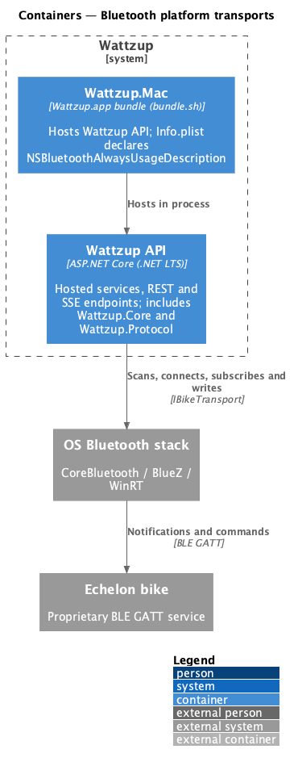
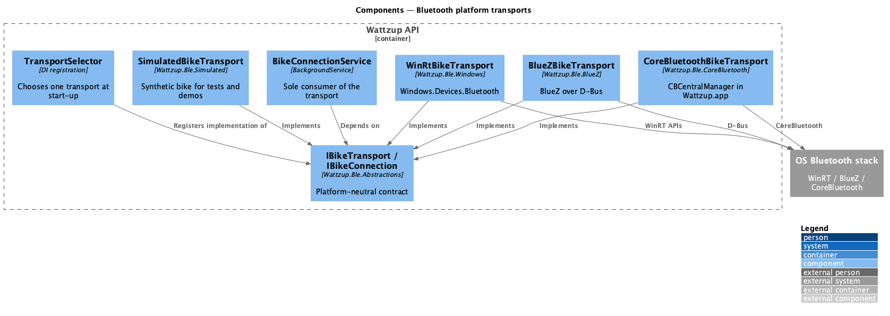
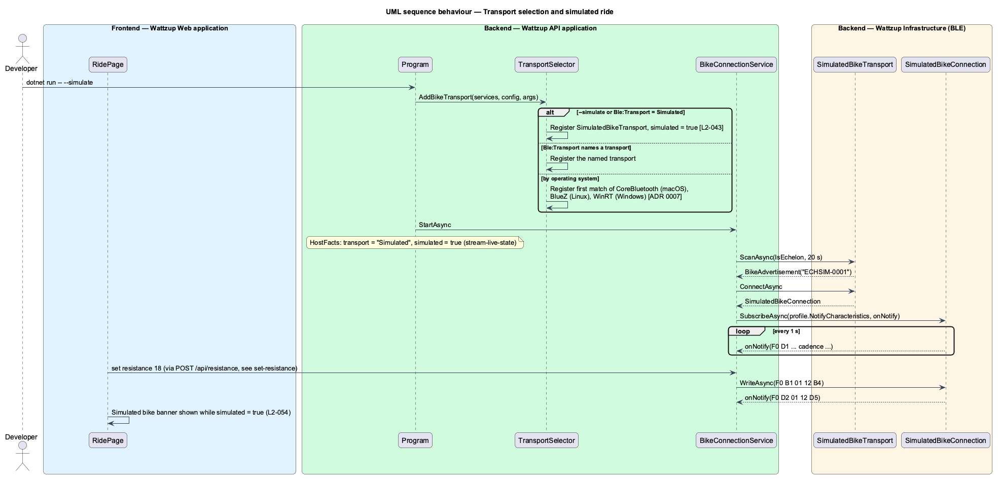

# Bluetooth platform transports

## Overview

The prototype relied on the Python library `bleak`, which hides the differences between the Windows, Linux and macOS Bluetooth stacks. .NET has no single equivalent for all three platforms, so the backend defines its own small Bluetooth abstraction and provides one implementation per platform. A fourth implementation simulates a bike, so the system runs and is tested with no hardware.

**transport** — implementation of `IBikeTransport` for one Bluetooth stack

**app bundle** — macOS directory package (`.app`) carrying an `Info.plist`; macOS grants Bluetooth access only to bundled applications that declare a usage description

**hardware smoke test** — check run by a person against a real bike: scan, connect, receive cadence, set resistance

**supported transport** — transport that has passed its hardware smoke test and is advertised as supported

Every other backend feature talks only to `IBikeTransport` and `IBikeConnection`. The transport is chosen once at start-up from configuration or the operating system, so platform code never leaks into the protocol, core or API layers. CoreBluetooth is the first real transport, because the machine next to the bike is a Mac (ADR 0007). The BlueZ and Windows transports follow against the same abstraction. Until they pass their smoke tests they are built but not advertised as supported.

## Description

- **`IBikeTransport` / `IBikeConnection` / `BikeAdvertisement` / `BluetoothAdapterState`** — the abstraction in `Wattzup.Ble.Abstractions`, described in `discover-and-connect-bike`. Each transport reports a fixed `Name`, which the state carries as `transport` (L2-014), and an `AdapterState` with an `AdapterStateChanged` event, which the state carries as `adapter`.
- **`CoreBluetoothBikeTransport`** (`Wattzup.Ble.CoreBluetooth`, target `net10.0`, `[SupportedOSPlatform("macos")]`, `Name = "CoreBluetooth"`) — wraps `CBCentralManager` and `CBPeripheral` as tasks and events, through the Objective-C runtime (ADR 0008). A delegate class registered at run time receives the callbacks on a private serial dispatch queue; each completes a task or is moved to the thread pool.
  - `CBCentralManager.State` maps to `AdapterState`: `PoweredOn` is `On`; `PoweredOff`, `Unauthorized` and `Unsupported` are `Off`; `Unknown` and `Resetting` are `Unknown`.
  - `Wattzup.Mac` packages it: `bundle.sh` publishes `Wattzup.Api` into `Wattzup.app` with `NSBluetoothAlwaysUsageDescription` in its `Info.plist` and signs it ad hoc (ADR 0008, `host-and-structure`). Run from a terminal, the server uses the terminal app's Bluetooth permission instead.
  - It builds with the plain .NET SDK on every platform; no workload or Xcode is needed.
- **`BlueZBikeTransport`** (`Wattzup.Ble.BlueZ`, target `net10.0`, `Name = "BlueZ"`) — talks to BlueZ 5.50 or later over D-Bus (`org.bluez.Adapter1`, `Device1`, `GattCharacteristic1`). `Adapter1.Powered` maps to `AdapterState`. D-Bus client library: `Tmds.DBus.Protocol`, which is maintained, trimming-safe and has no native dependency. Not yet a supported transport.
- **`WinRtBikeTransport`** (`Wattzup.Ble.Windows`, target `net10.0-windows10.0.19041.0`, `Name = "WinRT"`) — uses `BluetoothLEAdvertisementWatcher` for scanning, `BluetoothLEDevice.FromBluetoothAddressAsync` for connecting, and `GattCharacteristic.ValueChanged` for notifications. `Radio.State` maps to `AdapterState`. Not yet a supported transport.
- **`SimulatedBikeTransport`** (`Wattzup.Ble.Simulated`, `Name = "Simulated"`) — advertises `ECHSIM-0001`, accepts every write, and emits a `0xD1` workout packet every 1 s with a synthetic cadence curve. It emits a `0xD2` resistance packet after each set-resistance write, echoing the requested level. It takes `TimeProvider`, so tests advance its clock with `FakeTimeProvider`. Tests inject faults through `SimulationControl`: power the bike off, switch the adapter off, drop the link, throw on the next write.
- **`TransportSelector`** — registers exactly one transport in DI.
  - `--simulate` or `Wattzup:Ble:Transport = Simulated` selects the simulator, and `HostFacts` sets `simulated = true` in the state (`live-state/stream-live-state`). The dashboard then shows the `Simulated bike` banner (L2-054).
  - Otherwise `Wattzup:Ble:Transport` names a transport, or the selector picks by operating system in the order CoreBluetooth (`OperatingSystem.IsMacOS`), BlueZ (`IsLinux`), WinRT (`IsWindows`).
  - The selector registers only transports whose assembly the host references. `Wattzup.Api` references `Wattzup.Ble.CoreBluetooth`, which registers only when `OperatingSystem.IsMacOS()`, and `Wattzup.Ble.BlueZ`, which registers only when `OperatingSystem.IsLinux()`. `Wattzup.Api` and its acceptance tests target `net10.0-windows10.0.19041.0` when built on Windows and `net10.0` elsewhere (`WattzupHostFramework` in `Directory.Build.props`), so `dotnet run` needs no framework argument. Only the Windows target references `Wattzup.Ble.Windows`.
- **`BluetoothUnavailableException`** — thrown by every transport when the adapter is missing, off or unauthorised, so `BikeConnectionService` handles the 3 platforms the same way.

Each transport marshals native callbacks onto the thread pool before it calls the notify handler, and never blocks a native callback thread. UUID comparison is case-insensitive in every transport. No type outside a `Wattzup.Ble.*` project touches a platform Bluetooth API.

The hardware smoke test of L2-043 is run by a person on each platform, never by an agent or CI. CI builds every project but runs no transport against hardware (ADR 0007). Every automated test uses `SimulatedBikeTransport` or a test double of the two interfaces.

### Notify characteristics per machine

`IBikeConnection.SubscribeAsync(notifyCharacteristicUuids, onNotify, ct)` takes the list of notify characteristics that `BikeConnectionService` names from the chosen machine's profile: `[…f4]` for the bike, `[…f4, …f3]` for the treadmill (ADR 0009, L2-063). Each transport subscribes every listed characteristic that the Echelon service `…f1` has, and completes only when every subscription is in place, so no init command is written before the last one (L2-063 criterion 5). Frames from every subscribed characteristic go to the same `onNotify`, one frame per call. A listed characteristic that the service lacks is skipped; `<TO SUPPLY>` whether a transport logs the skip. Writes still go only to `…f2`; no transport writes another characteristic or the `FE59` firmware-update service (L2-063 criterion 10).

`SimulatedBikeTransport` advertises 2 devices: `ECHSIM-0001` with the Echelon service `…f1`, and `STRIDE-SIM-0001` with the treadmill's advertised service `…f0`. Each machine's filter selects its own device. Connecting to `STRIDE-SIM-0001` returns a `SimulatedTreadmillConnection`, which reports speed and incline only when they change, as the real treadmill does. On subscribe it reports `D3` speed 0 and `D2` incline 0. Its answers to belt, speed and incline commands, and the `SimulationControl` members `IgnoreBeltStart` and `StopBeltFromConsole()`, are described in `treadmill/control-the-belt` and `treadmill/control-speed-and-incline`. `--simulate --machine treadmill` runs the treadmill with no hardware, and the dashboard then shows the `Simulated treadmill` banner (L2-071).

## Requirements

| L2 ID | Refines (L1) | Requirement |
|-------|--------------|-------------|
| `L2-043` | `L1-012` | Cross-platform Bluetooth. |

## Diagrams

### System context

Wattzup reaches the bike through whichever OS Bluetooth stack the host runs on, CoreBluetooth first.

### Containers

The transport is a library loaded into the Wattzup API container. On macOS that container is packaged as the `Wattzup.Mac` app bundle.

### Components

`TransportSelector` binds exactly 1 of the 4 transports to `IBikeTransport`. Each platform transport wraps its native stack.

### Class structure

The 4 transports realise the same 2 interfaces and report their name and adapter state. Only `TransportSelector` knows the concrete types.

### Behaviour — transport selection and simulated ride

At start-up the selector picks a transport. With `--simulate`, the simulated bike produces telemetry and echoes resistance writes, so the UI runs with no bike (L2-043).

