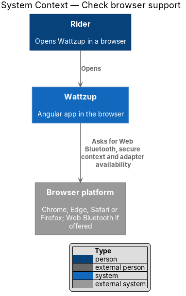
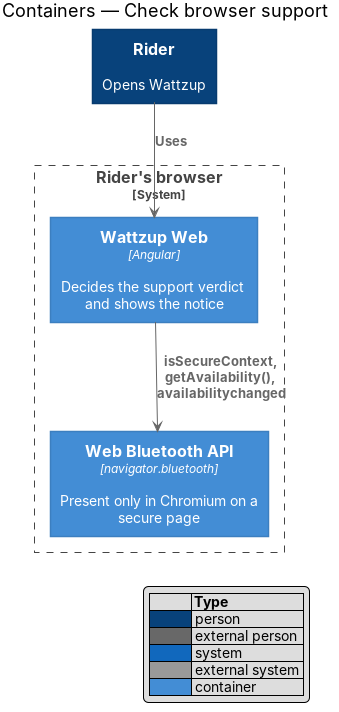
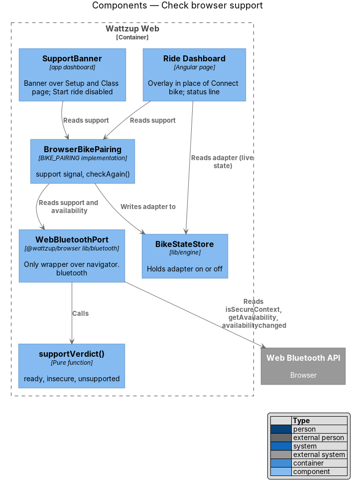
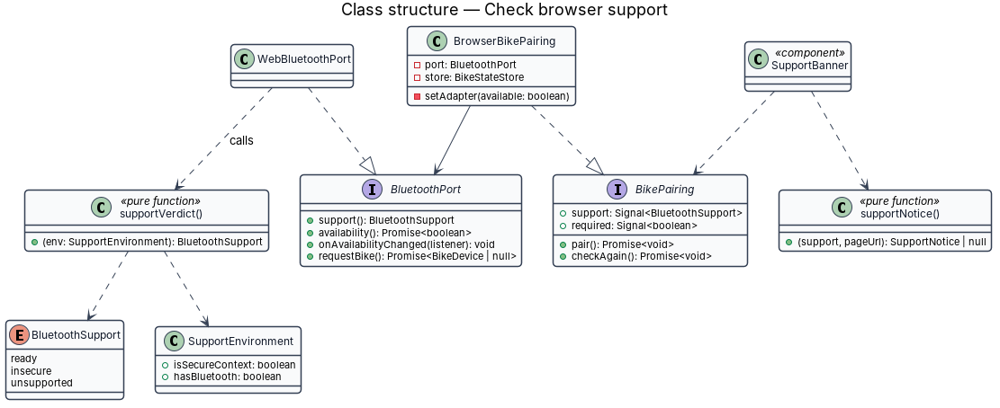
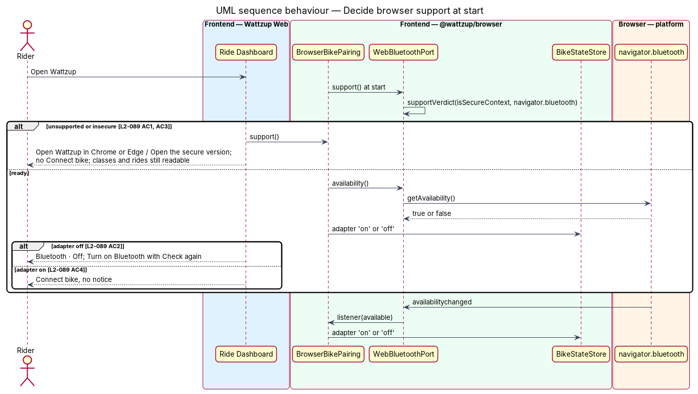

# Check browser support

## Overview

Wattzup reaches the bike through Web Bluetooth, a browser API that only Chromium browsers offer: Chrome and Edge on Windows, macOS, Linux, ChromeOS and Android. Safari, Firefox and every browser on iOS lack it, and Chromium also withholds it from pages that are not a secure context. This feature detects those cases when Wattzup starts and tells the rider plainly what is missing, instead of leaving a Connect button that can never work. The class library and past sessions stay readable, because they need no Bluetooth (L2-089).

**Web Bluetooth** — browser API (`navigator.bluetooth`) through which a page asks the rider to pick a Bluetooth Low Energy device and then talks GATT to it

**secure context** — page served over HTTPS or from `localhost`, the only pages to which Chromium exposes Web Bluetooth

**adapter availability** — answer of `navigator.bluetooth.getAvailability()`: whether the device has a usable Bluetooth adapter switched on

**support verdict** — 1 of `ready`, `insecure`, `unsupported` or `adapter-off`, computed once at start and again when availability changes

## Description

- **`supportVerdict`** (`@wattzup/browser`, `lib/bluetooth/bluetooth-support.ts`) — pure function over `{isSecureContext, hasBluetooth}`, with a unit test per row:

  | `isSecureContext` | `hasBluetooth` | Verdict |
  |---|---|---|
  | `false` | any | `insecure` |
  | `true` | `false` | `unsupported` |
  | `true` | `true` | `ready` |

  `insecure` wins over `unsupported`, because Chromium hides `navigator.bluetooth` on an insecure page and the fix there is HTTPS, not another browser. The verdict type is `BluetoothSupport` in `@wattzup/api`.
- **`BluetoothPort`** (`lib/bluetooth/`) — the only wrapper over `navigator.bluetooth`. Besides the chooser and device calls of `bike-connectivity/connect-the-bike` it offers `support()` (the verdict), `availability()` (`getAvailability()`, `true` where the browser cannot tell) and `onAvailabilityChanged(listener)` (`availabilitychanged`). `WebBluetoothPort` is the real one; unit tests and `?simulate` use ports that are always `ready` and on.
- **`BrowserBikePairing`** — implements `BIKE_PAIRING`'s `support: Signal<BluetoothSupport>` and `checkAgain()`. On a `ready` page it asks `availability()` at start and on **Check again**, and follows `availabilitychanged`, writing `adapter` `on` or `off` through `BikeStateStore`; on an `unsupported` or `insecure` page it asks Bluetooth nothing. `provideBrowserContracts()` builds it at start, so every page's status line knows.
- **Status line** — `connectionStatus(…, support)` reads **Bluetooth · Unavailable in this browser** (tone `wait`) when the verdict is not `ready`, and **Bluetooth · Off** (tone `bad`) when `adapter` is `off`, not that no bike was found (L2-089 criterion 2).
- **Ride Dashboard** — `rideViewState(…, support)` picks the overlay, first match wins: `browser-unsupported`, `browser-insecure`, `adapter-off`, then `connect-bike` and the rest. `rideOverlayText(kind, state, location.href)` words them as the `ride/unsupported`, `ride/insecure` and `ride/bluetooth-off` mocks: *Open Wattzup in Chrome or Edge* with **Copy link** (the page address, which reads *Link copied* for 1.6 s); *Open the secure version of this page* with **Open over HTTPS** (the same address on `https:`); *Turn on Bluetooth* with **Check again** and **Open diagnostics**. Each is an `alert` with a warning icon, and none offers **Connect bike** (L2-089 criteria 1 to 3).
- **Setup and class pages** — `SupportBanner` (app, `dashboard/support-banner/`) renders the `wz-alert` warning banner of the `unsupported` and `insecure` Ride Setup and Class mocks under the header: *Open Wattzup in Chrome or Edge.* with **Copy link**, or *Open the secure version of this page.* with **Open over HTTPS** (a link, through the alert's `actionHref`). The page stays usable; **Start ride** is disabled and described by the reason under it: *Needs Chrome or Edge to reach the bike.* or *Needs the HTTPS page to reach the bike.* `supportNotice(support, pageUrl)` (`core/`) words the banner and the reason. The class library, Progress and Session Summary stay open and need nothing (L2-089 criterion 1).
- Nothing is shown when the verdict is `ready` (L2-089 criterion 4).

Verification: unit tests for `supportVerdict` (one per table row), `BrowserBikePairing` (verdict, `getAvailability`, `availabilitychanged`, **Check again**, nothing asked on an unsupported page), `rideViewState`, `rideOverlayText`, `connectionStatus` and `supportNotice`; Playwright specs (`support.spec.ts`) that shadow `navigator.bluetooth`, stub `isSecureContext` and answer `getAvailability()` with `false` before load, asserting the dashboard notices, the status line, **Copy link**, the readable class library, the setup and class-page banners with **Start ride** disabled, and **Connect bike** returning once Bluetooth is on.

## Requirements

| L2 ID | Refines (L1) | Requirement |
|-------|--------------|-------------|
| `L2-089` | `L1-012` | Browser support. Where `navigator.bluetooth` is missing, Wattzup shall say that Wattzup needs Bluetooth in Chrome or Edge on a computer or an Android phone, keeping the class library and past sessions readable but starting no ride; where `getAvailability()` is `false`, the status shall say Bluetooth is off or missing on this device; on an insecure page it shall say to open it over HTTPS and shall not offer to connect; on a supported browser no such message shall show. |

## Diagrams

### System context

The rider opens Wattzup in some browser. The browser either offers Web Bluetooth and a working adapter or it does not; Wattzup reads that before offering to connect.

### Containers

Only the Wattzup app takes part. It asks the browser's Web Bluetooth API for support and availability and nothing else.

### Components

`BluetoothPort` reads the browser, `supportVerdict` decides, `BrowserBikePairing` exposes the verdict through the `BIKE_PAIRING` token, and the Ride Dashboard's overlay, the status line and `SupportBanner` act on it.

### Class structure

`supportVerdict` is pure over `SupportEnvironment`. `BrowserBikePairing` turns it into a signal, keeps `adapter` from `getAvailability()`, and the app reads both only through `BikePairing` and the live state.

### Behaviour — decide support at start

Wattzup computes the verdict at start, shows the notice or the Connect button, and recomputes when the adapter is switched on or off (L2-089).

