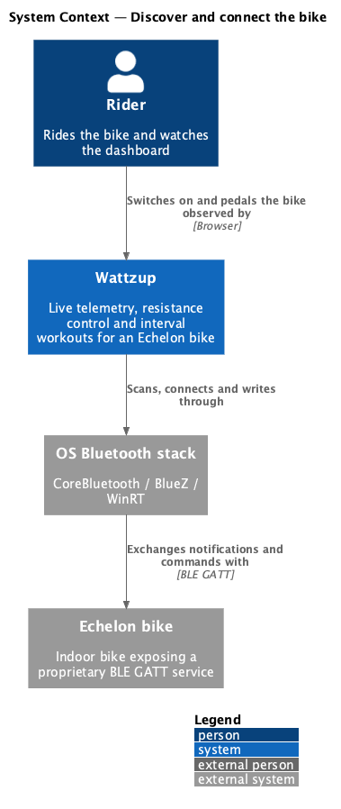
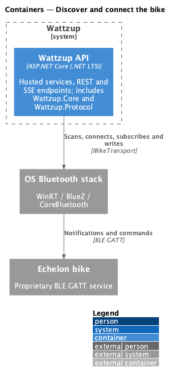
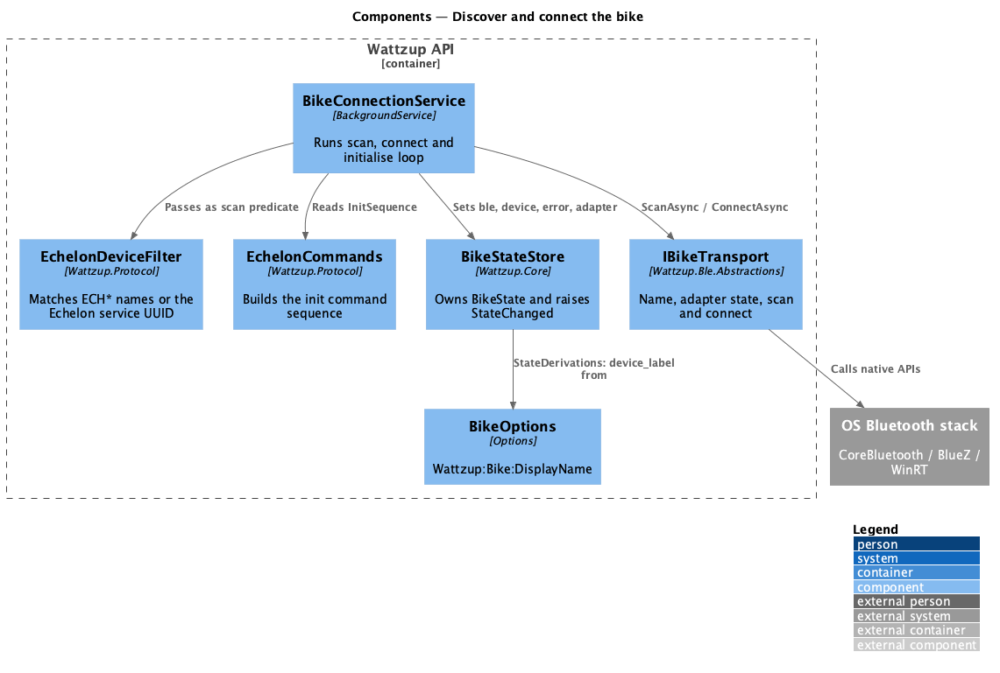
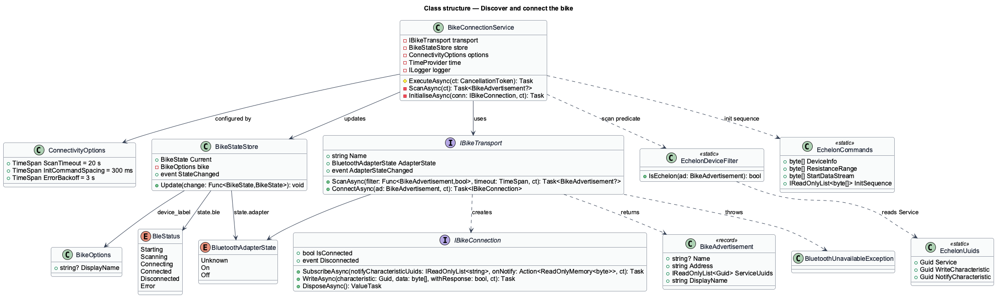
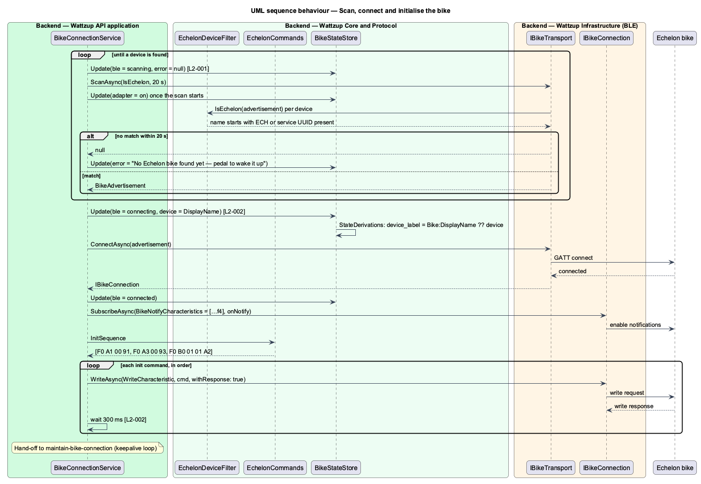
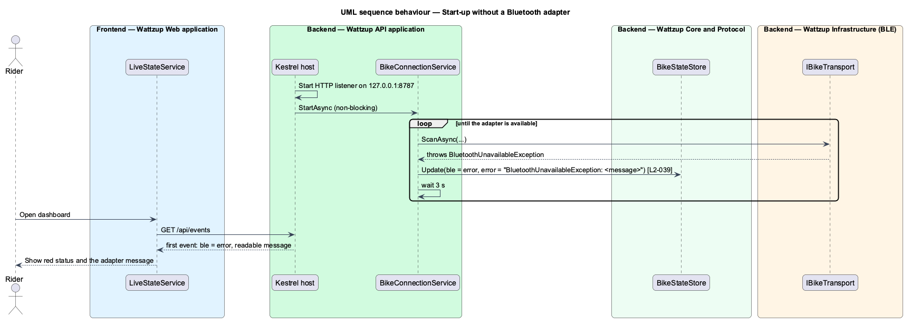

# Discover and connect the bike

## Overview

Wattzup reads live riding data from an Echelon indoor bike and controls the bike's resistance. The bike exposes a proprietary Bluetooth Low Energy (BLE) service and has no wired interface. Before any telemetry, resistance command or workout can run, the backend has to find the bike, connect to it and switch on its data stream. This feature covers that start-up path, and the report of what the backend can see while it does so.

**BLE advertisement** — short broadcast packet in which a peripheral announces its name and service identifiers

**GATT characteristic** — addressable value on a BLE peripheral that a client reads, writes or subscribes to

**init sequence** — three fixed commands (device info, resistance range, start data stream) that make the bike begin sending workout data

**adapter state** — whether the host's Bluetooth radio is usable: `unknown` before the first attempt, `on` or `off`

**device label** — name the dashboard shows for the bike: the configured `Wattzup:Bike:DisplayName` when set, otherwise the advertised name or address

The feature sits at the bottom of the bike-connectivity subsystem. It runs inside the Wattzup API process as a hosted background service and starts with the process, independent of whether any browser is open. The same service keeps the HTTP API available when the host has no working Bluetooth adapter, so the dashboard can report the fault instead of failing to load. Connection upkeep after start-up (keepalive and recovery) belongs to the sibling feature `maintain-bike-connection`. The choice of transport belongs to `bluetooth-platform-transports`.

## Description

- **`BikeConnectionService`** — `BackgroundService` in `Wattzup.Api`. It runs the scan → connect → initialise loop for the life of the process. It publishes each lifecycle change (`scanning`, `connecting`, `connected`, `error`) and the adapter state to `BikeStateStore`. The transport's `Name` and the `--simulate` flag reach the state as `transport` and `simulated` through `HostFacts` (`live-state/stream-live-state`).
- **`EchelonDeviceFilter`** — pure predicate in `Wattzup.Protocol`. It accepts a `BikeAdvertisement` whose name starts with `ECH` (ordinal, case-insensitive) or whose service UUID list contains `EchelonUuids.Service` (case-insensitive) (L2-001).
- **`EchelonUuids`** — constants for the service, write characteristic and notify characteristic UUIDs.
- **`EchelonCommands`** — static command builder in `Wattzup.Protocol`. `InitSequence` returns the device-info, resistance-range and start-stream byte arrays in that order.
- **`IBikeTransport`** — abstraction over the OS Bluetooth stack (`Wattzup.Ble.Abstractions`).
  - `Name` is the transport name reported in `transport` (`CoreBluetooth`, `BlueZ`, `WinRT` or `Simulated`).
  - `AdapterState` returns a `BluetoothAdapterState`, and `AdapterStateChanged` fires when the radio is switched on or off.
  - `ScanAsync(filter, timeout, ct)` returns the first matching `BikeAdvertisement` or `null`.
  - `ConnectAsync(advertisement, ct)` returns an `IBikeConnection`.
- **`IBikeConnection`** — an open GATT link. It exposes `SubscribeAsync(notifyCharacteristicUuids, onNotify, ct)`, `WriteAsync(bytes, withResponse)`, `IsConnected` and a `Disconnected` event. The bike's list is `EchelonUuids.BikeNotifyCharacteristics`, `[…f4]` (ADR 0009).
- **`BikeAdvertisement`** — record holding `Name`, `Address` and `ServiceUuids` as seen during the scan. `DisplayName` returns the name, or the address when the name is empty.
- **`BluetoothAdapterState`** — enum `Unknown`, `On`, `Off`, serialised as `unknown`, `on`, `off` in `adapter`.
- **`BikeStateStore`** — single-writer owner of `BikeState` in `Wattzup.Core`. `Update(Func<BikeState, BikeState>)` applies a change under a short lock, swaps the reference and raises `StateChanged`, which drives the broadcast. On every update `StateDerivations` (`live-state/stream-live-state`) sets `device_label` to `BikeOptions.DisplayName` when it is configured and a device is selected, and to `device` otherwise.
- **`ConnectivityOptions`** — bound from `Wattzup:Ble`. It holds `ScanTimeout` (20 s), `InitCommandSpacing` (300 ms) and `ErrorBackoff` (3 s).
- **`BikeOptions`** — bound from `Wattzup:Bike`. `DisplayName` is empty by default and documented in the README with the other settings.

The scan lasts at most `ScanTimeout`. Before each scan the service sets `ble = scanning` and `error = null` and broadcasts (L2-001). If nothing matches, the service sets `error` to `No Echelon bike found yet — pedal to wake it up`, keeps `ble` at `scanning`, and starts the next scan immediately. On a match the service sets `ble = connecting` and `device = DisplayName`. After the connection opens, the service sets `ble = connected`, subscribes to the notify characteristic before it writes any init command, then writes each init command with response and waits `InitCommandSpacing` between writes (L2-002).

When the adapter is missing, off or unauthorised, `IBikeTransport` throws `BluetoothUnavailableException`. The service records `ble = error`, `adapter = off` and `error = "BluetoothUnavailableException: <message>"`, then retries after `ErrorBackoff`. Kestrel is already listening at that point because the service does not block host start-up (L2-039). The first scan that starts without the exception sets `adapter = on`. `AdapterStateChanged` updates `adapter` between attempts, so the dashboard's Bluetooth-off banner and overlay clear as soon as the radio returns.

Every delay in the loop (scan timeout, init spacing, error backoff) is taken from an injected `TimeProvider`. Acceptance tests in `Wattzup.Api.AcceptanceTests` run the host through `WebApplicationFactory` with `SimulatedBikeTransport` and `FakeTimeProvider`, and read `GET /api/status` and the event stream. They cover the scan states, the 20 s timeout message, the subscribe-before-write order with 300 ms spacing, the `device_label` fallback and an adapter switched off and on through `SimulationControl`. The filter's table of names and UUIDs has one unit test per case in `Wattzup.Protocol.Tests`.

### The chosen machine

Wattzup drives the bike or the Echelon treadmill, one at a time (L2-062, ADR 0009). With the bike chosen, which is the default, the loop above is unchanged. `BikeConnectionService` reads `MachineProfile.For(store.Current.Machine)` at the start of each attempt and takes from it the device filter, the notify characteristic list, the init sequence, the keepalive frame and the not-found message. The bike's profile holds exactly the values described above. `EchelonDeviceFilter.Matches` now also rejects names starting with `STRIDE` (case-insensitive), even with the Echelon service, so the bike's scan never selects the treadmill (L2-063 criterion 4). A `MachineSelector.Changed` event cancels the whole current attempt, scan or open link, and the next attempt uses the new machine's profile. The treadmill's profile, the machine change and the treadmill's init sequence are described in `treadmill/choose-machine`.

## Requirements

| L2 ID | Refines (L1) | Requirement |
|-------|--------------|-------------|
| `L2-001` | `L1-001` | Bike scanning. The backend must scan for BLE devices for up to 20 seconds per attempt and select the first device whose advertised name starts with `ECH` (case-insensitive) or whose advertised service UUIDs include the Echelon service UUID (case-insensitive). |
| `L2-002` | `L1-001` | Connection and initialisation. On selecting a device, the backend must connect, subscribe to the notify characteristic, then send the three init commands in order with write-with-response, 300 ms apart. |
| `L2-039` | `L1-010` | Graceful lifecycle. |

## Diagrams

### System context

The rider wakes the bike by pedalling. Wattzup reaches the bike only through the operating system's Bluetooth stack.

### Containers

Discovery runs entirely inside the Wattzup API container, which talks to the OS Bluetooth stack through `IBikeTransport`.

### Components

`BikeConnectionService` drives the loop. It uses `EchelonDeviceFilter` and `EchelonCommands` from the protocol library, calls `IBikeTransport`, and records each lifecycle state and the adapter state in `BikeStateStore`.

### Class structure

The service depends on the transport abstraction and the pure protocol types. A platform transport is selected at start-up, and the service never references a platform type directly.

### Behaviour — scan, connect and initialise

A scan either times out and repeats, or yields a device. The service then connects, subscribes before writing (L2-002), and sends the 3 init commands 300 ms apart.

### Behaviour — Bluetooth adapter unavailable at start-up

The HTTP host starts regardless. The service records `adapter = off` and the fault, and retries every 3 s until the adapter appears (L2-039).

