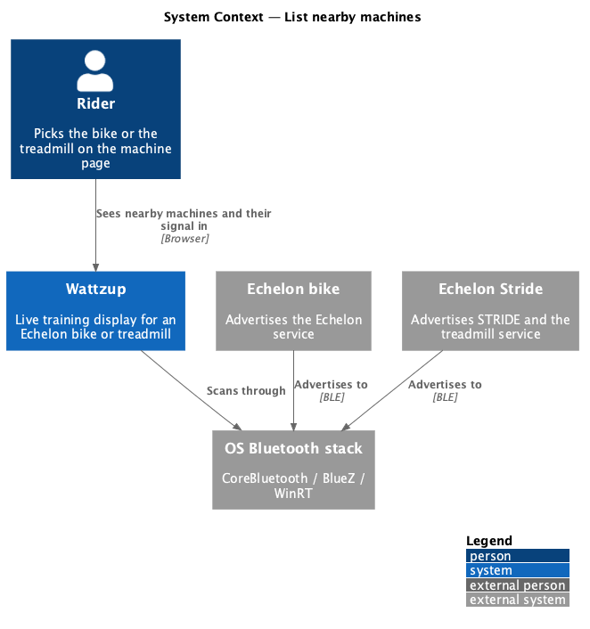
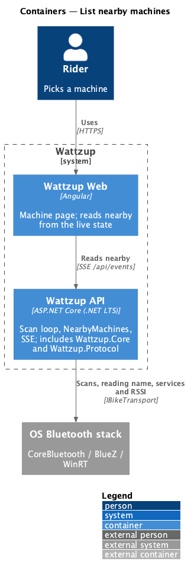
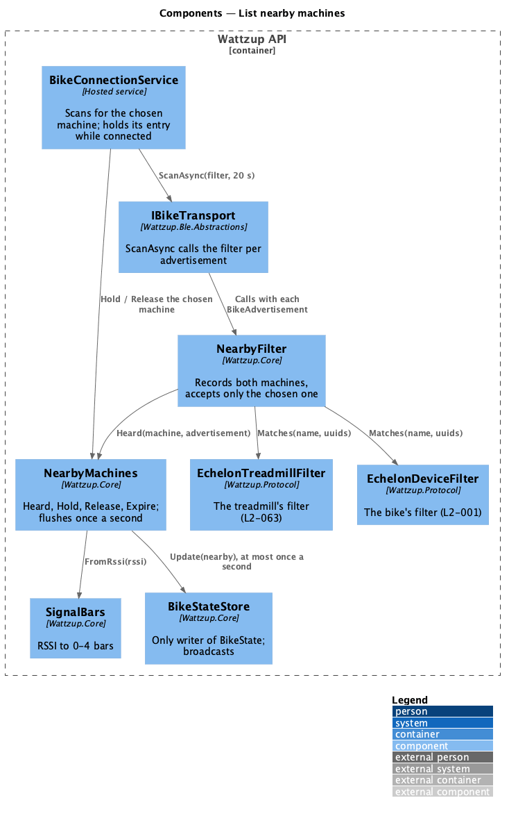
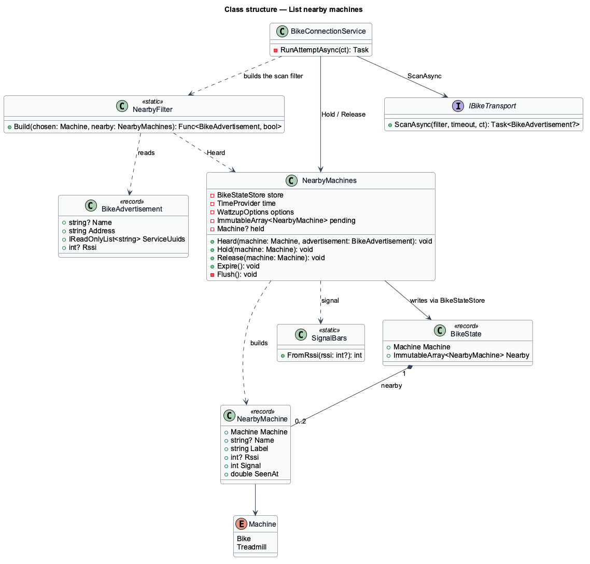
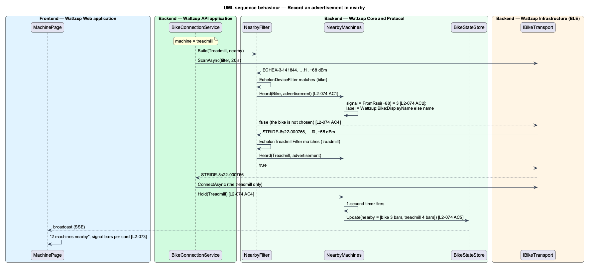
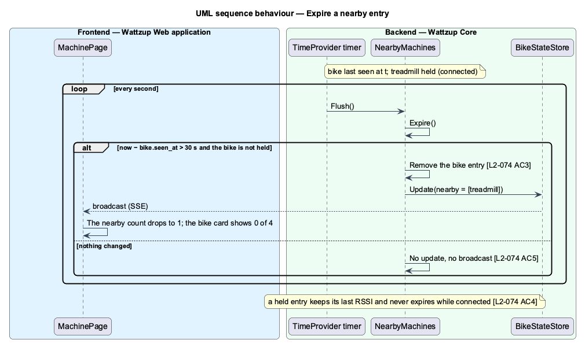

# List nearby machines

## Overview

Wattzup drives one Echelon machine at a time, the bike or the treadmill (L2-062). Before the rider picks one, the machine page at `/machine` shows which machines are switched on and in range, and how strong each signal is (L2-073). The backend already scans for the chosen machine; this feature makes the scan record every Echelon machine it hears, bike or treadmill, in a short list carried in the state as `nearby` (L2-074, ADR 0010). The list is for display only. Wattzup never connects to the machine that is not chosen.

**nearby entry** — record of one Echelon machine heard advertising: `{machine, name, label, rssi, signal, seen_at}`, at most one per machine (L2-014, L2-074)

**RSSI** — received signal strength indicator, the strength of an advertisement in dBm as the computer's Bluetooth adapter measured it; nearer machines read closer to 0

**signal** — RSSI mapped to 0 to 4 bars: 4 from −60 dBm, 3 from −70, 2 from −80, 1 from −90, 0 below (L2-074 criterion 2)

**expiry** — removal of an entry not heard for 30 s (L2-074 criterion 3)

**label** — the machine's configured display name, `Wattzup:Bike:DisplayName` or `Wattzup:Treadmill:DisplayName` (default `Echelon Stride`), else the advertised name

The list lives in memory with the rest of the state, in the one Wattzup process (ADR 0004). The frontend's use of it, the machine page, belongs to `treadmill/choose-machine`. The scan loop it extends belongs to `bike-connectivity/discover-and-connect-bike`, and the RSSI each transport reports to `bike-connectivity/bluetooth-platform-transports`.

## Description

### Abstractions (`Wattzup.Ble.Abstractions`)

- **`BikeAdvertisement`** — gains `int? Rssi`, the advertisement's signal strength in dBm, `null` when the platform gives none. `IBikeTransport.ScanAsync(filter, timeout, ct)` is unchanged: it calls `filter` for every advertisement it hears and returns the first one the filter accepts.

### Core (`Wattzup.Core`)

- **`NearbyMachine`** (`Wattzup.Core.State`, new record) — `Machine Machine`, `string? Name`, `string Label`, `int? Rssi`, `int Signal`, `double SeenAt` (Unix seconds). Serialised as `{machine, name, label, rssi, signal, seen_at}` in snake_case with nulls written (L2-014).
- **`BikeState`** — gains `ImmutableArray<NearbyMachine> Nearby`, `[]` at start-up (L2-014 criterion 1). `MachineSelector.Select` keeps it across a machine change, because both machines' entries stay true.
- **`SignalBars.FromRssi(int? rssi)`** (`Wattzup.Core.Machines`, new, pure) — returns 4 for −60 dBm or more, 3 for −70 or more, 2 for −80 or more, 1 for −90 or more, and 0 below or for `null` (L2-074 criterion 2).
- **`NearbyMachines`** (`Wattzup.Core.Machines`, new singleton) — the only code that changes `nearby`. It takes `BikeStateStore`, `DisplayNames` (both machines' display name settings, also used for `device_label`) and `TimeProvider`.
  - `Heard(Machine machine, BikeAdvertisement advertisement)` replaces that machine's entry with one built from the advertisement: `name` the advertised name, `label` the machine's display name setting else `name`, `rssi`, `signal` from `SignalBars.FromRssi`, and `seen_at` now (L2-074 criterion 1).
  - `Hold(Machine machine)` and `Release(Machine machine)` mark the chosen machine's entry as held while its link is open: a held entry keeps its last RSSI and does not expire (L2-074 criterion 4).
  - `Expire()` removes each entry that is not held and was last seen more than 30 s ago (L2-074 criterion 3).
  - Changes are batched: `Heard` and `Expire` change a pending list. A `TimeProvider` timer flushes it into the store at most once a second, through one `BikeStateStore.Update` that sets only `Nearby`, so a busy scan causes at most one broadcast a second (L2-074 criterion 5). The same timer calls `Expire()`. An update that also changes another field (for example `ble`) takes the pending list with it.
- **`NearbyFilter`** (`Wattzup.Core.Machines`, new, pure) — `Build(Machine chosen, NearbyMachines nearby)` returns the `Func<BikeAdvertisement, bool>` that `BikeConnectionService` passes to `ScanAsync`. For each advertisement it asks `EchelonDeviceFilter.Matches` and `EchelonTreadmillFilter.Matches`. On a match it calls `nearby.Heard` for that machine. It returns `true` only when the match is the chosen machine, so the scan never ends on, and Wattzup never connects to, the other machine (L2-074 criterion 4).

### API (`Wattzup.Api`)

- **`BikeConnectionService`** — scans with `NearbyFilter.Build(store.Current.Machine, nearby)` in place of `profile.Matches`. After a connection opens it calls `nearby.Hold(machine)`; when the link closes it calls `nearby.Release(machine)`. Scanning stops while connected, as before. Scanning for the other machine while connected is not built: no transport offers it yet, and L2-074 criterion 4 asks for it only where the transport supports it. The other machine's entry therefore expires 30 s after the connection opens.
- **`WattzupOptions.Treadmill.DisplayName`** — bound from `Wattzup:Treadmill:DisplayName`, default `Echelon Stride`, documented in the README. It is also the treadmill's `device_label` (L2-014). An empty value shows the advertised name.
- **OpenAPI** — the schema transformer describes `nearby` and `NearbyMachine` with their types and nullability, so the frontend's generated types include them (L2-074 criterion 7).

### Simulator (`Wattzup.Ble.Simulated`)

`SimulatedBikeTransport` advertises `ECHSIM-0001` at −68 dBm and `STRIDE-SIM-0001` at −55 dBm, each once a second while a scan runs, so `nearby` holds both machines with 3 and 4 bars and the machine page reads `2 machines nearby` (L2-074 criterion 6). `SimulationControl.Advertise(name, rssi)` and `SimulationControl.Silence(name)` let a test add a device, change its RSSI or stop it advertising.

### Acceptance tests

`Wattzup.Api.AcceptanceTests` run the host through `WebApplicationFactory` with `SimulatedBikeTransport` and `FakeTimeProvider`, and await SSE messages with a timeout that names the last message received.

- `Given_the_simulator_then_nearby_lists_the_bike_and_the_treadmill_with_their_signal` (L2-074 AC1, AC6)
- `Given_the_treadmill_display_name_then_its_nearby_label_is_that_name` (L2-074 AC1)
- `Given_a_machine_stops_advertising_then_its_entry_goes_after_30_seconds` (L2-074 AC3)
- `Given_the_chosen_machine_connects_then_its_entry_stays_and_the_other_machine_is_never_connected` (L2-074 AC4)
- `The_OpenAPI_document_describes_nearby` (L2-074 AC7)

`Wattzup.Core.Tests` hold `SignalBarsTests`, one case per row: −50, −60, −61, −70, −80, −90, −91 dBm and `null`. `NearbyMachinesTests` prove the batching and expiry against `FakeTimeProvider`: five advertisements in one second reach the store once with the last RSSI (L2-074 AC5), nothing is published while nothing changes, an entry goes 30 s after it was last heard, and a held entry stays until 30 s after its release. The batching is tested here rather than through the API because the simulator coalesces quick changes on its own, so an API test could not tell batching from coalescing. `NearbyFilterTests` cover a bike advertisement while the treadmill is chosen (recorded, not accepted), a treadmill advertisement while the treadmill is chosen (recorded and accepted), and a non-Echelon device (neither).

### Open questions

- **Scanning while connected.** Whether WinRT, BlueZ and CoreBluetooth can keep scanning for the other machine while a link is open, and at what cost to the link, is `<TO SUPPLY>` from the hardware smoke tests. Until then the other machine drops off `nearby` 30 s after the chosen one connects.
- **Several machines of one kind.** `nearby` holds at most one entry per machine (L2-014); with two bikes in range, the entry shows the most recently heard. Picking between two machines of one kind needs a requirement first.
- **Advertisement rate.** Platforms report repeated advertisements of one device at different rates, and some de-duplicate them; an entry's RSSI may lag. The 30 s expiry is long enough for an Echelon machine that advertises at least every few seconds; the real interval is `<TO SUPPLY>`.

## Requirements

| L2 ID | Refines (L1) | Requirement |
|-------|--------------|-------------|
| `L2-074` | `L1-001` | Nearby machines. While it scans, the backend keeps a short list of the Echelon machines it hears, so the machine page can say which are nearby and how strong their signal is. |
| `L2-014` | `L1-005` | State model contract. The JSON state must keep the prototype's snake_case field names so the contract is stable across the rewrite, and add the fields the design needs. |

## Diagrams

### System context

Wattzup hears both Echelon machines through the operating system's Bluetooth stack and shows them to the rider, but drives only the chosen one.

### Containers

The Wattzup API scans through `IBikeTransport` and streams `nearby` to Wattzup Web over SSE.

### Components

`BikeConnectionService` scans with the filter from `NearbyFilter`, which records each Echelon advertisement in `NearbyMachines` and accepts only the chosen machine. `NearbyMachines` writes `nearby` through `BikeStateStore` at most once a second.

### Class structure

`NearbyMachines` owns the list; `SignalBars` and `NearbyFilter` are pure and need no Bluetooth to test. `NearbyMachine` is the record the state carries.

### Behaviour — record an advertisement

Each advertisement that passes either machine's filter updates that machine's entry; only the chosen machine ends the scan and is connected. The pending list reaches the state on the next 1-second flush (L2-074 criteria 1, 2, 4 and 5).

### Behaviour — expire an entry

On each flush, an entry that is not held and was not heard for 30 s is removed, and the machine page's count follows (L2-074 criterion 3).

