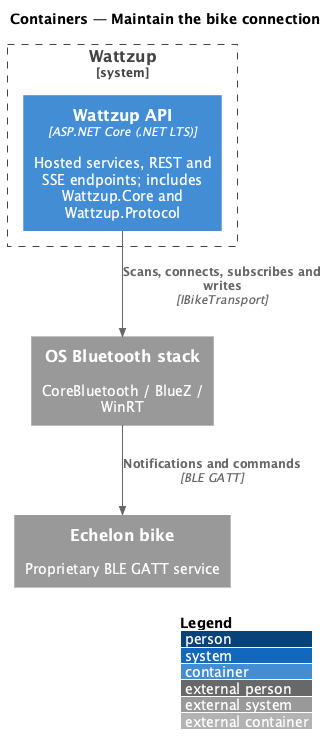
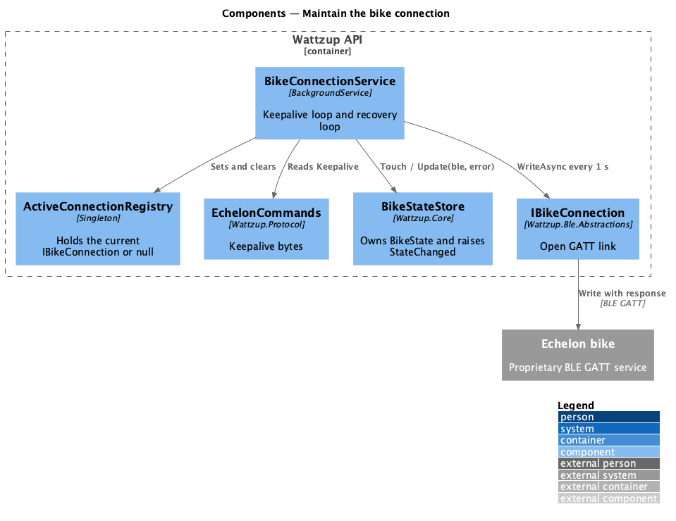

# Maintain the bike connection

## Overview

An Echelon bike stops streaming data, and eventually drops the link, unless the client sends a periodic keepalive command. Rides also last long enough for the link to fail for ordinary reasons: the rider switches the bike off, the Bluetooth radio loses signal, or the OS stack raises an exception. This feature keeps an established connection alive and returns the backend to scanning after any failure, with no restart and no user action.

**keepalive** — fixed command `F0 A0 01 01 92` written once per second to hold the bike's data stream open

**recovery loop** — outer loop of `BikeConnectionService` that resumes scanning after a disconnect or an exception

The feature follows `discover-and-connect-bike` in the same `BikeConnectionService` and ends when the connection closes. Each keepalive also triggers a state broadcast, which keeps time-derived fields such as `displayed_seconds` current even when the bike sends no new metrics (see `stream-live-state`).

## Description

- **`BikeConnectionService`** — the hosted service from `discover-and-connect-bike`. After initialisation it enters `RunKeepaliveAsync`, which writes `EchelonCommands.Keepalive` every `KeepaliveInterval` while `IBikeConnection.IsConnected` is `true` (L2-003).
- **`PeriodicTimer`** — .NET timer created over the injected `TimeProvider`. It paces the keepalive at 1 s without drift accumulation, and tests advance it with `FakeTimeProvider` instead of sleeping.
- **`BikeStateStore.Touch()`** — raises `StateChanged` without changing any field, so the broadcaster recomputes `displayed_seconds` and sends a fresh message.
- **`ActiveConnectionRegistry`** — singleton holding the current `IBikeConnection` or `null`. `set-resistance` and `run-interval-workout` read it to decide whether the bike is reachable. A reconnect during a workout is what lets the engine resume the segment and resend its level (L2-013, L2-012), which the dashboard announces with the `Reconnected` banner (`dashboard/show-connection-status`).
- **`ConnectivityOptions.KeepaliveInterval`** — 1 s. **`ErrorBackoff`** — 3 s.

The service handles 2 exit paths from the keepalive loop, and 1 request that cuts a wait short:

1. **Disconnect.** `IsConnected` turns `false` or `Disconnected` fires. The service clears `ActiveConnectionRegistry`, sets `ble = disconnected`, disposes the connection and returns to the scan step immediately (L2-004).
2. **Exception.** Any exception other than `OperationCanceledException` during scan, connect, initialise or keepalive is caught at the loop boundary. The service clears the registry, sets `ble = error` and `error = "<ExceptionType>: <message>"`, broadcasts, waits `ErrorBackoff` and scans again (L2-004). A `BluetoothUnavailableException` also sets `adapter = off`, as described in `discover-and-connect-bike`. Any other exception leaves `adapter` unchanged.

3. **Reconnect request.** `POST /api/bike/reconnect` calls `BikeConnectionService.RequestReconnect()`, which cancels the linked token of the current scan or error backoff, so the loop scans again at once and the endpoint answers 202. While `ble` is `connected` or `connecting` it answers 409 with `code` = `already_connected` (L2-004). The endpoint is a control endpoint and carries the rate limit of `secure-api`.

No failure ends the outer loop. Only cancellation of the host's stopping token ends it. Shutdown behaviour is described in `host-and-structure`.

Acceptance tests in `Wattzup.Api.AcceptanceTests` drive the host with `SimulatedBikeTransport` and `FakeTimeProvider`:

- Advancing 5 s while connected records between 4 and 6 keepalive writes, each with response, and one broadcast per keepalive (L2-003).
- `SimulationControl.DropLink()` yields `ble = disconnected` followed by `scanning` (L2-004).
- `SimulationControl.ThrowOnNextWrite` yields `ble = error` with `error = "<ExceptionType>: <message>"`, and scanning resumes after the clock advances 3 s (L2-004).
- During the 3 s backoff, `POST /api/bike/reconnect` answers 202 and a scan starts without advancing the clock; while connected it answers 409 `already_connected` (L2-004).
- With `PoweredOn = false`, advancing the clock by 1 hour leaves the service scanning. Switching the bike back on yields `connected` within one 20 s scan cycle (L2-004).

### The treadmill

With the treadmill chosen (L2-062), the same keepalive loop and recovery loop run with the treadmill's profile (`treadmill/choose-machine`). The keepalive writes `MachineProfile.Keepalive(counter)` instead of the fixed frame: `F0 A0 01 <n> <checksum>`, where `<n>` starts at 1 on each connection, counts to 255 and wraps to 1, never 0 (L2-063 criterion 6). The bike's profile ignores the counter, so the bike's keepalive stays `F0 A0 01 01 92`. Disconnects and exceptions recover as described above (L2-063 criterion 9). A machine change (`MachineSelector.Changed`) cancels the keepalive like a reconnect request, but the loop does not write `ble = disconnected`, because the change has already set `scanning`. On the treadmill a disconnect also sets `belt` to `null` (L2-064 criterion 8). While Wattzup has no link, only the treadmill's safety key and stop button can stop the belt (L2-066).

## Requirements

| L2 ID | Refines (L1) | Requirement |
|-------|--------------|-------------|
| `L2-003` | `L1-001` | Keepalive. While connected, the backend must write the keepalive command once per second and broadcast state on each keepalive. |
| `L2-004` | `L1-001` | Disconnect and error recovery. The backend must recover automatically from disconnects and from any Bluetooth exception. |

## Diagrams

### System context

The keepalive and recovery traffic flows only between Wattzup and the bike, through the OS Bluetooth stack.

### Containers

All upkeep runs inside the Wattzup API container.

### Components

`BikeConnectionService` writes keepalives through the active `IBikeConnection`, publishes the current connection in `ActiveConnectionRegistry`, and touches `BikeStateStore` on each tick.

### Class structure

The service owns the recovery loop. `ActiveConnectionRegistry` is the single shared reference to the live link that other features read.

### Behaviour — keepalive while connected

Each 1 s tick writes the keepalive with response and touches the store, which produces a broadcast (L2-003).

### Behaviour — disconnect and exception recovery

A disconnect returns to scanning immediately. An exception sets `ble = error`, waits 3 s, and then returns to scanning (L2-004).

