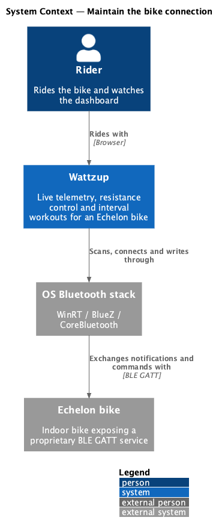
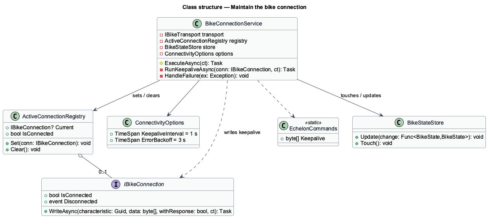
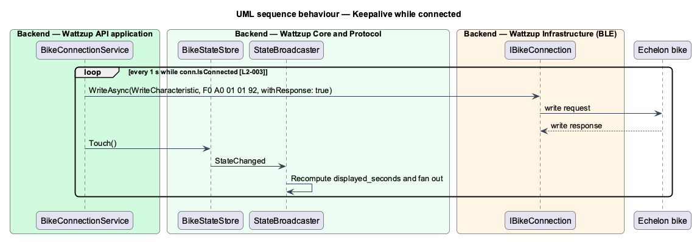
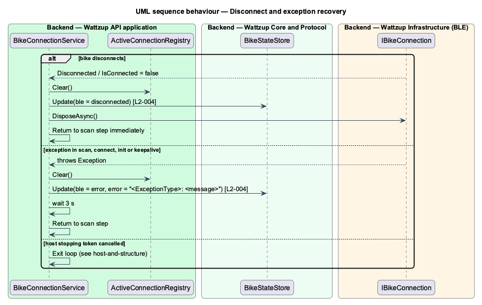

# Maintain the bike connection

## Overview

An Echelon bike stops streaming data, and eventually drops the link, unless the client sends a periodic keepalive command. Rides also last long enough for the link to fail for ordinary reasons: the rider switches the bike off, the Bluetooth radio loses signal, or the OS stack raises an exception. This feature keeps an established connection alive and returns the backend to scanning after any failure, with no restart and no user action.

**keepalive** — fixed command `F0 A0 01 01 92` written once per second to hold the bike's data stream open

**recovery loop** — outer loop of `BikeConnectionService` that resumes scanning after a disconnect or an exception

The feature follows `discover-and-connect-bike` in the same `BikeConnectionService` and ends when the connection closes. Each keepalive also triggers a state broadcast, which keeps time-derived fields such as `displayed_seconds` current even when the bike sends no new metrics (see `stream-live-state`).

## Description

- **`BikeConnectionService`** — the hosted service from `discover-and-connect-bike`. After initialisation it enters `RunKeepaliveAsync`, which writes `EchelonCommands.Keepalive` every `KeepaliveInterval` while `IBikeConnection.IsConnected` is `true` (L2-003).
- **`PeriodicTimer`** — .NET timer that paces the keepalive at 1 s without drift accumulation.
- **`BikeStateStore.Touch()`** — raises `StateChanged` without changing any field, so the broadcaster recomputes `displayed_seconds` and sends a fresh message.
- **`ActiveConnectionRegistry`** — singleton holding the current `IBikeConnection` or `null`. `set-resistance` and `run-interval-workout` read it to decide whether the bike is reachable.
- **`ConnectivityOptions.KeepaliveInterval`** — 1 s. **`ErrorBackoff`** — 3 s.

The service handles 2 exit paths from the keepalive loop:

1. **Disconnect.** `IsConnected` turns `false` or `Disconnected` fires. The service clears `ActiveConnectionRegistry`, sets `ble = disconnected`, disposes the connection and returns to the scan step immediately (L2-004).
2. **Exception.** Any exception other than `OperationCanceledException` during scan, connect, initialise or keepalive is caught at the loop boundary. The service clears the registry, sets `ble = error` and `error = "<ExceptionType>: <message>"`, broadcasts, waits `ErrorBackoff` and scans again (L2-004).

No failure ends the outer loop. Only cancellation of the host's stopping token ends it. A long-run test with the simulated transport switched off for 1 hour confirms that the process stays alive and keeps scanning. Shutdown behaviour is described in `host-and-structure`.

## Requirements

| L2 ID | Refines (L1) | Requirement |
|-------|--------------|-------------|
| `L2-003` | `L1-001` | Keepalive. While connected, the backend must write the keepalive command once per second and broadcast state on each keepalive. |
| `L2-004` | `L1-001` | Disconnect and error recovery. The backend must recover automatically from disconnects and from any Bluetooth exception. |

## Diagrams

### System context

The keepalive and recovery traffic flows only between Wattzup and the bike, through the OS Bluetooth stack.

### Containers

All upkeep runs inside the Wattzup API container.

### Components

`BikeConnectionService` writes keepalives through the active `IBikeConnection`, publishes the current connection in `ActiveConnectionRegistry`, and touches `BikeStateStore` on each tick.

### Class structure

The service owns the recovery loop. `ActiveConnectionRegistry` is the single shared reference to the live link that other features read.

### Behaviour — keepalive while connected

Each 1 s tick writes the keepalive with response and touches the store, which produces a broadcast (L2-003).

### Behaviour — disconnect and exception recovery

A disconnect returns to scanning immediately. An exception sets `ble = error`, waits 3 s, and then returns to scanning (L2-004).

