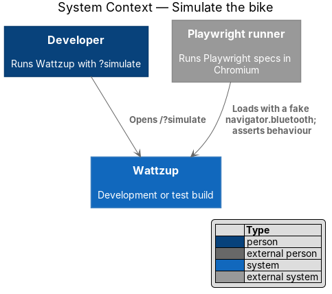
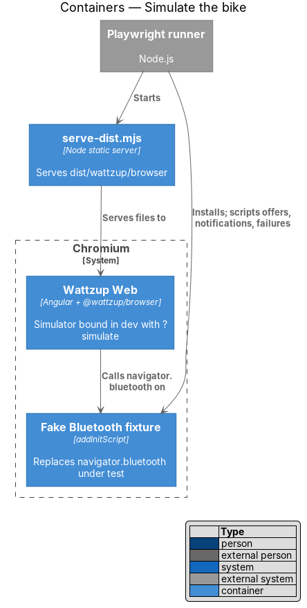
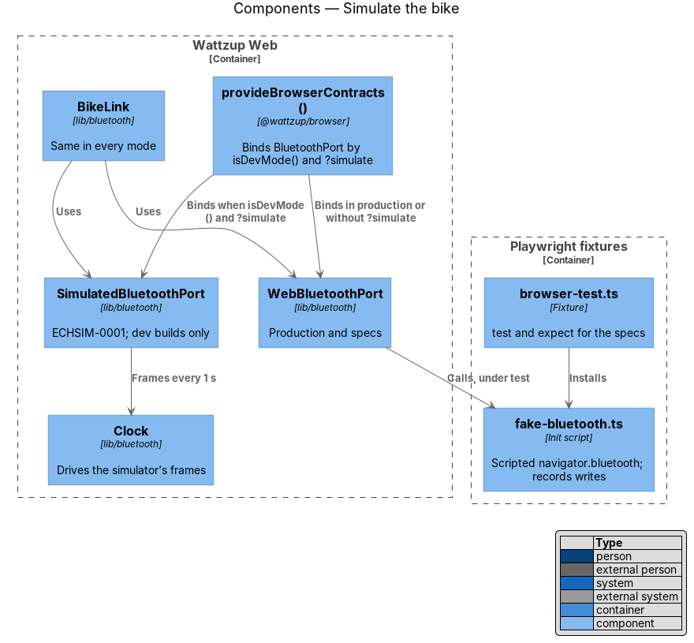
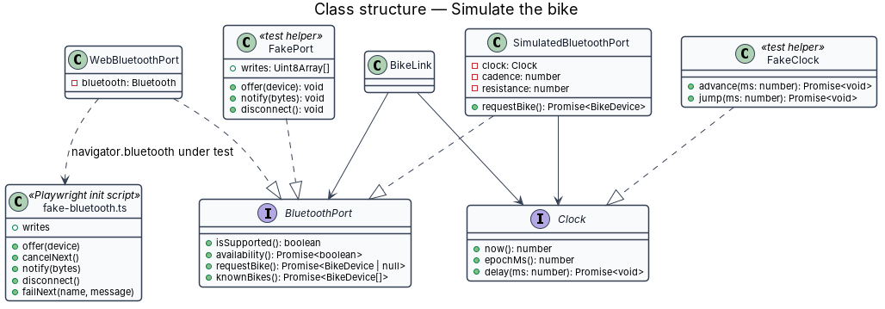
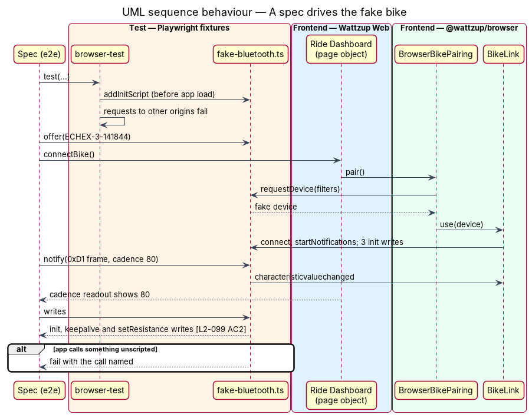

# Simulate the bike

## Overview

Every feature of Wattzup runs end to end without a bike, and no automated test uses real Bluetooth (AGENTS.md). In development Wattzup offers a simulated bike behind `?simulate`, and its Playwright specs replace `navigator.bluetooth` itself with a fake that records every write and pushes notifications on demand (L2-099).

**simulated bike** — in-page stand-in for an Echelon bike named `ECHSIM-0001` that sends a `0xD1` workout frame every second and echoes each set-resistance write with a `0xD2` frame

**fake Bluetooth fixture** — Playwright fixture that installs a scripted `navigator.bluetooth` before the app loads and fails the spec on any call it does not expect

**fake clock** — `Clock` implementation whose time advances only when a test says so

## Description

Development simulation:

- **`SimulatedBluetoothPort`** (`@wattzup/browser`, `lib/bluetooth/`) — implements `BluetoothPort`. `requestBike()` answers the simulated bike `ECHSIM-0001` at once, with no chooser. Its `GattLink` sends a `0xD1` frame each second on `Clock` with the simulated cadence (85 rpm), and a `0xD2` frame echoing each `setResistance` write (L2-099 criterion 1).
- **Selection** — `provideBrowserContracts()` binds `BluetoothPort` to `SimulatedBluetoothPort` when `simulateRequested(isDevMode(), location.search)` is `true` (a development build whose address holds the `simulate` parameter); otherwise to `WebBluetoothPort`. Production builds (`isDevMode()` `false`) never construct the simulator; its class, a few hundred bytes, stays in the bundle (L2-099 criterion 1). `simulated` in the state is `true` while it is bound, so the dashboard shows the *Simulated bike* banner: `Wattzup was opened with ?simulate` (the `info` connection-banner mock).

Behaviour specs:

- **`fake-bluetooth.ts`** (`frontend/e2e/fixtures/`) — an `addInitScript` that replaces `navigator.bluetooth` and `isSecureContext` before the app loads. It exposes, through `page.exposeFunction` and `page.evaluate`:
  - `bluetooth.offer(device)` and `bluetooth.cancelNext()` — what the next `requestDevice` answers;
  - `bluetooth.notify(bytes)` — push a notification on the notify characteristic;
  - `bluetooth.disconnect()` — fire `gattserverdisconnected`;
  - `bluetooth.failNext(name, message)` — reject the next call with a DOMException;
  - `bluetooth.writes` — every write with its bytes and time, and every `requestDevice` call with its filters.
  Any call it has no script for (another service, `getDevices` when not offered, a write before subscribe) fails the spec with the call named (L2-099 criterion 2).
- **`browser-test.ts`** (`frontend/e2e/fixtures/`) — the shared `test`: it installs `fake-bluetooth.ts` and `fake-youtube.ts`, fails the spec on an error in the page's console, and fails the spec on any request to another origin (L2-088 criterion 2). Specs in `frontend/e2e/` import `test` and `expect` from it and use their own page objects in `e2e/pages/`; a spec that needs a catalogue serves its own `classes.json`, otherwise the build's copy answers. `simulate.spec.ts` proves the production build ignores `?simulate`.
- **Playwright project** — `playwright.config.ts` serves `dist/wattzup/browser` with `scripts/serve-dist.mjs` and runs `e2e/`; Chromium only, as for every spec.

Unit tests:

- **`FakeClock`** (`lib/bluetooth/`, for tests) — `advance(ms)` resolves due `delay` promises in time order; `jump(ms)` moves time at once and resolves overdue delays late, as a throttled tab does; `now()` moves only with them. Every time-driven rule (keepalive, init spacing, workout ticks, retries, journal writes) takes `Clock` and is tested with `FakeClock`; no test sleeps (L2-099 criterion 3).
- **`FakePort`** (test helpers in `bike-link.spec.ts` and `browser-bike-pairing.spec.ts`) — the in-process counterpart of the fixture for the `BikeLink` and `BrowserBikePairing` unit tests.

Verification: unit tests of the simulator's frames byte for byte; a spec per fixture verb; and `simulate.spec.ts`, which proves through behaviour that the production build ignores `?simulate`: **Connect bike** opens the chooser. No build step searches the bundle for strings, since AGENTS.md rules out structure tests.

## Requirements

| L2 ID | Refines (L1) | Requirement |
|-------|--------------|-------------|
| `L2-099` | `L1-012` | Simulated bike. With `?simulate` in a development build, a simulated bike `ECHSIM-0001` shall send a workout packet every second and echo each resistance command, and **Connect bike** shall connect to it without the chooser, while production builds ignore `?simulate`; Playwright specs shall run against a fake `navigator.bluetooth` that records every write and pushes notifications, with no real bike or adapter and any unexpected Bluetooth call failing the spec; time-driven rules shall be unit-tested with a fake clock and no sleeps. |

## Diagrams

### System context

A developer runs Wattzup against the simulated bike; the test runner drives it against the fake Bluetooth fixture. Neither touches a real bike.

### Containers

In development the simulator lives inside the app. Under Playwright the fixture replaces the browser's Web Bluetooth API before the app loads.

### Components

`provideBrowserContracts()` chooses the `BluetoothPort`. `BikeLink` is the same in every case; only the port behind it changes.

### Class structure

3 implementations of `BluetoothPort` serve production, development and unit tests; the Playwright fixture fakes the browser API below `WebBluetoothPort` instead.

### Behaviour — a spec drives the fake bike

The fixture installs the fake, the spec connects, pushes a frame, checks the readout and the writes, and fails on any unexpected call (L2-099 criterion 2).

