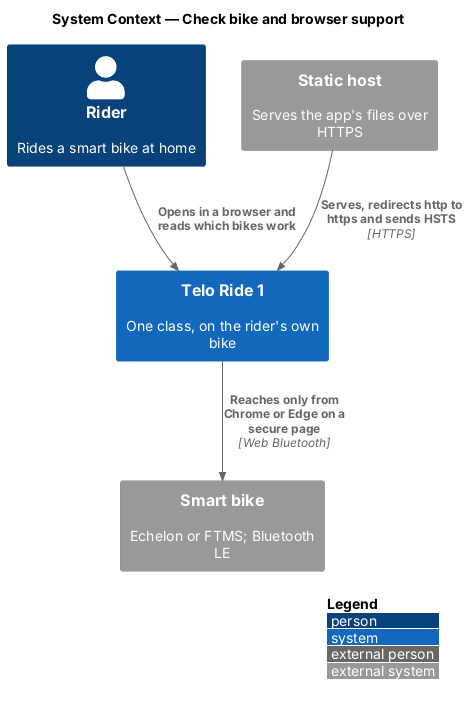
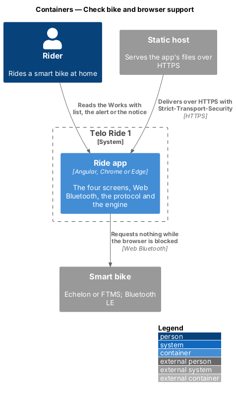
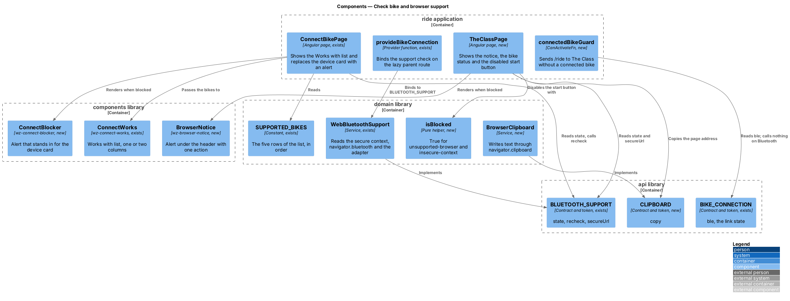
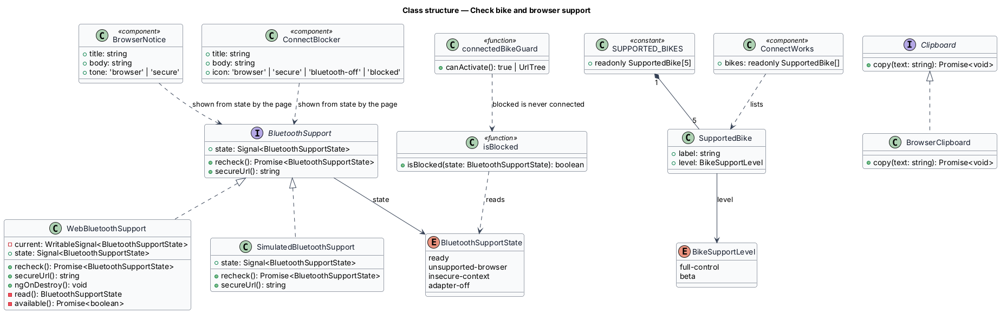
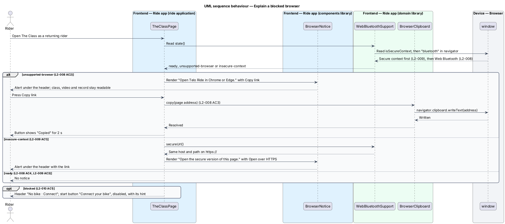
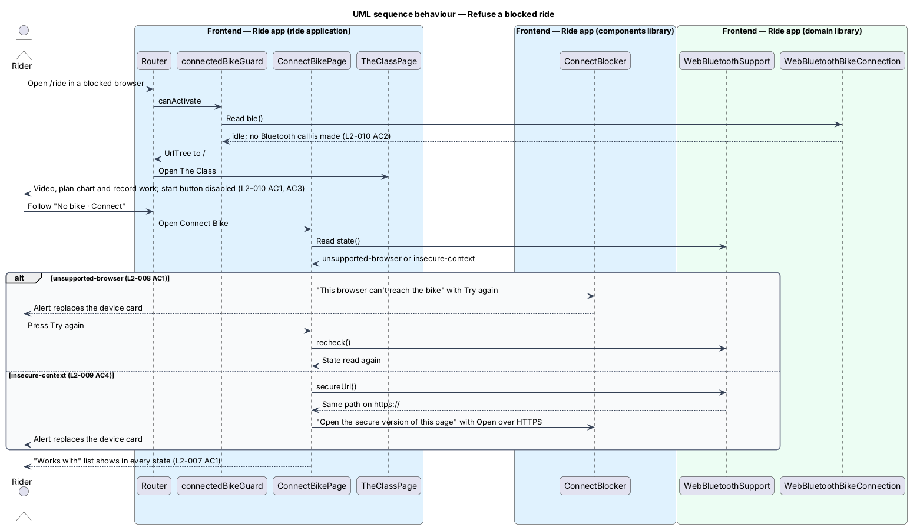

# Check bike and browser support

## Overview

Telo Ride 1 is one class on the rider's own smart bike. The Ride app reaches the bike directly from the browser through Web Bluetooth, so the browser and the page address decide whether a ride can happen at all. This feature states which bikes Telo Ride 1 works with and how well, detects a browser or a page that cannot reach a bike, says why in plain words, and keeps a ride from starting there. The class, its video and the rider's record stay readable in every case.

The following terms are used in this design:

- **Web Bluetooth**: browser API (`navigator.bluetooth`) through which a page talks to a Bluetooth LE device, present only in Chromium browsers
- **secure context**: page served over HTTPS or from `localhost`, the only kind of page on which a browser exposes Web Bluetooth
- **blocked**: state of a browser that cannot reach a bike, because it has no Web Bluetooth (`L2-008`) or the page is not a secure context (`L2-009`)
- **support state**: one of `ready`, `unsupported-browser`, `insecure-context` and `adapter-off`, read from the browser
- **full control**: support level at which the app reads the bike's telemetry and sets its resistance
- **beta**: support level of a bike that speaks the Fitness Machine Service (FTMS), on which resistance control depends on the bike granting it
- **alert**: panel with `role="alert"` that replaces the device card on Connect Bike
- **notice**: band with `role="alert"` under the header of The Class, which leaves the rest of the screen usable

Neighbouring features own the adjacent concerns. Pairing, the chooser and the Bluetooth-off alert belong to [Connect a bike](../connect-a-bike/README.md). The bike status in the header belongs to [Keep the bike connected](../keep-the-bike-connected/README.md). The simulated bike, which needs no Web Bluetooth, belongs to [Ride a simulated bike](../ride-a-simulated-bike/README.md). The Class screen and its start button belong to [Show the class](../../the-class/show-the-class/README.md), and the choice between Connect Bike and The Class at `/` (`L2-167`) to [Open the app](../../the-class/open-the-app/README.md). The Class Ride route belongs to [Ride the class](../../class-ride/ride-the-class/README.md). The static host and its response headers belong to [Host and deliver](../../platform/host-and-deliver/README.md).

## Description

The slice runs from two screens of the `ride` application through one support check in the `domain` library. No backend takes part.

**Contracts in the `api` library**

- **`BluetoothSupport`** and the token `BLUETOOTH_SUPPORT` (`api/src/bike/bluetooth-support.ts`) exist. The contract exposes `state` as a signal of `BluetoothSupportState`, `recheck()`, and `secureUrl()`, which returns the current address on `https://` with the same host, path, query and fragment. The contract is unchanged.
- **`SupportedBike`** and **`BikeSupportLevel`** (`api/src/bike/supported-bike.ts`) exist. A row carries a `label` and a `level` of `full-control` or `beta`.
- **`Clipboard`** and the token `CLIPBOARD` are new (`api/src/screen/clipboard.ts`). The contract has one method, `copy(text)`, which resolves when the text is on the clipboard.

**Logic in the `domain` library**

- **`WebBluetoothSupport`** (`domain/src/bluetooth/web-bluetooth-support.ts`) exists. It reads `isSecureContext` first and `'bluetooth' in navigator` second. A plain `http` page therefore reads `insecure-context` even in Chrome, and the rider is told to go secure, never to change browser (`L2-009`). It then calls `getAvailability()` and listens to `availabilitychanged`; that part serves [Connect a bike](../connect-a-bike/README.md). It removes its listener in `ngOnDestroy`.
- **`SimulatedBluetoothSupport`** exists and always reads `ready`. `provideBikeConnection()` binds it only in a development build opened with `?simulate`.
- **`SUPPORTED_BIKES`** (`domain/src/bluetooth/supported-bikes.ts`) exists. It holds the five rows in the order of `L2-007` AC1.
- **`isBlocked(state)`** is a new pure helper in `domain/src/bluetooth/`. It returns `true` for `unsupported-browser` and `insecure-context`. `adapter-off` is not blocked: the browser can reach a bike once Bluetooth is on.
- **`BrowserClipboard`** is a new service in `domain/src/browser/`. It implements `Clipboard` through `navigator.clipboard.writeText`.

**Presentation in the `components` library**

- **`ConnectWorks`** (`wz-connect-works`, block `connect-works`) exists. It renders the "Works with" section from its `bikes` input. Its stylesheet lays the list out in one column on a phone and two from sm (`L2-007` AC4).
- **`ConnectBlocker`** (`wz-connect-blocker`, block `connect-blocker`) is new. `ConnectBikePage` draws the block inline today, four times. The component takes a `title`, a `body` and an `icon`, sets `role="alert"` and `aria-labelledby` on its host, and projects one action into the `connect-blocker__retry` position. [Connect a bike](../connect-a-bike/README.md) uses it for its own alerts.
- **`BrowserNotice`** (`wz-browser-notice`, block `browser-notice`) is new. The block exists only in the design system. The component takes a `title` and a `body`, sets `role="alert"` on its host, and projects one action into `browser-notice__action`.

**Screens in the `ride` application**

- **`ConnectBikePage`** (`ride/src/app/connect/connect-bike-page.ts`) exists. It switches on `support.state()` and replaces the device card with an alert. Two things change for Telo Ride 1. The unsupported-browser body reads "Open Telo Ride 1 in Chrome or Edge…" where the code reads "Open Telo Ride". The four inline `connect-blocker` sections become `wz-connect-blocker`. The secure-page alert of `L2-009` AC4 is already in the code and has no mock (mock gap: the HTTPS alert on Connect Bike; open question 6).
- **`TheClassPage`** is new and is owned by [Show the class](../../the-class/show-the-class/README.md). For this feature it injects `BLUETOOTH_SUPPORT` and `CLIPBOARD`. It renders `wz-browser-notice` under the header for `unsupported-browser` and `insecure-context`. The **Copy link** button copies `location.href`, then carries `data-copied` and reads "Copied" for 2 seconds, as the design system's alert page specifies; a timer the page clears on destroy ends that state. **Open over HTTPS** is a link to `secureUrl()`. When `isBlocked()` is true the start button reads "Connect your bike", is a disabled `button` and keeps its hint (`L2-010` AC1). The title of the unsupported-browser notice omits the "1" (open question 5); the mock changes first.
- **`connectedBikeGuard`** is a new `CanActivateFn` in `ride/src/app/bike/`. It guards `/ride` and returns a `UrlTree` to `/` unless `BIKE_CONNECTION.ble()` reads `connected`. It calls no method on the connection, so nothing is requested from Bluetooth (`L2-010` AC2). The same guard serves `L2-087` AC4 in [Ride the class](../../class-ride/ride-the-class/README.md). The existing `rememberedBikeGuard` belongs to Telo Ride's Home and is replaced by the guard of [Open the app](../../the-class/open-the-app/README.md).
- **`provideBikeConnection()`** (`ride/src/app/bike/provide-bike-connection.ts`) exists. It binds `BLUETOOTH_SUPPORT` on the lazy parent route in `ride.routes.ts`, so the check stays out of the initial bundle. It gains the binding of `CLIPBOARD`.

**Outside the app**

The redirect from `http` to `https` and the `Strict-Transport-Security` header (`L2-009` AC2) are the static host's work. `docs/deployment.md` describes them for Telo Ride's backend host only. The host product and its configuration file for Telo Ride 1 are `<TO SUPPLY>` (open question 1 leaves the backend, and with it the host, undecided).

The routes `/connect`, `/` and `/ride` are assumptions the mocks share (open question 7).

**Acceptance tests**

`frontend/e2e/browser-support.spec.ts` and the page object `connect-bike.page.ts` exist and are rewritten for the Telo Ride 1 copy and screens. The fake `navigator.bluetooth` of `fixtures/fake-bluetooth.ts` fails a spec on any unexpected Bluetooth call, which proves `L2-010` AC2.

## Requirements

The feature realizes the following level-2 (L2) requirements. Each refines a level-1 (L1) requirement, cited by identifier.

| L2 ID | Refines (L1) | Requirement |
|-------|--------------|-------------|
| `L2-007` | `L1-002` | Connect Bike shall show, in every state, a "Works with" section that lists in order "Echelon EX-5s", "Echelon EX-3", "Echelon EX-8s" and "Echelon Connect Sport", each "Full control", and "Other FTMS smart bikes", "Beta". For a connected Echelon bike the app shall read its telemetry and set its resistance (`L2-013`). For a connected bike that advertises FTMS (service `0x1826`) and is not an Echelon, the app shall read Indoor Bike Data and, if the bike grants control, set its resistance (`L2-014`). The list shall be two columns at sm or wider and one column on a phone. |
| `L2-008` | `L1-002` | In a browser without `navigator.bluetooth` on a secure page, Connect Bike shall replace the device card with an alert (`role="alert"`) that reads "This browser can't reach the bike" and "Open Telo Ride 1 in Chrome or Edge on a laptop or Android tablet. Safari and Firefox don't support Web Bluetooth yet.", with "Try again". In such a browser The Class shall show an alert (`role="alert"`) under the header that reads "Open Telo Ride in Chrome or Edge." with "Bluetooth to the bike only works there — you can look around, but not ride." and **Copy link**, and the class, its video and the rider's record shall stay readable. **Copy link** shall copy the page address to the clipboard, and the button shall show its copied state. A supported browser on a secure page shall show no unsupported-browser message on any screen. |
| `L2-009` | `L1-002` | On a page served over plain `http` other than `localhost`, The Class shall show an alert (`role="alert"`) under the header that reads "Open the secure version of this page." with "Bluetooth is blocked on plain http, so the bike can’t connect." and **Open over HTTPS**, a link to the same path on `https://`. A production deployment shall redirect a request over `http` to `https`, and its responses shall carry `Strict-Transport-Security`. A secure context shall show no HTTPS notice on any screen. On a page served over plain `http` other than `localhost`, Connect Bike shall replace the device card with an alert (`role="alert"`) that reads "Open the secure version of this page" and "Bluetooth is blocked on plain http, so the bike can’t connect.", with **Open over HTTPS**, which goes to the same path on `https://`. |
| `L2-010` | `L1-002` | In a blocked browser, the header of The Class shall read "No bike · Connect", and the start button shall read "Connect your bike", be disabled, and be followed by "The class needs the bike to set resistance.". In a blocked browser, opening the `/ride` address shall open The Class instead, and nothing shall be requested from Bluetooth. In a blocked browser, the video, the plan chart and the record shall work normally on The Class and on the page-not-found screen. |

## Diagrams

### System context

The rider opens Telo Ride 1 in a browser. The app reaches the smart bike only from Chrome or Edge on a secure page, and the static host redirects `http` to `https`.

### Containers

The slice lives in the Ride app. Browser storage takes no part, and the app requests nothing from the bike while the browser is blocked.

### Components

`TheClassPage` and `ConnectBikePage` read `BLUETOOTH_SUPPORT`, which `provideBikeConnection()` binds to `WebBluetoothSupport`. The pages render `BrowserNotice` or `ConnectBlocker` from the support state, and `connectedBikeGuard` reads only the link state.

### Class structure

`WebBluetoothSupport` and `SimulatedBluetoothSupport` realize `BluetoothSupport`, whose state is a `BluetoothSupportState`. `SUPPORTED_BIKES` holds five `SupportedBike` rows, and `BrowserClipboard` realizes the new `Clipboard` contract.

### Behaviour: explain a blocked browser

The Class reads the support state, in which the secure context is checked before Web Bluetooth. It shows the notice that fits, copies the page address on **Copy link**, and disables the start button while the browser is blocked.

### Behaviour: refuse a blocked ride

`connectedBikeGuard` sends `/ride` to The Class without calling Bluetooth. Connect Bike, reached from the header, replaces its device card with the alert for the support state and keeps the "Works with" list.

