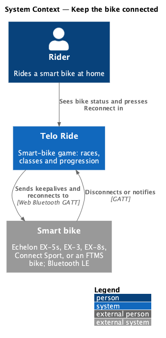
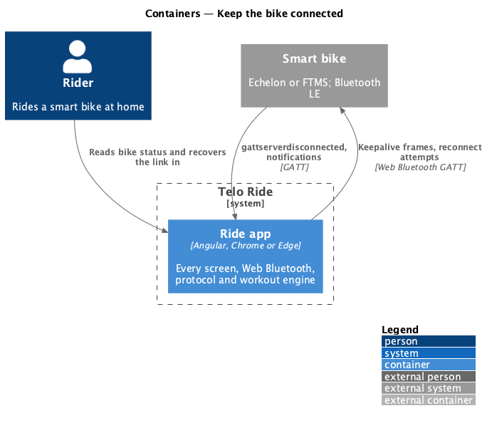
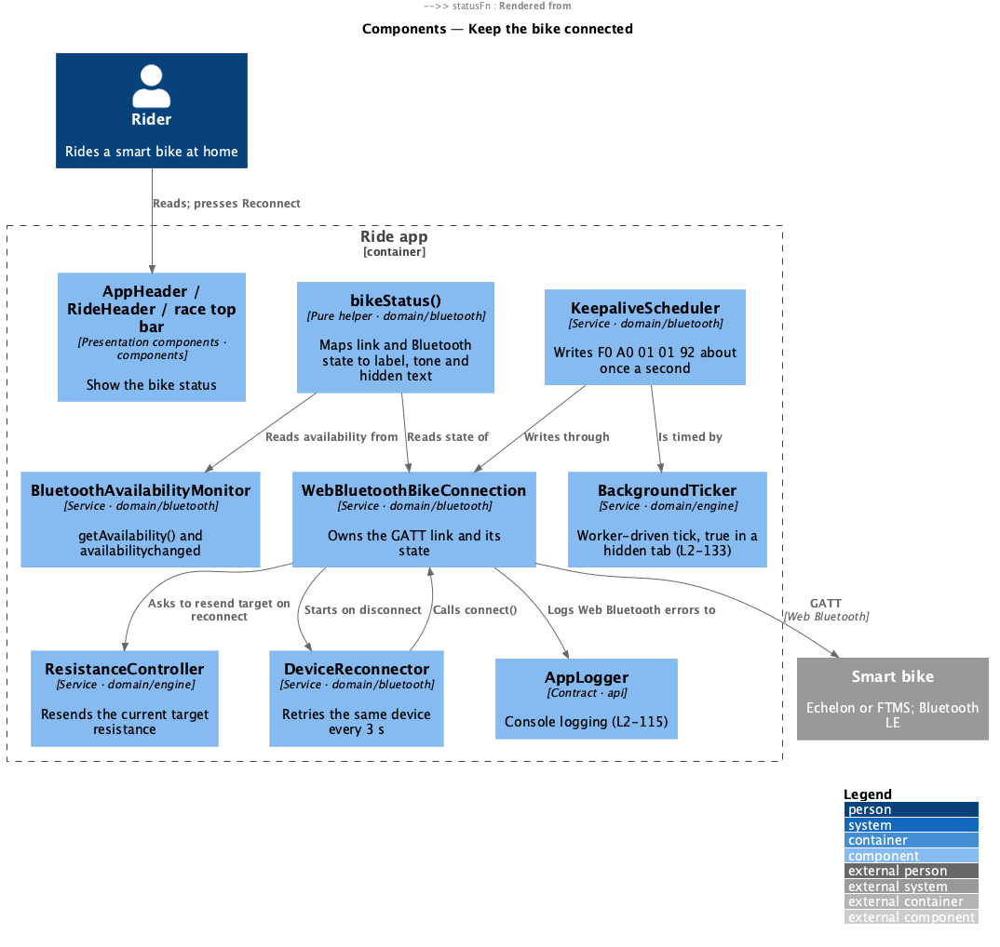
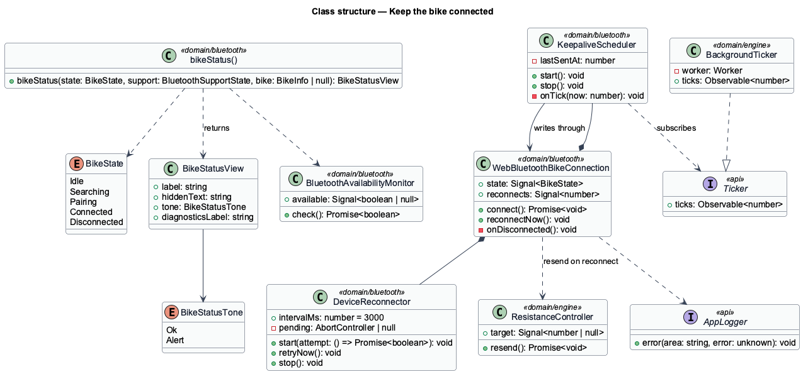
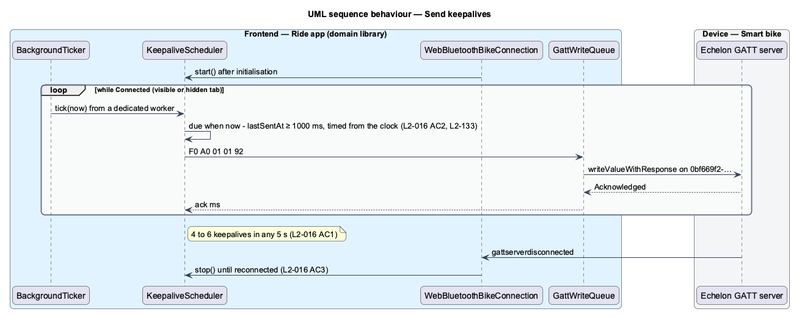
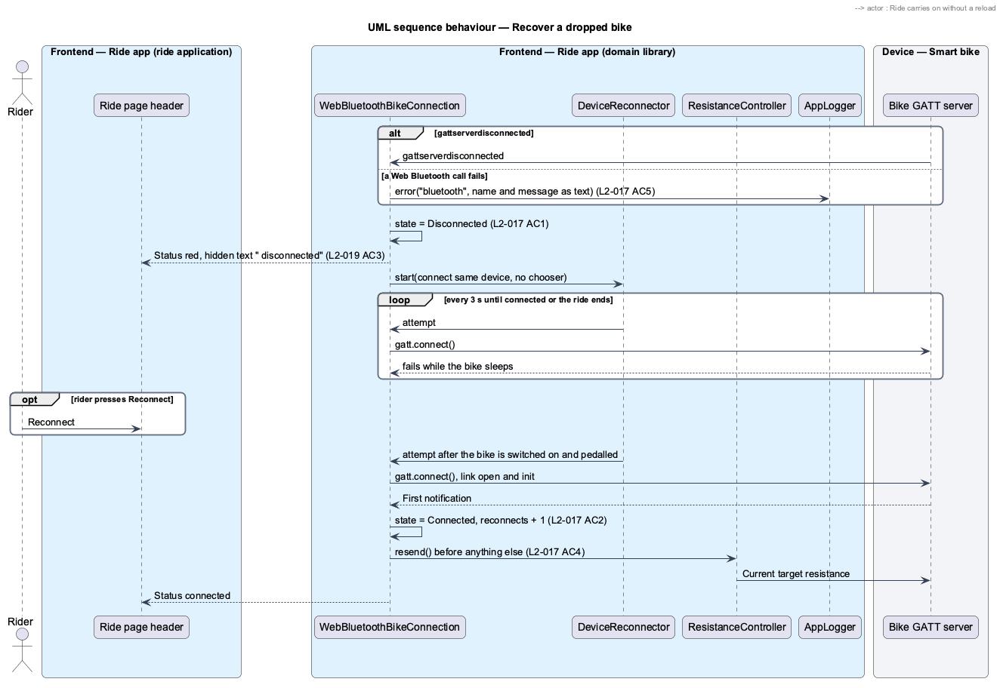
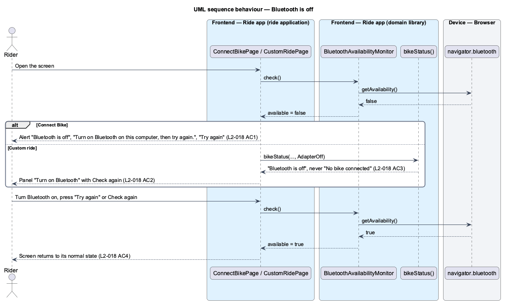

# Keep the bike connected

## Overview

A ride on Telo Ride lasts from 20 minutes to an hour or more, and the app sets resistance for every hill and interval throughout. An Echelon bike stops talking to a client that goes quiet, a sleeping bike drops its link, and a computer's Bluetooth radio may be switched off. This feature keeps the link to a connected bike alive, recovers it on its own after a drop, and shows the rider at all times whether the bike is connected.

The following terms are used in this design:

- **keepalive** — Echelon frame `F0 A0 01 01 92`, written with response about once a second while the bike is connected
- **drop** — loss of the GATT link, signalled by the `gattserverdisconnected` event or by a failing Web Bluetooth call
- **retry** — attempt to reconnect to the same device without the browser chooser, made every 3 seconds after a drop
- **bike status** — indicator in the app header, the race top bar and the custom ride header that says whether the bike is connected
- **adapter off** — state in which `navigator.bluetooth.getAvailability()` resolves `false`, because the computer's Bluetooth radio is switched off or absent

The slice starts once [connect-a-bike](../connect-a-bike/README.md) has connected and initialised a bike. On a reconnect, the current target resistance is sent again before anything else, using the controller described in [control-resistance](../control-resistance/README.md). Timing in a hidden tab relies on the background-safe clock of [performance/keep-the-ride-clock-true](../../performance/keep-the-ride-clock-true/README.md) (`L2-133`).

## Description

The slice lives in the Ride app. No backend takes part.

- **`KeepaliveScheduler`** — service in `domain`'s `bluetooth/` folder, owned by `WebBluetoothBikeConnection` and started after Echelon initialisation. On each tick it writes `F0 A0 01 01 92` with response through `GattWriteQueue` when at least 1,000 ms of clock time have passed since the last keepalive. Timing comes from elapsed clock time, not a count of ticks, so 4 to 6 keepalives go out in any 5 seconds and about one a second continues in a hidden tab. It stops on a drop and restarts after a reconnect.
- **`BackgroundTicker`** — implementation of the `Ticker` contract (`api`, token `TICKER`) in `domain`'s `engine/` folder. It runs its timer in a dedicated Web Worker, whose timers the browser does not throttle the way it throttles a hidden tab's main thread. Its worker and subscriptions are released when the ride ends. The same ticker drives the ride clock (`L2-133`).
- **`DeviceReconnector`** — service in `domain`'s `bluetooth/` folder, used for the bike and for a heart-rate strap ([show-heart-rate](../show-heart-rate/README.md)). `start(attempt)` runs the attempt every 3,000 ms until it succeeds or `stop()` is called when the rider ends the ride. `retryNow()` cancels the pending retry through its `AbortController` and attempts at once. A bike switched off for an hour reconnects within one retry of being switched on and pedalled, with no reload.
- **`WebBluetoothBikeConnection`** — the connection from [connect-a-bike](../connect-a-bike/README.md). On `gattserverdisconnected`, or when any Web Bluetooth call rejects, it sets `state` to `Disconnected`, stops the keepalive and starts the reconnector. On a successful reconnect it increments `reconnects`, runs the link's initialisation, and calls `ResistanceController.resend()` before any other write. It exposes `reconnectNow()` for the **Reconnect** action. It writes every Web Bluetooth error to `AppLogger` (`L2-115`) and passes the error's name and message to the screens as text, never as HTML.
- **`BluetoothAvailabilityMonitor`** — service in `domain`'s `bluetooth/` folder. `check()` calls `navigator.bluetooth.getAvailability()`, and the monitor listens for `availabilitychanged`, releasing the listener with its owner. Its `available` signal feeds the `AdapterOff` state of `BluetoothSupport` ([check-bike-and-browser-support](../check-bike-and-browser-support/README.md)).
- **`bikeStatus()`** — pure helper in `domain`'s `bluetooth/` folder, with unit tests for every row of its table. It maps the link state, the support state and the bike to a `BikeStatusView`: a visible label, the hidden text read by screen readers, a tone, and the Diagnostics `aria-label`. It never reports "No bike connected" while Bluetooth is off.
- **Status presentation** — three presentation components in `components` render a `BikeStatusView`, with colour never the only carrier of the state:
  - `AppHeader` (block `app-header`, owned by the home subsystem) shows, at lg (≥ 1024 px) and wider, the bike name with the hidden text " connected", or a red status titled "Bike not connected" with the hidden text " not connected" (`app-header__bike--off`).
  - The race top bar turns its status red with the hidden text " disconnected" when the bike drops during a race.
  - `RideHeader` (block `ride-header`) on Custom ride reads one of "Connected", "Disconnected", "No bike connected", "Bluetooth is off" or "Bluetooth unavailable in this browser", and links to Diagnostics with `aria-label` "Diagnostics: {bike} {state}".
- **Bluetooth-off screens** — `ConnectBikePage` shows an alert reading "Bluetooth is off" and "Turn on Bluetooth on this computer, then try again.", with "Try again". `CustomRidePage` shows the status "Bluetooth is off" and a panel reading "Turn on Bluetooth" with "Your browser can’t see a Bluetooth radio. Switch it on in your computer’s settings — or, if this machine has none, plug in a USB Bluetooth adapter." and **Check again**. Both actions call `check()`; when Bluetooth is on again, the screen returns to its normal state.

## Requirements

The feature realizes the following level-2 (L2) requirements. Each L2 requirement refines a level-1 (L1) requirement, cited by identifier.

| L2 ID | Refines (L1) | Requirement |
|-------|--------------|-------------|
| `L2-016` | `L1-003` | With an Echelon bike connected and initialised, the app shall write between 4 and 6 keepalive frames `F0 A0 01 01 92`, each with response, in any 5 seconds. In a hidden tab, keepalives shall continue at about one a second, timed from the clock rather than counted ticks (L2-133). When the bike disconnects, keepalives shall stop until it reconnects. |
| `L2-017` | `L1-003` | On `gattserverdisconnected` or any failing Web Bluetooth call, the bike state shall become `disconnected`, and the app shall retry the same bike every 3 seconds without the chooser until it connects or the rider ends the ride. A bike switched off for an hour shall reconnect within one retry of being switched on and pedalled, without a reload. **Reconnect** shall cancel the pending retry and start an attempt at once. A reconnect during a ride shall send the current target resistance again before anything else. A Web Bluetooth error's name and message shall be rendered as text and go to the console (L2-115). |
| `L2-018` | `L1-003` | When `navigator.bluetooth.getAvailability()` resolves `false`, Connect Bike shall show an alert reading "Bluetooth is off" and "Turn on Bluetooth on this computer, then try again.", with "Try again". Custom ride shall show the bike status "Bluetooth is off" and a panel reading "Turn on Bluetooth" with "Your browser can’t see a Bluetooth radio. Switch it on in your computer’s settings — or, if this machine has none, plug in a USB Bluetooth adapter." and **Check again**. The status shall never say that no bike was found while Bluetooth is off. When Bluetooth is on again, "Try again" or **Check again** shall return the screen to its normal state. |
| `L2-019` | `L1-003` | At lg or wider, the app header shall show a connected bike's name with the hidden text " connected", or, with no connected bike, a red status titled "Bike not connected" with the hidden text " not connected". In a race, a dropped bike shall turn the top bar status red with the hidden text " disconnected". On Custom ride the status shall read one of "Connected", "Disconnected", "No bike connected", "Bluetooth is off" or "Bluetooth unavailable in this browser", and link to Diagnostics with `aria-label` "Diagnostics: {bike} {state}". |

## Diagrams

### System context

The rider reads the bike status and may press **Reconnect**. Telo Ride sends keepalives to the bike and reconnects to it after a drop.

### Containers

Only the Ride app and the bike take part. Every keepalive, reconnect attempt and status change happens on the device.

### Components

`KeepaliveScheduler` is timed by `BackgroundTicker` and writes through the connection. On a drop, `WebBluetoothBikeConnection` starts `DeviceReconnector` and, once reconnected, asks `ResistanceController` to resend the target. The status components render the view that `bikeStatus()` derives from the link state and `BluetoothAvailabilityMonitor`.

### Class structure

`WebBluetoothBikeConnection` composes a `KeepaliveScheduler` and a `DeviceReconnector`. The scheduler subscribes to the `Ticker` contract, realized by `BackgroundTicker`. The pure `bikeStatus()` helper returns a `BikeStatusView` with a label, hidden text, tone and Diagnostics label.

### Behaviour — send keepalives

Each worker tick checks the clock, and a keepalive is written when a second has passed since the last one, so the rate holds in a hidden tab (`L2-016`). A drop stops the keepalive until the bike reconnects.

### Behaviour — recover a dropped bike

A drop or a failed call sets the state to `Disconnected`, turns the status red and starts a retry every 3 seconds. **Reconnect** cancels the pending retry and tries at once. A successful reconnect resends the current target resistance before anything else (`L2-017`).

### Behaviour — Bluetooth is off

When `getAvailability()` resolves `false`, Connect Bike shows its alert and Custom ride shows its panel and the status "Bluetooth is off". A later check that finds Bluetooth on returns the screen to normal (`L2-018`).

