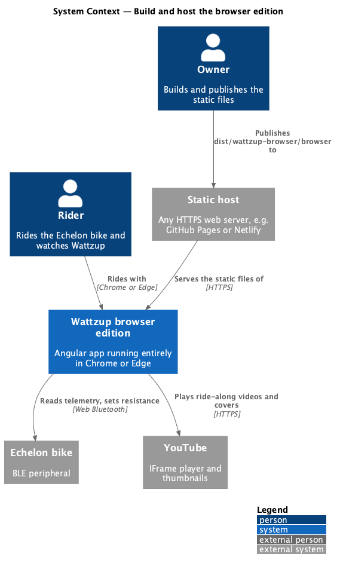
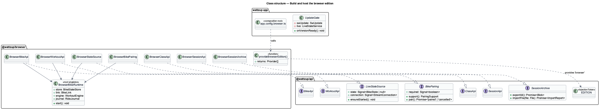

# Build and host the browser edition

## Overview

Wattzup ships in 2 editions of 1 Angular application (L1-016). The backend edition is the .NET backend next to the bike serving the app from the same origin. The browser edition is the same app alone: a folder of static files that any HTTPS host serves, with no Wattzup process to install or run. This feature describes how that folder is built, how the app is wired to run without a backend, and how it is secured, installed and kept available offline.

**edition** — 1 of the 2 ways Wattzup is built and run: `backend` or `browser`

**contract** — TypeScript interface in `@wattzup/api` with an injection token, such as `BikeApi` and `BIKE_API`, that every app component depends on instead of an implementation

**composition root** — the file that binds every contract token to an implementation: `app.config.ts` for the backend edition, `app.config.browser.ts` for the browser edition

**in-browser implementation** — class in `@wattzup/browser` that fulfils a contract with Web Bluetooth, IndexedDB and in-memory state instead of HTTP

**static host** — any web server that serves files as they are, such as GitHub Pages, Netlify or `npx http-server`, with no Wattzup code running on it

The app's components and services already depend only on contract tokens (ADR 0013). The browser edition therefore swaps the bindings, not the screens. A second composition root binds each token to an in-browser implementation, and a build configuration of the `wattzup` project selects that root. The backend edition's build, bundle and tests stay as they are (L2-088 criterion 4).

## Description

Build:

- **`browser` build configuration** (`frontend/angular.json`, project `wattzup`) — production settings with 5 differences from the default configuration:
  - `fileReplacements` swaps `src/app/app.config.ts` for `src/app/app.config.browser.ts`.
  - `outputPath` is `dist/wattzup-browser`, so the 2 editions never overwrite each other.
  - `index` is `src/index.browser.html`, which carries the Content-Security-Policy `<meta>` element (L2-097).
  - `assets` add `manifest.webmanifest`, the app icons and `classes.json` (see `load-classes-in-browser`).
  - `serviceWorker` is `ngsw-config.json` (L2-098).
- **`browser-development` configuration** — the same replacements without optimisation, used by `npm start -- --configuration browser`. Only this configuration honours `?simulate` (see `simulate-bike-in-browser`).
- **`npm run build:browser`** — runs `node scripts/copy-classes.mjs` (copies `backend/src/Wattzup.Api/classes.json` into `frontend/public/browser/`, because Angular assets cannot read outside the workspace), then `ng build wattzup --configuration browser`, then `scripts/check-bundle-size.mjs dist/wattzup-browser/browser`, which fails above 300 KB gzipped of initial JavaScript (L2-088 criterion 6).
- **`tools/verify/verify.mjs`** — adds the browser build and the browser-edition behaviour specs to the checks it runs side by side.

Wiring:

- **`app.config.browser.ts`** (`frontend/projects/wattzup/src/app/`) — the browser edition's composition root. It keeps the shared providers of `app.config.ts` (zoneless change detection, router, theme, YouTube player) and replaces the HTTP bindings with `provideBrowserEdition()`. It provides no `HttpClient` interceptor and no `UNAUTHORIZED_HANDLER`, because there is no API key (L2-097 criterion 1). It is the only file that imports `@wattzup/browser`, so the backend bundle never contains it.
- **`provideBrowserEdition()`** (`@wattzup/browser`, `lib/contracts/`) — returns the providers that bind each contract token:

  | Token (`@wattzup/api`) | Backend edition | Browser edition |
  |---|---|---|
  | `BIKE_API` | `HttpBikeApi` | `BrowserBikeApi` |
  | `WORKOUT_API` | `HttpWorkoutApi` | `BrowserWorkoutApi` |
  | `CLASS_API` | `HttpClassApi` | `BrowserClassApi` |
  | `SESSION_API` | `HttpSessionApi` | `BrowserSessionApi` |
  | `LIVE_STATE_SOURCE` (new) | `EventStreamLiveState` | `BrowserStateSource` |
  | `BIKE_PAIRING` (new) | `ServerBikePairing` | `BrowserBikePairing` |
  | `SESSION_ARCHIVE` (new) | not offered (`null`) | `BrowserSessionArchive` |
  | `EDITION` (new) | `'backend'` | `'browser'` |

- **`LIVE_STATE_SOURCE`** (new contract in `@wattzup/api`) — `LiveStateSource` exposes the read-only signals `state`, `connection`, `lastStateAt`, `loadFailed`, `loadStatus` and `streamEpoch`, and the calls `ensureStarted()`, `reload()`, `restart()` and `retryNow()`. `EventStreamLiveState` holds the `GET /api/status`, `EventSource`, event-token and 2 s reconnect logic that `LiveStateService` held before; `LiveStateService` reads the token and re-exposes its signals (see `run-rides-in-browser`).
- **`EDITION`** (new token in `@wattzup/api`) — `InjectionToken<'backend' | 'browser'>`. A screen that differs between editions reads it: the Unlock page is not routed, the Diagnostics dialog hides the backend's file facts, and Progress shows **Export history** and **Import history** only in the browser edition. No component tests a build flag.
- **`BrowserBikeRuntime`** (`@wattzup/browser`, `lib/engine/`) — root-provided singleton that owns the browser edition's state store, bike link, workout engine and session journal. Every in-browser contract implementation delegates to it, so 1 bike connection and 1 engine serve every screen.

Hosting, security and offline:

- **Routing on a static host** — routes use the path location strategy, as in the backend edition. The README's *Browser edition* section gives the fallback setting for common hosts (Netlify `_redirects`, nginx `try_files`, `http-server --proxy`) so a deep link such as `/sessions/<id>` serves `index.html` (L2-088 criterion 3). `<TO SUPPLY>`: the default host, if the project publishes the edition itself.
- **`index.browser.html`** — carries `<meta http-equiv="Content-Security-Policy">` with `default-src 'self'`, `connect-src 'self'`, `img-src 'self' data: https://i.ytimg.com`, `frame-src https://www.youtube-nocookie.com`, `script-src 'self' https://www.youtube.com`, `style-src 'self'` and `object-src 'none'` (L2-097 criterion 2). The hosting example also sends the same policy, `X-Content-Type-Options: nosniff` and `Referrer-Policy: no-referrer` as headers, because `frame-ancestors` and the other 2 headers have no `<meta>` form.
- **Privacy** — the edition makes no request after loading except `classes.json`, its own static files and YouTube's player and thumbnails (L2-097 criterion 3). It has no analytics, error reporting or remote logging. Bluetooth names, error strings, catalogue text and imported text are bound as text, never as HTML (L2-097 criterion 4).
- **Validation** — the in-browser contracts validate input with the same rules as the API and reject with an `ApiProblem` carrying the same `code` values, such as `invalid_plan` and `already_connected`, so the UI shows the same messages (L2-097 criterion 6).
- **`manifest.webmanifest`** — `name` `Wattzup`, `short_name` `Wattzup`, `start_url` `/`, `display` `standalone`, the theme and background colours from the design tokens, and 192 px and 512 px icons, including a maskable one (L2-098 criterion 2).
- **Angular service worker** (`@angular/service-worker`, `ngsw-config.json`) — prefetches the app shell, fonts, icons and lazy chunks, and caches `classes.json` with a freshness strategy (network first, cache when offline). YouTube is not cached (L2-098 criterion 1).
- **`UpdateGate`** (`frontend/projects/wattzup/src/app/core/`, browser edition only) — listens to `SwUpdate.versionUpdates`. A new version is downloaded in the background and activated on the next load. It never calls `activateUpdate()` or reloads while `workout.status` is running, paused or waiting (L2-098 criterion 3).

Verification:

- Browser-edition behaviour specs (`frontend/e2e/browser/`) run against `dist/wattzup-browser/browser` served by `scripts/serve-dist.mjs`. Every spec fails on any request to `/api/**` and on any origin other than its own and the faked YouTube (L2-088 criterion 2, L2-097 criterion 3).
- A spec opens `/classes/<id>` and `/sessions/<id>` directly (L2-088 criterion 3).
- The existing behaviour specs keep running against the backend edition unchanged (L2-088 criterion 4).
- `UpdateGate` unit tests drive a fake `SwUpdate` with a ride running and stopped.
- The offline criterion (L2-098 criterion 1) is a manual check, because Playwright's service-worker support with route fakes does not prove the real cache. `<TO SUPPLY>`: whether to add an automated offline spec once the fake-Bluetooth fixture exists.

## Requirements

| L2 ID | Refines (L1) | Requirement |
|-------|--------------|-------------|
| `L2-088` | `L1-016` | Browser edition build and hosting. `npm run build:browser` shall produce static files in `dist/wattzup-browser/browser` that run Wattzup on any HTTPS static host, or on `http://localhost`, with no backend; the edition shall make no request to `/api/*` or another origin except YouTube, shall open deep links, shall leave the backend edition unchanged, shall look and behave as the backend edition except where L2-089 to L2-099 differ, and shall keep its initial JavaScript within 300 KB gzipped. |
| `L2-097` | `L1-016` | Browser edition security and privacy. The edition shall have no API key, unlock page or event tokens; shall carry a Content-Security-Policy allowing only its own origin plus the 3 YouTube exceptions of L2-036; shall send no state, packet, session or device name off the device; shall render untrusted text as text; shall request only the Echelon service; and shall validate input by the API's rules with the API's `code` values. |
| `L2-098` | `L1-016` | Installable and offline. Once loaded over HTTPS, the edition shall load and run a ride from `/setup` offline, with class videos and covers unavailable; it shall be installable as an app; and a new version shall be used from the next load, never reloading a ride in progress. |

## Diagrams

### System context

The rider opens the browser edition in Chrome or Edge. The static host delivers the files once; afterwards the browser talks only to the bike over Bluetooth and to YouTube for videos and covers.

### Containers

The build turns the Angular workspace into a static folder. In the rider's browser, that folder runs as 1 app with a service worker, IndexedDB storage and a Web Bluetooth link. No container runs on a server.

### Components

`app.config.browser.ts` calls `provideBrowserEdition()`, which binds each `@wattzup/api` token to its in-browser implementation. Each implementation delegates to the one `BrowserBikeRuntime`. App components keep depending on the tokens only.

### Class structure

The contracts and tokens live in `@wattzup/api`. The browser classes implement them and hold a reference to `BrowserBikeRuntime`. The `EDITION` token and `UpdateGate` are the only edition-aware pieces in the app.

### Behaviour — start the browser edition

The browser loads `index.browser.html` from the host or the service-worker cache. Angular bootstraps with the browser composition root, the runtime starts, and the dashboard renders from `LiveStateService` with no request to `/api` (L2-088, L2-097).

### Behaviour — deliver an update without interrupting a ride

The service worker finds a new version in the background. `UpdateGate` holds activation while a ride is running and leaves the new version for the next load (L2-098 criterion 3).

