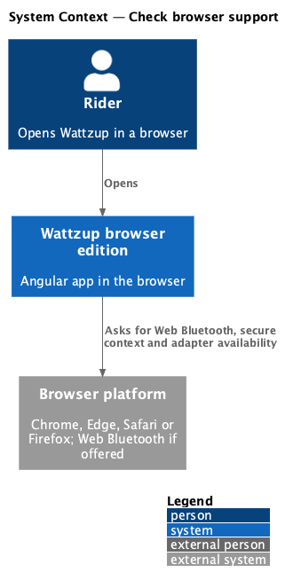
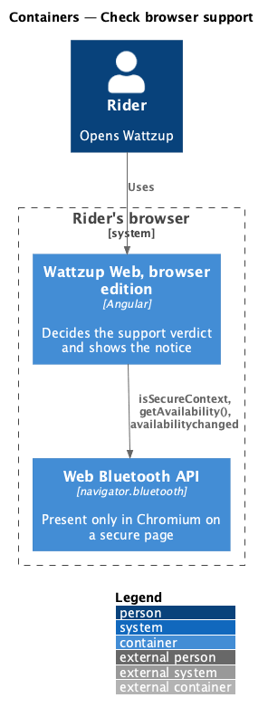
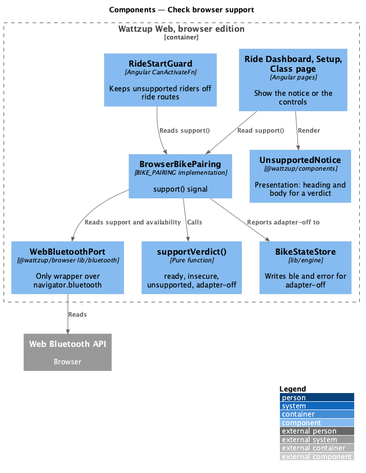
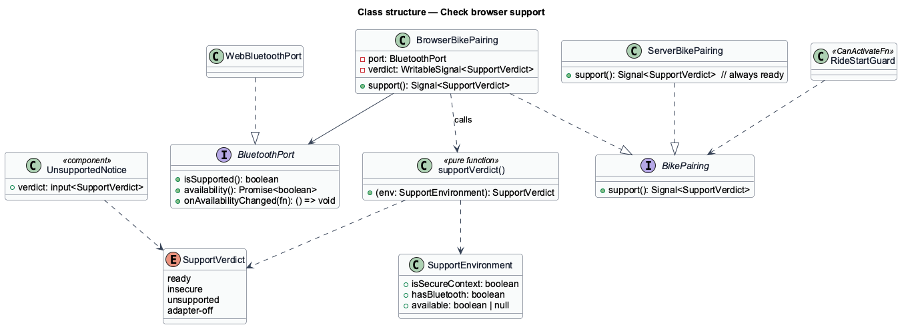
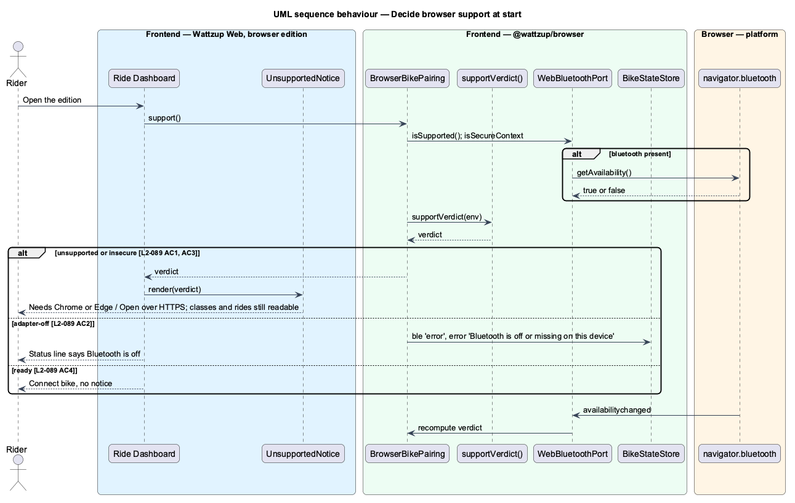

# Check browser support

## Overview

The browser edition reaches the bike through Web Bluetooth, a browser API that only Chromium browsers offer: Chrome and Edge on Windows, macOS, Linux, ChromeOS and Android. Safari, Firefox and every browser on iOS lack it, and Chromium also withholds it from pages that are not a secure context. This feature detects those cases when the edition starts and tells the rider plainly what is missing, instead of leaving a Connect button that can never work. The class library and past sessions stay readable, because they need no Bluetooth (L2-089).

**Web Bluetooth** — browser API (`navigator.bluetooth`) through which a page asks the rider to pick a Bluetooth Low Energy device and then talks GATT to it

**secure context** — page served over HTTPS or from `localhost`, the only pages to which Chromium exposes Web Bluetooth

**adapter availability** — answer of `navigator.bluetooth.getAvailability()`: whether the device has a usable Bluetooth adapter switched on

**support verdict** — 1 of `ready`, `insecure`, `unsupported` or `adapter-off`, computed once at start and again when availability changes

## Description

- **`BluetoothSupport`** (`@wattzup/browser`, `lib/bluetooth/`) — pure function `supportVerdict(env)` over a `SupportEnvironment` of `{isSecureContext, hasBluetooth, available}`, with a unit test per row:

  | `isSecureContext` | `hasBluetooth` | `available` | Verdict |
  |---|---|---|---|
  | `false` | any | any | `insecure` |
  | `true` | `false` | — | `unsupported` |
  | `true` | `true` | `false` | `adapter-off` |
  | `true` | `true` | `true` | `ready` |

  `insecure` wins over `unsupported`, because Chromium hides `navigator.bluetooth` on an insecure page and the fix there is HTTPS, not another browser.
- **`BluetoothPort`** (`lib/bluetooth/`) — the only wrapper over `navigator.bluetooth`. It exposes `isSupported()`, `availability(): Promise<boolean>` and an `availabilitychanged` listener, plus the chooser and device calls of `connect-bike-in-browser`. `WebBluetoothPort` is the real one; tests and `?simulate` use fakes.
- **`BrowserBikePairing.support()`** — returns the current `PairingSupport` (the verdict) as a signal. It recomputes on `availabilitychanged`. `ServerBikePairing` (backend edition) always answers `ready`.
- **`BikeStateStore`** — on `adapter-off` it writes `ble` `error` and `error` `Bluetooth is off or missing on this device` (L2-089 criterion 2); on `unsupported` and `insecure` it leaves `ble` `disconnected` and connects nothing.
- **`UnsupportedNotice`** (`@wattzup/components`, presentation) — the notice shown on the Ride Dashboard and `/setup` in place of **Connect bike** and **Start ride**. It takes the verdict as input and renders the copy below; it injects nothing. `<TO SUPPLY>`: the mock for this notice in `docs/mocks/`, which shall exist before the component is built.

  | Verdict | Heading | Body |
  |---|---|---|
  | `unsupported` | Wattzup needs Bluetooth in Chrome or Edge | Open Wattzup in Chrome or Edge on a computer or an Android phone. Your classes and past rides are still here. |
  | `insecure` | Open Wattzup over HTTPS | The browser only allows Bluetooth on secure pages. Open the https:// address of this page. |

- **`RideStartGuard`** (app, `core/`) — `CanActivateFn` on the ride routes that start a ride; on `unsupported` or `insecure` it keeps the rider on `/setup` with the notice. `/classes`, `/classes/:id`, `/sessions/:id` and `/progress` stay open; a class page shows the notice in place of **Ride this class** (L2-089 criterion 1).
- Nothing is shown when the verdict is `ready` (L2-089 criterion 4).

Verification: unit tests for `supportVerdict` (one per table row) and for `BrowserBikePairing` recomputing on `availabilitychanged`; browser-edition specs that delete `navigator.bluetooth` before load, stub `isSecureContext`, and answer `getAvailability()` with `false`, asserting the notice, the readable class library and the absence of any Bluetooth call.

## Requirements

| L2 ID | Refines (L1) | Requirement |
|-------|--------------|-------------|
| `L2-089` | `L1-016` | Browser support. Where `navigator.bluetooth` is missing, the edition shall say that Wattzup needs Bluetooth in Chrome or Edge on a computer or an Android phone, keeping the class library and past sessions readable but starting no ride; where `getAvailability()` is `false`, the status shall say Bluetooth is off or missing on this device; on an insecure page it shall say to open it over HTTPS and shall not offer to connect; on a supported browser no such message shall show. |

## Diagrams

### System context

The rider opens the edition in some browser. The browser either offers Web Bluetooth and a working adapter or it does not; Wattzup reads that before offering to connect.

### Containers

Only the browser edition's app takes part. It asks the browser's Web Bluetooth API for support and availability and nothing else.

### Components

`BluetoothPort` reads the browser, `supportVerdict` decides, `BrowserBikePairing` exposes the verdict through the `BIKE_PAIRING` token, and the pages, the guard and `UnsupportedNotice` act on it.

### Class structure

`supportVerdict` is pure over `SupportEnvironment`. `BrowserBikePairing` turns it into a signal and the app reads it only through `BikePairing`.

### Behaviour — decide support at start

The edition computes the verdict at start, shows the notice or the Connect button, and recomputes when the adapter is switched on or off (L2-089).

