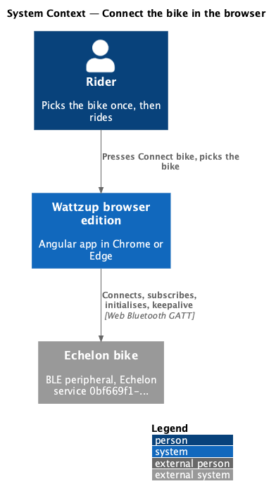
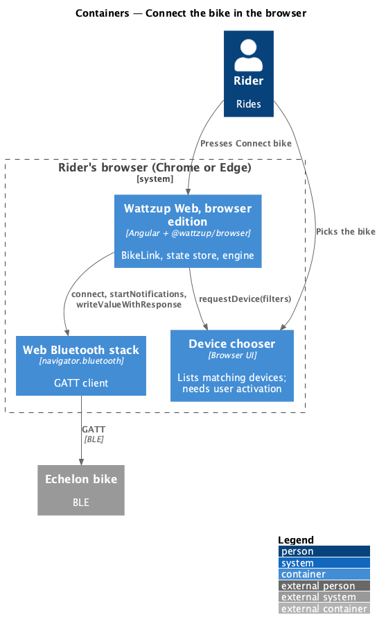
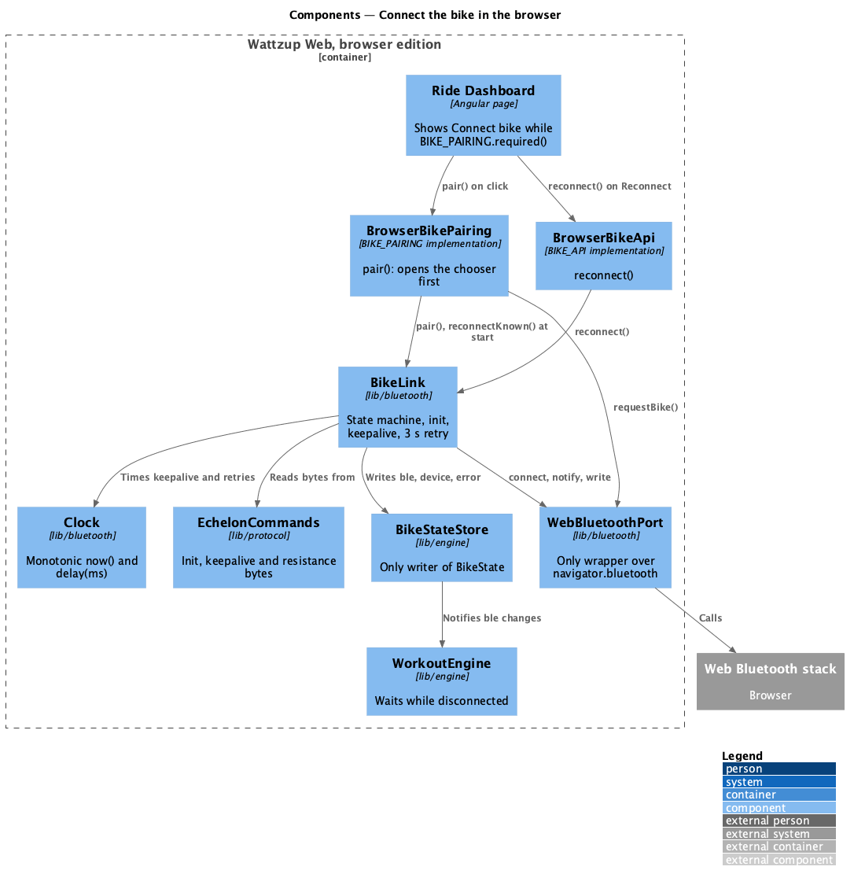
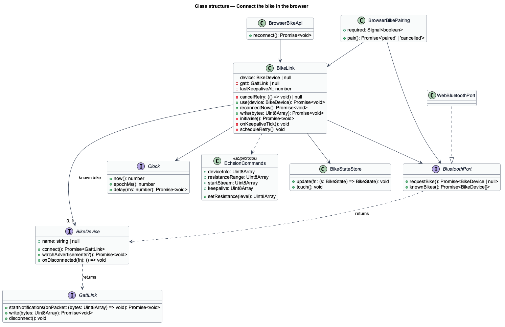
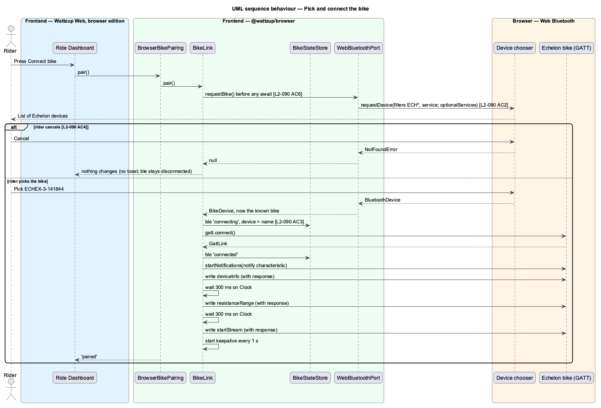
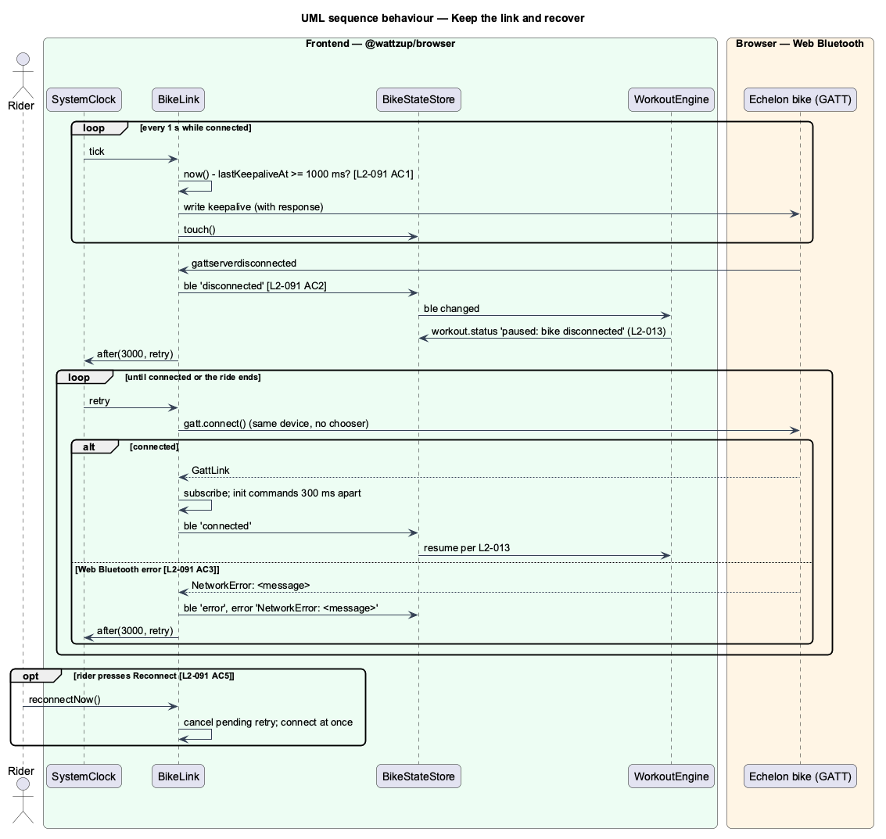

# Connect the bike in the browser

## Overview

In the backend edition the backend scans for the bike in the background and connects on its own (L2-001 to L2-004). A web page cannot do that: Web Bluetooth lets a page reach a device only after the rider picks it in the browser's own device chooser, and the chooser opens only in answer to a tap or click. This feature replaces background scanning with that one-time choice, then keeps the connection as the backend does: it subscribes, sends the 3 init commands, writes the keepalive each second, and reconnects to the same bike without the chooser when the link drops (L2-090, L2-091). The `ble` states and their meaning are those of L2-014.

**device chooser** — browser-drawn dialog, opened by `navigator.bluetooth.requestDevice()`, in which the rider picks 1 nearby device that matches the page's filters

**user activation** — the browser's record that the rider has just tapped, clicked or pressed a key; `requestDevice()` fails without it

**known bike** — `BluetoothDevice` the rider picked, held by the page for as long as it is open, and remembered by the browser across visits where `getDevices()` is offered

**GATT link** — connection to the bike's GATT server through which the page subscribes to the notify characteristic and writes to the write characteristic

## Description

- **`BluetoothPort`** (`@wattzup/browser`, `lib/bluetooth/`) — the only code that touches `navigator.bluetooth`. Besides support (see `check-browser-support`) it offers:
  - `requestBike(): Promise<BikeDevice | null>` — calls `requestDevice` with `filters` `[{namePrefix: 'ECH'}, {namePrefix: 'Ech'}, {namePrefix: 'ech'}, {services: [ECHELON_SERVICE]}]`, `exclusionFilters` `[{namePrefix: 'STRIDE'}]` (never a Stride treadmill, as `EchelonDeviceFilter`) and `optionalServices` `[ECHELON_SERVICE]`, so only Echelon devices appear and only the Echelon service is granted (L2-090 criterion 2, L2-097 criterion 5). `namePrefix` is case-sensitive, hence 3 prefixes for the case-insensitive rule of L2-001. A `NotFoundError` from the rider cancelling resolves `null`.
  - `knownBikes(): Promise<BikeDevice[]>` — `getDevices()` filtered by `isEchelonDevice`, or `[]` where the browser lacks it.
  - `BikeDevice` — wraps `BluetoothDevice`: `name`, `connect(): Promise<GattLink>`, `onDisconnected(listener)` for the `gattserverdisconnected` event, and `whenNearby()` where `watchAdvertisements()` is offered, which resolves on the first `advertisementreceived` and then stops watching.
  - `GattLink` — `startNotifications(onPacket)`, `write(bytes)` (always `writeValueWithResponse`), `disconnect()`.
- **`BikeLink`** (`lib/bluetooth/`) — the browser counterpart of `BikeConnectionService`. It holds the known bike and runs this state machine, writing `ble`, `device` and `error` through `BikeStateStore`. Its connection writes one command at a time, so init commands, keepalives and resistance commands queue rather than overlap; Chrome refuses a GATT write while another is in flight (`NetworkError: GATT operation already in progress`), and the first hardware run dropped the link on that error several times a minute:

  | From | Event | To | Action |
  |---|---|---|---|
  | `disconnected` | **Connect bike** picks a bike | `connecting` | `device` = name; connect |
  | `disconnected` | **Connect bike** cancelled | `disconnected` | nothing; no toast (L2-090 criterion 4) |
  | `connecting` | GATT connected | `connected` | subscribe, then init commands 300 ms apart (L2-090 criterion 3) |
  | `connected` | `gattserverdisconnected` | `disconnected` | stop keepalive; engine waits (L2-013); retry in 3 s (L2-091 criterion 2) |
  | any | Web Bluetooth error | `error` | `error` = `<name>: <message>`; retry in 3 s (L2-091 criterion 3) |
  | `disconnected`, `error` | retry timer or **Reconnect** | `connecting` | `device.gatt.connect()` without the chooser |

  The init sequence and command bytes come from `lib/protocol/` (`EchelonCommands.deviceInfo`, `EchelonCommands.resistanceRange`, `EchelonCommands.startStream`, `EchelonCommands.keepalive`), which mirrors `Wattzup.Protocol` (see `run-rides-in-browser`).
- **Keepalive** — while `connected`, `BikeLink` writes `KEEPALIVE` after each `Clock.delay(1000)`, one delay after another, so a throttled tab whose timer fires late writes 1 overdue keepalive instead of a burst (L2-091 criterion 1). In a hidden tab Chromium may slow timers to once a minute; if the bike drops the link meanwhile, recovery runs when the tab is visible again (L2-091 criterion 4).
- **Recovery** — retries every 3 s on `Clock`, with no limit, until `connected` or the rider ends the ride; a retry needs no user activation because it reuses the known `BluetoothDevice`. **Reconnect** calls `BrowserBikeApi.reconnect()`, which cancels the pending retry and connects at once; while `connected` or `connecting` it rejects as the API answers, with status 409 and `code` `already_connected`, as L2-004 criterion 5 (L2-091 criterion 5).
- **`BrowserBikePairing`** — implements `BIKE_PAIRING`. `required` is `true` while no known bike exists. `pair()` calls `BluetoothPort.requestBike()` as its first statement, with no `await` before it, so the click's user activation reaches `requestDevice` (L2-090 criterion 6). A `SecurityError` (no activation, or blocked by policy) sets `ble` `error` with the reason in plain words.
- **Start-up** — `BrowserBikePairing`, built at start, calls `BikeLink.reconnectKnown()`. It asks `knownBikes()`, which is `getDevices()` filtered by `matchesBike`, or `[]` where the browser lacks `getDevices()`. With exactly 1 known bike whose `whenNearby()` is offered, it watches for that bike's advertisements; the first one stops the watch, and the bike is connected as if just picked, without the chooser. With none, several, or no `watchAdvertisements()`, it does nothing and the dashboard shows **Connect bike**; if the rider picks a bike while the known one is quiet, the pick wins. A failed watch is logged as a warning (L2-090 criterion 5). Both `getDevices()` and `watchAdvertisements()` are treated as optional, so a browser where they are behind a flag behaves as one without them.
- **Connect your bike** — while `BIKE_PAIRING.required()` is `true`, `rideViewState` picks the `connect-bike` overlay and `RideOverlay` shows the *Connect your bike* panel of the `browser-no-bike` mock: a `region` named by its heading, the wake-the-bike line, a primary **Connect bike** button and the one-device-at-a-time note. The Ride Dashboard calls `pair()` in the button's click handler. The status line reads **No bike connected** in the quiet tone, with no state label, while `ble` is `disconnected` and `device` is null.
- **`BIKE_PAIRING`** (`@wattzup/api`) — `required: Signal<boolean>` and `pair(): Promise<void>`, which never rejects. The token's default, used by the backend edition, is never required, because the backend finds the bike by scanning.

Verification:

- Unit tests of `BikeLink` with a fake `BluetoothPort` and `FakeClock`, one per row of the state table, plus: a known bike connected once it advertises, left alone without `whenNearby`, and not connected when the rider picked one meanwhile; subscribe before the first write; 3 init writes in order, each with response, at least 300 ms apart; 4–6 keepalives in 5 s; 1 overdue keepalive after a 60 s gap; retries every 3 s; `already_connected`.
- Browser-edition specs with the fake `navigator.bluetooth` fixture (see `simulate-bike-in-browser`): Connect bike, cancel, connect, disconnect and reconnect, the filters passed to `requestDevice`, and a bike remembered from an earlier visit (`rememberBikeBeforeLoad`, `advertise`) connected without the chooser.

## Requirements

| L2 ID | Refines (L1) | Requirement |
|-------|--------------|-------------|
| `L2-090` | `L1-016` | Choosing and connecting the bike in the browser. With no chosen bike the dashboard shall show `ble` `disconnected` and **Connect bike**, requesting nothing from Bluetooth until pressed; the chooser shall be filtered to Echelon names or the Echelon service and ask for that service only; a picked bike shall be connected, subscribed and initialised as L2-002; cancelling shall leave `disconnected` with no error; a previously chosen bike shall be reconnected without the chooser where `getDevices()` is offered; a chooser that cannot open shall set `ble` `error` with the reason. |
| `L2-091` | `L1-016` | Keepalive and recovery in the browser. The keepalive of L2-003 shall be written once per second, timed by the clock; a disconnect shall set `ble` `disconnected`, make a running workout wait and retry the same bike every 3 s without the chooser; a Web Bluetooth error shall set `ble` `error` as `<error name>: <message>` and retry after 3 s; a hidden tab shall keep keepalives as far as allowed and recover within 1 retry when visible; **Reconnect** shall cancel the retry and connect at once. |

## Diagrams

### System context

The rider picks the bike once in the browser's chooser. From then on Wattzup talks to the bike directly over Web Bluetooth.

### Containers

The browser edition's app holds the GATT link. The browser's Web Bluetooth stack and its device chooser sit between the app and the bike.

### Components

The dashboard's **Connect bike** calls `BrowserBikePairing`, which asks `BluetoothPort` for a bike and hands it to `BikeLink`. `BikeLink` owns the state machine, init, keepalive and recovery, and writes `ble` through `BikeStateStore`.

### Class structure

`BikeLink` depends on the `BluetoothPort` and `Clock` interfaces only, so tests drive it with fakes. Command bytes come from `EchelonCommands`.

### Behaviour — pick and connect the bike

The click opens the chooser without an intervening `await`. A picked bike is connected, subscribed and initialised; a cancelled chooser changes nothing (L2-090).

### Behaviour — keep the link and recover

Each second `BikeLink` writes the keepalive. When the bike drops, the workout waits and `BikeLink` retries the same bike every 3 s without the chooser (L2-091).

