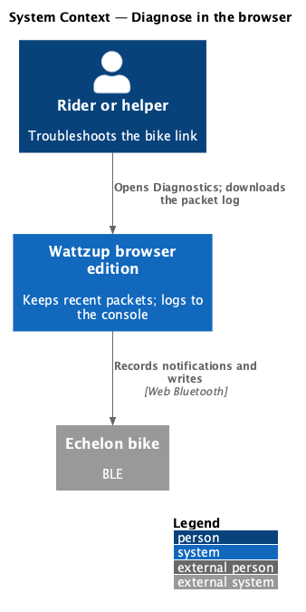
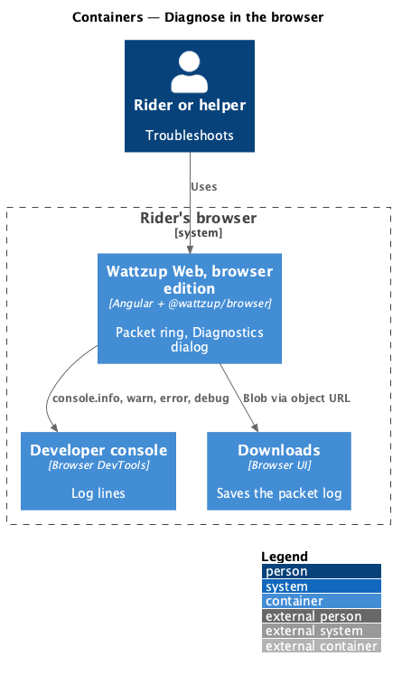
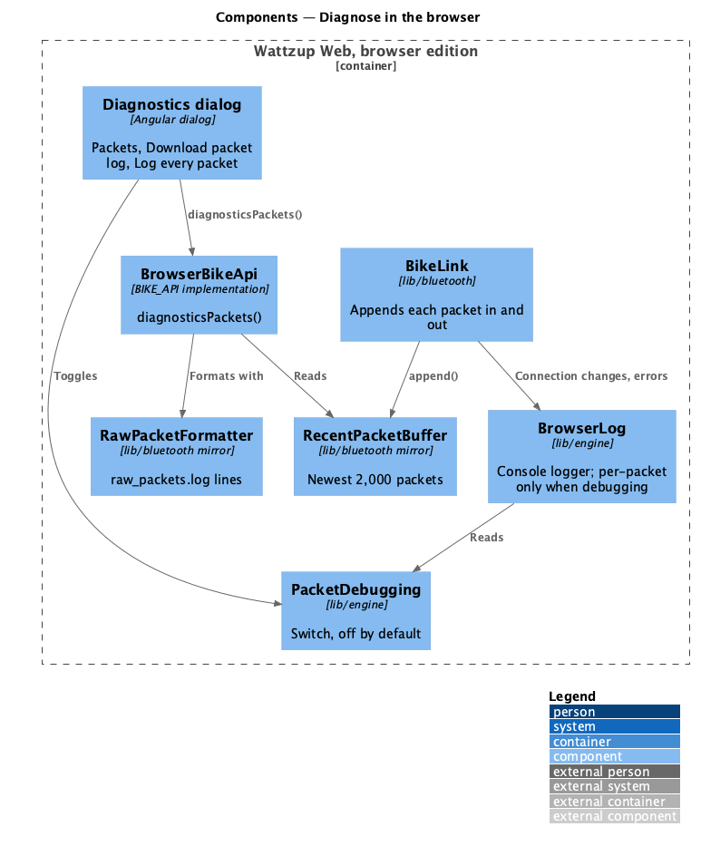
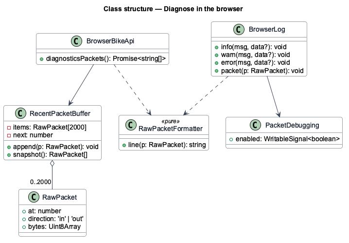
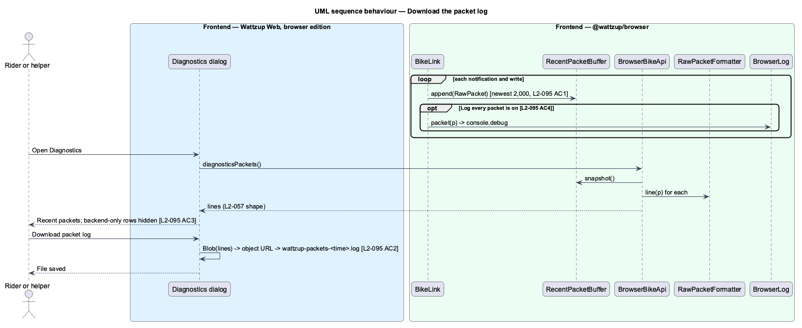

# Diagnose in the browser

## Overview

When the bike misbehaves, the backend edition offers 3 aids: the raw packet log file (L2-030), the persisted status snapshot (L2-031) and structured server logs (L2-033), with the Diagnostics dialog showing recent packets (L2-023, L2-057). A web page cannot write files on its own or keep a server log. The browser edition therefore keeps the recent packets in memory, lets the rider download them in the same format as `raw_packets.log`, logs connection changes, commands and errors to the browser console, and drops the snapshot file (L2-095).

**raw packet** — 1 Bluetooth notification or written command, kept as its time, direction and bytes in hex

**packet ring** — fixed-size in-memory buffer that keeps the newest 2,000 raw packets and drops the oldest

**packet debugging** — Diagnostics-dialog switch that also logs each packet to the console, off by default

## Description

- **`RecentPacketBuffer`** (`@wattzup/browser`, `lib/bluetooth/`; mirror of `Wattzup.Core/Telemetry/RecentPacketBuffer`) — a ring of 2,000 `RawPacket {at, direction, bytes}`. `BikeLink` appends each notification and each write (L2-095 criterion 1).
- **`RawPacketFormatter`** (mirror) — formats 1 packet as 1 line of `raw_packets.log` (L2-030), so a downloaded log reads like the backend's.
- **`BrowserBikeApi.diagnosticsPackets()`** — answers the ring's lines, newest last, in the shape of L2-057, so the Diagnostics dialog shows them unchanged.
- **Diagnostics dialog** (app, `dashboard/`) — when `EDITION` is `browser`:
  - adds **Download packet log**, which saves the ring as `wattzup-packets-<yyyy-mm-ddThh-mm>.log` through an object URL (L2-095 criterion 2);
  - adds a **Log every packet** switch bound to `PacketDebugging` (L2-095 criterion 4);
  - hides the rows that describe the backend's files and process: the snapshot path, the bind address, the exposure and the transport's host facts (L2-095 criterion 3).
  `<TO SUPPLY>`: the dialog's browser-edition state in `docs/mocks/`.
- **`BrowserLog`** (`lib/engine/`) — the browser edition's logger, used where the backend uses `ILogger`: `info` for connection changes and commands, `warn` for catalogue problems and retries, `error` for Bluetooth errors. It writes to `console` only; nothing leaves the device (L2-097). Per-packet lines are written at `debug` only while `PacketDebugging` is on.
- No status snapshot is written (L2-095 criterion 3). The state that L2-031 persists is visible live in the dialog.

Verification: `RecentPacketBuffer` and `RawPacketFormatter` parity tests (ring overflow at 2,001; line format); a browser-edition spec that pushes packets through the fake Bluetooth fixture, opens the dialog, sees them, downloads the log and checks its first line, and checks the hidden backend rows.

## Requirements

| L2 ID | Refines (L1) | Requirement |
|-------|--------------|-------------|
| `L2-095` | `L1-016` | Diagnostics in the browser. The last 2,000 raw packets shall be kept in memory and shown by the Diagnostics dialog as L2-057 lists them; **Download packet log** shall download them in the format of `raw_packets.log`; no status snapshot file shall be written and backend-only fields shall be left out of the dialog; connection changes, commands and errors shall be logged to the console at the matching level, without per-packet entries unless debugging is turned on. |

## Diagrams

### System context

The rider, or someone helping, opens Diagnostics and downloads the packet log to share it.

### Containers

The app keeps the packets in memory and hands a file to the browser's download; the console receives the log lines.

### Components

`BikeLink` appends to `RecentPacketBuffer`; `BrowserBikeApi` serves the lines to the dialog; `BrowserLog` writes to the console.

### Class structure

The buffer holds `RawPacket`s; the formatter turns them into log lines; `PacketDebugging` gates per-packet logging.

### Behaviour — download the packet log

Packets accumulate in the ring; the dialog lists them and downloads them as a file (L2-095).

