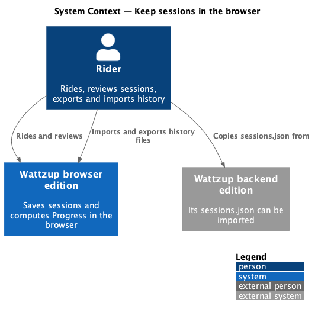
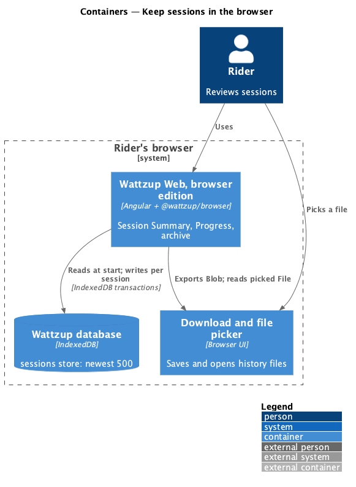
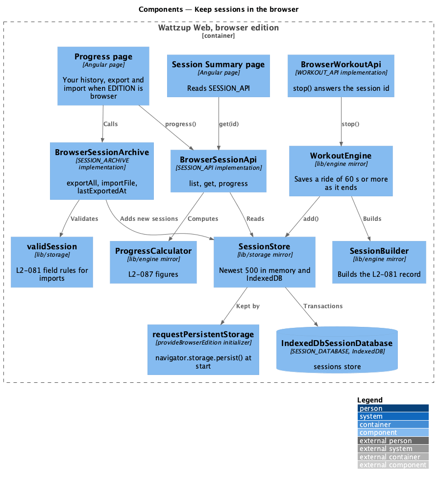
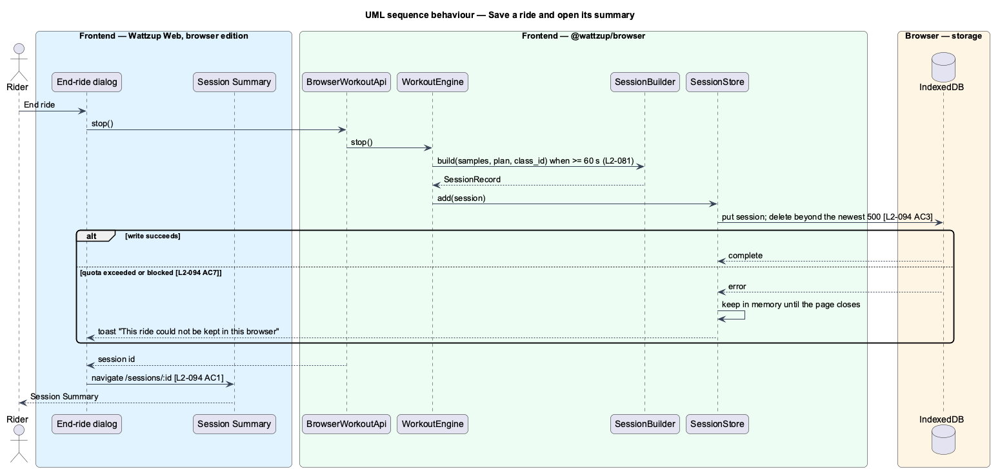
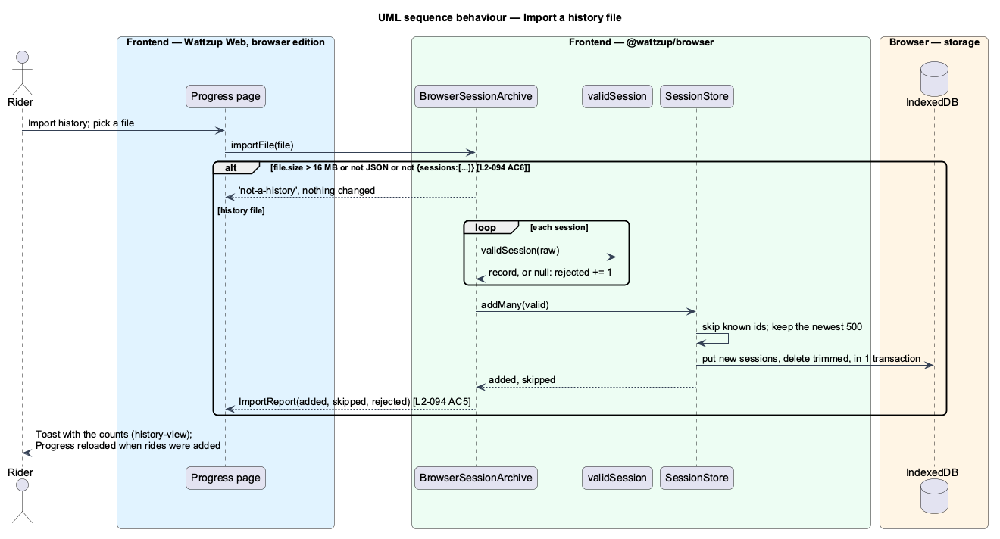

# Keep sessions in the browser

## Overview

The backend edition keeps each saved ride, a session, in a JSON file next to the bike and computes Progress from it (L2-081 to L2-087, ADR 0015). The browser edition has no file system, so it keeps sessions in the browser's IndexedDB under the same record shape and computes the same figures in the page. Browser storage can be cleared by the rider or evicted by the browser, so this feature also asks for persistent storage and lets the rider export the history to a file and import it again, including a `sessions.json` from the backend edition (L2-094).

**session** — saved bike ride as L2-081 defines it: what was ridden, its totals, its traces and its cadence dips

**IndexedDB** — the browser's transactional object store, kept per origin

**persistent storage** — origin storage that the browser does not evict under pressure, granted through `navigator.storage.persist()`

**history file** — JSON file `{"sessions":[<session>…]}` in the format of L2-082, newest first, used by both editions

## Description

- **`SessionDatabase`** (`@wattzup/browser`, `lib/storage/`, token `SESSION_DATABASE`) — `loadAll()` and `write(put, deleteIds)` in 1 transaction, and `readJournal()` and `writeJournal(entry | null)` for the ride in progress. `IndexedDbSessionDatabase` opens IndexedDB database `wattzup`, version 1, with object store `sessions` (key path `id`, index `ended_at`), and wraps the callback API in promises by hand, with no package. Version 2 adds the `journal` store of `run-rides-in-browser`, upgrading a version 1 database in place. Unit tests pass an in-memory `SessionDatabase`.
- **`SessionStore`** (`lib/storage/`, mirror of `Wattzup.Core/Sessions/SessionStore`) — holds the sessions newest first in memory, loaded from `sessions` once (`ready()`). `add(session)` inserts it, trims to the newest 500 and writes the change in 1 transaction: a `put` for the new session and a `delete` for each trimmed one (L2-094 criterion 3). A failed write rejects but leaves the session in memory for the page. `newId()` gives 12 lowercase hex characters from `crypto.getRandomValues`.
- **`SessionBuilder`** and **`ProgressCalculator`** (`lib/engine/`, with `SessionRecord` and `TimeZone`) — mirrors of the .NET types. `TimeZone.offsetMs(utcMs)` is the seam for local days: `BROWSER_TIME_ZONE` reads `Date.getTimezoneOffset`, and the tests use a fixed UTC−5 as the .NET tests do. `SessionBuilder` builds the record when a ride of at least 60 running seconds ends (L2-081). `ProgressCalculator` computes the streak, the week, bests and achievements of L2-087 in the browser's time zone, with the parity rows of its .NET tests (L2-094 criterion 8).
- **`BrowserSessionApi`** — implements `SESSION_API`: `list()`, `get(id)` (`not-found` when absent) and `progress()`, all answered from `SessionStore` and `ProgressCalculator` in the shapes of the generated `SessionList`, `SessionDetail` and `ProgressReport`.
- **`WorkoutEngine`** — when a ride of at least 60 running seconds ends (stop, end of plan or bike shut off), builds the session and adds it to `SessionStore`, as the backend engine's `Finish` does; `BrowserWorkoutApi.stop()` answers its id so the End-ride dialog opens its Session Summary (L2-084, L2-094 criterion 1). When saving fails (quota exceeded, storage blocked), the session stays in memory until the page closes (`SessionStore.isSaved(id)` is false, exposed as `SESSION_ARCHIVE.isSaved`), the summary still opens, and on arriving from the ride it shows the warning toast `Couldn’t keep this ride` of the mocks' `browser-not-kept` state (L2-094 criterion 7). Ending is never delayed by the write beyond the transaction's own time.
- **Persistent storage** — `provideBrowserEdition()` asks once at start with `navigator.storage.persist()` (L2-094 criterion 4). The answer changes nothing on screen: *Your history* always says the rides are kept in this browser only, since clearing site data erases them either way.
- **`EDITION`** (`@wattzup/api`) — `backend` by default, bound to `browser` by `provideBrowserEdition()`. Progress branches on it, as AGENTS.md asks of a screen that differs between the editions.
- **`SESSION_ARCHIVE`** (`@wattzup/api`) — the contract of the history file: `exportAll(): Promise<Blob>`, `importFile(file): Promise<ImportReport | 'not-a-history'>`, `isSaved(id): boolean` and `lastExportedAt(): number | null`. `ImportReport` is `{added, skipped, rejected}`. The backend edition binds nothing.
- **`BrowserSessionArchive`** (`lib/contracts/`) — implements it:
  - `exportAll()` — the history file `{"sessions":[…]}` newest first, as sessions.json, and records the time in `localStorage` (`wattzup.lastExportedAt`, through `SafeStorage`). The Progress page saves it as `wattzup-sessions-<yyyy-mm-dd>.json` (local date) through a temporary object URL (L2-094 criterion 5).
  - `importFile(file)` — answers `not-a-history` with nothing read for a file over 16 MB, and with nothing changed for one that is not JSON or not `{"sessions":[…]}`. Otherwise it checks each session with `validSession` and adds the valid ones through `SessionStore.addMany`, which skips known ids and writes once (L2-094 criteria 5 and 6).
- **`validSession`** (`lib/storage/session-record-validator.ts`) — keeps a session only when every L2-081 field has its type and range and its plan passes `validatePlan` (the plan's stored video is checked as `{video_id, start_seconds}`). Only the record's own fields are kept, so an exported `SessionDetail`'s `previous` and `bests` never reach the store. Imported text is rendered as text (L2-097 criterion 4).
- **`DeviceHistory`** and **`HistoryImport`** (`@wattzup/components`, `device-history/`) — the *Your history* panel of the mocks' `browser-*` Progress states: the rides kept, the age of the last export (amber with a warning icon over 30 days or when never exported, so colour is not the only carrier), **Export history** and **Import history**. `HistoryImport` is the Import button with its hidden JSON file input, also used on an empty Progress page (`browser-empty`).
- **Progress page** (app, `dashboard/`) — when `EDITION` is `browser`, shows `DeviceHistory` under the achievements and `HistoryImport` beside *Find a class* when no ride is saved. `history-view.ts` (`core/`) words the panel and the toasts: `Imported 3 rides` (success, or warning when some were left out), `Nothing new to import`, `Couldn’t import that file`, as the mocks' `browser-imported`, `browser-nothing-new`, `browser-partly-rejected` and `browser-not-a-backup` states. After an import that added rides, the page reloads its figures.

Verification: `SessionBuilder` and `ProgressCalculator` parity tests; `SessionStore` tests over an in-memory `SessionDatabase`; `validSession` tests per field rule; `importFile` tests per case (too large, not JSON, not a history file, duplicate id, invalid session, mixed); `history-view` tests per toast; browser-edition specs that end a ride and reload to find it on Progress and see the warning when the browser refuses the write (`sessions.spec.ts`), and import a backend-edition history, refuse another file and export the history (`history-file.spec.ts`).

## Requirements

| L2 ID | Refines (L1) | Requirement |
|-------|--------------|-------------|
| `L2-094` | `L1-016` | Sessions kept in the browser. An ended ride's session shall be saved in IndexedDB in the shape of L2-081 and open its summary; sessions shall survive closing the browser; the newest 500 shall be kept; the edition shall ask for persistent storage, and Progress shall always say the rides are kept in this browser only, with the days since the last export and Import history even when empty; **Export history** shall download `wattzup-sessions-<date>.json` in L2-082's format and **Import history** shall add new sessions, skip known ids and report counts; a file that is not a history export shall change nothing, and a history's unreadable sessions shall be left out and counted while its valid ones are added; a failed save shall still open the summary and show a toast; Progress figures shall follow L2-087 in the browser's time zone. |

## Diagrams

### System context

The rider rides, reviews sessions and moves the history between devices or editions as a file.

### Containers

The app reads and writes the `sessions` store in IndexedDB. A history file passes through the browser's download and file picker.

### Components

`BrowserWorkoutApi` builds a session and adds it to `SessionStore`. `BrowserSessionApi` serves summaries and Progress. `BrowserSessionArchive` exports and imports.

### Class structure

`SessionStore` owns the sessions and writes through `SessionDatabase`. The archive validates imports with `validSession`.

### Behaviour — save a ride and open its summary

The ride ends, the session is built and written in 1 transaction, and its id opens the summary; a failed write still opens it (L2-094 criteria 1 and 7).

### Behaviour — import a history file

The rider picks a file. It is size-checked, parsed and validated session by session, and only new valid sessions are added (L2-094 criteria 5 and 6).

