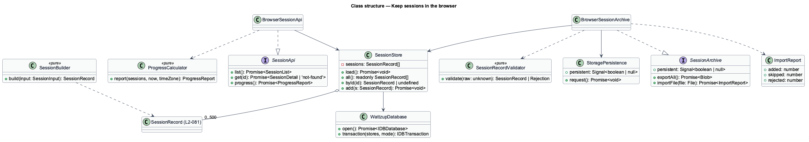

# Keep sessions in the browser

## Overview

The backend edition keeps each saved ride, a session, in a JSON file next to the bike and computes Progress from it (L2-081 to L2-087, ADR 0015). The browser edition has no file system, so it keeps sessions in the browser's IndexedDB under the same record shape and computes the same figures in the page. Browser storage can be cleared by the rider or evicted by the browser, so this feature also asks for persistent storage and lets the rider export the history to a file and import it again, including a `sessions.json` from the backend edition (L2-094).

**session** — saved bike ride as L2-081 defines it: what was ridden, its totals, its traces and its cadence dips

**IndexedDB** — the browser's transactional object store, kept per origin

**persistent storage** — origin storage that the browser does not evict under pressure, granted through `navigator.storage.persist()`

**history file** — JSON file `{"sessions":[<session>…]}` in the format of L2-082, newest first, used by both editions

## Description

- **`WattzupDatabase`** (`@wattzup/browser`, `lib/storage/`) — opens IndexedDB database `wattzup`, version 1, with 2 object stores: `sessions` (key path `id`, index `ended_at`) and `journal` (1 record, the ride in progress; see `run-rides-in-browser`). It wraps the callback API in promises. `<TO SUPPLY>`: whether to use the `idb` package (about 1 KB gzipped) or a hand-written wrapper.
- **`SessionStore`** (mirror of `Wattzup.Core/Sessions/SessionStore`) — holds the sessions newest first in memory, loaded from `sessions` at start. `add(session)` inserts it, trims to the newest 500 and writes the change in 1 transaction: a `put` for the new session and a `delete` for each trimmed one (L2-094 criterion 3).
- **`SessionBuilder`** and **`ProgressCalculator`** — mirrors of the .NET types. `SessionBuilder` builds the record when a ride of at least 60 running seconds ends (L2-081). `ProgressCalculator` computes the streak, the week, bests and achievements of L2-087 in the browser's time zone, with the parity rows of its .NET tests (L2-094 criterion 8).
- **`BrowserSessionApi`** — implements `SESSION_API`: `list()`, `get(id)` (`not-found` when absent) and `progress()`, all answered from `SessionStore` and `ProgressCalculator` in the shapes of the generated `SessionList`, `SessionDetail` and `ProgressReport`.
- **`BrowserWorkoutApi.stop()`** — ends the ride, builds and adds the session, and answers its id so the End-ride dialog opens its Session Summary (L2-084, L2-094 criterion 1). When saving fails (quota exceeded, storage blocked), the session stays in memory until the page closes, the summary still opens, and a toast says `This ride could not be kept in this browser` (L2-094 criterion 7). Ending is never delayed by the write beyond the transaction's own time.
- **`StoragePersistence`** (`lib/storage/`) — at start calls `navigator.storage.persisted()` and, when `false`, `persist()`. The result is exposed as `persistent: Signal<boolean | null>` through `SESSION_ARCHIVE` (L2-094 criterion 4).
- **`BrowserSessionArchive`** — implements the new `SESSION_ARCHIVE` contract:
  - `exportAll()` — a `Blob` of the history file; the Progress page saves it as `wattzup-sessions-<yyyy-mm-dd>.json` through a temporary object URL (L2-094 criterion 5).
  - `importFile(file)` — rejects files over 16 MB before reading; parses JSON; validates each session with `SessionRecordValidator` (the rules L2-081 sets on each field); adds valid sessions whose `id` is new; and answers `ImportReport {added, skipped, rejected}`. Nothing already saved changes (L2-094 criteria 5 and 6). Imported text is rendered as text (L2-097 criterion 4).
- **Progress page** (app, `dashboard/`) — when `EDITION` is `browser`, adds **Export history** and **Import history** (a `Btn` and a file input labelled by a `Btn`) and, when `persistent()` is `false`, a note: `Your browser may clear this history. Export it to keep a copy.` The import result shows as a toast: `Added 12 rides, skipped 3 already here, rejected 1`. `<TO SUPPLY>`: the mock for these controls and the note on Progress in `docs/mocks/`.

Verification: `SessionStore`, `SessionBuilder` and `ProgressCalculator` parity tests; `importFile` tests per case (too large, not JSON, not a history file, duplicate id, invalid session, mixed); store tests against `fake-indexeddb` in the unit-test environment; browser-edition specs that end a ride and reload to find it on Progress, export a file and import it back, and fail a save to see the toast.

## Requirements

| L2 ID | Refines (L1) | Requirement |
|-------|--------------|-------------|
| `L2-094` | `L1-016` | Sessions kept in the browser. An ended ride's session shall be saved in IndexedDB in the shape of L2-081 and open its summary; sessions shall survive closing the browser; the newest 500 shall be kept; the edition shall ask for persistent storage and, if refused, say so on Progress; **Export history** shall download `wattzup-sessions-<date>.json` in L2-082's format and **Import history** shall add new sessions, skip known ids and report counts; invalid or oversized imports shall add only valid sessions and change nothing saved; a failed save shall still open the summary and show a toast; Progress figures shall follow L2-087 in the browser's time zone. |

## Diagrams

### System context

The rider rides, reviews sessions and moves the history between devices or editions as a file.

### Containers

The app reads and writes the `sessions` store in IndexedDB. A history file passes through the browser's download and file picker.

### Components

`BrowserWorkoutApi` builds a session and adds it to `SessionStore`. `BrowserSessionApi` serves summaries and Progress. `BrowserSessionArchive` exports and imports.

### Class structure

`SessionStore` owns the sessions and writes through `WattzupDatabase`. The archive validates imports with `SessionRecordValidator`.

### Behaviour — save a ride and open its summary

The ride ends, the session is built and written in 1 transaction, and its id opens the summary; a failed write still opens it (L2-094 criteria 1 and 7).

### Behaviour — import a history file

The rider picks a file. It is size-checked, parsed and validated session by session, and only new valid sessions are added (L2-094 criteria 5 and 6).

