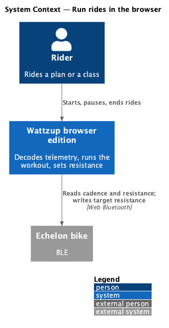
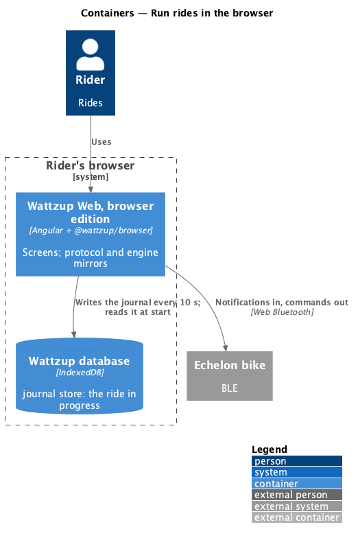
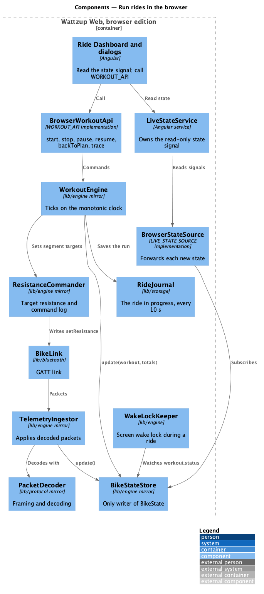
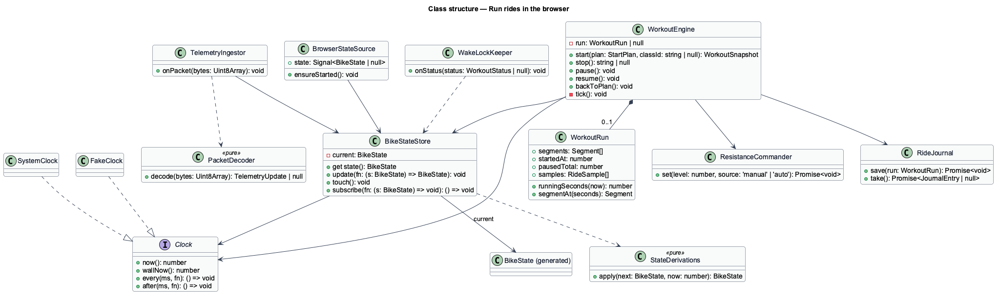
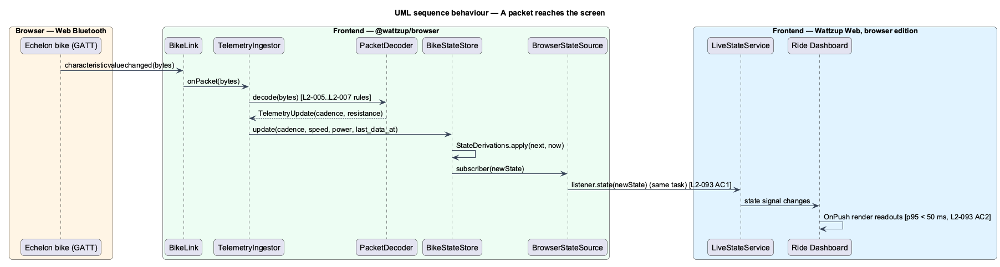
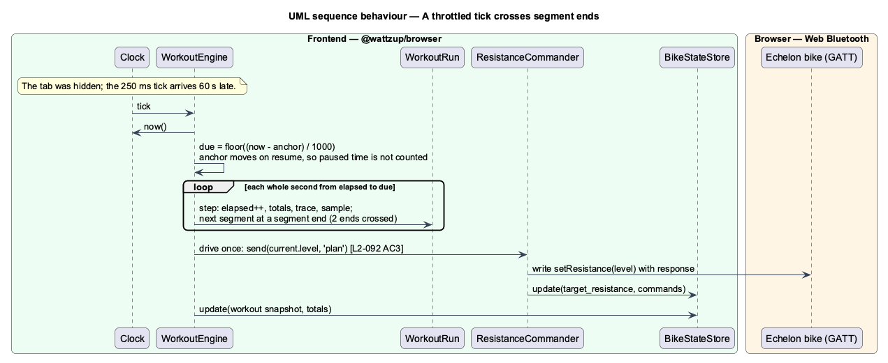
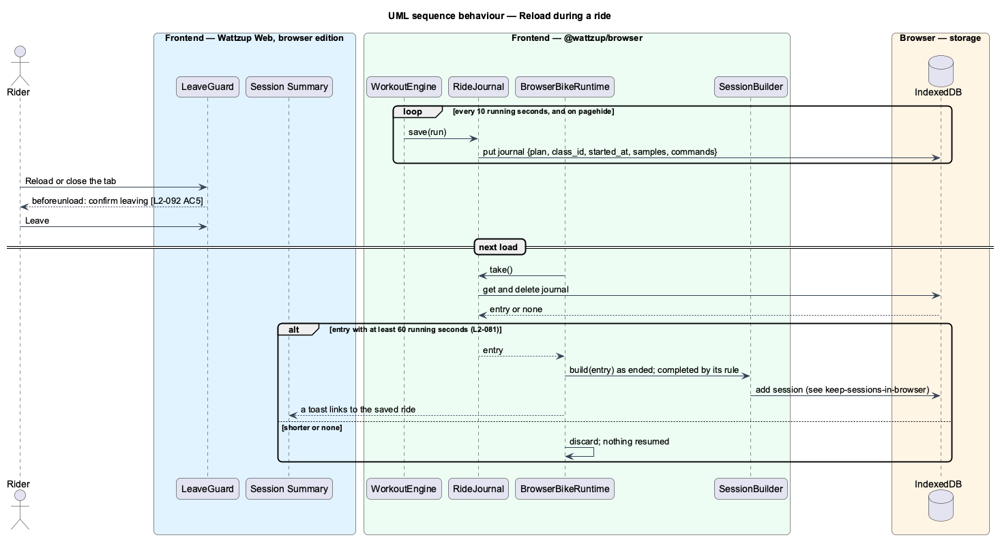

# Run rides in the browser

## Overview

In the backend edition, `Wattzup.Protocol` decodes the bike's packets and `Wattzup.Core` holds the state, sets resistance and runs the workout engine; the browser only renders what the event stream pushes. The browser edition has no backend, so the same rules run inside the page. This feature describes the TypeScript mirror of those 2 projects in `@wattzup/browser`, how it feeds `LiveStateService` without an event stream, how its workout clock survives a throttled tab, and how a ride survives the screen sleeping or the page being reloaded (L2-092, L2-093).

**mirror** — TypeScript module in `@wattzup/browser` that applies the same rule as a named .NET type, under the same name, and is proven by the same table of cases; the .NET type and its tests are the reference

**monotonic clock** — `performance.now()`, a clock that never jumps back with the wall clock and keeps counting while timers are throttled

**throttled tab** — hidden tab whose timers Chromium delays, to once a second at first and to once a minute after 5 minutes hidden

**wake lock** — Screen Wake Lock API sentinel (`navigator.wakeLock.request('screen')`) that keeps the screen on while held

**ride journal** — IndexedDB record of the ride in progress, rewritten at least every 10 s, from which a reloaded page saves the ride as a session

## Description

Mirrors (`@wattzup/browser`; each has the same name and behaviour as the .NET type in brackets):

| `lib/` folder | Mirror | Reference | Rules |
|---|---|---|---|
| `protocol/` | `EchelonUuids`, `EchelonCommands`, `EchelonDeviceFilter` | `Wattzup.Protocol` | service and characteristic UUIDs, command bytes, checksum, device filter (L2-001, L2-008) |
| `protocol/` | `PacketDecoder`, `SpeedCalculator`, `TelemetryUpdate` | `Wattzup.Protocol` | framing, counting, resistance and workout packets, km/h per rpm (L2-005 to L2-007) |
| `engine/` | `BikeStateStore`, `StateDerivations`, `CommandLog` | `Wattzup.Core/State` | only writer of `BikeState`, `device_label`, displayed time, command log (L2-014, L2-032, L2-048) |
| `engine/` | `TelemetryIngestor`, `PowerEstimator` | `Wattzup.Core/Telemetry` | apply decoded packets; estimated power and ride totals (L2-049) |
| `engine/` | `ResistanceCommander` | `Wattzup.Core/Resistance` | target vs. reported resistance, override until the next segment (L2-009, L2-047) |
| `engine/` | `WorkoutPlanValidator`, `PlanExpander`, `WorkoutEngine`, `WorkoutRun`, `PowerTraceHistory` | `Wattzup.Core/Workouts` | plans, segments, stepping, waiting, pause, replacement, trace (L2-010 to L2-013, L2-045, L2-046, L2-050) |

- The mirrors use the generated contract types from `@wattzup/api` (`BikeState`, `WorkoutSnapshot`, `Segment`, `CommandEntry`, `StartPlan`), so the in-browser state has exactly the shape of L2-014 and every screen reads it unchanged (L2-092 criterion 2). The fields that describe the backend host take fixed values: `transport` `WebBluetooth`, `simulated` from `?simulate`, `exposed` `false`, `bind_address` `null`, `ui_clients` 1. `<TO SUPPLY>`: whether L2-014 allows `WebBluetooth` as a `transport` value or the contract gains it.
- The edition drives the bike only and has no machine choice (ADR 0016).
- **Parity tests** — each mirror's unit tests restate the rows of the reference's tests, 1 TypeScript case per C# case, with the same name and the same inputs and outputs (L2-092 criterion 1). A change to a rule changes both in the same change (AGENTS.md). `<TO SUPPLY>`: whether to move the shared rows into case files read by both test suites, which removes the duplication but adds a folder to the layout.

Clock and loop:

- **`Clock`** (`lib/engine/`) — `now()` (monotonic ms), `wallNow()` (epoch s, for `ended_at` and timestamps), `every(ms, fn)` and `after(ms, fn)`. `SystemClock` uses `performance.now()`, `Date.now()` and `setTimeout`; `FakeClock` drives the tests.
- **`WorkoutEngine`** — ticks every 250 ms on `Clock.every`. A tick never adds a fixed step: it computes running time as `now − started − paused total` and finds the current segment by start and duration, so a tick that arrives 60 s late lands in the right segment (L2-092 criterion 3). When a tick crosses 1 or more segment ends, the engine applies only the current segment's target resistance, writes 1 `auto` command and logs 1 segment change. Per-second samples for the session are taken for each whole running second elapsed, filling a gap from the last reported values.
- **`TelemetryIngestor`** — runs on each notification from `BikeLink`, decodes with `PacketDecoder` and updates the store in 1 `update`.

Live state:

- **`BikeStateStore`** — holds the current `BikeState`, applies each change and `StateDerivations` synchronously, and notifies subscribers with the new reference. There is no lock: the page is single-threaded.
- **`BrowserStateSource`** — implements `LIVE_STATE_SOURCE`. `ensureStarted()` sets `connection` to `open` and `state` to the store's current state, then sets `state` on each change on the same task, so a notification reaches the signal with no serialisation and no network hop (L2-093 criteria 1 and 2). It never reports `offline`, so the backend connection banners never show (L2-093 criterion 4).
- **`LiveStateService`** — unchanged in role: it owns the state signal and is the only reader of `LIVE_STATE_SOURCE`. Its `EventSource` code moves into `EventStreamLiveState` in `@wattzup/api` (see `build-and-host`).

Long rides and leaving:

- **`WakeLockKeeper`** (`lib/engine/`) — requests a screen wake lock when `workout.status` becomes running, re-requests it on `visibilitychange` to visible, and releases it when the ride ends. Without the API it does nothing (L2-092 criterion 4).
- **`LeaveGuard`** (app, `core/`, browser edition only) — while a ride is running, paused or waiting, a `beforeunload` listener asks the browser to confirm leaving (L2-092 criterion 5).
- **`RideJournal`** (`lib/storage/`) — every 10 s of running time, and on `pagehide`, writes `{plan, class_id, started_at, samples, commands}` of the current `WorkoutRun` to the `journal` store in IndexedDB. On start, `BrowserBikeRuntime` reads the journal: when it holds at least 60 running seconds, `SessionBuilder` saves it as an ended session with `completed` by its rule, and the journal is cleared; a shorter journal is discarded. The ride is not resumed (L2-092 criterion 5, L2-081).
- Resource bounds — the store keeps 1 state object; `PowerTraceHistory` and the samples are bounded by the plan's length; the trace keeps L2-038's frame rate because it is unchanged. `<TO SUPPLY>`: the 4-hour memory measurement of L2-093 criterion 3, run on demand.

Verification: parity unit tests per mirror with `FakeClock`; engine tests for a 60 s gap crossing 2 segment ends (1 command, correct segment, samples filled); `BrowserStateSource` ordering; `WakeLockKeeper` and `RideJournal` with fakes; browser-edition specs that push notifications through the fake `navigator.bluetooth` and assert the dashboard readouts, the countdown, an automatic resistance write at a segment change and the summary after reload.

## Requirements

| L2 ID | Refines (L1) | Requirement |
|-------|--------------|-------------|
| `L2-092` | `L1-016` | Protocol and workout rules in the browser. The edition shall apply the rules of L2-005 to L2-013, L2-032, L2-045 to L2-049, passing a unit test per table row with the backend's inputs and outputs; its state shall match the backend's L2-014 state field for field except the fields L2-095 removes; segment times shall come from a monotonic clock so a throttled tab lands in the current segment and applies a skipped change once; a ride shall hold a screen wake lock where offered; closing or reloading during a ride shall ask to confirm, and a ride L2-081 would save shall be saved as ended from samples kept at least every 10 s, without resuming. |
| `L2-093` | `L1-016` | Live state in the browser. `LiveStateService` shall expose the same read-only signal, fed from the in-browser bike connection and engine, with no component reading Bluetooth; a notification shall reach the screen within 50 ms (p95), measured on demand; a 4-hour ride shall grow tab memory by no more than 50 MB and keep L2-038's frame rate; only the Bluetooth banners of L2-054 shall show. |

## Diagrams

### System context

The rider rides; the browser edition reads the bike, runs the workout and sets resistance, all on the rider's device.

### Containers

The app holds the mirrors of `Wattzup.Protocol` and `Wattzup.Core`. IndexedDB keeps the ride journal. Nothing runs on a server.

### Components

`BikeLink` hands packets to `TelemetryIngestor`, which writes `BikeStateStore`. `WorkoutEngine` ticks on `Clock` and sets resistance through `ResistanceCommander`. `BrowserStateSource` forwards each new state to `LiveStateService`.

### Class structure

The engine and store depend on `Clock`; the source depends on the store; the journal depends on the engine's `WorkoutRun`. Every state type comes from `@wattzup/api`.

### Behaviour — a packet reaches the screen

A notification is decoded, applied to the store and forwarded to the signal on the same task (L2-092, L2-093).

### Behaviour — a throttled tick crosses segment ends

A late tick computes the time from the monotonic clock, lands in the current segment and sets its target resistance once (L2-092 criterion 3).

### Behaviour — reload during a ride

The journal written during the ride lets the next load save it as an ended session (L2-092 criterion 5).

