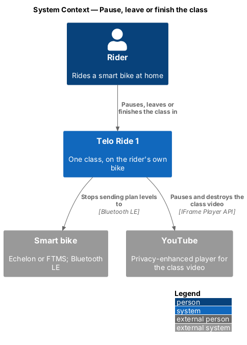
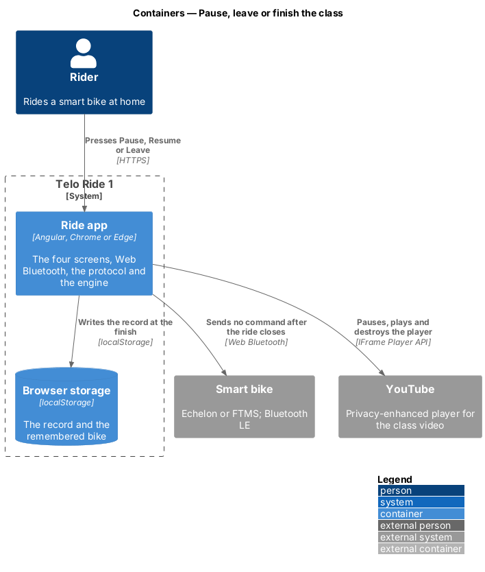
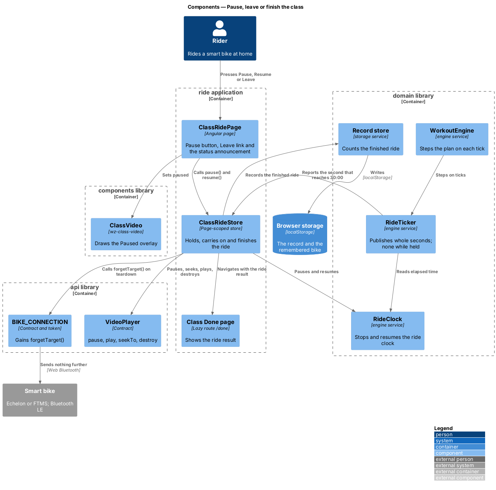
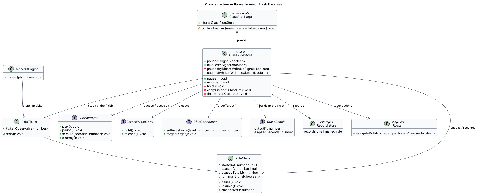
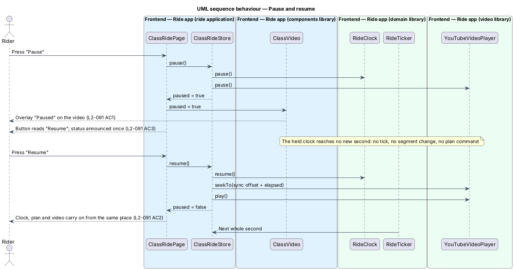
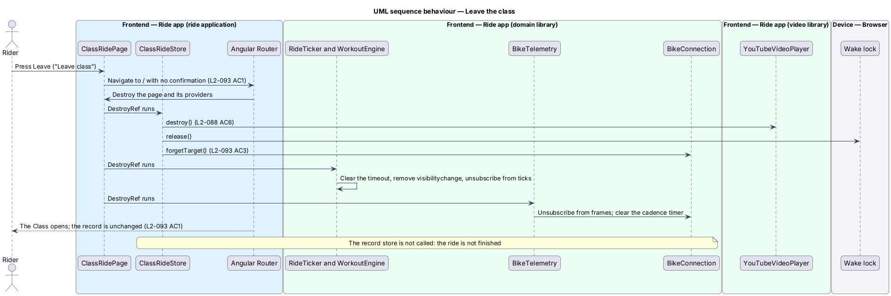
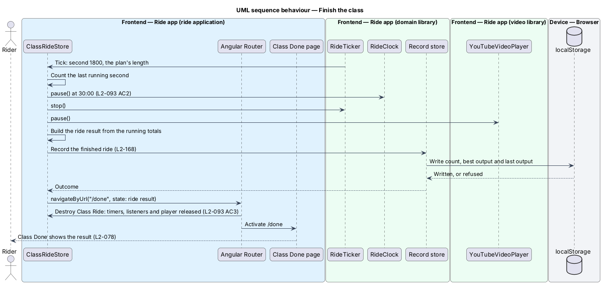

# Pause, leave or finish the class

## Overview

Telo Ride 1 has one class, 30 Minute HIIT Cardio, which the rider takes on the Class Ride screen
while the app sets the bike's resistance and plays the class video. The ride is always solo, so
no one else depends on its clock. The rider can therefore stop it for a moment, walk away from
it, or ride it to the end.

This feature covers the three ways a ride stops:

- **Pause** holds the clock, the plan and the video where they are; **Resume** carries on from
  the same place.
- Leave returns to The Class at once. The ride is not finished and the record does not change.
- The finish comes when the ride clock reaches the plan's length, 30:00. The ride is finished,
  the record is updated and Class Done opens.

In all three, whatever the ride acquired is released when Class Ride closes.

Local terms:

- **ride clock**: elapsed running time of the ride, taken from a monotonic clock and held while the ride is paused
- **hold**: state in which the ride clock, the plan and the video stand still
- **finished ride**: ride whose clock reached the plan's length
- **record**: rider's ride count, best output and last output, kept on the device
- **ride result**: output, running time, on-target share and eight effort averages of one finished ride, handed to Class Done

Neighbouring features own the adjacent concerns:

- The screen, the video and the bike panel belong to
  [ride the class](../ride-the-class/README.md).
- A hold caused by a lost bike (`L2-092`) belongs to
  [wait for a lost bike](../wait-for-a-lost-bike/README.md). This feature and that one share the
  same hold.
- Updating the record (`L2-168`) belongs to
  [keep the record](../../class-done/keep-the-record/README.md); showing the result (`L2-078`)
  belongs to [show Class Done](../../class-done/show-class-done/README.md).
- The manual resistance controls that stay enabled during a pause (`L2-028` AC4) belong to
  [control resistance](../../bike/control-resistance/README.md).
- The confirmation the browser asks for when the tab is closed mid-ride (`L2-133` AC4) belongs to
  [keep the ride clock true](../../performance/keep-the-ride-clock-true/README.md); the heap
  after repeated leaving (`L2-138` AC3) belongs to
  [stay smooth on long rides](../../performance/stay-smooth-on-long-rides/README.md).

## Description

The slice lives in the Ride app: `ClassRidePage` and `ClassRideStore` in the `ride` application,
the clock and ticker in `domain`'s `engine/`, and the pause overlay in `components`. Pausing,
leaving and the finish exist in the code for Telo Ride's class ride; Telo Ride 1 changes where
Leave and the finish go and what the finish writes.

### Pause and Resume

- **Pause button** (exists in `class-ride-page.html`; changes). A `wz-button` in the header's
  `end` slot. It reads "Pause" while the ride runs and "Resume" while it is held, and calls
  `ClassRideStore.pause()` or `resume()`. Today the button also carries an `aria-label`; its
  visible label (`class-ride__pause-label`) names it, as in the mocks.
- **`ClassRideStore.pause()` and `resume()`** (exist). `pause()` sets the private signal
  `pausedByRider` and, unless the bike is already lost, calls `hold()`: `RideClock.pause()` and
  `VideoPlayer.pause()`. `resume()` clears the signal and, unless the bike is lost, calls
  `carryOn()`: `RideClock.resume()`, then `seekTo(sync offset + elapsed)` and `play()` on the
  player.
- **`RideClock.pause()` and `resume()`** (exist). The clock records when it was paused and adds
  the paused interval to `pausedTotalMs` on resume, so `elapsedMs()` does not move while held.
- **`RideTicker`** (exists). It publishes a second only when the clock reaches a new whole
  second. A held clock reaches none, so `WorkoutEngine` steps no segment and sends no plan
  level, and the ride's running totals do not grow.
- **`ClassVideo`** (exists, `wz-class-video`). Its `paused` input draws the `class-video__paused`
  overlay reading "Paused". The overlay is `aria-hidden`; the page announces the change itself.
- **Announcement** (exists in `class-ride-page.html`; changes). A visually hidden
  `role="status"` paragraph. Today it reads "Ride paused" while paused and is empty otherwise,
  so a resume is not announced. Telo Ride 1 sets its text once on each change, to pause and to
  resume. The specs and mocks give no words for either; the text is `<TO SUPPLY>` (no mock
  draws the announcement, `L2-091` AC3).
- **`ClassResist`** (exists). Its `disabled` input follows `ClassRideStore.canControl`, which
  depends on the bike's link state only. A pause does not disable it.

### Leave

- **Leave link** (exists in `class-ride-page.html`; changes). An `<a wz-button>` with
  `aria-label="Leave class"`. Its `routerLink` changes from `['/classes', ride.id]` to `/`. It
  opens no dialog.
- Leaving destroys `ClassRidePage` and with it every provider the page declares. Nothing in the
  leave path touches the record store, so the count, best and last stay as they were
  (`L2-168` AC2).

### Finish

- **`ClassRideStore.finish()`** (exists; changes). The store's `ticks` subscription calls it
  when the second reaches the class's `lengthSeconds`. It pauses the clock at the plan's length,
  stops the ticker, pauses the player and releases the wake lock. Today it then submits the ride
  to `RIDE_OUTBOX` for the backend and navigates to `/results`. In Telo Ride 1 it builds the
  ride result from the ride's running totals, hands it to the record store, and navigates to
  `/done` with the result in the navigation's state. The submission, `RideRecorder` and
  `SubmitRideRequest` leave.
- **`ClassResult`** (exists in `api`; changes). The value Class Done receives. Its Telo Ride 1
  shape (output, running time, average watts, on-target share, eight effort averages) is defined
  in [show Class Done](../../class-done/show-class-done/README.md).
- **Record store** (new). The contract, token and `localStorage` implementation are defined in
  [keep the record](../../class-done/keep-the-record/README.md). `finish()` calls it once.
- **`/done` route** (new). The route path is an assumption the mocks share (open question 7).

### Release

- **Page-scoped providers** (exist). `ClassRideStore`, `RideClock`, `RideTicker`,
  `WorkoutEngine`, `ResistanceController`, `BikeTelemetry` and `VideoClockSync` are provided on
  `ClassRidePage`. Destroying the page destroys them.
- **`DestroyRef` teardown** (exists). `RideTicker` clears its timeout and removes its
  `visibilitychange` listener; `WorkoutEngine` and the store unsubscribe from `ticks` and from
  the `TICKER` beat through `takeUntilDestroyed`; `BikeTelemetry` unsubscribes from the
  connection's `frames` and clears its cadence timer; the store destroys the player and releases
  the wake lock; the page's `beforeunload` host listener goes with the page.
- **`BikeConnection.forgetTarget()`** (new method on the existing contract in `api`). The
  connection is provided on the parent route and outlives the ride. `WebBluetoothBikeConnection`
  keeps the last target resistance and sends it again after a reconnect (`L2-017` AC4). Without a
  change, a reconnect after the rider left would send the ended ride's level. The store calls
  `forgetTarget()` in its teardown, so no further resistance command is sent for that ride
  (`L2-093` AC3). `SimulatedBikeConnection` implements it as well.

## Requirements

The feature realizes the following level-2 (L2) requirements. Each refines the level-1 (L1)
requirement cited beside it.

| L2 ID | Refines (L1) | Requirement |
|-------|--------------|-------------|
| `L2-091` | `L1-015` | When the rider presses **Pause** in a running class ride, the video and the clock shall stop, an overlay on the video shall read "Paused", and Pause shall become **Resume**. The resistance controls shall stay enabled. When **Resume** is pressed, the clock, the plan and the video shall pick up where they left off. When the ride is paused or resumed, the change shall be announced once to a screen reader. |
| `L2-093` | `L1-015` | When the rider presses Leave, The Class shall open without a confirmation, the ride shall not be finished, and the record shall not change. When the clock reaches 30:00, the ride shall be finished, the record shall be updated (`L2-168`) and Class Done shall open (`L2-078`). When Class Ride closes because the rider leaves or finishes, no further resistance command shall be sent for that ride, and its timers, listeners and video shall be released. |

## Diagrams

### System context

The rider pauses, leaves or finishes the class in Telo Ride 1. The bike stops receiving plan
levels and the YouTube video stops with the ride.

### Containers

The Ride app holds the ride and writes the record to the browser's storage only at the finish.
The bike and the YouTube player are told to stop from the app.

### Components

`ClassRidePage` carries the Pause button and the Leave link. `ClassRideStore` holds and carries
on the clock and the player, and at the finish hands the result to the record store and to Class
Done.

### Class structure

`ClassRideStore` owns the two reasons for a hold, `pausedByRider` and `pausedByBike`, and the
`hold`, `carryOn` and `finish` steps. `RideClock` keeps the paused total; `BikeConnection` gains
`forgetTarget()`.

### Behaviour: pause and resume

Pause holds the clock and the video and shows the overlay; no tick arrives while held, so the
plan does not move. Resume seeks the video to the clock and plays it.

### Behaviour: leave the class

Leave navigates to The Class with no confirmation. Destroying the page releases the timers, the
listeners and the player, and the connection forgets the target resistance.

### Behaviour: finish the class

The tick that reaches 30:00 finishes the ride: the store stops the clock, updates the record and
opens Class Done with the ride result.

