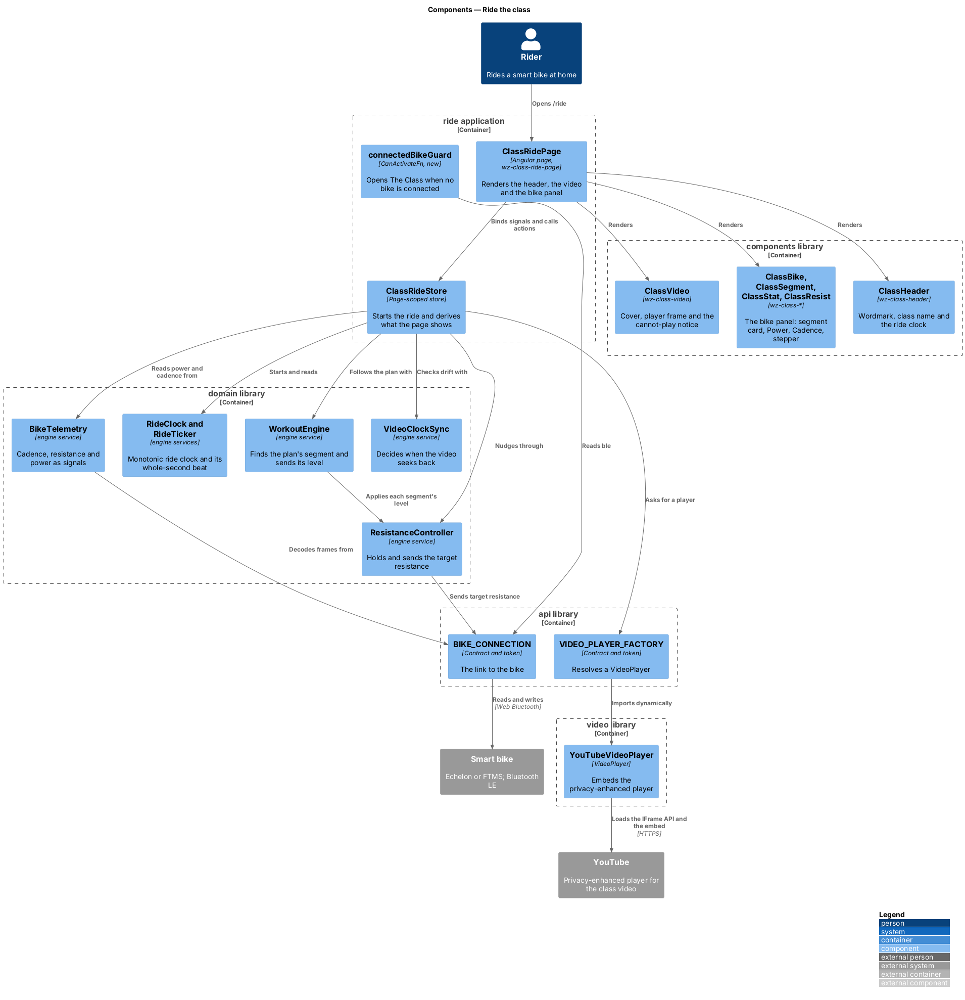
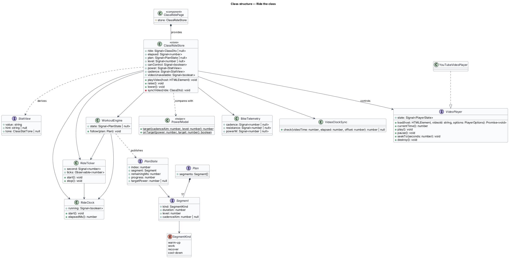
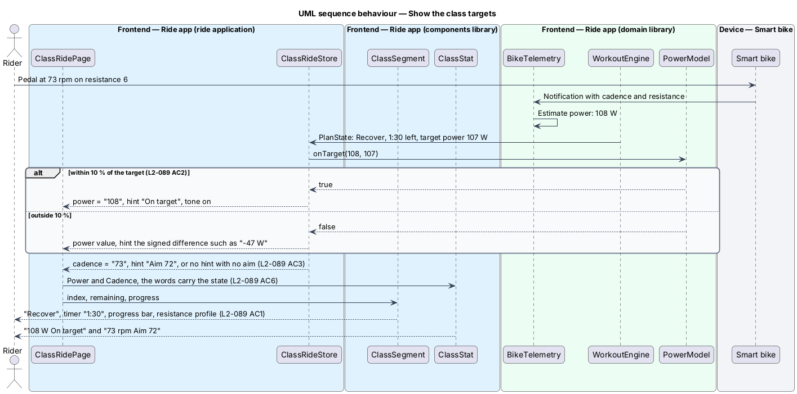

# Ride the class

## Overview

Telo Ride 1 has one class, 30 Minute HIIT Cardio, and four screens. Class Ride is the third: the
screen the rider is on while pedalling. It plays the class video in step with the ride, sets the
bike's resistance for every interval of the class, and shows the rider how the current interval
is going. The ride is always solo.

This feature covers the screen itself and what it shows while a ride runs: the header with the
ride clock, the class video kept on the clock, and the bike panel with the current segment, the
power and cadence against their targets, and the resistance stepper. It starts when the rider
presses the start button on The Class and Class Ride opens at 0:00.

Local terms:

- **ride clock**: elapsed running time of the ride, taken from a monotonic clock and held while the ride is paused
- **plan**: timed segments the class follows, each with a kind, a duration, a level and a cadence aim
- **segment card**: first cell of the bike panel, showing the current segment's kind, time left, progress and the plan's resistance profile
- **target power**: power a segment asks for, computed from its cadence aim and level by the power formula
- **sync offset**: video time at which ride 0:00 starts, 0:12.0 for this class
- **drift**: difference between the video's time and the ride clock plus the sync offset
- **bike panel**: row under the video holding the segment card, Power, Cadence and the resistance stepper

Neighbouring features own the adjacent concerns:

- Pausing, leaving and the finish at 30:00 belong to
  [pause, leave or finish the class](../pause-leave-or-finish-the-class/README.md).
- The lost-bike alert belongs to [wait for a lost bike](../wait-for-a-lost-bike/README.md).
- The class, its plan and the start button belong to
  [show the class](../../the-class/show-the-class/README.md).
- Sending a segment's level and the manual nudge (`L2-027`, `L2-028`) belong to
  [control resistance](../../bike/control-resistance/README.md); decoding and the power estimate
  (`L2-020`, `L2-021`, `L2-023`) belong to
  [read bike telemetry](../../bike/read-bike-telemetry/README.md).
- The clock's accuracy in a hidden tab, the wake lock and the once-a-second readouts (`L2-133`,
  `L2-134`) belong to
  [keep the ride clock true](../../performance/keep-the-ride-clock-true/README.md).
- The wordmark and Full screen belong to [show the wordmark](../../ui/show-the-wordmark/README.md)
  and [switch theme and full screen](../../ui/switch-theme-and-full-screen/README.md).

## Description

The slice lives in the Ride app. The page and its store are in the `ride` application, the
presentation in `components`, the rules in `domain`'s `engine/`, and the player in `video`. Most
of it exists, built for Telo Ride's class ride at `/classes/:id/ride`; Telo Ride 1 moves it to
`/ride`, removes the group ride and the backend, and changes the copy and header to the mocks in
`docs/mocks/pages/class-ride/`.

### Route and providers

- **`/ride` route** (exists as `classes/:id/ride` in `ride.routes.ts`; changes). The path
  becomes `ride`, with no `:id`, and still loads `classRideRoutes` with `loadChildren`. Its title
  becomes "Class ride · Telo Ride 1". The route path is an assumption the mocks share (open
  question 7).
- **`connectedBikeGuard`** (new, `ride/src/app/bike/connected-bike.guard.ts`). A `CanActivateFn`
  that returns `true` when `BIKE_CONNECTION.ble()` is `connected` and otherwise a `UrlTree` for
  `/`. It calls no method of the connection, so nothing is requested from Bluetooth. It replaces
  `rememberedBikeGuard` on this route, which today redirects to `/connect` and starts a
  reconnect. A reload of `/ride` therefore opens The Class (`L2-087` AC4), as does a blocked
  browser (`L2-010` AC2, designed in
  [check bike and browser support](../../bike/check-bike-and-browser-support/README.md)).
- **`provideClassRide()`** (exists; changes). It binds `SCREEN_WAKE_LOCK` to
  `BrowserScreenWakeLock` and the class video through `provideClassVideo()`. Its binding of
  `MONOTONIC_TIME` to `performance.now()` moves to `provideBikeConnection()` on the parent
  route, because the keepalive reads the same clock
  ([keep the bike connected](../../bike/keep-the-bike-connected/README.md)). The
  `RIDE_HUB_CLIENT` binding and `provideClasses()` (the HTTP catalogue) leave. Where the class definition comes from is `<TO SUPPLY>` (open question 1); the
  design treats it as a class definition the frontend holds, read through the contract that
  [show the class](../../the-class/show-the-class/README.md) defines.
- **`provideClassVideo()`** (exists). It binds `VIDEO_PLAYER_FACTORY` to a dynamic
  `import('@telo/video')`, so the player's code loads only when a screen asks for a player.

### Page and store

- **`ClassRidePage`** (exists, `wz-class-ride-page`; changes). The page provides the ride's
  services on itself: `ClassRideStore`, `RideClock`, `RideTicker`, `WorkoutEngine`,
  `ResistanceController`, `BikeTelemetry` and `VideoClockSync`. `LiveSessionStore` leaves the
  list. The three accumulators `RideTotals`, `EffortTotals` and `OnTargetCounter` join it, with
  the `ReadoutSampler` of
  [keep the ride clock true](../../performance/keep-the-ride-clock-true/README.md). The template renders `wz-class-header` with **Pause**, Leave and a new
  `wz-fullscreen-toggle` in its `end` slot, a visually hidden `h1`
  ("30 Minute HIIT Cardio · solo class ride"), `wz-class-video`, and `wz-class-bike` holding
  `wz-class-segment`, two `wz-class-stat` and `wz-class-resist`. The template holds no control
  that finishes the ride (`L2-087` AC3); the e2e page object's `finish` locator is removed with
  it.
- **`class-ride-page.scss`** (exists; changes). On a landscape viewport 768 px wide or more the
  `class-ride` block is one viewport tall, the header keeps its height, the video takes the
  height left at 16:9 and the bike panel is one row, so the screen does not scroll (`L2-087`
  AC5). Below that it is one column that scrolls.
- **`ClassRideStore`** (exists; changes). A page-scoped store. On construction it reads the
  class and starts the ride: `RideClock.start()`, `RideTicker.start()` and
  `WorkoutEngine.follow(plan)`. It exposes `ride`, `elapsed` (the ticker's whole second), `plan`
  (the engine's `PlanState`), `level`, `canControl`, `power`, `cadence` and `videoUnavailable`
  as signals, and `playVideo(host)`, `raise()` and `lower()` as actions. The route parameter,
  `LiveSessionStore`, `RideRecorder` and `RIDE_OUTBOX` leave it. On each tick the store reports
  the running seconds to `RideTotals` (output, owned by
  [read bike telemetry](../../bike/read-bike-telemetry/README.md)), to `EffortTotals` (the
  eight efforts, owned by [show Class Done](../../class-done/show-class-done/README.md)) and to
  `OnTargetCounter` (owned by [score on target](../../class-done/score-on-target/README.md)).
- **`StatView`** (exists). The value, hint and tone of one stat. `power` reads "On target" with
  tone `on` when `PowerModel.onTarget(watts, target)` holds, and otherwise the signed difference
  ("-47 W") with tone `under` or `over`. Today an unknown power shows the hint "Target {n} W";
  the specs name no such hint, so Telo Ride 1 shows no hint while power or target is unknown.
  `cadence` reads "Aim 72", or no hint for a segment with no aim.

### Rules in `domain`

- **`RideClock`**, **`RideTicker`** (exist). The clock answers `elapsedMs()` from
  `MONOTONIC_TIME`; the ticker publishes each new whole second as the signal `second` and on
  `ticks`.
- **`WorkoutEngine`** and **`planStateAt(plan, elapsedMs)`** (exist). On each tick the engine
  computes the `PlanState` (segment, index, `remainingMs`, `progress`, `targetPower`) and, when
  the index changes, sends the segment's level through `ResistanceController.applyPlanLevel`.
- **`Segment`** (exists in `api`; changes). `cadenceAim` becomes `number | null`, because a
  segment may have no aim (`L2-089` AC3). `planStateAt` then gives `PlanState.targetPower`,
  itself `number | null`, as `null` for such a segment. The kind `steady` leaves `SegmentKind`. The warm-up and cool-down aims of this class
  are `<TO SUPPLY>` (open question 11).
- **`PowerModel.onTarget(power, target)`** (exists). Power within 10 % of the target is on
  target.
- **`BikeTelemetry`** (exists; changes). It merges decoded notifications into the signals
  `cadence`, `resistance` and `powerW`. `heartRate` and `speedKmh` leave it.
- **`VideoClockSync.check(videoTime, elapsed, offset)`** (exists). It returns the time to seek
  to when the drift exceeds `DRIFT_LIMIT_SECONDS` (1.5), otherwise `null`.

### Presentation in `components`

- **`ClassHeader`** (exists, `wz-class-header`; changes). Inputs `title`, `mode`, `elapsed` and
  `total`. It renders the lockup, the name with its mode, and the clock as `role="timer"` with
  `aria-label="7:00 of 30:00"`. Its stylesheet hides `class-ride__name` below md,
  `class-ride__clock-total` on a phone, and the lockup below 384 px. The lockup reads
  "TELO RIDE 1".
- **`ClassVideo`** (exists, `wz-class-video`). Inputs `videoId`, `title`, `unavailable` and
  `paused`; output `frame`, the element the player embeds in. It draws the cover until the
  player paints over it and, when `unavailable`, the notice
  “The video can’t play. The bike will still follow the class.” with `role="status"`. The mocks
  draw no such state (mock gap: the video that cannot play).
- **`ClassBike`** (exists, `wz-class-bike`). Two columns on a phone and one row of four from md.
- **`ClassSegment`** (exists, `wz-class-segment`). Inputs `segments`, `index`, `remaining` and
  `progress`. It renders the kind with its swatch, the time left as `role="timer"` with
  `aria-label="Recover: 1:30 left"`, the progress bar and the resistance profile.
- **`ClassStat`** (exists, `wz-class-stat`). Inputs `label`, `value`, `unit`, `hint` and `tone`.
  The hint's words carry the state; the tone only styles them. The mocks draw only "On target"
  (mock gap: power off target).
- **`ClassResist`** (exists, `wz-class-resist`). Inputs `level`, `max` and `disabled`; outputs
  `lower` and `raise`. It reads "6" and "of 32" with `aria-label="Resistance 6 of 32"` between
  two 48 px buttons.
- **`FullscreenToggle`** (exists, `wz-fullscreen-toggle`). New on this page; the page binds it
  to the `FULLSCREEN` token.

### Video

- **`VideoPlayer`** and **`VIDEO_PLAYER_FACTORY`** (exist in `api`). The contract the store
  uses: `load`, `currentTime`, `play`, `pause`, `seekTo`, `destroy` and the signal `state`.
- **`YouTubeVideoPlayer`** (exists in `video`). It loads the IFrame API script and embeds the
  video from `https://www.youtube-nocookie.com`. A script that cannot load, or a player error,
  sets `state` to `error` and never rejects.

`ClassRideStore.playVideo(host)` loads the player with `controls: false`, `autoplay: true` and
`startSeconds` equal to the sync offset plus the ride clock. On each tick `syncVideo` asks
`VideoClockSync` for a seek. When the factory rejects or `state` is `error`, `videoUnavailable`
is true and nothing else changes: the clock, the engine and the bike do not depend on the
player. The store destroys the player when the page is destroyed (`L2-088` AC6).

## Requirements

The feature realizes the following level-2 (L2) requirements. Each refines the level-1 (L1)
requirement cited beside it.

| L2 ID | Refines (L1) | Requirement |
|-------|--------------|-------------|
| `L2-087` | `L1-015` | Class Ride, at `/ride`, shall show a header with the wordmark, "30 Minute HIIT Cardio · Solo", the clock (`role="timer"`, "7:00 / 30:00", `aria-label="7:00 of 30:00"`), **Pause**, Leave (`aria-label="Leave class"`) and Full screen, and a visually hidden `h1` reading "30 Minute HIIT Cardio · solo class ride". The header shall hide the class name below md, shall hide the total "/ 30:00" on a phone, and shall hide the wordmark below 384 px. A production build shall offer no shortcut that finishes the ride early. The `/ride` address, opened without a connected bike, shall open The Class instead. On a landscape viewport 768 px wide or more, Class Ride shall not scroll. |
| `L2-088` | `L1-015` | In a running class ride at 7:00 with a 0:12 offset, the video shall play at 7:12, without player controls. When the video drifts more than 1.5 seconds from the ride clock plus the offset, the video shall seek back into sync. When the ride pauses, the video shall pause, and Resume shall play it from the same place. When the video cannot load, is blocked or the network is lost, the plan, the clock and the bike shall carry on, and a notice under the video shall say “The video can’t play. The bike will still follow the class.” The YouTube player shall use the privacy-enhanced domain (`youtube-nocookie.com`). When the rider leaves or finishes the ride, the player shall be destroyed and shall stop playing. |
| `L2-089` | `L1-015` | The segment card shall show the current segment's kind ("Recover"), the time left ("1:30", `role="timer"`, `aria-label="Recover: 1:30 left"`), a progress bar and the plan's resistance profile. Power shall read "108 W" with "On target" when power is within 10 % of the segment's target power, otherwise the signed difference in watts ("-47 W"). Cadence shall read "73 rpm" with "Aim 72"; a segment with no aim shall show no aim. The resistance stepper shall read "6" and "of 32" between 48 px "Lower resistance" and "Raise resistance" buttons. At md or wider the bike panel shall be one row of four. The text shall carry "On target" or a difference, never the colour alone. |

## Diagrams

### System context

The rider takes the class through Telo Ride 1, which drives the smart bike over Bluetooth and
plays the class video from YouTube.

### Containers

The Ride app is the only container the slice touches. It talks to the bike over Web Bluetooth
and embeds the YouTube player; nothing is stored while the ride runs.

### Components

`ClassRidePage` renders the presentation components from `ClassRideStore`, which runs the clock,
the ticker and the engine from `domain` and reaches the player in `video` through the contract in
`api`. `connectedBikeGuard` stands in front of the route.

### Class structure

`ClassRideStore` composes the ride's services and turns their signals into the `StatView` values
the page binds. `WorkoutEngine` derives a `PlanState` from the `Plan` and the clock;
`YouTubeVideoPlayer` realizes `VideoPlayer`.

### Behaviour: open Class Ride

The guard lets the route open only with a connected bike. The store starts the clock, the ticker
and the engine, the first segment's level goes to the bike, and the video loads at the sync
offset.

### Behaviour: keep the video on the ride clock

On each tick the store compares the video's time with the ride clock plus the sync offset and
seeks when the drift exceeds 1.5 seconds. A player that cannot play raises the notice and leaves
the ride running.

### Behaviour: show the class targets

A bike notification updates power and cadence; a tick updates the segment card. The store
compares power with the segment's target power and the page shows the words that carry the
result.

