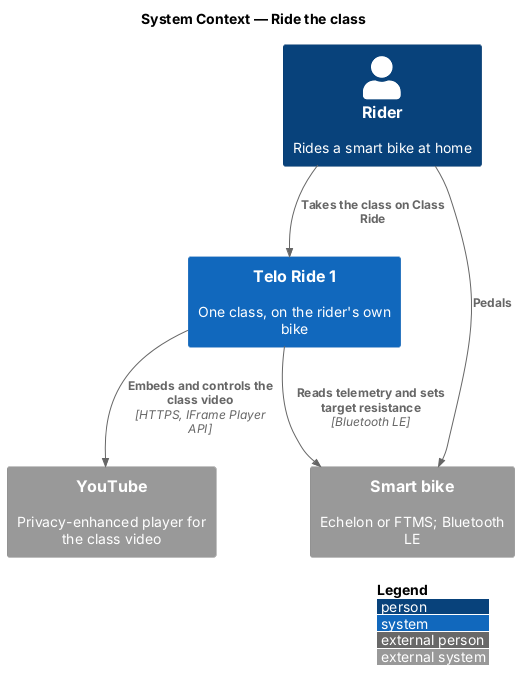
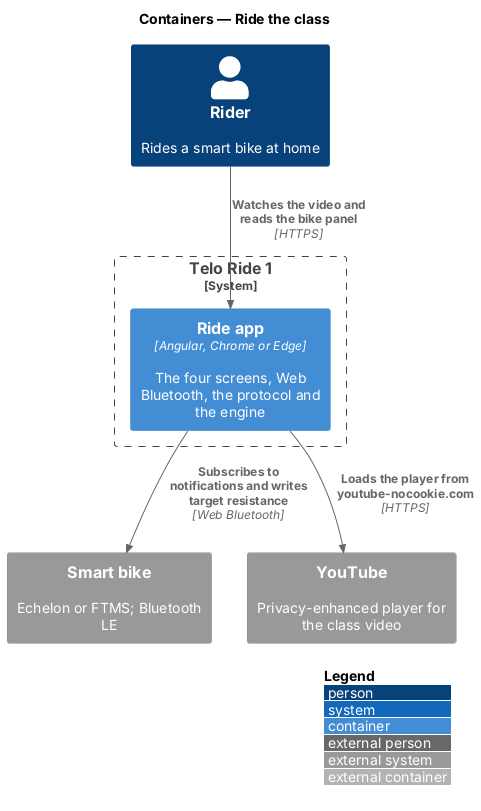
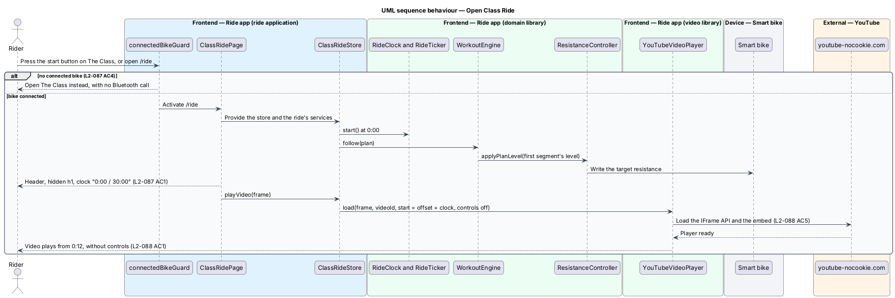
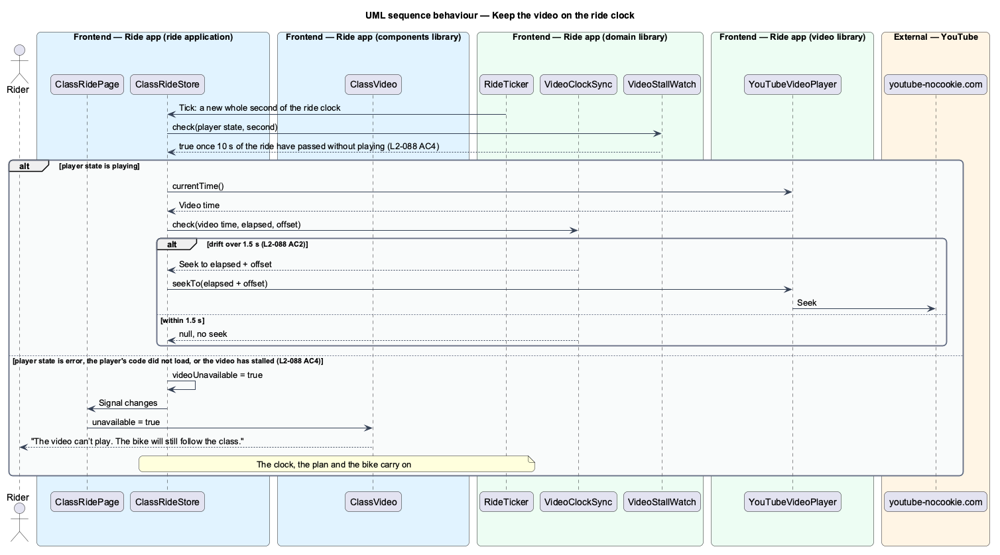

# Ride the class

## Overview

Telo Ride 1 has one class, Intervals to the Beat, and four screens. Class Ride is the third: the
screen the rider is on while pedalling. It plays the class video in step with the ride, sets the
bike's resistance for every interval of the class, and shows the rider how the current interval
is going. The ride is always solo.

This feature covers the screen itself and what it shows while a ride runs: the header with the
ride clock, the class video kept on the clock, and the bike panel with the current segment, the
power and cadence against their targets, and the resistance stepper. It starts when the rider
presses the start button on The Class and Class Ride opens at 0:00.

Slice 31.1 built the screen as this document describes it: the address, the guard, the header at every width, the
bike panel and the layout that does not scroll in landscape. What a later slice changes is marked with its slice.
Slice 31.3 built the two notices of a ride that goes on short of something: the video that cannot play, which now
includes a video stalled for want of a network, and the bike that is set by hand.

Local terms:

- **ride clock**: elapsed running time of the ride, taken from a monotonic clock and held while the ride is paused
- **plan**: timed segments the class follows, each with a kind, a duration, a level and a cadence aim
- **segment card**: first cell of the bike panel, showing the current segment's kind, time left, progress and the plan's resistance profile
- **target power**: power a segment asks for, computed from its cadence aim and level by the power formula
- **sync offset**: video time at which ride 0:00 starts, 0:03.0 for this class
- **drift**: difference between the video's time and the ride clock plus the sync offset
- **bike panel**: row under the video holding the segment card, Power, Cadence and the resistance stepper
- **box**: the video's box on the stage, which the course takes in a ride in Ibiza

Neighbouring features own the adjacent concerns:

- Pausing, leaving and the finish at 20:00 belong to
  [pause, leave or finish the class](../pause-leave-or-finish-the-class/README.md).
- The lost-bike alert belongs to [wait for a lost bike](../wait-for-a-lost-bike/README.md).
- The class, its plan and the start button belong to
  [show the class](../../the-class/show-the-class/README.md).
- Riding in Ibiza (`L2-174` to `L2-177`) is journey 37's. Until it is built, "Ibiza Sunset Strip" opens the ride
  carried over from Telo Ride at the same address: World loading, then the course in the box with the class video
  inset in its corner (`docs/specs/L2.md`, open question 20).
- Sending a segment's level and the manual nudge (`L2-027`, `L2-028`) belong to
  [control resistance](../../bike/control-resistance/README.md); decoding and the power estimate
  (`L2-020`, `L2-021`, `L2-023`) belong to
  [read bike telemetry](../../bike/read-bike-telemetry/README.md).
- The clock's accuracy in a hidden tab, the wake lock and the once-a-second readouts (`L2-133`,
  `L2-134`) belong to
  [keep the ride clock true](../../performance/keep-the-ride-clock-true/README.md).
- The wordmark and Full screen belong to [show the wordmark](../../ui/show-the-wordmark/README.md)
  and [switch theme and full screen](../../ui/switch-theme-and-full-screen/README.md).

## Description

The slice lives in the Ride app. The page and its store are in the `ride` application, the
presentation in `components`, the rules in `domain`'s `engine/`, and the player in `video`. Most
of it was carried over from Telo Ride's class ride at `/classes/:id/ride`; slice 31.1 moved it to
`/ride`, put the guard in front of it and brought the screen in line with the mocks in
`docs/mocks/pages/class-ride/` (`default` and `off-target`).

### Route and providers

- **`/ride` route** (`ride.routes.ts`; built by slice 31.1). The path is `ride`, with no class in it, and loads
  `classRideRoutes` with `loadChildren`. Its title is "Class ride · Telo Ride 1". The address Telo Ride gave the
  ride, `classes/intervals-to-the-beat/ride`, is no route and reaches Page not found. `/ride` closes the part of
  open question 7 that is this screen's.
- **`connectedBikeGuard`** (`ride/src/app/bike/connected-bike.guard.ts`; built by slice 31.1, with one unit test
  per `ble` state). A `CanActivateFn` that returns `true` when `BIKE_CONNECTION.ble()` is `connected` and otherwise
  a `UrlTree` for `/`. It calls no method of the connection, so nothing is requested from Bluetooth. It is the
  route's only guard: it replaced `rememberedBikeGuard`, which sent a rider with no remembered bike to `/connect`
  and started a reconnect, and `blockedBrowserGuard` of slice 30.6, which it covers, because a blocked browser never
  has a connected bike (`L2-010` AC2, designed in
  [check bike and browser support](../../bike/check-bike-and-browser-support/README.md)). A bookmark, a typed
  address and a reload of `/ride` therefore open The Class (`L2-087` AC4), where `rememberedBikeGuard` sends a new
  rider on to Connect Bike (`L2-167` AC3) and reconnects a remembered bike. A ride is not carried across a reload.
- **`theClassGuard`** (`ride/src/app/classes/the-class.guard.ts`, slice 30.1) stays on the child route: a class that
  breaks a rule has no ride (`L2-080` AC3).
- **`provideClassRide()`** (exists). It binds the one class (`provideTheClass()`), how the rider chose to ride
  (`provideHowToRide()`), `MONOTONIC_TIME` to `performance.now()`, `SCREEN_WAKE_LOCK` to `BrowserScreenWakeLock`,
  the class video through `provideClassVideo()`, and `WORLD_RENDERER`, a dynamic import of `@telo/world` that the
  carried-over ride in the course uses until journey 37. The class ships with the app (ADR 0037), so nothing is
  fetched.
- **`provideClassVideo()`** (exists). It binds `VIDEO_PLAYER_FACTORY` to a dynamic
  `import('@telo/video')`, so the player's code loads only when a screen asks for a player.

### Page and store

- **`ClassRidePage`** (exists, `wz-class-ride-page`). It reads how the rider chose to ride. With "Class video" it
  renders `ClassRideSession` at once. With "Ibiza Sunset Strip" it renders the carried-over World loading and then
  `ClassRideSession` with the course (open question 20), until slice 37.1 removes World loading.
- **`ClassRideSession`** (exists, `wz-class-ride-session`). The ride itself. It provides the ride's services on
  itself, so they go when the rider leaves: `ClassRideStore`, `RideClock`, `RideTicker`, `WorkoutEngine`,
  `ResistanceController`, `BikeTelemetry` and `VideoClockSync`. The template renders `wz-class-header` with
  **Pause**, Leave (`aria-label="Leave class"`) and `wz-fullscreen-button` in its `end` slot, a visually hidden `h1`
  ("Intervals to the Beat · solo class ride"), `wz-class-video` (or `wz-class-world` with the course, which takes
  the same box, `L2-087` AC6), and `wz-class-bike` holding `wz-class-segment`, two `wz-class-stat` and
  `wz-class-resist`. The template holds no control that finishes the ride (`L2-087` AC3); the e2e page object keeps
  a `finish` locator only to prove there is none. Journey 32 adds the accumulators of the result (`RideTotals`,
  `EffortTotals`, `OnTargetCounter`) and journey 34 the `ReadoutSampler`.
- **`class-ride-session.scss`** (exists; changed by slice 31.1). The `class-ride` block is one viewport tall
  (`100dvh`) with the header above a body that may scroll. In a landscape viewport 768 px wide or more
  (`@media (min-width: 48rem) and (orientation: landscape)`) the stage is as tall as the body, the bike panel is one
  row, and the box takes the height left, so the screen does not scroll (`L2-087` AC5), from a phone on its side
  (844 × 390) to a desktop. The box fills that space; the player fits its 16:9 picture inside it. The box is never
  drawn under 8 rem tall: a window too short for that scrolls to the bike panel rather than cut it off (`L2-139`
  AC1). In portrait and below md the screen is one column that scrolls, with the box at 16:9. Carried over, the
  no-scroll layout began at lg; the mocks' stylesheet was brought in line first.
- **Header buttons** (open question 10, closed by slice 31.1). On a phone Pause and Leave are 48 px squares, icon
  only. From sm they draw as the design has them, 36 px tall, with Leave 34 px wide and the Full screen toggle
  36 px, and each takes a touch anywhere in 44 × 44 px (`L2-140` AC2): `wz-button` and the toggle extend their tap
  area with a pseudo-element, both ways since this slice.
- **`ClassRideStore`** (exists). A store provided by `ClassRideSession`. On construction it reads the class from
  `THE_CLASS` and starts the ride: `RideClock.start()`, `RideTicker.start()` and `WorkoutEngine.follow(plan)`. It
  exposes `ride`, `elapsed` (the ticker's whole second), `plan` (the engine's `PlanState`), `level`, `canControl`,
  `byHand`, `power`, `cadence` and `videoUnavailable` as signals, and `playVideo(host)`, `raise()` and `lower()` as actions.
  Pausing, the lost bike and the finish are designed in the neighbouring features and rebuilt by slice 31.2; the
  result it hands over today is the carried-over one, which journey 32 replaces.
- **The bike set by hand** (built by slice 31.3; mock `class-ride/by-hand`). When `store.byHand()` is true the
  session's template draws `wz-inline-message` with the class `class-ride__notice`, tone `warn` and
  `role="status"`, under the bike panel: “The class can’t set this bike’s resistance. Set it by hand.”
  (`L2-014` AC3). `byHand` is `ResistanceController.byHand`, designed in
  [control resistance](../../bike/control-resistance/README.md); the stepper is disabled through `canControl`.
  The notice stays for the rest of the ride. It sits `space-2` under the panel, and in a landscape window from md
  the box gives up its height, so the screen still does not scroll (`L2-087` AC5), with the video's notice as
  well down to 844 × 390 and 768 × 432.
- **`powerStat(power, target)`** and **`cadenceStat(cadence, aim)`** (`ride/src/app/class-ride/stat-view.ts`;
  built by slice 31.1 from the store's own code, with a unit test per row). Pure helpers that return a `StatView`:
  the value, the line under it and its tone. `powerStat` reads "On target" with tone `on` when
  `PowerModel.onTarget(watts, target)` holds, and otherwise the signed difference in whole watts ("-39 W", "+38 W")
  with tone `under` or `over`. The edge is inside: against 231 W, 208 W and 254 W are on target, 207 W and 255 W are
  not. Carried over, an unknown power showed "Target 231 W"; the specs name no such line, so there is none while
  power or the target is unknown, and unknown power reads "—" (`L2-023` AC2). `cadenceStat` reads "Aim 90", or no
  line for a segment with no aim. The store's `power` and `cadence` signals call them.

### Rules in `domain`

- **`RideClock`**, **`RideTicker`** (exist). The clock answers `elapsedMs()` from
  `MONOTONIC_TIME`; the ticker publishes each new whole second as the signal `second` and on
  `ticks`.
- **`WorkoutEngine`** and **`planStateAt(plan, elapsedMs)`** (exist). On each tick the engine
  computes the `PlanState` (segment, index, `remainingMs`, `progress`, `targetPower`) and, when
  the index changes, sends the segment's level through `ResistanceController.applyPlanLevel`.
- **`Segment`** (exists in `api`). Every segment of Intervals to the Beat has a cadence aim (`L2-080` AC2, AC3;
  the warm-up 80 rpm and the cool-down 81 rpm, open question 11), so `PlanState.targetPower` is always a number
  for this class; the helpers still answer a segment with no aim or no target with no line. The kind `steady`,
  which no segment of the class has, is carried over and not drawn.
- **`PowerModel.onTarget(power, target)`** (exists). Power within 10 % of the target is on
  target, the edge included. Slice 31.1 builds the rule for Power's line, which closes that part of open question
  2; the share of the ride on target (`L2-170`) is slice 32.5's.
- **`BikeTelemetry`** (exists). It merges decoded notifications into the signals
  `cadence`, `resistance` and `powerW`. `speedKmh` stays for the course's rider until journey 37.
- **`VideoClockSync.check(videoTime, elapsed, offset)`** (exists). It returns the time to seek
  to when the drift exceeds `DRIFT_LIMIT_SECONDS` (1.5), otherwise `null`.
- **`VideoStallWatch.check(state, second)`** (`domain` `engine/video-stall-watch.ts`; built by slice 31.3, with a
  unit test per row). With no network YouTube's player reports no error: it stays `loading` or `buffering`. The
  watch is asked on each tick with the player's state and the ride's whole second, and returns `true` once the
  video has gone `VIDEO_STALL_SECONDS` (10) of the ride without `playing`. The count is in the ride's seconds, so
  it stands still while the ride is held, and it starts again whenever the video plays. Provided by
  `ClassRideSession`.

### Presentation in `components`

- **`ClassHeader`** (exists, `wz-class-header`). Inputs `title`, `mode`, `elapsed` and
  `total`. It renders the lockup, the name with its mode, and the clock as `role="timer"` with
  `aria-label="5:30 of 20:00"`. Its stylesheet hides `class-ride__name` below md,
  `class-ride__clock-total` on a phone (below sm), and the wordmark's words below 384 px, where the mark stays and
  keeps the name "Telo Ride 1". Its margin is 16 px on a phone and 24 px from sm, as the mock draws it (slice 31.1;
  carried over, 24 px began at lg).
- **`ClassVideo`** (exists, `wz-class-video`). Inputs `videoId`, `title`, `unavailable` and
  `paused`; output `frame`, the element the player embeds in. It draws the cover until the
  player paints over it and, when `unavailable`, the notice
  “The video can’t play. The bike will still follow the class.” with `role="status"`, `space-2` under the box
  (mock `class-ride/video-unavailable`, drawn by slice 31.3). In a landscape window from md its box
  fills the height the stage leaves, never under 8 rem; otherwise it is 16:9.
- **`ClassWorld`** (exists, `wz-class-world`; carried over, until journey 37). The course in the same box, by the
  same rule, with the class video inset in its corner.
- **`ClassBike`** (exists, `wz-class-bike`). Two columns on a phone and one row of four from md.
- **`ClassSegment`** (exists, `wz-class-segment`). Inputs `segments`, `index`, `remaining` and
  `progress`. It renders the kind with its swatch, the time left as `role="timer"` with
  `aria-label="Recover: 0:30 left"`, the progress bar and the resistance profile.
- **`ClassStat`** (exists, `wz-class-stat`). Inputs `label`, `value`, `unit`, `hint` and `tone`.
  The hint's words carry the state; the tone only styles them: `on` in the brand colour, `under` in the warning
  colour, `over` muted and a weight heavier. The mock `class-ride/off-target` draws the difference (the mock gap
  "power off target", drawn by slice 31.1).
- **`ClassResist`** (exists, `wz-class-resist`). Inputs `level`, `max` and `disabled`; outputs
  `lower` and `raise`. It reads "13" and "of 32" with `aria-label="Resistance 13 of 32"` between
  two 48 px buttons.
- **`FullscreenToggle`** (exists, `wz-fullscreen-toggle`). The app's `wz-fullscreen-button` binds it
  to the `FULLSCREEN` token in the header's `end` slot.

### Video

- **`VideoPlayer`** and **`VIDEO_PLAYER_FACTORY`** (exist in `api`). The contract the store
  uses: `load`, `currentTime`, `play`, `pause`, `seekTo`, `destroy` and the signal `state`.
- **`YouTubeVideoPlayer`** (exists in `video`). It loads the IFrame API script and embeds the
  video from `https://www.youtube-nocookie.com`. A script that cannot load, or a player error,
  sets `state` to `error` and never rejects. A video waiting for more of itself is `buffering`
  (YouTube's state 3; added to `PlayerState` by slice 31.3), which is all the player reports when
  the network has gone.

`ClassRideStore.playVideo(host)` loads the player with `controls: false`, `autoplay: true` and
`startSeconds` equal to the sync offset plus the ride clock. On each tick `syncVideo` asks
`VideoClockSync` for a seek, and asks `VideoStallWatch` whether the video has stalled. When the
factory rejects, `state` is `error`, or the video has not played for 10 s of the ride,
`videoUnavailable` is true and nothing else changes; a stalled video that plays again makes it
false and is sought back onto the clock: the clock, the engine and the bike do not depend on the
player. The store destroys the player when the page is destroyed (`L2-088` AC6).

## Requirements

The feature realizes the following level-2 (L2) requirements. Each refines the level-1 (L1)
requirement cited beside it.

| L2 ID | Refines (L1) | Requirement |
|-------|--------------|-------------|
| `L2-087` | `L1-015` | Class Ride, at `/ride`, shall show a header with the wordmark, "Intervals to the Beat · Solo", the clock (`role="timer"`, "5:30 / 20:00", `aria-label="5:30 of 20:00"`), **Pause**, Leave (`aria-label="Leave class"`) and Full screen, and a visually hidden `h1` reading "Intervals to the Beat · solo class ride". The header shall hide the class name below md, shall hide the total "/ 20:00" on a phone, and shall hide the wordmark below 384 px. A production build shall offer no shortcut that finishes the ride early. The `/ride` address, opened without a connected bike, shall open The Class instead. On a landscape viewport 768 px wide or more, Class Ride shall not scroll. In a ride in Ibiza the course shall take the video's box and everything else on the screen shall be as it is with the class video. |
| `L2-088` | `L1-015` | In a running class ride at 5:30 with a 0:03 offset, the video shall play at 5:33, without player controls. When the video drifts more than 1.5 seconds from the ride clock plus the offset, the video shall seek back into sync. When the ride pauses, the video shall pause, and Resume shall play it from the same place. When the video cannot load, is blocked or the network is lost, the plan, the clock and the bike shall carry on, and a notice under the video shall say “The video can’t play. The bike will still follow the class.” A video that has not played for 10 seconds of the ride cannot play; when it plays again the notice shall go. The YouTube player shall use the privacy-enhanced domain (`youtube-nocookie.com`). When the rider leaves or finishes the ride, the player shall be destroyed and shall stop playing. |
| `L2-089` | `L1-015` | The segment card shall show the current segment's kind ("Recover"), the time left ("0:30", `role="timer"`, `aria-label="Recover: 0:30 left"`), a progress bar and the plan's resistance profile. Power shall read "233 W" with "On target" when power is within 10 % of the segment's target power, otherwise the signed difference in watts ("-39 W"). Cadence shall read "91 rpm" with "Aim 90"; a segment with no aim shall show no aim. The resistance stepper shall read "13" and "of 32" between 48 px "Lower resistance" and "Raise resistance" buttons. At md or wider the bike panel shall be one row of four. The text shall carry "On target" or a difference, never the colour alone. |

## Diagrams

### System context

The rider takes the class through Telo Ride 1, which drives the smart bike over Bluetooth and
plays the class video from YouTube.

### Containers

The Ride app is the only container the slice touches. It talks to the bike over Web Bluetooth
and embeds the YouTube player; nothing is stored while the ride runs.

### Components

`ClassRidePage` renders, through `ClassRideSession`, the presentation components from `ClassRideStore`, which runs the clock,
the ticker and the engine from `domain` and reaches the player in `video` through the contract in
`api`. `connectedBikeGuard` stands in front of the route.

### Class structure

`ClassRideStore` composes the ride's services and turns their signals into the `StatView` values
the page binds. `WorkoutEngine` derives a `PlanState` from the `Plan` and the clock;
`YouTubeVideoPlayer` realizes `VideoPlayer`.

### Behaviour: open Class Ride

The guard lets the route open only with a connected bike. The store starts the clock, the ticker
and the engine, the first segment's level goes to the bike, and the video loads at the sync
offset.

### Behaviour: keep the video on the ride clock

On each tick the store compares the video's time with the ride clock plus the sync offset and
seeks when the drift exceeds 1.5 seconds. A player that cannot play, or that has not played for
10 seconds of the ride, raises the notice and leaves the ride running.

### Behaviour: show the class targets

A bike notification updates power and cadence; a tick updates the segment card. The store
compares power with the segment's target power through `powerStat` and the page shows the words that
carry the result.

