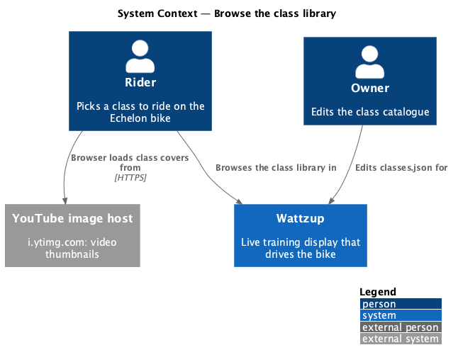
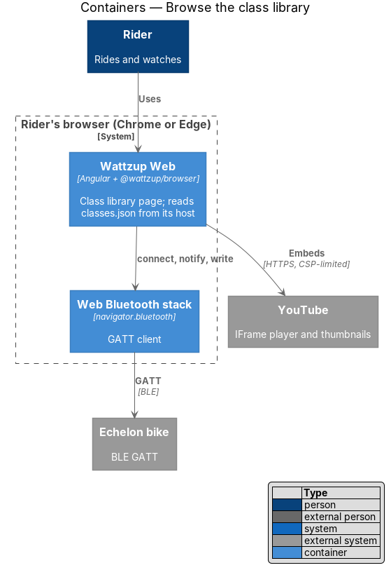
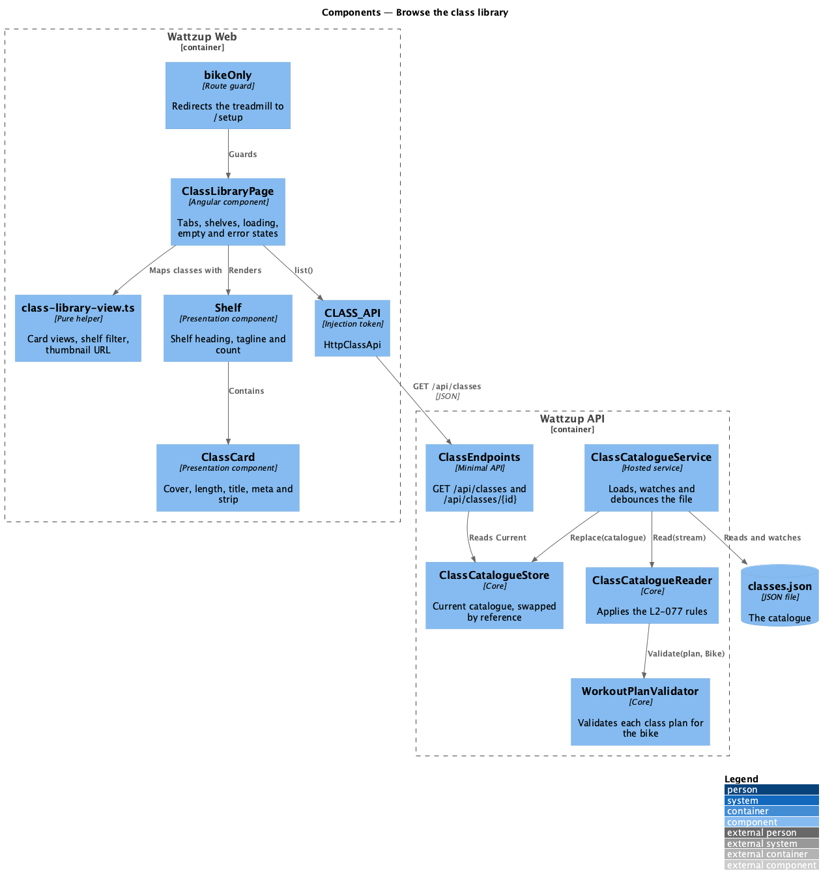
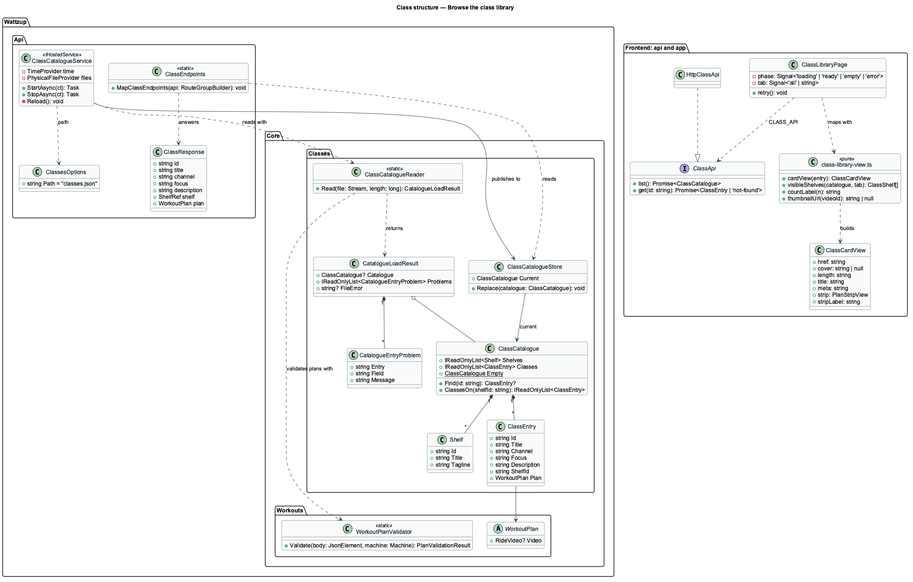
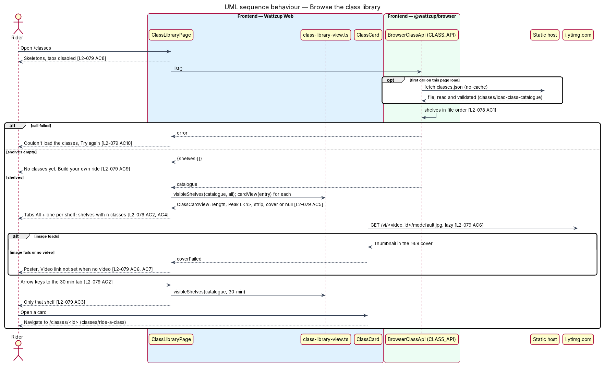
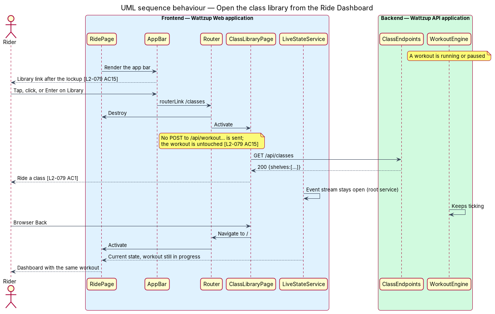

# Browse the class library

## Overview

Riders follow YouTube bike classes, and each class pairs with a ride: a warm-up, intervals or a steady level, a cool-down, levels and cadence aims, and the point in the video where the ride starts. This feature keeps those classes as data and shows them to the rider as shelves of video covers (L1-014, ADR 0014). The owner adds, changes or removes a class by replacing one JSON file beside `index.html`, with no rebuild. The library is where the rider lands after ending a ride too short to save (L2-051, L2-058), and the Ride Dashboard links to it from its app bar at any time, a ride in progress included (L2-079 criterion 15).

**class** — catalogue entry that pairs a bike plan with the YouTube video it follows, filed on one shelf

**catalogue** — JSON file `classes.json` of shelves and classes, published beside `index.html` and read by the page (`classes/load-class-catalogue`)

**shelf** — group of classes that the catalogue defines, with an id, a title and a tagline, shown in file order

**class library** — page at `/classes` that shows the shelves as tabs and cards

**cover** — image on a class card: the YouTube thumbnail built from the class's `video_id`, or the bundled poster when the class has no video or the thumbnail fails

The catalogue is read-only. No screen writes it, and a ride never depends on it: riding a class starts the ordinary `WORKOUT_API.start` (`classes/ride-a-class`). One malformed class cannot take the library down. The reader skips it with a warning and offers the rest (L2-077 criteria 3 to 6).

The feature extends existing designs:
- `platform/build-and-host` allows `img-src https://i.ytimg.com` for covers (L2-097 criterion 2, ADR 0014).
- `classes/load-class-catalogue` reads and validates the catalogue and implements `CLASS_API`.
- `dashboard/dialogs-and-notifications` sends the rider to `/classes` instead of `/setup` after a ride too short to save.
- `platform/host-and-structure` gains the route and the components.
- `dashboard/responsive-accessible-layout` gains the `Library` link in the ride app bar (`AppBar`), the dashboard's entry point to the library, and its place in the Tab order.

The class page at `/classes/:id` belongs to `classes/ride-a-class`.

## Description

### Catalogue and contract

- The catalogue file, its rules, its reader and `BrowserClassApi` are described in `classes/load-class-catalogue` (L2-077, L2-096).
- **`ClassApi`** (`frontend/projects/api/src/lib/class-api.ts`) — `list(): Promise<ClassCatalogue>` and `get(id): Promise<ClassEntry | 'not-found'>`, behind the token `CLASS_API` (L2-078). `ClassCatalogue`, `ClassShelf` and `ClassEntry` are contract types in `src/contract/schema.d.ts`. `app.config.ts` binds the token to `BrowserClassApi`.
- **`frontend/public/classes.json`** — the default catalogue: 9 shelves by length (`15-min`, `20-min`, `25-min`, `30-min`, `35-min`, `40-min`, `45-min`, `60-min`, `60-min-endurance`), the 6 classes of `docs/mocks/README.md` (only *30 Minute HIIT Cardio* has a video, `QUoToFsMNig`, start 3), and one class per indoor training session in the GCN Training channel's workout playlists (185 videos, the *with music* version where a session has two), each with its video and the point where the session's 0:00 starts. Each plan follows the session's breakdown from the video description or, where there is none, its spoken cues; effort *e*/10 is level 8 + 1.6 × *e*, rounded. A session with more changes than an `intervals` plan holds (10 sets, 30 efforts) has its closest neighbouring steps merged, time-weighted. With 191 classes the file is about 250 KB.

### App and components

**Presentation components (`frontend/projects/components/`).** These follow `docs/mocks/pages/class-library/*` and keep the mocks' BEM blocks.
- **`Shelf`** (`shelf/`, `wz-shelf`, new) — a `section` labelled by its heading. It shows the title, the tagline and the count, with the cards in a list. Inputs: `title`, `tagline`, `count`.
- **`ClassCard`** (`class-card/`, `wz-class-card`, new) — one link (`<a class="class-card">`) to `/classes/<id>`. It contains:
  - `class-card__cover`: a 16:9 box sized before the image loads, holding `` or the `class-card__poster` with the channel;
  - `class-card__length`;
  - `class-card__strip`, the plan's profile bars;
  - `class-card__title` (an `h3`);
  - `class-card__meta`;
  - `class-card__note` `Video link not set` when there is no video.

  Inputs: `view: ClassCardView`. Output: `coverFailed`, which the parent turns into the poster. The card injects nothing (AGENTS.md).

**App (`frontend/projects/wattzup/src/app/`).**
- **`class-library-view.ts`** (`core/`, new, pure, with `class-library-view.spec.ts`):
  - `cardView(entry)` returns `ClassCardView`:
    - `href` `/classes/<id>`;
    - `length` from `formatDuration` of the total of `expandPlan(plan)` (`m:ss`, `h:mm:ss` from one hour);
    - `meta` `<channel> · <focus> · Peak L<n>`, with n the highest segment level;
    - `cover` `https://i.ytimg.com/vi/<video_id>/mqdefault.jpg` or `null`;
    - `profile`, `profileTotal` and `profileLabel` from `previewOf` (`core/ride-preview.ts`), the bars the setup preview draws, so a card and its class page show the same shape.
  - `visibleShelves(catalogue, tab)` returns every shelf for `all`, else the one shelf.
  - `countLabel(n)` returns `1 class` or `<n> classes`.
  - `thumbnailUrl(videoId)` builds the URL only from an 11-character id that matches `[A-Za-z0-9_-]`, else `null`.
- **`ClassLibraryPage`** (`dashboard/class-library-page/`, new, route `classes`, title `Ride a class · Wattzup`):
  - It calls `CLASS_API.list()` once on entry.
  - It holds `phase` (`loading`, `ready`, `empty`, `error`) and `tab` (`all` or a shelf id) in signals. The tab is never stored, so it resets on each visit (L2-079 criterion 3).
  - The heading block reads `Ride a class`, the lead copy and the bike's name, with `Build your own ride` linking to `/setup` (criterion 1).
  - The tab list reuses the `view-switch` pattern of `MainViewTabs`, with `All` and one tab per shelf, a roving `tabindex`, the arrow keys and `aria-selected` (criterion 2). The tabs are disabled while loading.
  - The states are skeletons (criterion 8), `No classes yet` (criterion 9), and `Couldn't load the classes` with `Try again` (criterion 10). The status line of L2-018 shows from the app bar, as on every page (criterion 11).
- **Entry from the Ride Dashboard** (L2-079 criterion 15):
  - `RidePage` (`dashboard/ride-page/ride-page.html`) renders `<wz-app-bar [workout] [view]>`.
  - `AppBar` (`dashboard/app-bar/`, app layer, already imports `RouterLink`) renders `<a class="btn btn--quiet btn--sm app-bar__library" routerLink="/classes"><wz-icon name="grid" size="sm" />Library</a>` right after the lockup and before the divider, so the Tab order is lockup, Library, workout link, then the end group (L2-041). The link has no `aria-label`: its text is its accessible name. `.btn` floors at `--target-comfortable` (44 × 44 px) and the global focus ring applies, so no new style is needed; `.app-bar__library` is a BEM hook with no rule of its own.
  - `Icon` (`components/icon/`) gains the decorative `grid` icon, the frame's `LayoutGrid`.
  - Following the link is plain router navigation to the existing `classes` route. Nothing on `WORKOUT_API` is called: the workout keeps running in the page's `WorkoutEngine`, `LiveStateService` (root-provided) keeps its state, and `RidePage` shows the same workout again when the rider returns to `/`.
- **Grid** — `.shelf__grid` uses one column under 576 px, two from 576 px, three from 992 px and four from 1200 px, with no horizontal scroll. Each card and tab is at least 44 × 44 px with a visible focus ring (criterion 13).

### Screen states

| Mock | State |
|---|---|
| `pages/class-library/default` | 3 shelves with 2 classes each. The GCN card shows its thumbnail; the other five show the poster and `Video link not set` |
| `pages/class-library/filtered` | The `30 min` tab is selected, so only that shelf is shown |
| `pages/class-library/loading` | Skeletons in the default layout, with the tabs disabled |
| `pages/class-library/empty` | `No classes yet`, with `Build your own ride` |
| `pages/class-library/error` | `Couldn't load the classes`, with `Try again` and `Build your own ride` |
| `pages/class-library/disconnected` | The cards with the connection status line of L2-018 |
| `pages/ride/*` | The ride app bar with `Library` after the lockup (L2-079 criterion 15) |

### Acceptance tests

The catalogue reader's and `BrowserClassApi`'s tests are in `classes/load-class-catalogue`.

Playwright (`frontend/e2e/`, Chromium only) serves a test `classes.json` beside `index.html` and answers `https://i.ytimg.com/**` from a fixture image. Page object `e2e/pages/class-library.page.ts`; spec `e2e/class-library.spec.ts`:
- `shows Ride a class with a tab per shelf and every shelf under All` (L2-079 AC1, AC2, AC4)
- `filters to one shelf from its tab and moves between tabs with the arrow keys` (L2-079 AC2, AC3)
- `shows each card's length, title, meta and strip, and opens its class page` (L2-079 AC5)
- `uses the YouTube thumbnail when the class has a video and the poster otherwise` (L2-079 AC6, AC7)
- `falls back to the poster when a thumbnail fails` (L2-079 AC6)
- `shows skeletons, then No classes yet for an empty catalogue` (L2-079 AC8, AC9)

Page object `e2e/pages/ride.page.ts` owns the `Library` link's locator; `e2e/class-library.spec.ts` covers the entry point:
- `opens the class library from the dashboard's Library link by keyboard, leaving the ride untouched` (L2-079 AC15): with a workout running on the fake bike, Tab reaches `Library` straight after the lockup, Enter opens `/classes` with `Ride a class`, and the workout is neither paused nor ended; browser Back shows the same workout on the dashboard.
- `opens the class library from the dashboard's Library link by touch` (L2-079 AC15), with a touch-enabled context.

Unit tests: `class-library-view.spec.ts` covers `cardView` for `hiit`, `intervals` and `flat` plans, `h:mm:ss` from one hour, `countLabel` for 1 and 2, and `thumbnailUrl` for a valid id and a malformed one. The responsive criterion (L2-079 AC13) is covered by the responsive sweep, which runs only when a person asks.

### Open questions

- **Default catalogue updates.** A new Wattzup release ships its own `classes.json`. An owner who replaced it on the host has to replace it again after deploying a new build. The README should say so.
- **Leaving a ride for the library.** The updated Ride Dashboard frame pauses the ride after 30 s and asks to save or discard it before opening the library. L2-079 criterion 15 keeps the link a plain navigation instead (mocks open question 19). The frame's flow needs a requirement for saving a ride that has not ended.
- **Way back to the ride.** The library's lockup links to `/classes`, so during a ride the rider returns to the dashboard with browser Back. A `Back to your ride` link on the library is <TO SUPPLY> by the design.
- **Thumbnail size.** `mqdefault.jpg` (320 × 180) is the 16:9 thumbnail. Wide desktop cards may look soft. A larger size (`hqdefault.jpg` is 4:3, letterboxed) needs a design decision.

## Requirements

| L2 ID | Refines (L1) | Requirement |
|-------|--------------|-------------|
| `L2-077` | `L1-014` | Class catalogue. A class is a bike plan with the YouTube video it follows. The catalogue of classes is a JSON file, `classes.json` beside `index.html`; invalid classes are left out with a warning, an unreadable file gives an empty catalogue, and a replaced file is read on the next load. |
| `L2-078` | `L1-005` | Class contract. `CLASS_API.list()` and `CLASS_API.get(id)` offer the catalogue, with not-found for an unknown id. |
| `L2-079` | `L1-014` | Class library page. `/classes` shows the catalogue as shelves of cards, with a tab per shelf, covers from YouTube thumbnails or the bundled poster, and loading, empty, error and disconnected states. Criterion 15: the Ride Dashboard shall show a `Library` link after the lockup, opened by touch, click or Enter, that opens `/classes` and changes nothing about the workout. |
| `L2-097` | `L1-009` | Security and privacy. Criterion 2: a Content-Security-Policy that allows only same-origin scripts, styles and connections, with three exceptions for YouTube (ADR 0012): `frame-src https://www.youtube-nocookie.com` and `script-src https://www.youtube.com` (the IFrame player API) for the ride-along video, and `img-src https://i.ytimg.com` for class covers (L2-079). |
| `L2-040` | `L1-011` | Responsive layout. The library's grid, tabs and cards follow the breakpoints of L2-079 criterion 13. |
| `L2-041` | `L1-011` | Accessibility. Tabs, cards and covers meet the keyboard, focus and text-alternative rules of L2-079 criteria 2, 5, 6 and 13; criterion 1 lists the dashboard's `Library` link, reached with Tab after the lockup (L2-079 criterion 15). |

## Diagrams

### System context

The rider browses classes in Wattzup, and the owner replaces the catalogue file that Wattzup reads. The rider's browser loads the class covers from YouTube's image host.

### Containers

Wattzup Web fetches the catalogue file from its own host. The covers come straight from `i.ytimg.com` into the browser, which is the image origin the Content-Security-Policy allows.

### Components

`BrowserClassApi` fetches the file and reads it through `readCatalogue` (`classes/load-class-catalogue`). `ClassLibraryPage` calls `CLASS_API`, maps classes to card views with `class-library-view.ts`, and renders `Shelf` and `ClassCard`.

### Class structure

`ClassCatalogue` holds shelves and classes, and each `ClassEntry` carries a `WorkoutPlan`. `ClassApi` returns the contract types, and the pure `class-library-view.ts` turns them into the `ClassCardView` that `ClassCard` renders.

### Behaviour — browse the library

The page asks for the catalogue and shows skeletons until it arrives. It then renders a tab per shelf and a card per class. Covers load from YouTube, and a failed cover falls back to the poster. A tab filters to its shelf (L2-079 criteria 2 to 10).

### Behaviour — open the library from the Ride Dashboard

The app bar's `Library` link routes to `/classes`. Nothing on `WORKOUT_API` is called, so the workout keeps running in the page; going back shows the same workout on the dashboard (L2-079 criterion 15).

