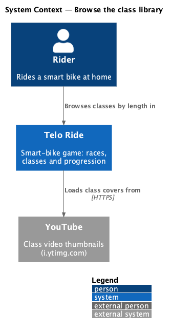
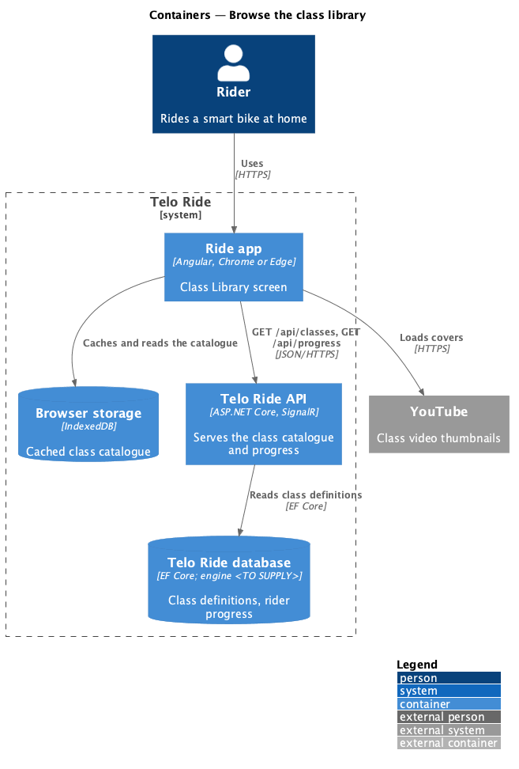
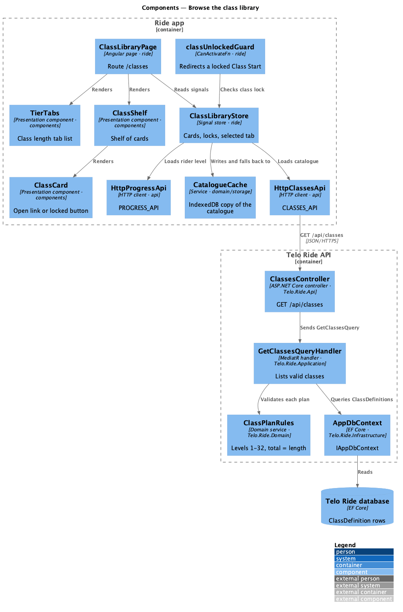
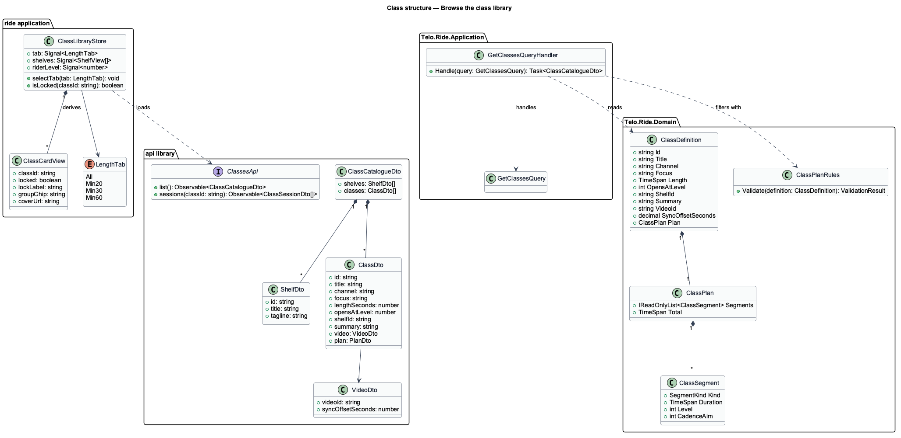
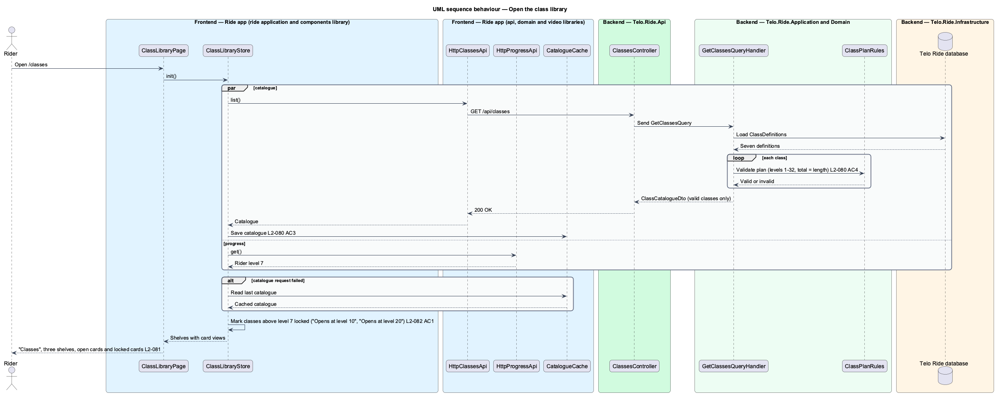
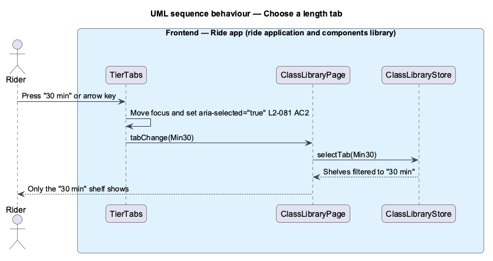
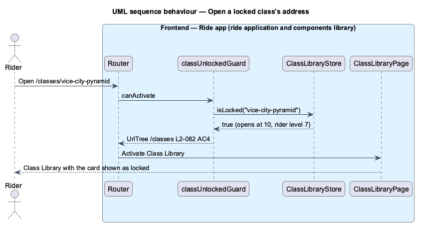

# Browse the class library

## Overview

Telo Ride has two doors: **Race** and **Classes**. This feature is the first screen behind the
Classes door. It lists every class a rider may ride, grouped by length, and shows which classes
the rider's level has not yet opened.

> **class** — catalogue entry pairing a YouTube video with a bike plan that follows it

> **plan** — timed list of segments a ride follows, each with a kind, a duration, a level and a cadence aim

> **sync offset** — video time at which the ride clock's 0:00 starts, for example 0:12.0

> **shelf** — group of classes of one length band (20 min, 30 min, 60 min endurance) with its own title and tagline

> **class tier** — rider level at which a class opens ("Opens at level 10")

The catalogue is data, not code. The backend holds it, validates every class plan and serves
only valid classes. The Ride app caches the catalogue so the library still reads without a
network (`L2-135`). The rider's level, which decides the locks, comes from the backend's
progress (`L2-044`); the tier rule itself belongs to the progression subsystem (`L2-043`).

The Class Library lives at `/classes`. An open class card leads to that class's Class Start
(`/classes/:id`, see the *start a class* feature). A locked card is a disabled button and leads
nowhere.

## Description

The slice runs from the library page down to the catalogue rows in the database.

**Frontend — `ride` application**

- **`ClassLibraryPage`** (`wz-class-library-page`, route `/classes`, `loadComponent`) — routed
  page. It reads the catalogue and the rider's level from `ClassLibraryStore` and renders the
  header, the length tabs and one shelf per length band.
- **`ClassLibraryStore`** — signal store provided on the `/classes` route. It loads the
  catalogue through `CLASSES_API` (falling back to `CatalogueCache`), loads the rider's level
  through `PROGRESS_API`, and derives each card's view model: open or locked, the lock label, and
  the next group chip (`L2-083`). It holds the selected tab.
- **`classUnlockedGuard`** — `CanActivateFn` on `/classes/:id`. It redirects a locked class's
  address to `/classes` (`L2-082` AC4).

**Frontend — `components` library**

- **`TierTabs`** (`wz-tier-tabs`) — tab list "Class length" with All, 20 min, 30 min and 60 min.
  It sets `aria-selected="true"` on the chosen tab and moves between tabs with the arrow keys.
- **`ClassShelf`** (`wz-class-shelf`) — one shelf: title, tagline and a grid of cards (one column
  on a phone, two at sm, three at lg).
- **`ClassCard`** (`wz-class-card`) — one class: cover, group chip "Group in {m} min · {n}/10",
  length, resistance profile, title and "{channel} · {focus}". Open, it renders a link; locked,
  it renders a disabled button with a lock and "Opens at level {n}" and no chip. Both branches
  share one `ng-template` for their content slots.
- **`ClassProfile`** (`wz-class-profile`) — small resistance profile drawn from the plan's
  segments.

**Frontend — `api` and `domain` libraries**

- **`ClassesApi`** / `CLASSES_API` / **`HttpClassesApi`** — contract, token and HTTP client for
  `GET /api/classes`. Returns `ClassDto[]` and the shelves.
- **`ClassDto`** — id, title, channel, focus, length in seconds, opens-at level, shelf id,
  summary, `VideoDto { videoId, syncOffsetSeconds }` and `PlanDto`.
- **`ProgressApi`** / `PROGRESS_API` — owned by the progression subsystem; this slice reads only
  the rider level.
- **`CatalogueCache`** (`domain/storage`) — keeps the last catalogue in IndexedDB for offline
  reading.

**Backend**

- **`ClassesController`** (`Telo.Ride.Api`) — `GET /api/classes`. It sends one
  `GetClassesQuery`.
- **`GetClassesQueryHandler`** (`Telo.Ride.Application`) — reads `ClassDefinition` rows through
  `IAppDbContext`, keeps those that pass `ClassPlanRules`, orders them by shelf and catalogue
  order, and maps them to `ClassDto`.
- **`ClassDefinition`** (`Telo.Ride.Domain`) — catalogue entry: id, title, channel, focus,
  length, opens-at level, shelf, summary, YouTube video id, sync offset and plan.
- **`ClassPlanRules`** (`Telo.Ride.Domain`) — validates a class plan: every segment level is 1
  to 32 and the plan's total equals the class length (`L2-080` AC4). An invalid class is left out
  of the listing and logged by id.
- **`CatalogueSeeder`** (`Telo.Ride.Infrastructure`) — idempotent seed run by the migration CLI
  command. It writes the seven classes of `L2-080` AC1 as `ClassDefinition` rows, so a catalogue
  change ships without a change to app code. The seed's source file and format are
  `<TO SUPPLY>`; ADR 0014 placed the catalogue in a file read by the backend before the backend
  had a database, and an ADR settles whether the file or the database is authoritative.

The cover image URL is built from the validated video id
(`https://i.ytimg.com/vi/<videoId>/mqdefault.jpg`, ADR 0014), never from a submitted link.

## Requirements

| L2 ID | Refines (L1) | Requirement |
|-------|--------------|-------------|
| `L2-080` | `L1-014` | The catalogue shall hold, in order, 20 Minute Power Intervals, 20 Min Threshold Builder, 30 Minute HIIT Cardio, 30 Min Tempo Paceline, 30 Min Vice City Pyramid, 60 Min Dolomites Endurance and 60 Min Coastal Endurance + Surges, each with its channel, focus, length and opening level. Each class shall have a YouTube video, a sync offset, a summary and a plan whose length matches the class. The catalogue shall come from the backend and be cached for offline reading. A class whose segment levels fall outside 1 to 32, or whose plan total differs from its length, shall not be listed. |
| `L2-081` | `L1-014` | The Class Library at `/classes` shall read "Classes" and "Ride a video alone whenever you like, or join a group of 8–10 riders. The bike follows the class either way." The "Class length" tabs (All, 20 min, 30 min, 60 min) shall mark the chosen tab `aria-selected="true"`, show only its shelf ("All" shows every shelf) and move with the arrow keys. The shelves shall read "20 min" / "Short and sharp — fits a lunch break.", "30 min" / "Structured intervals with a proper warm-up." and "60 min endurance" / "Long aerobic rides. Steady legs, steady heart." An open card shall link to its Class Start and show the cover, "Group in {m} min · {n}/10", the length, a resistance profile, the title and "{channel} · {focus}". Cards shall be one column on a phone, two at sm and three at lg. |
| `L2-082` | `L1-014` | For the mid rider (level 7), 30 Min Vice City Pyramid and 60 Min Dolomites Endurance shall read "Opens at level 10" and 60 Min Coastal Endurance + Surges "Opens at level 20"; for the new rider (level 1), 30 Min Tempo Paceline shall also read "Opens at level 5". A locked card shall be a disabled button with a lock and no group chip. A locked class's Class Start address shall open the Class Library instead. |

## Diagrams

### System context

The rider browses classes in Telo Ride. The library shows YouTube thumbnails as covers; it plays
no video.

### Containers

The Ride app reads the catalogue from the Telo Ride API, which reads it from the Telo Ride
database. The app keeps a copy in browser storage for offline reading.

### Components

`ClassLibraryPage` renders the presentation components from `ClassLibraryStore`, which combines
the catalogue from `CLASSES_API` with the rider level from `PROGRESS_API`. On the backend,
`ClassesController` sends `GetClassesQuery`, whose handler filters classes through
`ClassPlanRules`.

### Class structure

`ClassLibraryStore` builds one `ClassCardView` per `ClassDto`, deciding open or locked from the
rider level. On the backend, `ClassDefinition` holds a `ClassPlan` of `ClassSegment`s that
`ClassPlanRules` validates.

### Behaviour — open the library

The store requests the catalogue and the progress in parallel. The backend lists only valid
classes (`L2-080` AC4). A failed request falls back to the cached catalogue (`L2-080` AC3).
Locks follow the rider level (`L2-082`).

### Behaviour — choose a length tab

The tab list is local state: choosing a tab, by pointer or arrow key, filters the shelves with no
request (`L2-081` AC2).

### Behaviour — open a locked class's address

`classUnlockedGuard` compares the class's opening level with the rider level and redirects a
locked class to the library (`L2-082` AC4).

