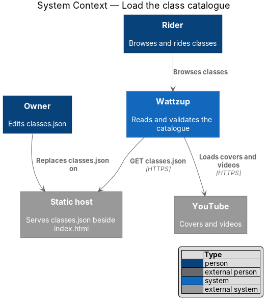
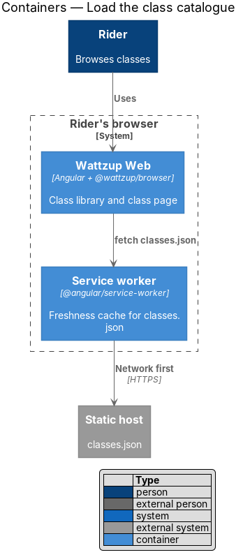
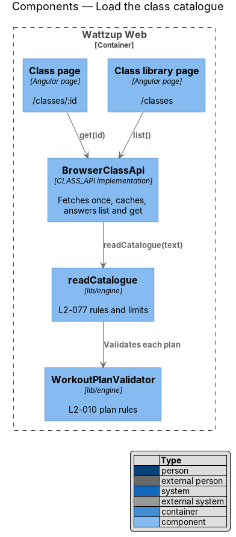
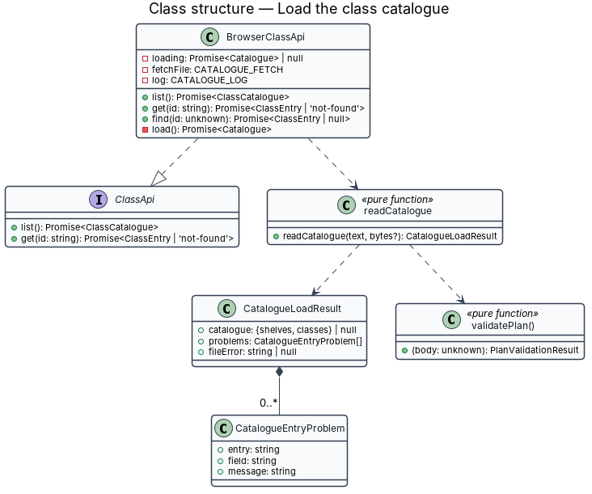
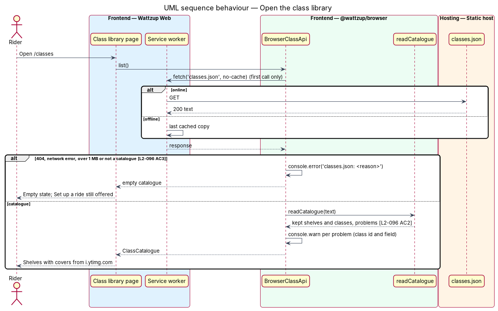

# Load the class catalogue

## Overview

A class is a bike plan with the YouTube video it follows, listed on a shelf of the class library (ADR 0014). The catalogue file `classes.json` (L2-077) sits beside `index.html` on the static host, and the page fetches and validates it itself before answering `CLASS_API` (L2-078). The owner still changes the classes by replacing 1 file, with no rebuild (L2-096).

**catalogue** — the JSON file of shelves and classes whose fields and limits L2-077 tables

**catalogue reader** — the code that applies L2-077's rules: it keeps valid shelves and classes in file order and leaves out the rest with a named problem

## Description

- **`classes.json` in the build** — the default catalogue is `frontend/public/classes.json`; the build copies it beside `index.html` with the other public assets (L2-096 criterion 1). The owner may replace the deployed file at any time.
- **`ClassCatalogueReader`** (`@wattzup/browser`, `lib/engine/`) — `readCatalogue(text, bytes?): CatalogueLoadResult` (`catalogue`, `problems`, `fileError`). It rejects text over 1 MB or not a JSON catalogue as a whole; it leaves out each shelf or class that breaks a rule of L2-077, with a `CatalogueEntryProblem` naming the `id` (or position), the field and the rule; it keeps the first 20 shelves and 200 valid classes; it keeps only a video's id and start point. It validates each plan with `WorkoutPlanValidator` (L2-096 criterion 2). Its unit tests cover each rule of L2-077, one case per rule.
- **`BrowserClassApi`** (`lib/contracts/`) — implements `CLASS_API`. On first use it fetches `classes.json` through `CATALOGUE_FETCH` relative to the document's base URL with `cache: 'no-cache'`, reads it, logs each problem with `console.warn` naming `classes.json`, the class or shelf and the field (through `CATALOGUE_LOG`), and caches the result for the page's life. `list()` answers the shelves that hold a class, with their classes; `get(id)` answers a class or `not-found` (L2-078 shapes). `find(id)` lets `BrowserWorkoutApi` accept a `class_id` (L2-081 criterion 7): an unknown id is refused with `invalid_workout` (`class_id: No class has that id.`), a known one gives the ride its origin (class id and title) for the saved session. A failed fetch or whole-file rejection logs 1 `console.error` naming `classes.json` and the reason and answers an empty catalogue, so the class library shows its empty state and `/setup` still works (L2-096 criterion 3).
- **Service worker** — caches `classes.json` with a freshness strategy, so an online visit sees the owner's latest file and an offline visit sees the last one fetched (see `platform/build-and-host`).
- **Pages** — the class library and class page are unchanged and behave as L2-079 and L2-080 (L2-096 criterion 4). Covers come from `https://i.ytimg.com`, allowed by the CSP. Every text field is bound as text.
- A replaced file is read on the next page load (L2-077 criterion 7).

Verification: unit tests of `readCatalogue` per rule; `BrowserClassApi` tests with a fake fetch (shapes, once per page, a warning per class left out, and an empty catalogue for a 404, a network failure, invalid JSON and over 1 MB); Playwright specs (`classes.spec.ts`) that serve a `classes.json` with a valid and an invalid class, start a class's ride from its page, and show the empty library for a missing file with **Build your own ride** still reaching `/setup`.

## Requirements

| L2 ID | Refines (L1) | Requirement |
|-------|--------------|-------------|
| `L2-077` | `L1-014` | Class catalogue. The catalogue shall be a JSON file of shelves and classes with the fields and limits of its table; invalid classes and shelves shall be left out with a warning naming them; a missing or invalid file shall give an empty catalogue; only a video's id and start point shall be kept; text shall be rendered as text. |
| `L2-096` | `L1-014` | Loading the class catalogue. The catalogue shall be read from `classes.json` beside `index.html`, replaceable without a rebuild, with the default build shipping the catalogue of L2-077; it shall be validated by L2-077's rules and limits in the browser, leaving out invalid entries and naming them in the console; a missing or invalid file shall show the library's empty state with rides from `/setup` still working; the library and class pages shall behave as L2-079 and L2-080. |

## Diagrams

### System context

The owner publishes `classes.json` with the static files. The rider's browser fetches it and loads covers and videos from YouTube.

### Containers

The service worker passes the fetch to the host or answers from its cache. The app reads and validates the file.

### Components

The class pages call `CLASS_API`. `BrowserClassApi` fetches the file once and hands it to `readCatalogue`, which uses `WorkoutPlanValidator`.

### Class structure

`readCatalogue` turns text into a `CatalogueLoadResult` of the kept catalogue, its problems and any file error. `BrowserClassApi` caches the result.

### Behaviour — open the class library

The first call fetches and reads the file; invalid entries are left out and named; a missing file gives the empty state (L2-096).

