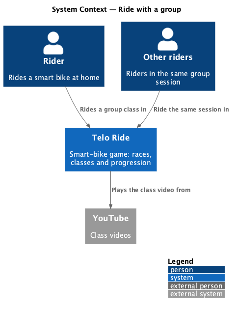
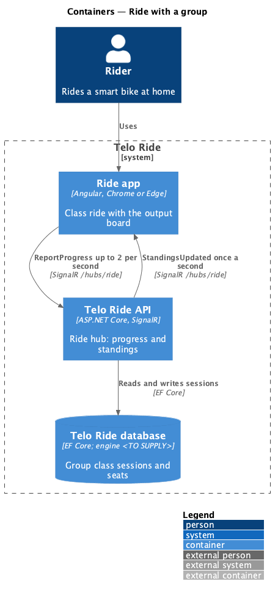
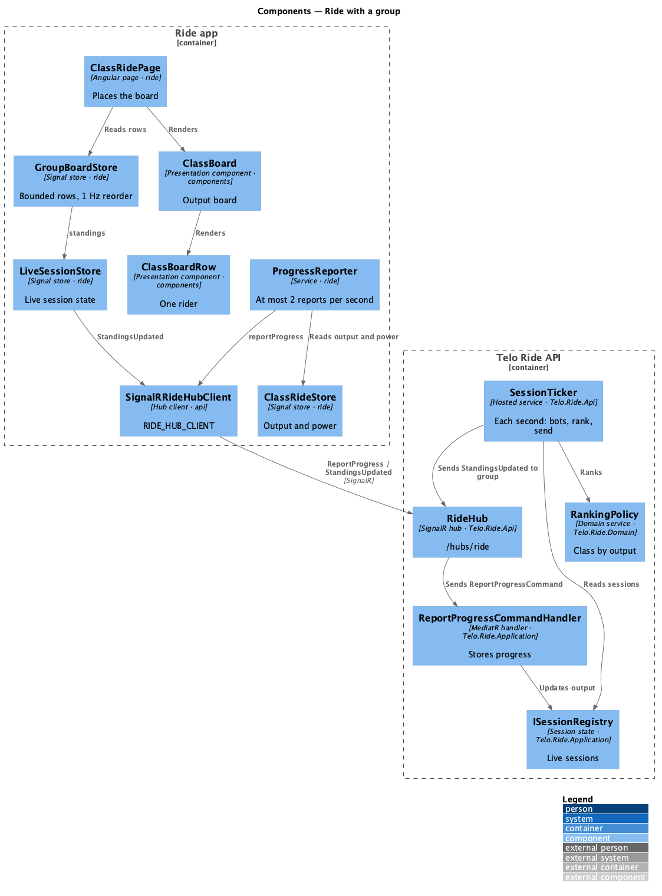
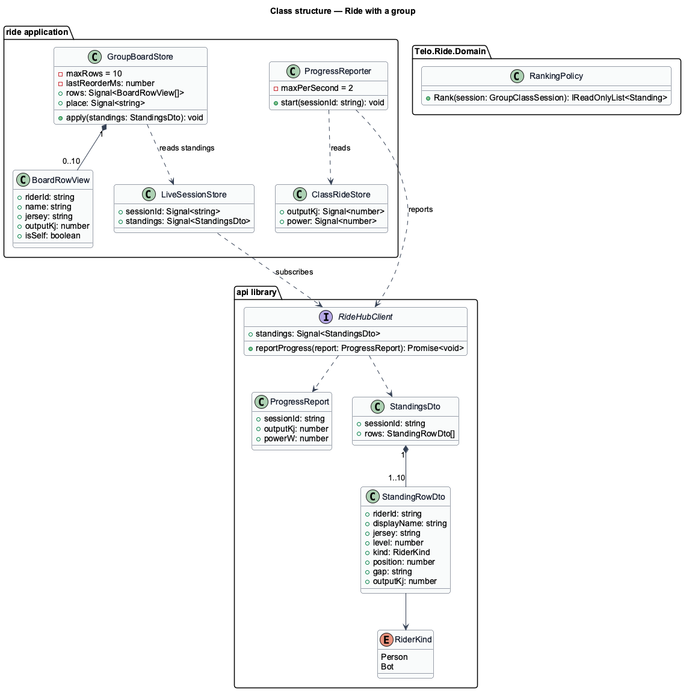
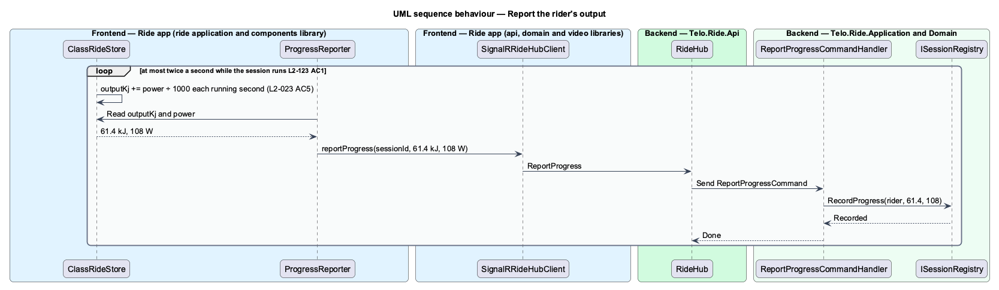
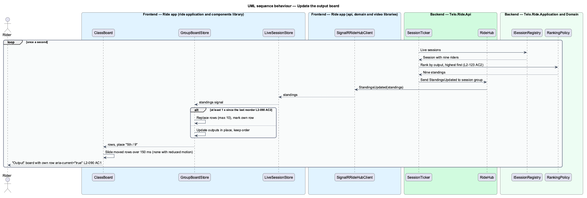

# Ride with a group

## Overview

A group class ride is a class ride shared with up to nine other riders in one group session.
Everyone rides the same video on the same clock. Beside the video, an output board ranks the
field by the energy each rider has put out, so heavier gears count.

> **output** — mechanical energy the rider has produced in the ride, in kilojoules (kJ), the sum of each running second's power ÷ 1000 (`L2-023` AC5)

> **output board** — live list of every rider in the session ranked by output, highest first

> **standings** — ranked list the multiplayer service sends once a second for a session

The board is fed by the multiplayer service, never by the browser's own arithmetic: each client
reports its rider's output and power at most twice a second; the service ranks the field and
sends the standings to everyone once a second (`L2-123`). The ride app only displays what it
receives, with the rider's own row marked.

This slice adds the board to the class ride described in *ride a class*. A solo class ride has no
board and gives the video the full width.

## Description

**Frontend — `ride` application**

- **`LiveSessionStore`** — route-scoped live session state, owned by the multiplayer subsystem.
  It wraps `RIDE_HUB_CLIENT` for the session and exposes the latest standings.
- **`ProgressReporter`** — owned by the multiplayer subsystem. It reads the rider's output and
  power from `ClassRideStore` and sends them through `RIDE_HUB_CLIENT.reportProgress` at most
  twice a second (`L2-123` AC1).
- **`GroupBoardStore`** — signal store provided on `/classes/:id/ride` only in group mode. It
  reads the standings from `LiveSessionStore`, keeps at most 10 rows (a fixed-size
  array replaced on each update, so nothing grows for the length of a ride), and publishes a new
  ordering at most once a second (`L2-090` AC2). It derives the rider's place ("5th / 9").
- **`ClassRideStore`** (see *ride a class*) — accumulates the rider's output in kJ and exposes
  it, with power, to `ProgressReporter`.
- **`ClassRidePage`** — places the board as a right-hand column at lg or wider and under the
  video below lg; in solo it renders no board (`L2-090` AC3–4).

**Frontend — `components` library**

- **`ClassBoard`** (`wz-class-board`) — "Output" heading with the place, and an ordered list of
  rows. It animates a reorder by sliding rows over 150 ms (no movement with reduced motion).
- **`ClassBoardRow`** (`wz-class-board-row`) — rank, jersey dot, display name (rendered as
  text), level and output in kJ. The rider's row carries `aria-current="true"`.

**Frontend — `api` library**

- **`RideHubClient`** / `RIDE_HUB_CLIENT` / **`SignalRRideHubClient`** — owned by the
  multiplayer subsystem. This slice uses `reportProgress(ProgressReport)` and the
  `standings` signal fed by the `StandingsUpdated` server event.
- **`StandingsDto`** — session id and rows of display name, jersey, level, kind (person or bot),
  position, gap and output.

**Backend** (multiplayer subsystem, *share progress and standings*)

- **`RideHub.ReportProgress`** sends one `ReportProgressCommand`.
- **`ReportProgressCommandHandler`** updates the rider's progress in the live session held by
  `ISessionRegistry`.
- **`SessionTicker`** — hosted service that, once a second, moves the bots on the pace model,
  asks `RankingPolicy` to rank each session (a class by output, `L2-123` AC2) and sends
  `StandingsUpdated` to the session's group.
- **`RankingPolicy`** (`Telo.Ride.Domain`) — orders a race by distance then finish time and a
  class by output.

## Requirements

| L2 ID | Refines (L1) | Requirement |
|-------|--------------|-------------|
| `L2-090` | `L1-015` | A group class ride's board shall read "Output" with the rider's place ("5th / 9") and list every rider by output in kJ, highest first, with the rider's row carrying `aria-current="true"`. When outputs change, the board shall reorder at most once a second, with rows sliding over 150 ms. At lg or wider the board shall be a right-hand column; below lg it shall sit under the video. A solo class ride shall have no board, and the video shall take the full width. |

## Diagrams

### System context

Riders in one group session ride the same class in Telo Ride and see each other on the board.

### Containers

Each Ride app reports progress to the Telo Ride API's ride hub and receives the standings from
it. Session state lives in the API process and the database.

### Components

`ProgressReporter` sends the rider's progress through the hub client; `LiveSessionStore` receives
the standings and `GroupBoardStore` turns them into rows for `ClassBoard`. On the backend,
`SessionTicker` ranks each session through `RankingPolicy`.

### Class structure

`GroupBoardStore` holds a bounded list of `BoardRowView`s built from the `StandingsDto` that
`LiveSessionStore` holds. `ProgressReporter` carries `ProgressReport` up through the hub contract.

### Behaviour — report the rider's output

The class ride sends output and power at most twice a second (`L2-123` AC1).

### Behaviour — update the output board

The service ranks by output and sends the standings once a second. The store reorders at most
once a second, and the board slides rows over 150 ms (`L2-090` AC1–2).

