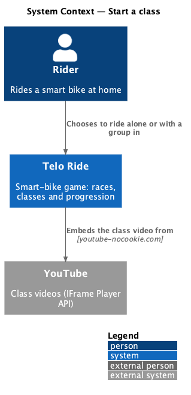
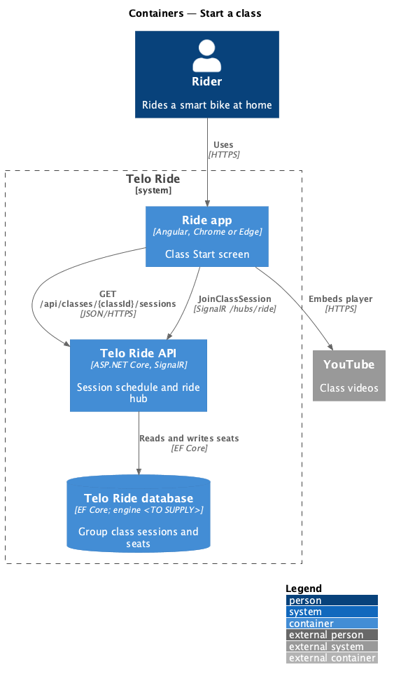
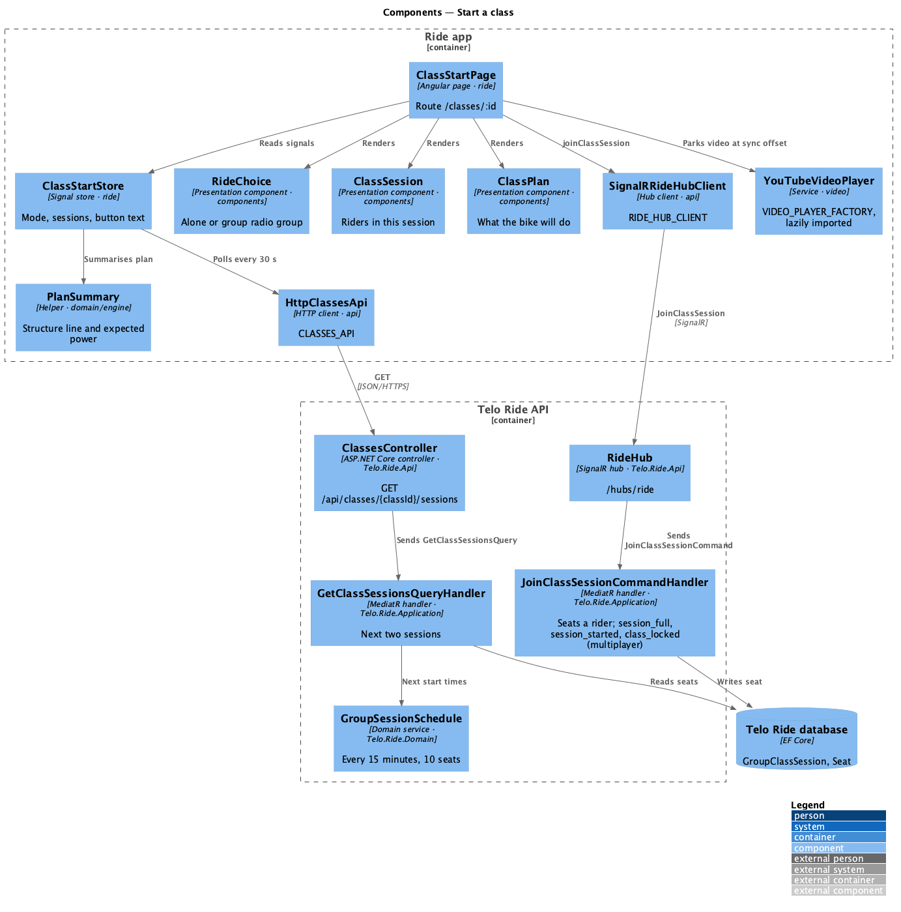
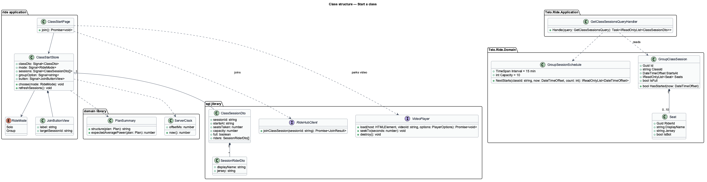
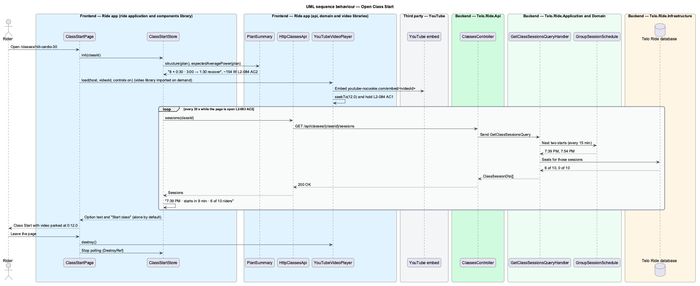
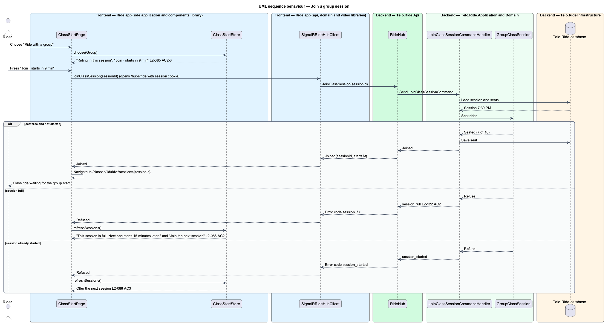
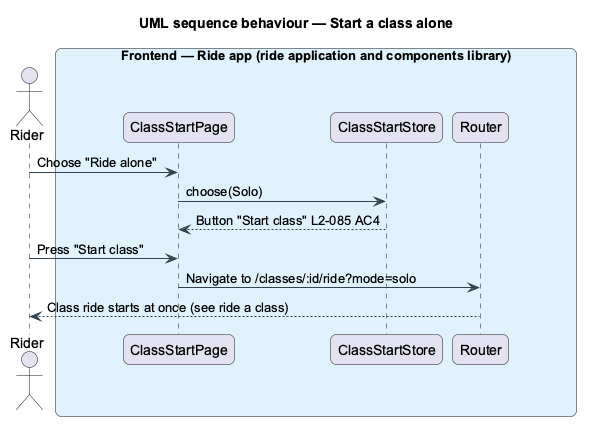

# Start a class

## Overview

Class Start is the screen between the Class Library and the class ride. It lives at
`/classes/:id`. It shows the class video parked at its start, says what the bike will do, and
asks one question: ride alone now, or join the next group session.

> **group session** — one live run of a class shared by up to 10 riders who start together on the server's clock

> **seat** — place in a group session held by a rider or, at the start, by a bot

> **sync offset** — video time at which the ride clock's 0:00 starts, for example 0:12.0

> **resistance profile** — chart of the plan's segment levels over the class length

The backend schedules a group session for every open class every 15 minutes. A session seats up
to 10 riders; at its start, bots fill the empty seats so every group rides ten strong
(`L2-083`, `L2-122`). Riding alone needs no server: the class ride starts at once and may pause.
Riding with a group joins a session through the ride hub, which the multiplayer subsystem owns
(see *run a group class session*).

A locked class never reaches this screen: `classUnlockedGuard` (see *browse the class library*)
redirects its address to the library.

**Slices.** Slice 6.3 builds the page for riding alone: the header, the video parked at the
sync offset, the class facts, "What the bike will do" with `PlanSummary`, the "Video link and
sync" disclosure, "How do you want to ride?" with "Ride alone" chosen and Start class, and
`classUnlockedGuard`. Until the schedule and the hub exist (slices 14.2 and 14.3), the group
option cannot be chosen and says why (`L2-085` AC5), as it does whenever the sessions cannot be
reached. The session roster, Join and the full and starting-soon states come with them.

## Description

**Frontend — `ride` application**

- **`ClassStartPage`** (`wz-class-start-page`, route `/classes/:id`, `loadComponent`) — routed
  page. It renders the header ("← Classes", Full screen), the parked video, the class facts,
  "What the bike will do", the "Video link and sync" disclosure and "How do you want to ride?".
  At lg it is two columns with the Join button at the foot of the aside (`L2-084` AC4).
- **`ClassStartStore`** — signal store provided on the route. It holds the class (from
  `ClassLibraryStore`'s catalogue or `CLASSES_API`), the chosen ride mode, and the next two group
  sessions. It polls `CLASSES_API.sessions(classId)` every 30 seconds through an RxJS `timer`
  bound to `DestroyRef`, and derives the option text and button label: "Join · starts in 9 min",
  "Join now · starting", "Join the next session" or "Start class".
- **`ClassJoinFlow`** — orchestration in the page. Alone, it navigates to
  `/classes/:id/ride?mode=solo`. Group, it calls `RIDE_HUB_CLIENT.joinClassSession` and, on
  success, navigates to `/classes/:id/ride?session={sessionId}`. On `session_full` or `session_started`, it reloads the sessions and offers the next one (`L2-086`).

**Frontend — `components` library**

- **`ClassStartVideo`** (`wz-class-start-video`) — host for the parked player, with a poster
  until the player is ready.
- **`ClassPlan`** (`wz-class-plan`) — "What the bike will do": total length, a `ClassProfile`
  (`role="img"`, "Resistance profile") and the structure line.
- **`ClassSync`** (`wz-class-sync`) — "Video link and sync" disclosure, collapsed by default
  (`aria-expanded="false"`), showing the link and the offset.
- **`RideChoice`** (`wz-ride-choice`) with **`RideOption`** — radio group "How do you want to
  ride?" with "Ride alone" and "Ride with a group".
- **`ClassSession`** (`wz-class-session`) — "Riding in this session" list of riders with
  jersey colour dots (`ClassDot`), or "Next session" when the next one is full.

**Frontend — `api`, `domain` and `video` libraries**

- **`ClassesApi.sessions(classId)`** — `GET /api/classes/{classId}/sessions`, returning
  `ClassSessionDto[]`: session id, start as server time, seats taken, capacity, riders (display
  name and jersey) and whether it is full.
- **`RideHubClient`** / `RIDE_HUB_CLIENT` — hub client owned by the multiplayer subsystem. This
  slice calls `joinClassSession(sessionId)`. The connection opens only here, when the rider
  joins (`L2-120` AC4).
- **`PlanSummary`** (`domain/engine`) — pure helper. It turns a plan into the structure line
  "8 × 0:30 · 3:00 → 1:30 recover" and the expected average power "~154 W average", using
  `PowerModel` (`L2-023` AC3). The custom workout preview uses the same helper.
- **`VideoPlayer`** / `VIDEO_PLAYER_FACTORY` — contract and token in `api`. The implementation,
  **`YouTubeVideoPlayer`**, sits in a lazily imported `video` library. It loads the YouTube
  IFrame API on demand, embeds `https://www.youtube-nocookie.com/embed/<videoId>`, and here
  parks the video at the sync offset with its controls shown (ADR 0012). The `video` library
  depends on `api` only; the change that adds it adds it to the dependency rule and the ESLint
  boundaries.
- **`ServerClock`** (`domain/engine`) — offset between the device clock and the server's,
  measured by the hub client. It turns a session's server start time into whole minutes left.

**Backend**

- **`ClassesController`** — `GET /api/classes/{classId}/sessions` sends one
  `GetClassSessionsQuery`.
- **`GetClassSessionsQueryHandler`** — asks `GroupSessionSchedule` for the next two session
  start times and reads their seats from `GroupClassSession` rows.
- **`GroupSessionSchedule`** (`Telo.Ride.Domain`) — one session every 15 minutes per open class,
  10 seats each (`L2-083` AC1).
- **`JoinClassSessionCommandHandler`** — reached through `RideHub.JoinClassSession`; owned by
  the multiplayer subsystem. It refuses a full session with `session_full` (`L2-122` AC2), a
  started one with `session_started` (`L2-086` AC3) and a class above the rider's level with
  `class_locked`.

## Requirements

| L2 ID | Refines (L1) | Requirement |
|-------|--------------|-------------|
| `L2-083` | `L1-014` | Each open class shall have a group session every 15 minutes, each seating up to 10 riders. The next session's chip shall read the whole minutes to its start and the seats taken ("Group in 9 min · 6/10") and update at least every 30 seconds. A session that starts with fewer than 8 riders online shall have bots fill its seats up to 10. |
| `L2-084` | `L1-014` | Class Start at `/classes/:id` for 30 Minute HIIT Cardio shall show "← Classes" and Full screen; the video player parked at the sync offset (0:12.0) with its controls; "GCN Training · 30 min · HIIT", the title and "Eight 30-second maximal efforts with a recovery that shrinks each round. The classic.". "What the bike will do" shall read "30:00", a resistance profile (`role="img"`, "Resistance profile") and "8 × 0:30 · 3:00 → 1:30 recover · ~154 W average". "Video link and sync" shall show the link and offset when expanded and be collapsed by default (`aria-expanded="false"`). At lg or wider it shall be two columns with the Join button at the foot of the aside. |
| `L2-085` | `L1-014` | "How do you want to ride?" shall be a radio group of "Ride alone" ("Start now. Pause whenever you like.") and "Ride with a group" ("7:39 PM · starts in 9 min · 6 of 10 riders"). With the group chosen, the aside shall list "Riding in this session" with each rider's name and jersey colour and "Everyone rides the same video in sync. The board ranks riders by output, so heavier gears count.", and the button shall read "Join · starts in 9 min" and join the session. With alone chosen, the button shall read "Start class" and start the class ride at once. |
| `L2-086` | `L1-014` | When the next session starts within a minute, the group option shall read "starts in 1 min" and the button "Join now · starting". When it is full, the option shall read "This session is full. Next one starts 15 minutes later.", the section "Next session" with "7:54 PM · 2 of 10 riders so far", and the button "Join the next session". A join to a session that has started shall be refused and Class Start shall offer the next session. |

## Diagrams

### System context

The rider starts a class in Telo Ride, which plays the class video from YouTube.

### Containers

The Ride app reads the session schedule over HTTPS and joins a session over the ride hub's
SignalR connection. The Telo Ride API keeps sessions and seats in the database.

### Components

`ClassStartPage` renders from `ClassStartStore`, which polls the sessions and builds the option
and button text. Joining goes through `RIDE_HUB_CLIENT` to `RideHub`. The parked video comes from
`VIDEO_PLAYER_FACTORY`.

### Class structure

`ClassStartStore` holds a `RideMode` and the next `ClassSessionDto`s and derives a
`JoinButtonView`. On the backend, `GroupSessionSchedule` produces the session times that
`GetClassSessionsQueryHandler` combines with `GroupClassSession` seats.

### Behaviour — open Class Start

The page parks the video at the sync offset, summarises the plan, and polls the schedule every
30 seconds while it is open (`L2-083` AC2, `L2-084`).

### Behaviour — join a group session

The hub connection opens when the rider joins. A full or started session is refused, and the
page offers the next session (`L2-085` AC3, `L2-086`).

### Behaviour — start alone

Riding alone needs no request: the page navigates to the class ride in solo mode (`L2-085` AC4).

## Open questions

- **HIIT's offset and work level.** Slice 6.1 took 30 Minute HIIT Cardio's sync offset (3 s)
  and work level (18) from `main`. The specs give 0:12.0 (`L2-080`, `L2-084`, `L2-088`) and the
  GCN ladder's work level 24 (`L2-096`), which yields the ~154 W of `L2-084` AC2; slice 6.3 set the
  catalogue to them.
- **The browser notices.** The needs-chromium and needs-https states disable Start class with a
  notice. Until they are built, a rider in a browser without Web Bluetooth who presses Start
  class reaches Connect Bike, which explains why (`L2-008`, `L2-009`).
