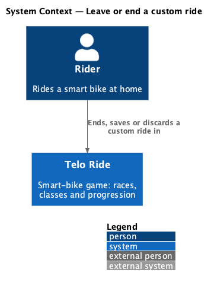
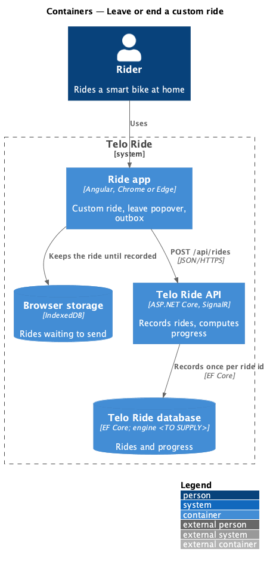
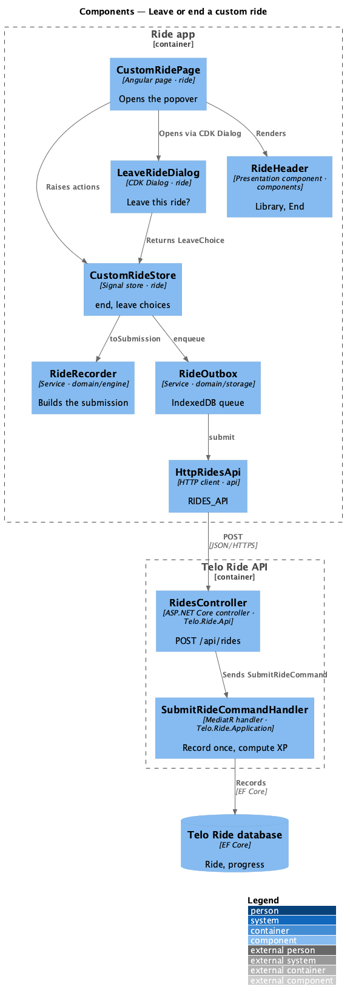
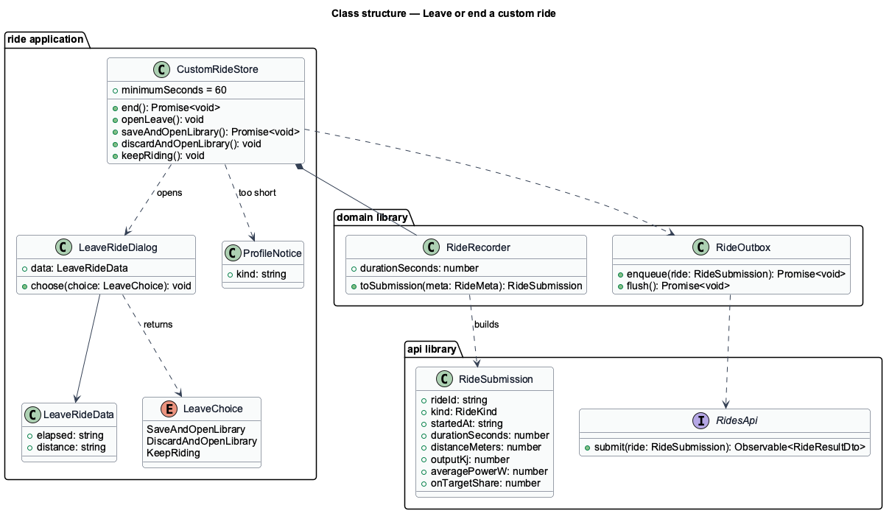
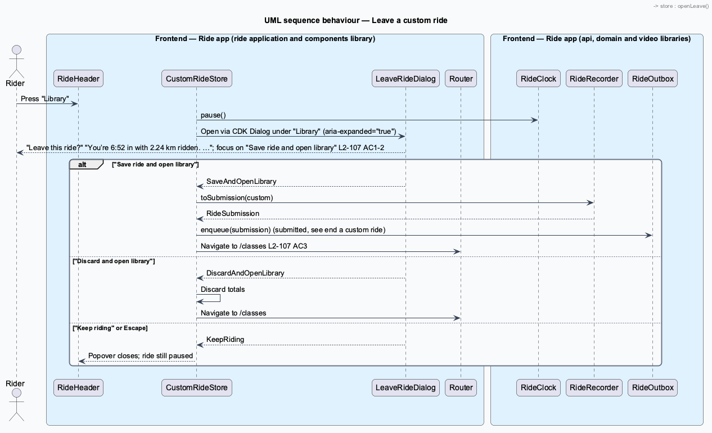
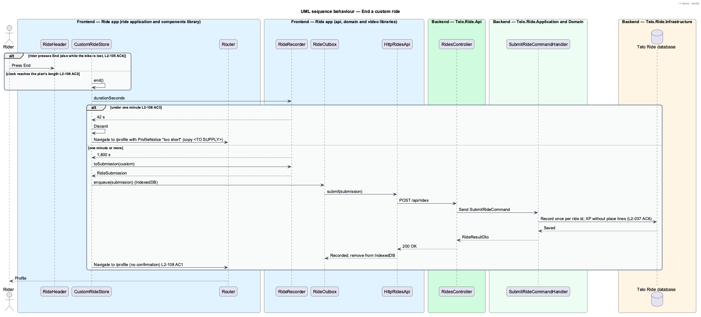

# Leave or end a custom ride

## Overview

A custom ride ends in one of three ways. The rider presses End, which saves and submits the ride
and opens Profile. The plan runs out, which does the same. Or the rider presses "Library", which
pauses the ride and asks "Leave this ride?" with the choice to save it, discard it or keep
riding.

> **ride submission** — record of a finished ride sent to the backend, which records it once per ride id and computes XP and progress from it (`L2-044`)

> **ride outbox** — IndexedDB queue that holds each ride submission until the backend has recorded it (`L2-135`)

> **leave popover** — modal popover (`role="dialog"`, `aria-modal="true"`) opened from "Library" that asks "Leave this ride?"

A ride shorter than one minute is not worth keeping: it is discarded, and Profile says it was too
short to save (`L2-108` AC3). Every saved ride goes through the ride outbox, so a ride ended
without a network is kept and sent when the network returns.

## Description

**Frontend — `ride` application**

- **`CustomRideStore`** (see *ride a custom workout*) — adds `end()`, `openLeave()`,
  `saveAndOpenLibrary()`, `discardAndOpenLibrary()` and `keepRiding()`. `end()` runs on End and
  when the clock reaches the plan's length. It also runs while the bike is lost, saving the ride
  as far as it went (`L2-105` AC4).
- **`LeaveRideDialog`** (`wz-leave-ride-dialog`) — opened by the store's page through CDK
  `Dialog` with a connected overlay position under "Library", so it reads as a popover while
  keeping the dialog's focus trap and `aria-modal="true"`. It reads "Leave this ride?" and "You’re
  6:52 in with 2.24 km ridden. The ride is paused while you decide.", puts initial focus on "Save
  ride and open library", offers "Discard and open library" and "Keep riding", and treats Escape
  as "Keep riding". On a phone it fits within the side margins, at most 20 rem wide. Its BEM
  block is the mock's `ride-leave`.
- **`RideHeader`** — "Library" carries `aria-haspopup="dialog"` and `aria-expanded="true"` while
  the popover is open.

**Frontend — `domain` and `api` libraries**

- **`RideRecorder`** — `toSubmission(meta)` builds the `RideSubmission` (kind `custom`, ride id,
  start time, duration, distance, output, average power, on-target share).
- **`RideOutbox`** (`domain/storage`) — `enqueue` writes the submission to IndexedDB and sends it
  through `RIDES_API`; it removes it once the backend has recorded it and retries otherwise
  (`L2-135`).
- **`RidesApi`** / `RIDES_API` / **`HttpRidesApi`** — `POST /api/rides`, owned by the
  progression subsystem.
- **`ProfileNotice`** — one-shot message the store hands to Profile through router navigation
  state, carrying the "too short to save" notice. Its copy is `<TO SUPPLY>`; `L2-108` AC3 gives
  the meaning, not the words, and no mock draws it.

**Backend** (progression subsystem, *keep progress on the backend*)

- **`RidesController`** → **`SubmitRideCommandHandler`** — records the ride once per ride id,
  checks plausibility (`L2-125` AC2), computes XP (no place or podium line for a custom workout,
  `L2-037` AC6) and returns the result.

## Requirements

| L2 ID | Refines (L1) | Requirement |
|-------|--------------|-------------|
| `L2-107` | `L1-016` | Pressing "Library" in a running custom ride shall pause the ride and open a popover (`role="dialog"`, `aria-modal="true"`) reading "Leave this ride?" and "You’re 6:52 in with 2.24 km ridden. The ride is paused while you decide.", with "Library" showing `aria-expanded="true"`. Focus shall start on "Save ride and open library"; "Discard and open library" and "Keep riding" shall also be offered, and Escape shall act as "Keep riding". "Save ride and open library" shall save and submit the ride and open the Class Library; "Discard and open library" shall open it without saving; "Keep riding" shall close the popover with the ride still paused. On a phone the popover shall fit within the side margins, at most 20 rem wide. |
| `L2-108` | `L1-016` | Pressing End shall save and submit the ride without a confirmation and open Profile. When the clock reaches the plan's length, the ride shall end as by End. A custom ride under one minute shall be discarded when it ends, and Profile shall say it was too short to save. |

## Diagrams

### System context

The rider ends or leaves a custom ride in Telo Ride, which keeps the ride in the rider's history.

### Containers

The Ride app stores each saved ride in browser storage and submits it to the Telo Ride API, which
records it in the database.

### Components

`CustomRideStore` decides save, discard or keep riding; `RideRecorder` builds the submission and
`RideOutbox` delivers it through `RIDES_API`.

### Class structure

`LeaveRideDialog` returns a `LeaveChoice` to `CustomRideStore`. The store turns the recorder's
totals into a `RideSubmission` for the outbox, or discards them.

### Behaviour — leave this ride

"Library" pauses the ride and opens the popover. Each choice saves and leaves, discards and
leaves, or keeps the ride paused (`L2-107`).

### Behaviour — end a custom ride

End, or the end of the plan, saves and submits the ride and opens Profile; a ride under one
minute is discarded instead (`L2-108`).

