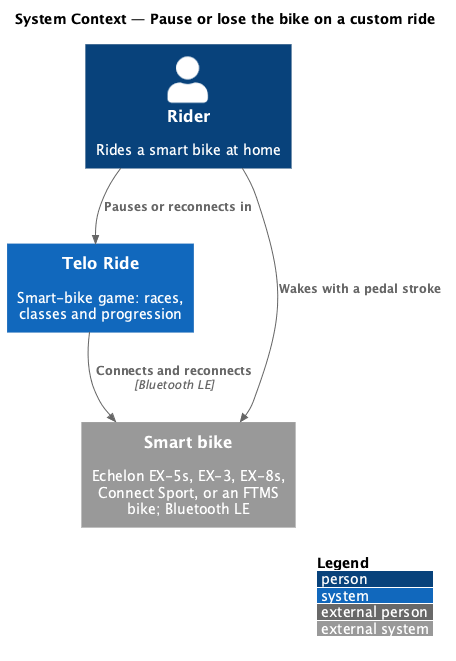
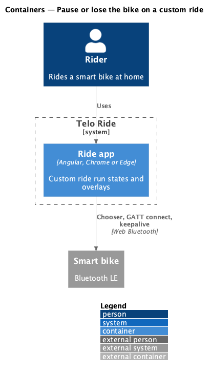
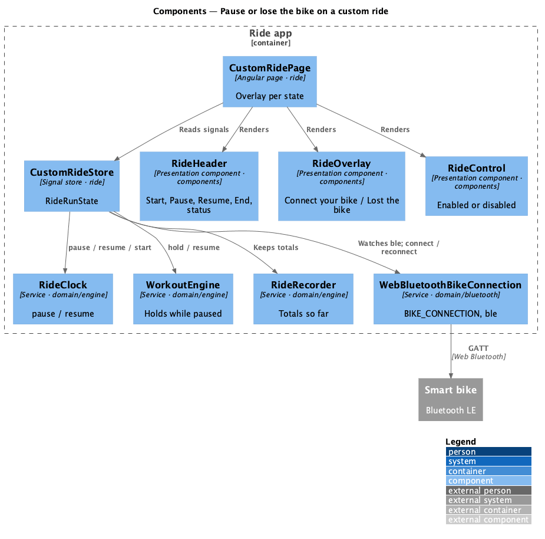
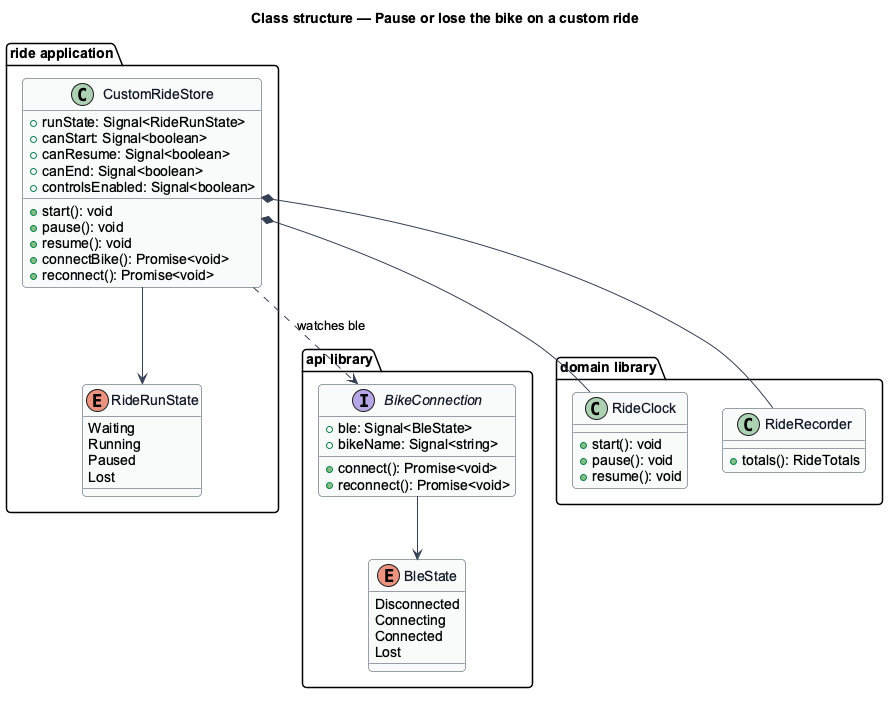
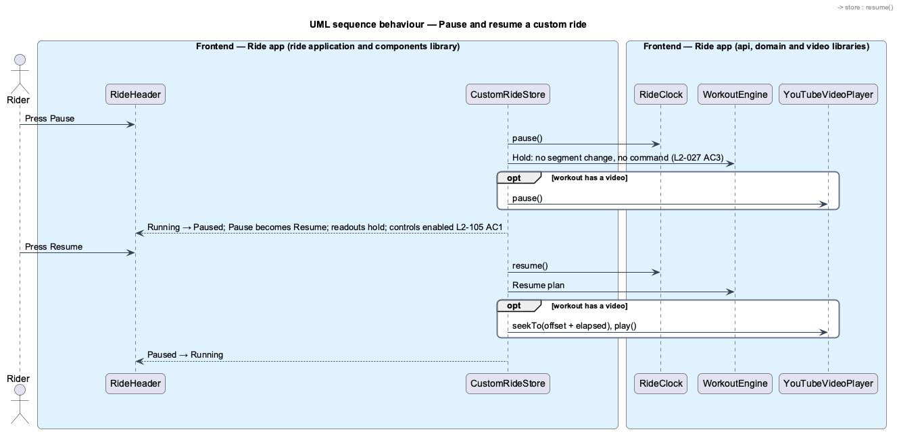
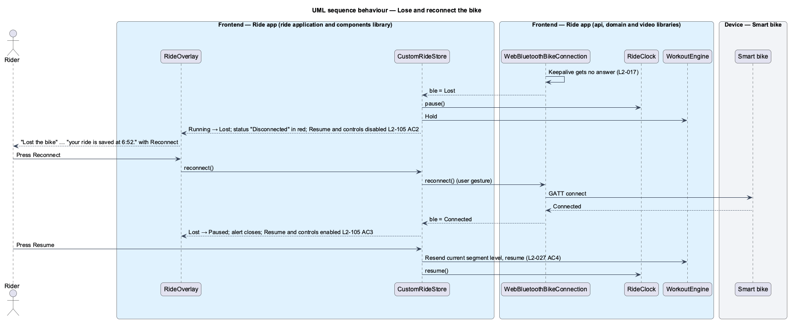
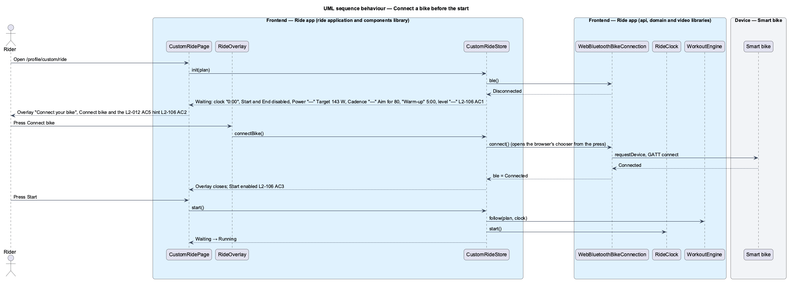

# Pause or lose the bike on a custom ride

## Overview

A custom ride belongs to the rider alone, so it stops whenever they stop. The rider may pause it
at will. If the bike stops answering, the ride pauses on its own and keeps everything ridden so
far. If the rider opens the custom ride with no bike connected, the dashboard waits behind a
"Connect your bike" overlay and starts only once a bike is there.

> **lost bike** — state in which the connected bike has stopped answering (`ble` state `lost`), detected by the bike subsystem (`L2-016`, `L2-017`)

> **no bike** — state in which no bike is connected when the custom ride opens

> **overlay** — panel over the dashboard that explains why the ride cannot run and offers the action that fixes it

A paused or lost ride sends no command to the bike and changes no segment (`L2-027` AC3). After
a lost bike reconnects, the ride stays paused until the rider presses Resume (`L2-105` AC3); this
differs from a solo class ride, which carries on when the bike is back (`L2-092` AC4).

## Description

**Frontend — `ride` application**

- **`CustomRideStore`** (see *ride a custom workout*) — adds `pause()`, `resume()`, `start()`
  and `connectBike()`. It holds a `RideRunState`: `waiting` (no bike, not started), `running`,
  `paused` or `lost`. It watches `BIKE_CONNECTION.ble`: `lost` while running moves to `lost` and
  pauses; `connected` while `lost` moves to `paused`; `connected` while `waiting` enables Start.
- **`CustomRidePage`** — renders the overlay for the current state.

**Frontend — `components` library**

- **`RideHeader`** — "Start" in place of Pause before the ride starts; Pause and Resume swap;
  the bike status reads "Disconnected" in red while lost; Resume and End disabled where the
  state says.
- **`RideOverlay`** (`wz-ride-overlay`) — "Connect your bike" with "Wake the Echelon EX-5s with a
  few pedal strokes, then pick it from the list your browser shows. We’ll remember it next time.",
  **Connect bike** and the hint of `L2-012` AC5; or the lost-bike alert "Lost the bike" with
  "Echelon EX-5s stopped answering. Wake it with a pedal stroke, then reconnect — your ride is
  saved at 6:52." and **Reconnect**. The bike name comes from the connection and is rendered as
  text.
- **`RideControl`** — every level bar, − and + disabled while there is no bike or it is lost;
  enabled while paused with a bike.
- **`RideReadouts`** and **`RideMetrics`** — "—" for any value with no live reading; no value
  from a stale ride (`L2-106` AC4).

**Frontend — `domain` library**

- **`RideClock`** and **`WorkoutEngine`** — `pause()` and `resume()`; nothing changes while
  paused.
- **`BikeConnection`** / `BIKE_CONNECTION` — `ble` state, `connect()` (opens the browser's
  chooser from the rider's press, `L2-012`) and `reconnect()`; owned by the bike subsystem.
- **`RideRecorder`** — keeps the totals ridden so far through a pause or a lost bike. Writing an
  in-progress checkpoint to IndexedDB, so a reload during a lost bike keeps the ride, is
  `<TO SUPPLY>` (the performance subsystem's *stay smooth on long rides* may settle it).

**Backend.** None.

## Requirements

| L2 ID | Refines (L1) | Requirement |
|-------|--------------|-------------|
| `L2-105` | `L1-016` | Pause shall hold the clock, plan and readouts and turn Pause into Resume, with the resistance controls still enabled. When the bike stops answering during a running ride, the ride shall pause; the status shall read "Disconnected" in red; Resume and every resistance control shall be disabled; and an alert shall read "Lost the bike" and "Echelon EX-5s stopped answering. Wake it with a pedal stroke, then reconnect — your ride is saved at 6:52." with **Reconnect**. When the bike reconnects, the ride shall stay paused until the rider presses Resume. When the bike is lost and the rider presses End, the ride shall be saved as far as it went. |
| `L2-106` | `L1-016` | With no connected bike, the custom ride shall open with the clock at "0:00" and "Start" and End disabled; Power "—" with "Target 143 W" and Cadence "—" with "Aim for 80"; the interval card "Warm-up" with 5:00; the level "—" and every resistance control disabled. The overlay shall read "Connect your bike" and "Wake the Echelon EX-5s with a few pedal strokes, then pick it from the list your browser shows. We’ll remember it next time." with **Connect bike** and the hint of `L2-012` AC5. When the bike connects, the overlay shall close and "Start" shall be enabled and start the ride. No metric shall report a value from a stale ride. |

## Diagrams

### System context

The rider pauses the ride, or reconnects a bike that has stopped answering, in Telo Ride.

### Containers

Every behaviour of this slice stays inside the Ride app and its Web Bluetooth link to the bike.

### Components

`CustomRideStore` turns the `ble` state and the rider's presses into a `RideRunState`, which
drives the header, the overlay and the controls.

### Class structure

`CustomRideStore` holds a `RideRunState` and reads `BleState` from `BikeConnection`; the
`RideRecorder` keeps the totals through every state.

### Behaviour — pause and resume

Pause holds the clock, the plan and the readouts; the controls stay enabled; Resume continues
(`L2-105` AC1).

### Behaviour — lose and reconnect the bike

A lost bike pauses the ride and disables Resume and the controls. After **Reconnect** the ride
stays paused until Resume (`L2-105` AC2–3).

### Behaviour — connect a bike before the start

With no bike, the dashboard waits behind the overlay; **Connect bike** opens the browser's
chooser, and a connected bike enables Start (`L2-106`).

