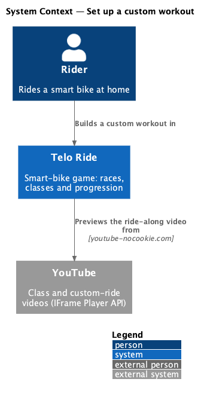
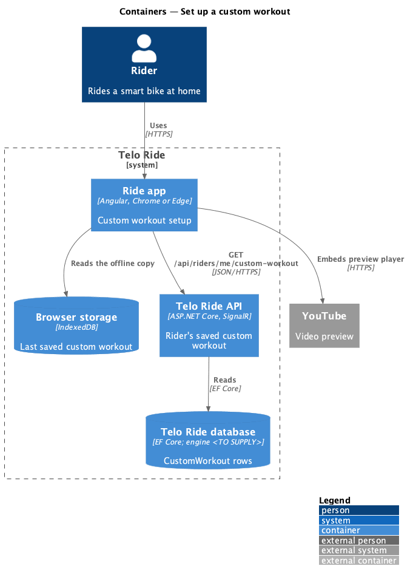
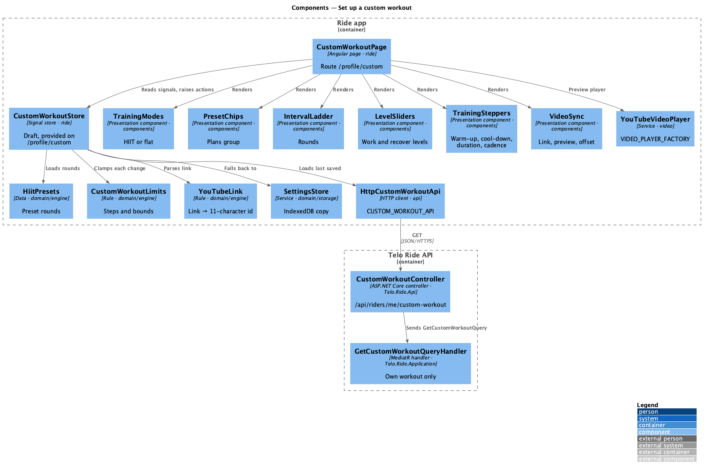
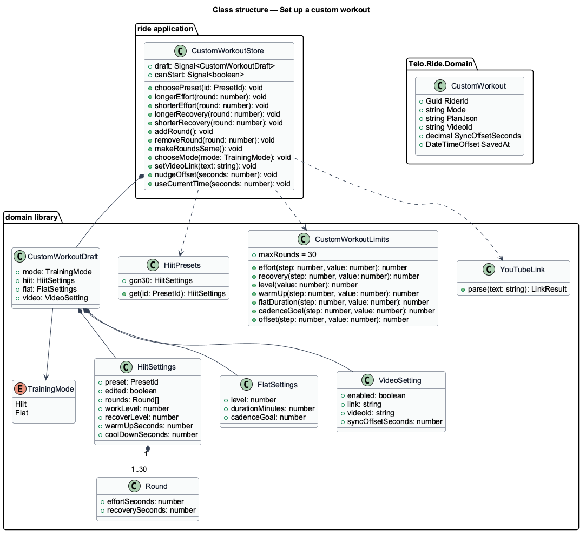
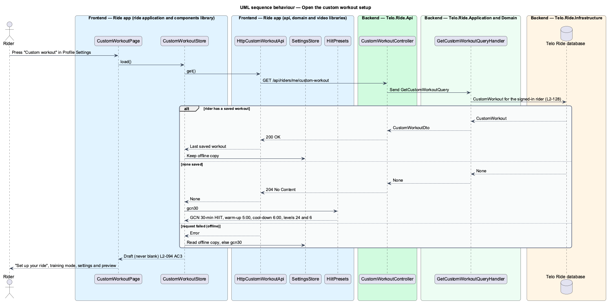
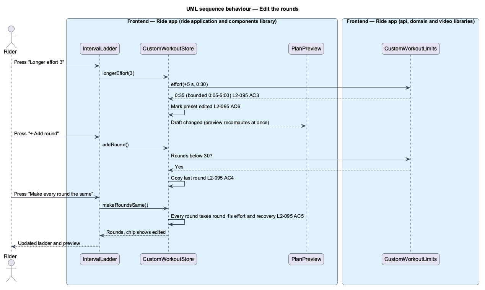
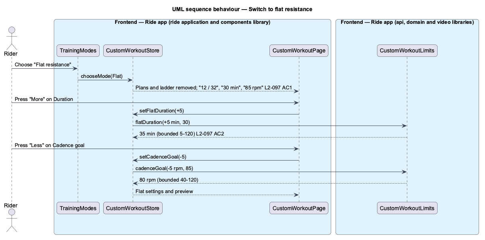
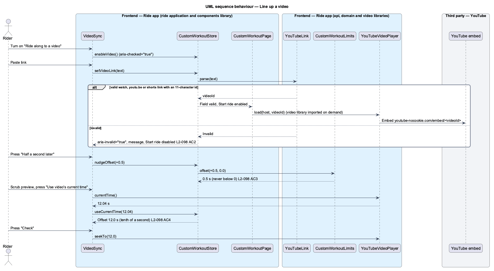

# Set up a custom workout

## Overview

Besides races and classes, a rider may build a ride of their own. Custom workout lives under
Profile, at `/profile/custom`, and opens from Profile's Settings (`L2-112`). The rider picks one
of two training modes, adjusts the plan, and may attach a YouTube video to ride along to. Telo
Ride then drives the bike's resistance through the plan.

> **training mode** — kind of custom plan: HIIT intervals or flat resistance

> **HIIT** — high-intensity interval training: rounds of a hard effort followed by an easier recovery

> **round** — one effort and the recovery after it, each with a duration

> **preset plan** — named starting set of rounds: "GCN 30-min HIIT", "Tabata", "40 / 20", "Minute on", "Long climbs"

> **work resistance** / **recover resistance** — levels (1 to 32) the bike holds during efforts and recoveries

> **flat resistance** — one level held for the whole ride at a cadence goal

> **sync offset** — video time at which the ride clock's 0:00 starts ("Ride 0:00 starts at")

The form never opens blank: it starts from the rider's last saved custom workout, or from the GCN
30-min HIIT plan if there is none (`L2-094` AC3). Every change updates the ride preview at once;
the preview, plan expansion and start are the *preview a custom workout* feature.

## Description

The route `/profile/custom` uses `loadChildren`. Its parent route provides
`CustomWorkoutStore`, so the setup screen and the custom ride (`/profile/custom/ride`) share one
draft and the draft goes when the rider leaves both.

**Frontend — `ride` application**

- **`CustomWorkoutPage`** (`wz-custom-workout-page`, child route `''`) — routed page. It renders
  the header (lockup, bike name, "Close" to Profile, Full screen), "Set up your ride", the
  training mode, the mode's settings, the video section and the preview column. At lg settings
  and preview are two independently scrolling columns; at sm the mode cards and steppers go two
  across.
- **`CustomWorkoutStore`** — signal store holding the `CustomWorkoutDraft`. Every editing action
  (`choosePreset`, `longerEffort(n)`, `shorterRecovery(n)`, `addRound`, `removeRound(n)`,
  `makeRoundsSame`, `setWorkLevel`, `setWarmUp`, `chooseFlat`, `setFlatDuration`,
  `setVideoLink`, `nudgeOffset`, …) applies `CustomWorkoutLimits` and marks the preset as
  edited. On open it loads the last saved workout through `CUSTOM_WORKOUT_API`, falling back to
  `SettingsStore`, then to `HiitPresets.gcn30`.

**Frontend — `components` library**

- **`TrainingModes`** / **`TrainingMode`** (`wz-training-modes`) — radio group "Training mode":
  "HIIT intervals" and "Flat resistance" with their descriptions.
- **`PresetChips`** / **`PresetChip`** (`wz-preset-chips`) — group "Plans"; the chosen chip
  carries `aria-pressed="true"` and an edited mark after any change.
- **`IntervalLadder`** (`wz-interval-ladder`) with **`LadderBlock`** — one row per round with
  "Longer effort N", "Shorter effort N", "Longer recovery N", "Shorter recovery N" and "Remove
  round N"; "+ Add round"; "Make every round the same"; the last round reads "Into cool-down".
- **`LevelSliders`** / **`LevelSlider`** (`wz-level-slider`) — range 1 to 32 labelled "Light …
  Max", 24 px tall, reading "24 / 32".
- **`TrainingSteppers`** / **`TrainingStepper`** (`wz-training-stepper`) — "Warm-up",
  "Cool-down", "Duration", "Cadence goal", with "More" and "Less" buttons.
- **`SetupToggle`** with **`Switch`** — "Ride along to a video" (`aria-checked`).
- **`VideoSync`** (`wz-video-sync`) — "YouTube link" field, preview player host, "Ride 0:00
  starts at" with "Half a second earlier" / "Half a second later", "Use video's current time",
  "Check" and the help text.

**Frontend — `domain`, `api` and `video` libraries**

- **`HiitPresets`** (`domain/engine`) — the preset round tables. GCN 30-min HIIT is eight
  efforts of 0:30 with recoveries 3:00, 2:30, 2:30, 2:00, 2:00, 1:30, 1:30 and the last round
  into the cool-down. The rounds of Tabata, 40 / 20, Minute on and Long climbs are
  `<TO SUPPLY>` (L2.md open question 4).
- **`CustomWorkoutLimits`** (`domain/engine`) — step sizes and bounds: effort ±0:05 within 0:05
  to 5:00; recovery ±0:15 within 0:15 to 10:00; 1 to 30 rounds; levels 1 to 32; warm-up and
  cool-down ±1:00 within 0:00 to 20:00; flat duration ±5 min within 5 to 120 min; cadence goal
  ±5 rpm within 40 to 120; offset ±0.5 s, never below 0.
- **`YouTubeLink`** (`domain/engine`) — `parse(text)` accepts `youtube.com/watch?v=`,
  `youtu.be/` and `youtube.com/shorts/` addresses with an 11-character video id and returns the
  id, or an invalid result. Only the id is kept; a submitted URL never reaches an iframe
  (ADR 0012).
- **`SettingsStore`** (`domain/storage`) — IndexedDB copy of the last saved workout for offline
  use.
- **`CustomWorkoutApi`** / `CUSTOM_WORKOUT_API` / **`HttpCustomWorkoutApi`** — `GET` and `PUT
  /api/riders/me/custom-workout`.
- **`VideoPlayer`** / `VIDEO_PLAYER_FACTORY` (**`YouTubeVideoPlayer`**, `video` library) — the
  preview player, loaded only once a valid link is entered.

**Backend**

- **`CustomWorkoutController`** (`Telo.Ride.Api`) — `GET /api/riders/me/custom-workout` sends
  one `GetCustomWorkoutQuery`; it returns 204 when the rider has none.
- **`GetCustomWorkoutQueryHandler`** — reads the signed-in rider's `CustomWorkout` through
  `IAppDbContext`. A rider reads only their own workout (`L2-128`).
- **`CustomWorkout`** (`Telo.Ride.Domain`) — the rider's saved workout, owned by `Rider`.

## Requirements

| L2 ID | Refines (L1) | Requirement |
|-------|--------------|-------------|
| `L2-094` | `L1-016` | Custom workout (`/profile/custom`) shall open from Profile's Settings with the lockup, the bike name, "Close" (to Profile) and Full screen, and read "Set up your ride" and "Telo Ride drives the bike's resistance for you. Pick how." "Training mode" shall be a radio group of "HIIT intervals" ("Hard and easy efforts on repeat. Resistance switches at every interval.") and "Flat resistance" ("One level, held the whole ride. You set the pace with your legs."). The form shall start from the GCN 30-min HIIT plan, never blank, or from the rider's last saved custom workout. At lg or wider settings and preview shall be two independently scrolling columns; at sm or wider the mode cards and steppers shall go two across. |
| `L2-095` | `L1-016` | The chips "GCN 30-min HIIT", "Tabata", "40 / 20", "Minute on" and "Long climbs" shall form a group "Plans" with the chosen one `aria-pressed="true"`, and choosing one shall load its rounds. GCN 30-min HIIT shall read "GCN 30-min HIIT · GCN Training" and list eight efforts of 0:30 with recoveries 3:00, 2:30, 2:30, 2:00, 2:00, 1:30 and 1:30, round 8 reading "Into cool-down". Effort shall move by 0:05 within 0:05 to 5:00 and recovery by 0:15 within 0:15 to 10:00. "+ Add round" shall copy the last round, up to 30; "Remove round N" shall remove it, down to one. "Make every round the same" shall give every round round 1's effort and recovery. Any change shall show the chip as edited and update the preview at once. |
| `L2-096` | `L1-016` | "Work resistance" shall read "24 / 32" and "Recover resistance" "6 / 32", each a range from 1 to 32 labelled "Light … Max", 24 px tall. "Warm-up" shall read 5:00 and "Cool-down" 6:00, moving by 1:00 within 0:00 to 20:00. The expanded warm-up shall run at level 8 with a cadence aim of 80 rpm, and the cool-down at the recover level. |
| `L2-097` | `L1-016` | Choosing "Flat resistance" shall remove the plans and ladder and show "Resistance level" "12 / 32", "Duration" "30 min" and "Cadence goal" "85 rpm", with "You can still nudge the level mid-ride from the dashboard." Duration shall move by 5 min within 5 to 120 min and cadence goal by 5 rpm within 40 to 120. The expanded flat plan shall be one steady segment at the chosen level and cadence goal for the whole duration. |
| `L2-098` | `L1-016` | With "Ride along to a video" on (`aria-checked="true"`), a "YouTube link" field, a preview player, "Ride 0:00 starts at", "Use video's current time" and "Check" shall show. A link that is not a `youtube.com/watch?v=`, `youtu.be/` or `youtube.com/shorts/` address with an 11-character video id shall mark the field invalid with a message and disable Start ride. "Half a second earlier" and "Half a second later" shall move the offset by 0.5 s, never below 0. "Use video's current time" shall set the offset to the preview's current time to a tenth of a second, and "Check" shall seek the preview to the offset. The help text shall read "Scrub the preview past the intro to the moment the warm-up begins, then use that time. The video skips to it when you start, and pauses and resumes with the ride." With the switch off, the ride shall have no video and its main view shall open on "Power vs. plan". |

## Diagrams

### System context

The rider builds a custom workout in Telo Ride and may preview a YouTube video to line up its
start.

### Containers

The Ride app loads the rider's last saved workout from the Telo Ride API and keeps a copy in
browser storage. The video preview comes from YouTube.

### Components

`CustomWorkoutPage` renders the form from `CustomWorkoutStore`. The store applies
`CustomWorkoutLimits`, loads presets from `HiitPresets` and checks links with `YouTubeLink`.

### Class structure

`CustomWorkoutDraft` holds either HIIT settings (rounds, levels, warm-up, cool-down) or flat
settings, and an optional `VideoSetting`. The backend's `CustomWorkout` mirrors it per rider.

### Behaviour — open the setup

The store loads the last saved workout from the backend, falls back to the device copy, and then
to the GCN 30-min HIIT preset (`L2-094` AC3).

### Behaviour — edit the rounds

Each ladder action applies its step and bound, marks the preset edited and recomputes the
preview (`L2-095`).

### Behaviour — switch to flat resistance

Flat mode swaps the plans and ladder for three settings with their own steps (`L2-097`).

### Behaviour — line up a video

The link is parsed to a video id; only a valid id loads the preview player. The offset is
nudged, captured from the preview or checked against it (`L2-098`).

