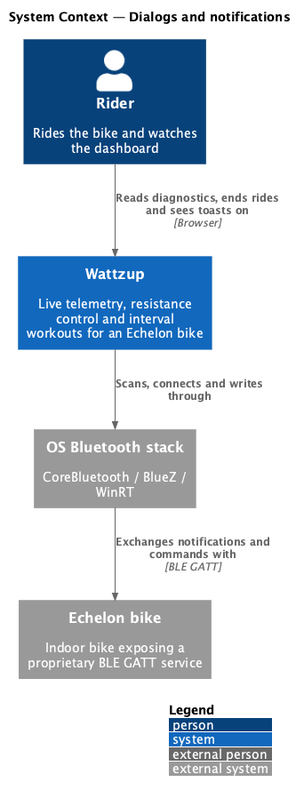
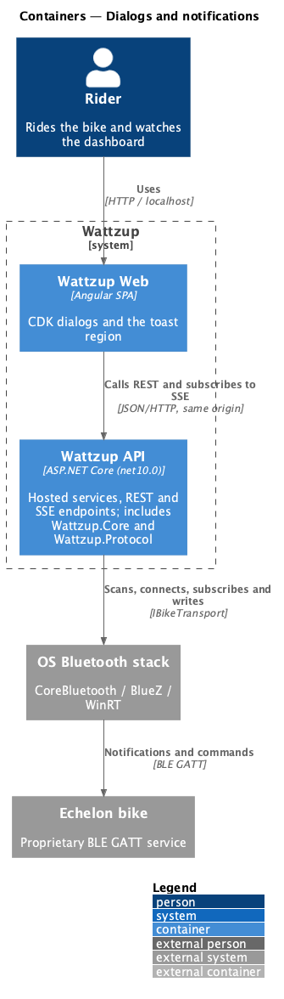
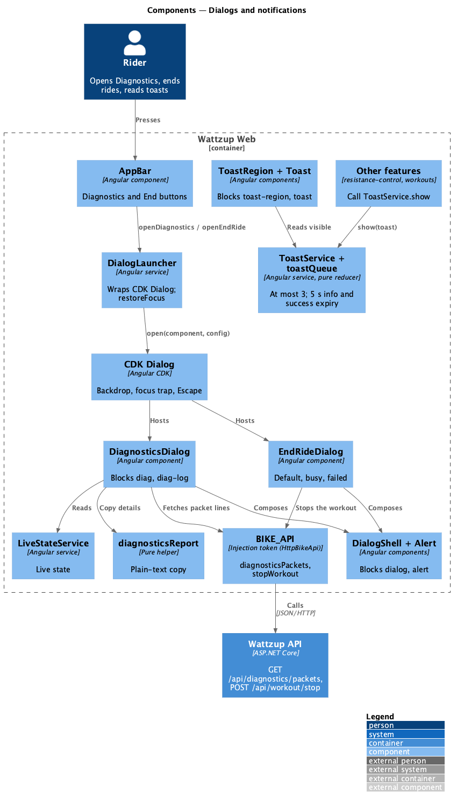
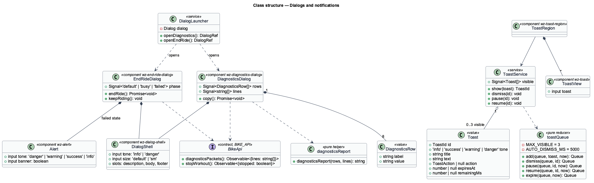
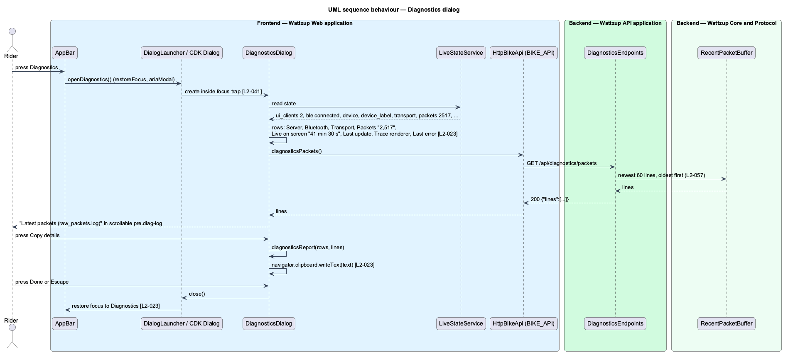
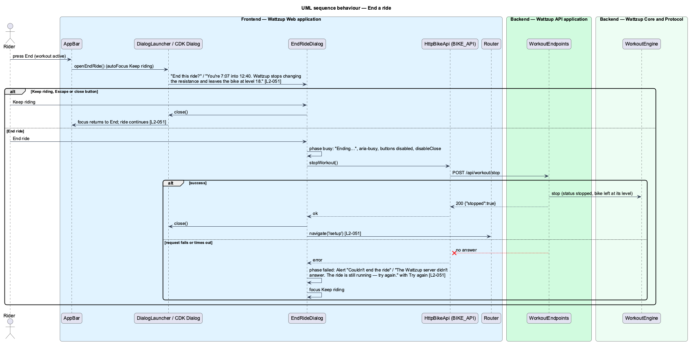
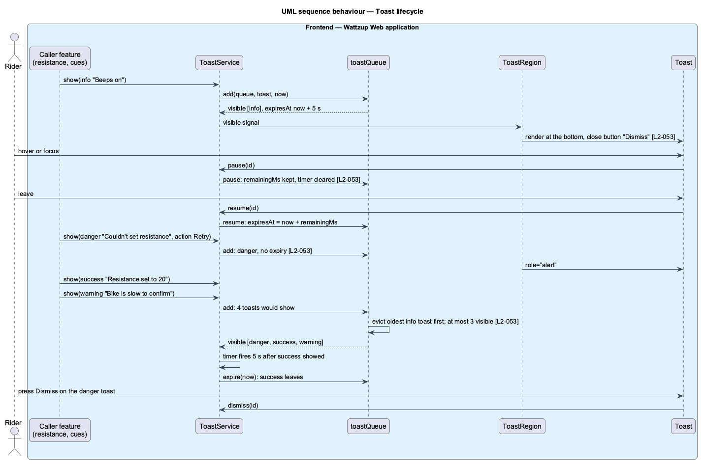

# Dialogs and notifications

## Overview

The ride dashboard keeps the rider's eyes on the numbers, so anything that interrupts it is either a dialog the rider asked for or a short notification that gets out of the way. This feature covers 2 dialogs opened from the app bar and the toast region they share with the rest of the app.

**diagnostics dialog** — dialog titled `Diagnostics` that lists what Wattzup sees right now and the latest raw packets, for troubleshooting (L2-023)

**end-ride dialog** — confirmation titled `End this ride?` that stops the running workout (L2-051)

**toast** — small, stacked notification at the bottom of the screen in one of 4 tones: info, success, warning or danger (L2-053)

**toast region** — fixed container that holds at most 3 visible toasts, newest at the bottom

Every dialog is an Angular CDK Dialog, never a hand-rolled modal. The CDK provides the backdrop, the focus trap, Escape to close and focus return to the opener. The diagnostics dialog replaces the prototype's footer. The replace-ride dialog (L2-052) belongs to `workouts/start-and-stop-workout`. The phase banner (L2-027) belongs to `workouts/play-workout-cues`. The look and copy come from `docs/mocks/dialogs/diagnostics/*.html`, `docs/mocks/dialogs/end-ride/*.html` and `docs/mocks/notifications/ride-toast/*.html`.

## Description

Shared building blocks (`wattzup-web/src/app/dashboard/`):

- **`DialogShell`** (`wz-dialog-shell`, block `dialog`) — renders the mocks' `dialog__panel`, `dialog__header` with `dialog__icon` (`--info` or `--danger`), `dialog__title`, the description, `dialog__body` and `dialog__footer`.
  - It declares each `ng-content` slot once: `[slot=description]`, `[slot=body]` and `[slot=footer]`.
  - It sets `aria-labelledby` and `aria-describedby` on the CDK container through the dialog config.
  - `size` maps to `dialog__panel--sm` for the end-ride dialog.
  - L2-023 and L2-051 name a close button, which the dialog mocks do not show. It sits at the end of the dialog header as an icon button named `Close` (L2-041). The dialog mocks gain it in the mock update that follows the requirements rewrite.
- **`Alert`** (`wz-alert`, block `alert`) — inline alert with `alert__title`, text and optional `alert__actions`, in tones `alert--danger`, `alert--warning` and `alert--success`. The connection banners use it too.
- **`DialogLauncher`** — root service wrapping the CDK `Dialog`. `openDiagnostics()` and `openEndRide()` open the components with `restoreFocus: true`, `autoFocus` set to the control the mock focuses, and `ariaModal: true`. The app bar's Diagnostics and End buttons call it, as do `Open diagnostics` in the ride overlays and banners.

Diagnostics dialog (L2-023):

- **`DiagnosticsDialog`** (`wz-diagnostics-dialog`, blocks `diag` and `diag-log`) — reads `LiveStateService` and `TraceRendererStatus`. It renders a `dl.diag` with 8 rows:

| Row | Value |
|---|---|
| Server | `Connected · event stream open · <ui_clients> viewers` |
| Bluetooth | `<ble> · <device> (<device_label>)`, or `<ble>` alone when `device` is `null` |
| Transport | `transport` |
| Packets | `packets` with thousands separators, for example `2,517` |
| Live on screen | `displayed_seconds` as `<m> min <s> s`, for example `41 min 30 s` |
| Last update | local time of `last_data_at` (`7:10:12 PM`), or `never` |
| Trace renderer | `WebGL` or `Canvas 2D` (L2-028) |
| Last error | `error`, or `None` |

  While the stream is offline the Server row reads `Offline · retrying every 2 s` (L2-023).
  - On open it calls `BIKE_API.diagnosticsPackets()` (`GET /api/diagnostics/packets`). It shows the `lines` under the heading `Latest packets (raw_packets.log)` in `pre.diag-log` with `tabindex="0"` and `aria-label="Latest raw packets"`, so the scrollable region is keyboard-reachable.
  - `Copy details` calls `navigator.clipboard.writeText(diagnosticsReport(rows, lines))`. The pure helper `diagnosticsReport` returns plain text, one `Label: value` line per row, a blank line, then the packet lines.
  - `Done`, Escape and the close button close the dialog, and focus returns to the Diagnostics button (L2-023).
  - Every value is bound with interpolation. Device names, the label and error strings render as text (L2-036).

End-ride dialog (L2-051):

- **`EndRideDialog`** (`wz-end-ride-dialog`) — opened from End while a workout is active. It has 3 states, as in `default.html`, `busy.html` and `failed.html`:
  - **Default** — title `End this ride?`, description `You're <elapsed> into <total>. Wattzup stops changing the resistance and leaves the bike at level <resistance>.` and the body note `Your power trace and totals stay on the dashboard until you start a new ride.` Focus starts on `Keep riding`.
  - **Busy** — after `End ride` it calls `BIKE_API.stopWorkout()` (`POST /api/workout/stop`). The button reads `Ending…` with `aria-busy="true"`, both buttons are disabled, and `disableClose` is set so Escape cannot close mid-request. On success the dialog closes and the router navigates to `/setup`.
  - **Failed** — the body shows the danger `Alert` `Couldn't end the ride` / `The Wattzup server didn't answer. The ride is still running — try again.` The danger button reads `Try again`, and focus returns to `Keep riding`.
  - Escape, the close button or `Keep riding` closes the dialog without a request. The ride continues, and focus returns to End (L2-051).
  - `<elapsed>` and `<total>` use the ride-clock format of `workouts/show-workout-countdown`.

Toasts (L2-053):

- **`ToastService`** — root service with `show(toast): ToastId`, `dismiss(id)`, `pause(id)` and `resume(id)`, exposing `visible` as a `Signal<Toast[]>`. Other features call it: resistance commands (L2-020, L2-048) and the beeps toggle (L2-027).
- **`toastQueue`** — pure reducer behind the service, taking the current time as an argument so its unit tests need no timers:
  - Info and success toasts expire 5 s after they show. Pausing records the time left, and resuming restarts the timer with it.
  - Warning toasts have no timer and stay until their owner or the rider dismisses them, for example `Bike is slow to confirm` (L2-048).
  - Danger toasts never expire (L2-053).
  - A 4th toast evicts the oldest info toast, then the oldest success toast, so at most 3 show. A danger or warning toast is never evicted. While 3 such toasts show, a new toast waits until one is dismissed.
- **`ToastRegion`** (`wz-toast-region`, block `toast-region`) — mounted once in the root `App` template, so toasts survive navigation between `/` and `/setup`. It carries `role="status"` and `aria-live="polite"`, and renders the visible toasts oldest first, so the newest is at the bottom.
- **`Toast`** (`wz-toast`, block `toast`, `toast--info`, `toast--success`, `toast--warning` or `toast--danger`) — renders the tone icon, `toast__title`, `toast__text`, an optional `toast__action` button such as `Retry`, and a close button named `Dismiss` (L2-053).
  - A danger toast carries `role="alert"`.
  - `pointerenter` and `focusin` pause the toast's timer, and `pointerleave` and `focusout` resume it.
  - The `data-state="leaving"` fade-out is skipped under reduced motion.

Tests:

- Unit tests cover `toastQueue` (expiry, pause and resume, eviction order, danger and warning persistence) and `diagnosticsReport`.
- Playwright behaviour specs use the `DiagnosticsDialog`, `EndRideDialog` and `ToastRegion` page objects with stubbed `/api/**`, including `/api/diagnostics/packets` and `/api/workout/stop`, and a stubbed event stream. They assert:
  - each diagnostics row, the packet lines and the clipboard text (with clipboard permission granted to the test context);
  - Escape and focus return for each dialog;
  - the end-ride busy, failed and success states, with navigation to `/setup`;
  - toast stacking, the 5 s expiry under Playwright's clock, and pause on hover.

## Requirements

| L2 ID | Refines (L1) | Requirement |
|-------|--------------|-------------|
| `L2-023` | `L1-008` | Diagnostics dialog. The Diagnostics button in the app bar must open a dialog titled `Diagnostics` describing what Wattzup sees. |
| `L2-051` | `L1-007` | End-ride dialog. |
| `L2-053` | `L1-006` | Toasts. |

## Diagrams

### System context

The rider asks Wattzup what it sees, ends a ride, and reads short notifications about commands and settings.

### Containers

Wattzup Web renders the dialogs and toasts. The Wattzup API answers the packet lines and the stop request.

### Components

`DialogLauncher` opens the 2 dialogs through the CDK. `ToastService` holds the toasts that `ToastRegion` renders, and other features call it.

### Class structure

Both dialogs compose `DialogShell`. The toast rules live in the pure `toastQueue` reducer, so the components only render.

### Behaviour — diagnostics dialog

The dialog opens with the live values, fetches the latest packets, copies the report and returns focus to the Diagnostics button on close (L2-023).

### Behaviour — end a ride

The rider confirms, the stop request runs with the dialog busy, and success opens `/setup`. A failure keeps the ride running and offers `Try again` (L2-051).

### Behaviour — toast lifecycle

An info toast expires after 5 s unless hovered or focused. A danger toast stays until dismissed, and a 4th toast evicts the oldest info toast (L2-053).

