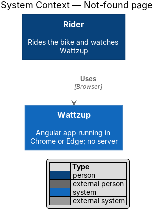
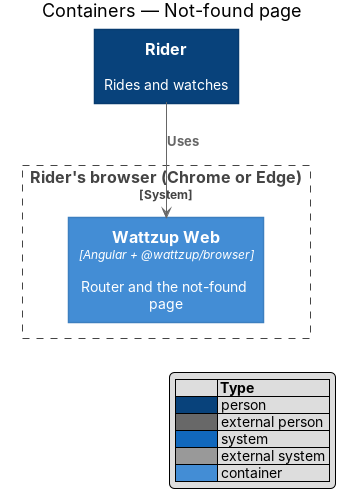
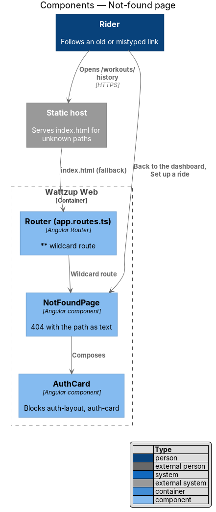
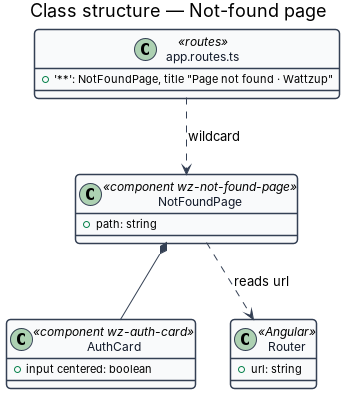
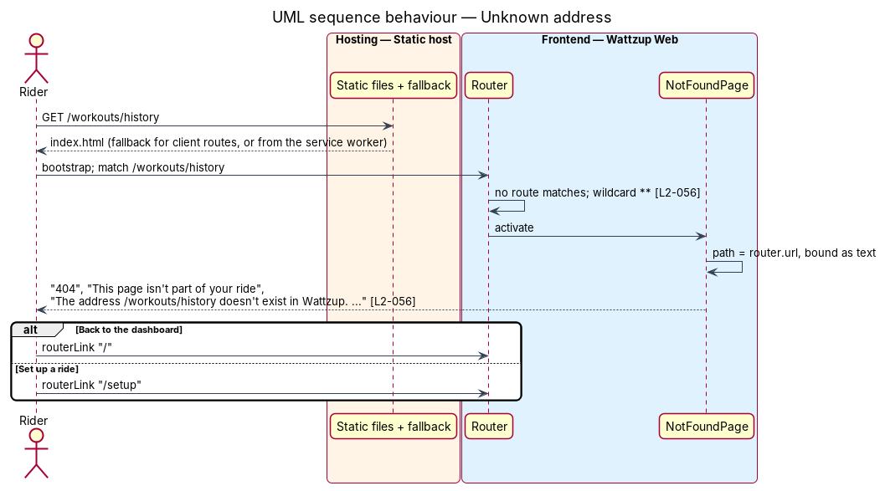

# Not-found page

## Overview

A rider can reach an address that is not part of Wattzup: an old bookmark, a mistyped link or a route that was removed. This feature shows a page that says so and leads back to the ride, without touching the ride or the bike connection (L2-056).

**not-found page** — page shown for any client route the router does not know, such as `/workouts/history` (L2-056)

**fallback** — the static host's rule, or the service worker's navigation handling, that answers an unknown path with `index.html`, so the Angular router decides what the path means (`platform/build-and-host`)

The look and copy come from `docs/mocks/pages/not-found/default.html`.

## Description

Components (presentation components in `frontend/projects/components/src/lib/`, the rest in `frontend/projects/wattzup/src/app/dashboard/` (ADR 0013; mapping in `platform/host-and-structure`)):

- **`AuthCard`** (`wz-auth-card`, blocks `auth-layout` and `auth-card`) — centred card with the large `lockup`, declaring one default `ng-content` slot. `centered` adds `auth-card--centered`, replacing the inline `text-align: center` of the not-found mock.
- **`NotFoundPage`** (`wz-not-found-page`, route `**`) — inside a centred `AuthCard`:
  - a `numeral` `404` with `aria-hidden="true"`;
  - the heading `This page isn't part of your ride`;
  - the text `The address <path> doesn't exist in Wattzup. Your ride and the bike connection are unaffected.`, where `<path>` is `router.url` bound with interpolation, so markup in the address renders as text;
  - 2 `routerLink`s: `Back to the dashboard` to `/` and `Set up a ride` to `/setup` (L2-056).
  The host serves `index.html` for unknown client routes (`platform/build-and-host`), so the router, not the host, decides that a path is unknown. The title is `Page not found · Wattzup` (L2-041), set through the route `title`. A ride in progress keeps running in the page's workout engine while this page shows.

Tests:

- Playwright behaviour specs use the `NotFoundPage` page object. They assert the 404 copy for `/workouts/history` with both links, and the literal rendering of a path containing markup.

## Requirements

| L2 ID | Refines (L1) | Requirement |
|-------|--------------|-------------|
| `L2-056` | `L1-011` | Not-found page. An unknown client route shall show `404`, `This page isn't part of your ride` and the address as text, with `Back to the dashboard` and `Set up a ride`. |

## Diagrams

### System context

The rider opens an address Wattzup does not know; nothing reaches the bike.

### Containers

Only the Wattzup app in the rider's browser takes part.

### Components

The static host's fallback serves `index.html`; the router's wildcard route shows `NotFoundPage` inside an `AuthCard`.

### Class structure

`NotFoundPage` reads the router's URL and composes `AuthCard`.

### Behaviour — an unknown address

The host answers with `index.html`, the router finds no route, and the page shows the path as text with links back (L2-056).

