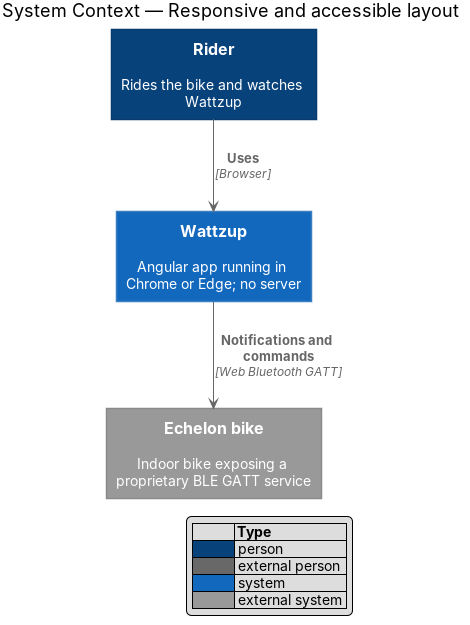
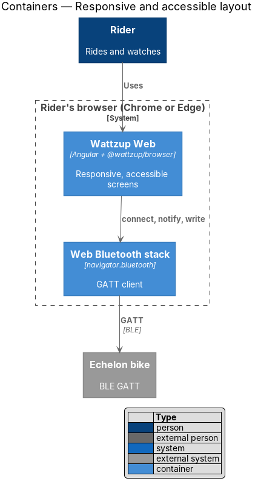
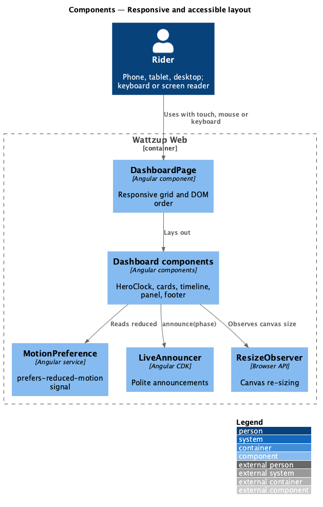

# Responsive and accessible layout

## Overview

Riders open Wattzup on whatever screen is nearest: a phone clipped to the handlebars, a tablet on a stand, or a laptop or TV across the room. Some ride with a keyboard or a screen reader, and some have asked their system to reduce motion. This feature defines the page layout of the ride dashboard and the setup screen across the design's breakpoints, and the accessibility behaviour that applies to every component, targeting WCAG 2.2 AA.

**breakpoint** — viewport width at which the layout changes: 40 rem (640 px), 48 rem (768 px) and 64 rem (1024 px), from the mocks' `ui.css` (L2-040)

**ride layout** — the ride dashboard's grid of `ride-main` (readouts, interval card, trace, totals strip) and `ride-aside` (the resistance panel and the `Sent to bike` log)

**live region** — element whose text changes are read aloud by screen readers without moving focus

**reduced motion** — the user preference `prefers-reduced-motion: reduce`

The breakpoints replace the generic XS to XL widths of the old design. The layout follows `docs/mocks/pages/ride/*.html` and `docs/mocks/pages/setup/*.html`, and the tokens come from `docs/design-system/tokens/`.

## Description

Layout (L2-040). Each layout block lives in the stylesheet of the component that renders it, with `min-width` media queries in rem:

| Viewport | Ride dashboard | Setup screen |
|---|---|---|
| below 40 rem | One column, `ride-aside` below `ride-main`. `app-bar__end` takes a full row, the Pause, End and beeps labels become visually hidden, and the buttons become 44 px icon buttons. The power numeral uses `--font-size-numeral-hero`. | One column, ride preview below the form |
| 40–47.99 rem | Readouts sit two across. The power numeral grows to `--font-size-numeral-hero-lg`, and the countdown numerals scale with the viewport. `app-bar__divider` shows. | Field grids of 2 and 3 columns |
| 48–63.99 rem | The `metrics` strip shows all 5 metrics in one row | As above |
| 64 rem and wider | `ride-layout` places the 340 px `ride-aside` (`--layout-ride-aside`) beside `ride-main`, each scrolling on its own inside a `100dvh` app | The 420 px `setup-aside` (`--layout-setup-aside`) sits beside the form |

- **`RidePage`** (`wz-ride-page`) — renders the skip link, `AppBar`, the connection banners and the `ride-layout` grid. Its stylesheet holds the mocks' layout blocks `app`, `ride-layout`, `ride-main`, `ride-aside` and `readouts`. DOM order equals visual order, so Tab order follows the layout (L2-041).
- **`AppBar`** (`wz-app-bar`, block `app-bar`) — holds, in DOM order:
  - the `lockup`, on the bike the `Library` link to `/classes` (`app-bar__library`, L2-079 criterion 15, `classes/browse-classes`), the `app-bar__divider` and `StatusLine`;
  - the workout button, labelled with `summary` or `Set up a ride`;
  - in `app-bar__end`: the ride clock, Pause or Resume, End, the beeps toggle, the theme toggle and Diagnostics.
  The bar uses `flex-wrap: wrap`, so items wrap without overlapping. Nothing scrolls horizontally at 320 px, because every block uses `minmax(0, 1fr)` columns and `min-width: 0`, and long names truncate with an ellipsis.
- **Touch targets** — every control is at least 44 × 44 px through the `--target-min` token: buttons, picker levels, close buttons, toast actions and links styled as buttons (L2-040).
- **Re-sizing** — `RideTrace` observes its plot with `ResizeObserver`, so an orientation change reflows the grid and re-sizes the canvas without a reload (L2-040, `show-live-metrics`).

Accessibility (L2-041):

- **Skip link** — `Skip to content` is the first focusable element and targets `#main` (`ride-main`).
- **Focus order and visibility** — Tab reaches the lockup, `Library` (bike), the workout button, Pause or Resume, End, the beeps toggle, the theme toggle, Diagnostics, Lower, the level picker, Raise and Back to plan, in that order. Every interactive element shows a `:focus-visible` outline in `--color-focus-ring`. On `/setup`, every field is reachable in form order.
- **Names** — the stepper buttons are named `Lower resistance` and `Raise resistance`, and the level picker is one slider named `Resistance level` whose value reads `Level <n> of 32` (`resistance-control`). The beeps toggle exposes `aria-pressed` (`workouts/play-workout-cues`). The workout button's accessible name is `Edit workout: 
`. The trace canvas carries `aria-hidden="true"` and has a text summary (`show-live-metrics`).
- **Announcements** — a segment change is announced through the CDK `LiveAnnouncer` with `polite` politeness, for example `Work, resistance 18, 40 seconds`. The workouts feature makes the call. The countdown carries `role="timer"` and `aria-live="off"`, so it is never read out each second.
- **States beyond colour** — every state carried by colour also has text or an attribute: the status line's state label, the delta text, `aria-valuenow` on the level picker, `aria-pressed` on the beeps and theme toggles, `aria-current`, `aria-invalid` and `disabled`. Components style those states through the attribute.
- **`MotionPreference`** — root service exposing `reduced` as a signal from `matchMedia('(prefers-reduced-motion: reduce)')`, updated on change. Under reduced motion the digit pulse, the phase-banner animation and the scanning animation are off, and colours change without transition. The global foundations carry the mocks' reduced-motion rule as a backstop (L2-041).
- **`ThemeService`** (`core/theme.service.ts`) — root service that owns the theme (L2-061). Its `theme` signal is `dark` unless local storage key `wattzup.theme` holds `light`; anything else reads as dark, and the device's `prefers-color-scheme` is ignored. It writes `data-theme` on `<html>`, and `toggle()` flips the theme and saves it. `index.html` ships `<html data-theme="dark">` and `<meta name="color-scheme" content="dark">`, so the page is dark before Angular boots; a rider who chose light sees dark for the moment before boot, because the CSP forbids an inline script that could apply it earlier. `RideTrace` re-reads its colours when `theme` changes.
- **Theme toggle** — an icon button in `app-bar__end` between the beeps toggle and Diagnostics, named `Light theme`, with `aria-pressed` true in the light theme. It shows a sun icon in the dark theme and a moon in the light theme. The name stays fixed and only `aria-pressed` changes, so a screen reader hears one control with a state.
- **Themes and contrast** — dark is the default and light is the rider's choice (`ThemeService`). The token pairs in `docs/design-system/tokens/contrast-pairs.json` meet 4.5:1 for text and 3:1 for large text and UI components in both themes, including the faint text the mocks lifted to `#80868f` (L2-041).
- **Dialogs** — every dialog is a CDK Dialog, which traps focus, closes with Escape and returns focus to the control that opened it (`dialogs-and-notifications`).

Tests:

- Playwright behaviour specs, through the `RidePage` and `SetupPage` page objects with the bike driven through the fake `navigator.bluetooth`, cover:
  - the Tab order through the app bar and the resistance panel;
  - the theme: dark by default under a light device preference, the toggle, and the choice kept across a reload;
  - the skip link;
  - the accessible names;
  - the `polite` announcement on a segment change;
  - focus return from each dialog.
- `theme.service.spec.ts` — one case per stored value (`light` reads light; nothing, `dark` or anything else reads dark), and `toggle()` writing `data-theme` and saving the choice.
- The responsive sweep (320, 600, 800, 1024 and 1440 px, asserting the column count and no horizontal scroll) and the `@axe-core/playwright` scan of each screen are written and kept current. They run only when a person asks, as do visual baselines (L2-040, L2-041).

## Requirements

| L2 ID | Refines (L1) | Requirement |
|-------|--------------|-------------|
| `L2-040` | `L1-011` | Responsive layout. |
| `L2-041` | `L1-011` | Accessibility. The UI must meet WCAG 2.2 AA. |
| `L2-061` | `L1-011` | Theme. Dark unless the rider picks light. |

## Diagrams

### System context

The rider uses Wattzup from any device with a browser, by touch, mouse or keyboard, with or without a screen reader.

### Containers

Layout and accessibility are properties of Wattzup Web. The Wattzup API only supplies data.

### Components

`RidePage` arranges the feature components in DOM order. `MotionPreference` and `LiveAnnouncer` provide cross-cutting accessibility services.

### Class structure

The page composes the app bar, banners, main area and aside. Each child is a separate component with its own BEM block.

### Behaviour — rotation and segment announcement

A rotation from a portrait phone to landscape crosses the 40 rem breakpoint, reflows the readouts and re-sizes the trace canvas. A segment change is announced politely, without reading the countdown each second (L2-040, L2-041).

