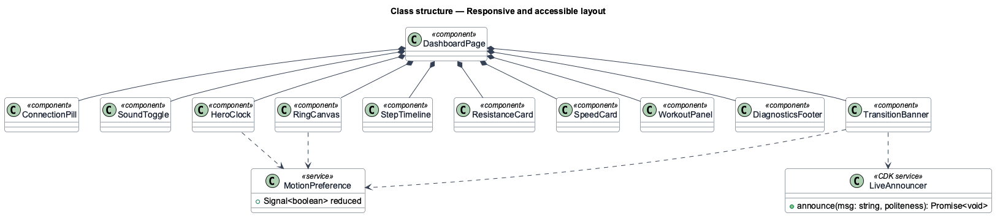
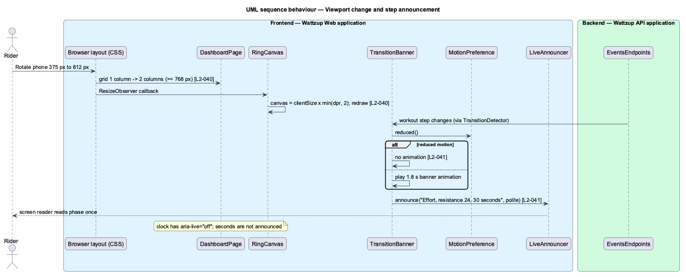

# Responsive and accessible layout

## Overview

Riders open the dashboard on whatever screen is nearest: a phone clipped to the handlebars, a tablet on a stand, or a laptop or TV across the room. Some ride with a keyboard or a screen reader, and some have asked their system to reduce motion. This feature defines the dashboard's page layout across 5 viewport classes and the accessibility behaviour that applies to every component on it, targeting WCAG 2.2 AA.

**viewport class** — width band: XS (< 576 px), SM (576–767 px), MD (768–991 px), LG (992–1199 px) and XL (≥ 1200 px)

**live region** — element marked `aria-live` whose text changes are read aloud by screen readers without moving focus

**reduced motion** — the user preference `prefers-reduced-motion: reduce`

The prototype already used fluid sizing (`clamp()`, `min(92vw, 520px)`) and a single reduced-motion rule. This design keeps those values and makes the breakpoints, touch targets, focus order and announcements explicit.

## Description

- **`DashboardPage`** — root routed component. Its template order is header (`ConnectionPill`, `SoundToggle`), hero (`HeroClock` over `RingCanvas`), `StepTimeline`, metric grid (`ResistanceCard`, `SpeedCard`), `WorkoutPanel`, then `DiagnosticsFooter`. DOM order equals visual order, so Tab order follows the layout (L2-041).
- **Layout tokens** (`styles/_layout.scss`):
  - The content column is `max-width: 900px`, centred, with a 16 px side gutter.
  - The hero is `width: min(92vw, 520px)` with `aspect-ratio: 1`.
  - Clock digits use `font-size: clamp(64px, 19vw, 124px)`.
  - `overflow-x: clip` on the root prevents horizontal scroll (L2-040).
- **Metric grid** — CSS grid with 1 column below 768 px and `repeat(2, 1fr)` at 768 px and above. The header uses `flex-wrap: wrap` with a gap, so the pills drop under the title at XS rather than overlapping (L2-040).
- **Touch targets** — every button and input has `min-height: 44px` and `min-width: 44px` (L2-040).
- **`ResizeObserver`** in `RingCanvas` and `Sparkline` — resizes the canvases on orientation change or layout change without a reload (L2-040).
- **`LiveAnnouncer`** (Angular CDK) — `TransitionBanner` calls `announce('Effort, resistance 24, 30 seconds', 'polite')` at each step transition. The per-second clock carries `role="timer"` and `aria-live="off"`, so it is never read out each second (L2-041).
- **Accessible names** — −/+ carry `aria-label="Decrease resistance"` / `"Increase resistance"`, the input is labelled `Resistance level`, and `RingCanvas` carries `aria-hidden="true"`.
- **Focus styles** — a `:focus-visible` outline of 2 px in `--fg` with a 2 px offset on every interactive element.
- **`MotionPreference`** — service exposing `reduced` as a signal from `matchMedia('(prefers-reduced-motion: reduce)')`, updated on change. Components read it to skip the digit pulse, the banner animation and colour easing. The ring renders a static frame (L2-041).
- **Colour contrast** — `--fg #eef2f6` on `--card #151a22`, and `--muted #8a94a3` on `--bg #0b0e13`. Both pairs are checked against 4.5:1 by an automated contrast test. Any failing pair is adjusted. Exact adjusted values: `<TO SUPPLY>` after the check runs (L2-041).
- **Automated checks** — Playwright runs the dashboard at 375, 600, 800, 1024 and 1440 px widths, asserts the column count and the absence of horizontal scroll, and runs `@axe-core/playwright` with no serious or critical violations allowed (L2-040, L2-041).

## Requirements

| L2 ID | Refines (L1) | Requirement |
|-------|--------------|-------------|
| `L2-040` | `L1-011` | Responsive layout. |
| `L2-041` | `L1-011` | Accessibility. The UI must meet WCAG 2.2 AA. |

## Diagrams

### System context

The rider uses Wattzup from any device with a browser.

### Containers

Layout and accessibility are properties of Wattzup Web; the Wattzup API only supplies data.

### Components

`DashboardPage` arranges the feature components. `MotionPreference` and `LiveAnnouncer` provide cross-cutting accessibility services.

### Class structure

The page composes every dashboard component. Accessibility services are injected where needed.

### Behaviour — viewport change and step announcement

A rotation from portrait phone to landscape reflows the grid and resizes the canvases. A step transition is announced politely, without reading the clock each second (L2-040, L2-041).

