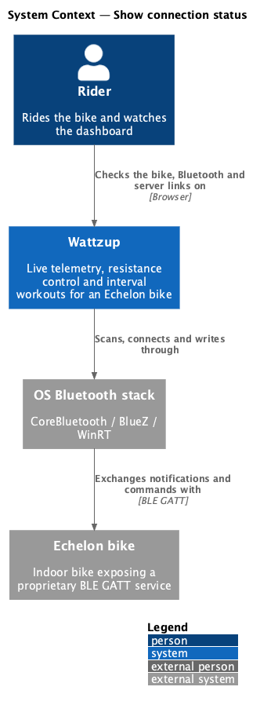
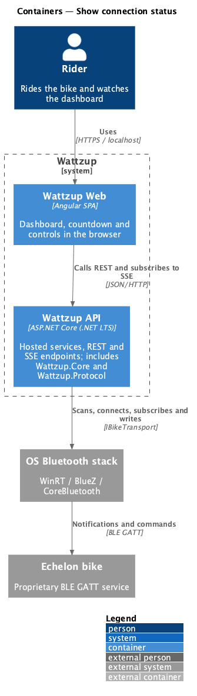
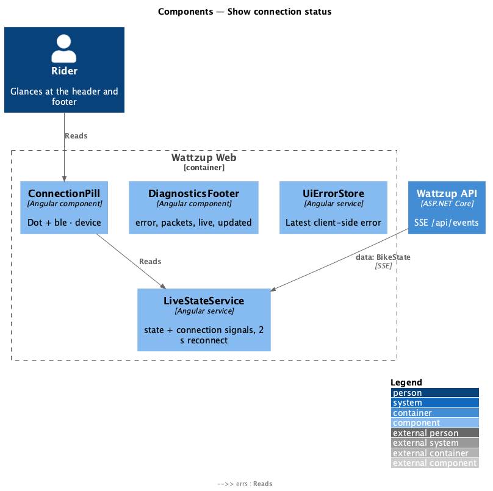
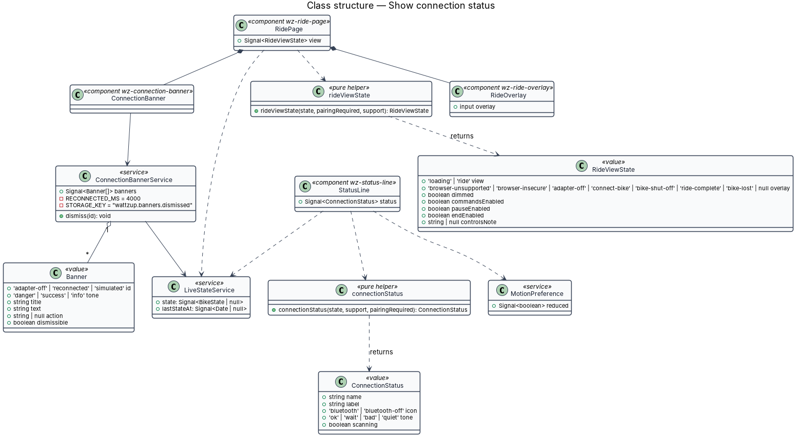
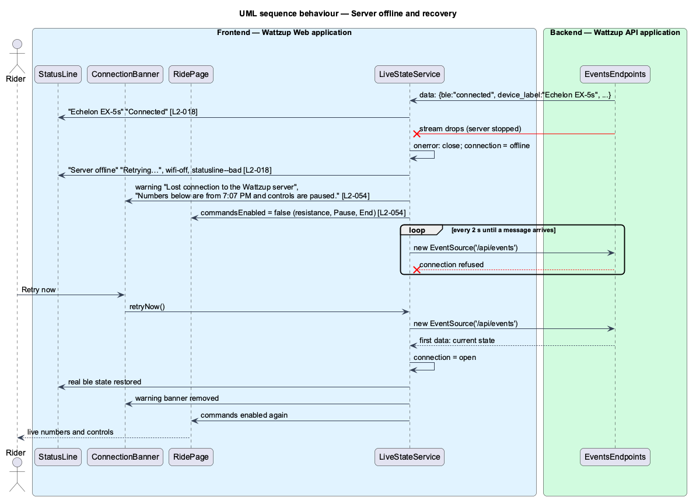
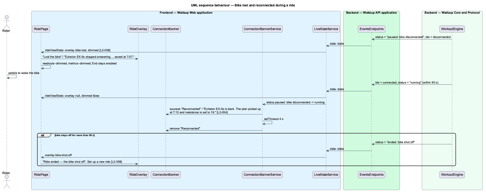

# Show connection status

## Overview

The data on the ride dashboard passes through 3 links: the host's Bluetooth radio, the Bluetooth link from the backend to the bike, and the HTTP link from the backend to the browser. Any of them can fail. This feature tells the rider at a glance which link is healthy, what Wattzup is doing about a failed one, and what the dashboard shows while it waits. It has 3 parts that read the same live state.

**status line** — app-bar element with an icon, a name and a state label for the connection, for example `Echelon EX-5s` `Connected` (L2-018)

**connection banner** — full-width alert under the app bar that reports a link change or a deployment fact, such as `Lost connection to the Wattzup server` or `Simulated bike` (L2-054)

**ride overlay** — panel laid over the main area of the ride dashboard while the dashboard cannot show a live ride, such as `Looking for your bike` (L2-058)

**ride view state** — single value derived from the live state that says which skeleton, overlay or error the dashboard shows and which controls are enabled

**stream connection** — the browser's view of the event stream: `connecting`, `open` or `offline`

The status line replaces the prototype's coloured pill, and the banners and overlays replace its footer error text. Colour is never the only carrier of a state: each state also has its own text and icon (L2-018). The look comes from the ride mocks (`docs/mocks/pages/ride/*.html`) and the connection-banner mocks (`docs/mocks/notifications/connection-banner/*.html`).

## Description

Core services and helpers (`frontend/src/app/core/`):

- **`LiveStateService`** — the only owner of the `EventSource` and of the reconnect logic (L2-044). It exposes read-only signals:
  - `state` (`BikeState | null`), the last state received. Its type comes from the OpenAPI document (`src/app/api/`).
  - `connection` (`'connecting' | 'open' | 'offline'`).
  - `lastStateAt` (`Date | null`), the browser time of the last state message.
  - `loadFailed` (`boolean`), set when the initial `GET /api/status` fails.
  On start it calls `GET /api/status` through the `BIKE_API` token, then opens `EventSource('/api/events')`, first fetching an event token when an API key is held (`platform/secure-api`). On `onerror` it closes the source, sets `connection = 'offline'` and schedules `connect()` 2 s later. The schedule repeats until a message arrives, and the first message sets `connection = 'open'` (L2-018). `retryNow()` cancels the pending delay and connects at once. `reload()` repeats the initial `GET /api/status`.
- **`connectionStatus(state, connection, loadFailed)`** — pure helper returning `{name, label, icon, tone}`. Rows are checked in this order, so the first match wins (L2-018):

| Condition | Name | State | Icon | Tone |
|---|---|---|---|---|
| `connection` `offline` | `Server offline` | `Retrying…` | wifi-off | bad |
| no state yet, or `loadFailed` | `Bike status` | `Unknown` | bluetooth | wait |
| `adapter` `off` | `Bluetooth` | `Off` | bluetooth-off | bad |
| `ble` `connected` | `device_label` | `Connected` | bluetooth | ok |
| `ble` `scanning` or `starting` | `Echelon bike` | `Scanning…` | bluetooth, animated | wait |
| `ble` `connecting` | `device_label` | `Connecting…` | bluetooth | wait |
| `ble` `disconnected` | `device_label` or `Echelon bike` | `Disconnected` | bluetooth-off | bad |
| `ble` `error` | `Bike status` | `Error` | bluetooth-off | bad |

- **`rideViewState(state, connection, loadFailed)`** — pure helper returning the ride view state: `view` (`loading`, `load-failed` or `ride`), `overlay` (`null`, `scanning`, `adapter-off`, `bike-lost` or `bike-shut-off`), `dimmed`, `commandsEnabled`, `pauseEnabled`, `endEnabled` and `controlsNote` (L2-058). Precedence, first match wins:
  1. `loadFailed` → `load-failed`. The main area reads `Couldn't load your ride` with `Try again` (`LiveStateService.reload()`) and `Open diagnostics`. Resistance controls are disabled with `Controls return when Wattzup can read the bike again.`
  2. No state → `loading`. Skeletons show, the workout button reads `Set up a ride`, and Pause and End are disabled.
  3. `adapter` `off` → overlay `adapter-off`: `Bluetooth is off` / `Wattzup can't reach this computer's Bluetooth adapter. Turn Bluetooth on — Wattzup retries every 3 seconds and connects on its own.` with `Open diagnostics`.
  4. `workout.status` `ended: bike shut off` → overlay `bike-shut-off`: `Ride ended — the bike shut off` / `<device_label> was off for more than 90 seconds, so Wattzup ended the workout at <elapsed>. Your numbers are kept below.` with `Set up a new ride` linking to `/setup`.
  5. `workout.status` `paused: bike disconnected` → overlay `bike-lost` with `dimmed = true`: `Lost the bike` / `<device_label> stopped answering. Wake it with a pedal stroke, then reconnect — your ride is saved at <elapsed>.` and `The plan is paused. If the bike stays off for 90 seconds, Wattzup ends the ride.` End stays enabled.
  6. `ble` `scanning` → overlay `scanning`: `Looking for your bike` / `No Echelon bike found yet — pedal to wake it up. Wattzup scans again every 20 seconds.`, adding `Your ride starts as soon as the bike connects: 
.` when `workout.status` is `waiting for bike`.
  7. Otherwise `ride`, with no overlay. With `ble` `connected` and no workout, the interval card reads `No workout running` / `Pick HIIT intervals or a flat level and Wattzup drives the resistance for you.` with `Set up a ride`, Pause and End are disabled, and manual resistance stays enabled.
  `commandsEnabled` is false while `connection` is `offline` (L2-054) or `ble` is not `connected`. `<elapsed>` uses the ride-clock format of `workouts/show-workout-countdown`.
- **`ConnectionBannerService`** — root service deriving the visible banners as a `Signal<Banner[]>` from `LiveStateService` (L2-054):
  - **offline**, warning, `role="alert"`: `Lost connection to the Wattzup server` / `Retrying every 2 seconds. Numbers below are from <local time of lastStateAt> and controls are paused.` with `Retry now` (`LiveStateService.retryNow()`). It shows while `connection` is `offline`.
  - **adapter off**, danger, `role="alert"`: `Bluetooth is off` / `Turn Bluetooth on to reach the bike. Wattzup retries every 3 seconds.` with `Open diagnostics`. It shows while `adapter` is `off`.
  - **reconnected**, success, `role="status"`: `Reconnected` / `<device_label> is back. The plan picked up at <elapsed> and resistance is set to <target_resistance>.` It shows for 4 s when `workout.status` changes from `paused: bike disconnected` to `running`.
  - **simulated**, info, `role="status"`: `Simulated bike` / `No hardware connected — Wattzup started with --simulate and is generating cadence and resistance.` It shows while `simulated` is true, until dismissed.
  - **exposed**, info, `role="status"`: `Shared on your network` / `This server listens on <bind_address>. Anyone with the API key can change the bike's resistance.` It shows while `exposed` is true, until dismissed.
  Dismissals are kept in session storage under `wattzup.banners.dismissed`, so a dismissed banner stays hidden for the browser session. Every storage access is wrapped in `try`/`catch` and falls back to memory.

Components (`frontend/src/app/dashboard/`, each `name.ts` + `name.html` + `name.scss`, OnPush):

- **`StatusLine`** (`wz-status-line`, block `statusline`) — renders `connectionStatus` as an icon, `statusline__name` and `statusline__state`. Tone `wait` adds `statusline--wait`, and tone `bad` adds `statusline--bad`. The scanning icon animates unless `MotionPreference.reduced` is true. The name is bound with interpolation, so a device name such as `<b>x</b>` renders as literal text (L2-018, L2-036).
- **`ConnectionBanner`** (`wz-connection-banner`) — renders each banner through the shared `Alert` component (block `alert`, with the mocks' `banner` class and `alert--warning`, `alert--danger` or `alert--success`). It places a `Dismiss` close button on dismissible banners.
- **`RideOverlay`** (`wz-ride-overlay`, block `overlay-panel`) — renders the overlay inside `ride-main`, with `role="alert"` for `bike-lost` and `adapter-off` and `role="status"` for `scanning` and `bike-shut-off`, as in the mocks. The scanning overlay shows the `spinner--lg` spinner, static under reduced motion. `Open diagnostics` opens the diagnostics dialog (`dialogs-and-notifications`).
- **`RidePage`** — applies `rideViewState`. It adds `readouts--dimmed` and `metrics--dimmed` where the mock dims with an inline opacity, shows skeletons for `loading`, and passes `commandsEnabled`, `pauseEnabled`, `endEnabled` and `controlsNote` to the app bar and the resistance panel (`resistance-control`).

The `Lost the bike` mock also shows a `Reconnect` button. It calls `POST /api/bike/reconnect` through `BIKE_API`, which cancels the current wait and starts a new scan at once (L2-004, L2-058). A 409 `already_connected` is ignored, because the next streamed state already shows the connection.

Tests:

- Unit tests in `src/app/core/` cover `connectionStatus` with one case per table row, `rideViewState` with one case per precedence step, and `ConnectionBannerService` with each banner and the 4 s reconnected timer.
- Playwright behaviour specs use the `RidePage` and `ConnectionBanner` page objects and the shared fixture, which answers every `/api/**` request and serves `/api/events` as a stubbed `text/event-stream`. They push a state per table row and assert the status line, then fail the stream and assert `Server offline` `Retrying…`, the warning banner, disabled controls and a reconnect attempt after 2 s under Playwright's clock. They also assert each overlay and banner, and the literal rendering of a markup device name.

## Requirements

| L2 ID | Refines (L1) | Requirement |
|-------|--------------|-------------|
| `L2-018` | `L1-006` | Connection status line. The app bar must show an icon, a name and a state label for the connection. |
| `L2-054` | `L1-006` | Connection banners. |
| `L2-058` | `L1-006` | Ride dashboard states. |

## Diagrams

### System context

The rider sees the health of the Bluetooth radio, the bike link and the server link that Wattzup maintains.

### Containers

Wattzup Web shows the Bluetooth and adapter state streamed by the Wattzup API, and its own view of the stream connection.

### Components

`StatusLine`, `ConnectionBanner` and `RideOverlay` read `LiveStateService` through pure helpers. `ConnectionBannerService` adds the timed and dismissed banners.

### Class structure

The helpers are pure functions of the live state, so each table row and precedence step has one unit test. The components only render their results.

### Behaviour — server offline and recovery

The stream fails, the status line reads `Server offline` `Retrying…`, the warning banner shows and command controls are disabled. The service retries every 2 s, and the first message after reconnecting restores the real state (L2-018, L2-054).

### Behaviour — bike lost and reconnected during a ride

The bike stops answering mid-ride. The readouts dim and the `Lost the bike` overlay shows. When the bike returns within 90 seconds, the overlay clears and the `Reconnected` banner shows for 4 s (L2-054, L2-058).

