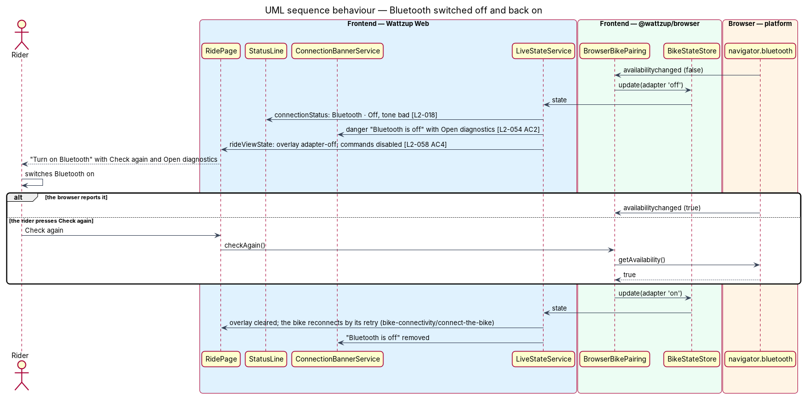

# Show connection status

## Overview

The data on the ride dashboard passes through 2 links: the device's Bluetooth radio, reached through the browser's Web Bluetooth, and the Bluetooth link from the page to the bike. Either can fail, and some browsers or pages cannot reach Bluetooth at all. This feature tells the rider at a glance which link is healthy, what Wattzup is doing about a failed one, and what the dashboard shows while it waits. It has 3 parts that read the same live state.

**status line** — app-bar element with an icon, a name and a state label for the connection, for example `Echelon EX-5s` `Connected` (L2-018)

**connection banner** — full-width alert under the app bar that reports a link change or a fact about the session, such as `Reconnected` or `Simulated bike` (L2-054)

**ride overlay** — panel laid over the main area of the ride dashboard while the dashboard cannot show a live ride, such as `Lost the bike` (L2-058)

**ride view state** — single value derived from the live state that says which skeleton or overlay the dashboard shows and which controls are enabled

**support verdict** — `ready`, `insecure` or `unsupported`, from `bike-connectivity/check-browser-support`

The status line replaces the prototype's coloured pill, and the banners and overlays replace its footer error text. Colour is never the only carrier of a state: each state also has its own text and icon (L2-018). The look comes from the ride mocks (`docs/mocks/pages/ride/*.html`) and the connection-banner mocks (`docs/mocks/notifications/connection-banner/*.html`).

## Description

Core services and helpers (`frontend/projects/wattzup/src/app/core/`):

- **`LiveStateService`** — the only reader of `LIVE_STATE_SOURCE` (L2-044, L2-093). It exposes read-only signals: `state` (`BikeState | null`, the type of `projects/api/src/contract/schema.d.ts`) and `lastStateAt` (`Date | null`). The state comes from the in-page bike connection and workout engine (`live-state/run-rides`), so there is no server link to lose.
- **`connectionStatus(state, support, pairingRequired)`** — pure helper returning `{name, label, icon, tone}`. Rows are checked in this order, so the first match wins (L2-018):

| Condition | Name | State | Icon | Tone |
|---|---|---|---|---|
| support verdict not `ready` | `Bluetooth` | `Unavailable in this browser` | bluetooth-off | wait |
| no state yet | `Bike status` | `Unknown` | bluetooth | wait |
| `adapter` `off` | `Bluetooth` | `Off` | bluetooth-off | bad |
| no bike picked (`ble` `disconnected`, `device` `null`) | `No bike connected` | none | bluetooth-off | quiet |
| `ble` `connected` | `device_label` | `Connected` | bluetooth | ok |
| `ble` `scanning` or `starting` | `Echelon bike` | `Scanning…` | bluetooth, animated | wait |
| `ble` `connecting` | `device_label` | `Connecting…` | bluetooth | wait |
| `ble` `disconnected` | `device_label` or `Echelon bike` | `Disconnected` | bluetooth-off | bad |
| `ble` `error` | `Bike status` | `Error` | bluetooth-off | bad |

- **`rideViewState(state, pairingRequired, support)`** — pure helper returning the ride view state: `view` (`loading` or `ride`), `overlay` (`null`, `browser-unsupported`, `browser-insecure`, `adapter-off`, `connect-bike`, `bike-shut-off`, `ride-complete` or `bike-lost`), `dimmed`, `commandsEnabled`, `pauseEnabled`, `endEnabled` and `controlsNote` (L2-058). Precedence, first match wins:
  1. No state → `loading`. Skeletons show, the workout button reads `Set up a ride`, and Pause and End are disabled.
  2. Support verdict `unsupported` or `insecure` → the notices of `bike-connectivity/check-browser-support` (L2-058 criterion 9).
  3. `adapter` `off` → overlay `adapter-off`: `Turn on Bluetooth` / `Wattzup can't reach this device's Bluetooth. Turn it on, then check again.` with `Check again` and `Open diagnostics` (L2-058 criterion 4).
  4. No bike picked → overlay `connect-bike`, the *Connect your bike* panel of `bike-connectivity/connect-the-bike` (L2-058 criterion 3).
  5. `workout.status` `ended: bike shut off` → overlay `bike-shut-off`: `Ride ended — the bike shut off` / `<device_label> was off for more than 90 seconds, so Wattzup ended the workout at <elapsed>. Your numbers are kept below.` with `See your ride` and `Ride another class` when the ride was saved, else `Ride another class` and `Build your own ride` (L2-058 criterion 6).
  6. `workout.status` `ended` with a saved session → overlay `ride-complete` (L2-084).
  7. `workout.status` `paused: bike disconnected` → overlay `bike-lost` with `dimmed = true`: `Lost the bike` / `<device_label> stopped answering. Wake it with a pedal stroke, then reconnect — your ride is saved at <elapsed>.` and `The plan is paused. If the bike stays off for 90 seconds, Wattzup ends the ride.` End stays enabled.
  8. Otherwise `ride`, with no overlay. With `ble` `connected` and no workout, the interval card reads `No workout running` / `Pick HIIT intervals or a flat level and Wattzup drives the resistance for you.` with `Set up a ride`, Pause and End are disabled, and manual resistance stays enabled.
  `commandsEnabled` is false while `ble` is not `connected`, with the note `Resistance controls wake up once the bike connects.` `<elapsed>` uses the ride-clock format of `workouts/show-workout-countdown`.
- **`ConnectionBannerService`** — root service deriving the visible banners as a `Signal<Banner[]>` from `LiveStateService` (L2-054):
  - **adapter off**, danger, `role="alert"`: `Bluetooth is off` / `Turn Bluetooth on to reach the bike. Wattzup retries every 3 seconds.` with `Open diagnostics`. It shows while `adapter` is `off`.
  - **reconnected**, success, `role="status"`: `Reconnected` / `<device_label> is back. The plan picked up at <elapsed> and resistance is set to <target_resistance>.` It shows for 4 s when `workout.status` changes from `paused: bike disconnected` to `running`.
  - **simulated**, info, `role="status"`: `Simulated bike` / `No hardware connected — Wattzup was opened with ?simulate and is generating cadence and resistance.` It shows while `simulated` is true, until dismissed.
  Dismissals are kept in session storage under `wattzup.banners.dismissed`, so a dismissed banner stays hidden for the browser session. Every storage access is wrapped in `try`/`catch` and falls back to memory.

Components (presentation components in `frontend/projects/components/src/lib/`, the rest in `frontend/projects/wattzup/src/app/dashboard/` (ADR 0013; mapping in `platform/host-and-structure`); each `name.ts` + `name.html` + `name.scss`, OnPush):

- **`StatusLine`** (`wz-status-line`, block `statusline`) — renders `connectionStatus` as an icon, `statusline__name` and `statusline__state`. Tone `wait` adds `statusline--wait`, and tone `bad` adds `statusline--bad`. The scanning icon animates unless `MotionPreference.reduced` is true. The name is bound with interpolation, so a device name such as `<b>x</b>` renders as literal text (L2-018, L2-097).
- **`ConnectionBanner`** (`wz-connection-banner`) — renders each banner through the shared `Alert` component (block `alert`, with the mocks' `banner` class and `alert--info`, `alert--danger` or `alert--success`). It places a `Dismiss` close button on dismissible banners.
- **`RideOverlay`** (`wz-ride-overlay`, block `overlay-panel`) — renders the overlay inside `ride-main`, with `role="alert"` for `bike-lost`, `adapter-off` and the support notices, and `role="status"` for `bike-shut-off` and `ride-complete`, as in the mocks. `Open diagnostics` opens the diagnostics dialog (`dialogs-and-notifications`).
- **`RidePage`** — applies `rideViewState`. It adds `readouts--dimmed` and `metrics--dimmed` where the mock dims with an inline opacity, shows skeletons for `loading`, and passes `commandsEnabled`, `pauseEnabled`, `endEnabled` and `controlsNote` to the app bar and the resistance panel (`resistance-control`).

The `Lost the bike` overlay also shows a `Reconnect` button. It calls `BIKE_API.reconnect()`, which cancels the pending retry and connects to the same bike at once (L2-004, L2-058). An `already_connected` refusal is ignored, because the state already shows the connection; any other failure shows `The bike didn't answer. Wake it with a pedal stroke, then try again.`

Tests:

- Unit tests in `frontend/projects/wattzup/src/app/core/` cover `connectionStatus` with one case per table row, `rideViewState` with one case per precedence step, and `ConnectionBannerService` with each banner and the 4 s reconnected timer.
- Playwright behaviour specs use the `RidePage` and `ConnectionBanner` page objects and the fake `navigator.bluetooth`. They drive the bike through each row of the table and assert the status line, turn the adapter off and on (`availabilitychanged`) and assert the overlay and banner, drop the bike mid-ride and assert the `Lost the bike` overlay and the `Reconnected` banner, and check the literal rendering of a markup device name.

## Requirements

| L2 ID | Refines (L1) | Requirement |
|-------|--------------|-------------|
| `L2-018` | `L1-006` | Connection status line. The app bar must show an icon, a name and a state label for the connection. |
| `L2-054` | `L1-006` | Connection banners. |
| `L2-058` | `L1-006` | Ride dashboard states. |

## Diagrams

### System context

The rider sees the health of the Bluetooth radio and the bike link that Wattzup maintains.

### Containers

Wattzup Web shows the Bluetooth and adapter state it reads through Web Bluetooth.

### Components

`StatusLine`, `ConnectionBanner` and `RideOverlay` read `LiveStateService` through pure helpers. `ConnectionBannerService` adds the timed and dismissed banners.

### Class structure

The helpers are pure functions of the live state, so each table row and precedence step has one unit test. The components only render their results.

### Behaviour — Bluetooth switched off and back on

The browser reports the adapter off. The status line reads `Bluetooth` `Off`, the danger banner and the `Turn on Bluetooth` overlay show and command controls are disabled. When the adapter is back, the browser reports it and the dashboard returns to the bike's state (L2-018, L2-054, L2-058).

### Behaviour — bike lost and reconnected during a ride

The bike stops answering mid-ride. The readouts dim and the `Lost the bike` overlay shows. When the bike returns within 90 seconds, the overlay clears and the `Reconnected` banner shows for 4 s (L2-054, L2-058).

