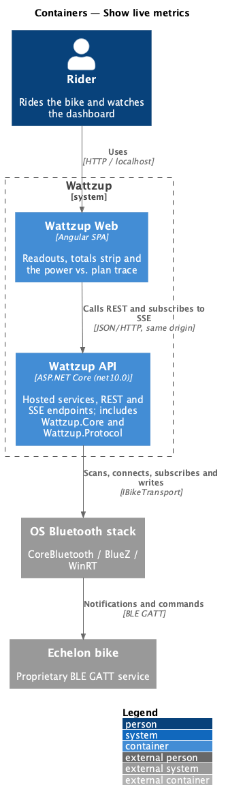
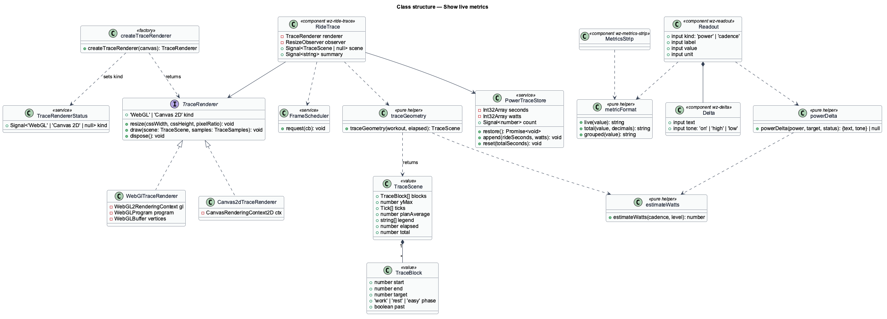
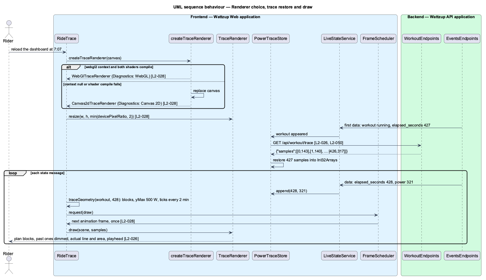

# Show live metrics

## Overview

A rider steers an interval by power and cadence, and checks the ride's totals between efforts. The bike reports cadence and resistance only. Wattzup estimates power from the two and derives speed, distance and energy, so every power figure is labelled as an estimate (ADR 0003). This feature shows those numbers on the ride dashboard in 3 places: the readouts at the top of the main area, the totals strip under the trace, and the "Power vs. plan" trace between them.

**readout** — large numeral with its unit and a sub-line, used for power and cadence (block `readout` in the mocks)

**power delta** — sub-line verdict comparing estimated power with the segment's target: `On target`, a high delta such as `+194 W`, a low delta such as `-185 W`, or `Paused`

**totals strip** — row of 5 metrics: heart rate, average power, speed, distance and energy (block `metrics`)

**power vs. plan trace** — chart of the ride's estimated power over time against the plan's target power per segment (block `trace`)

**trace renderer** — object that draws the trace on its canvas, either with WebGL2 or with Canvas 2D (ADR 0006)

**target power** — estimated watts for a segment, `estimateWatts(cadence aim, level)` = `max(0, round(cadence × (0.55 + level × 0.155)))`

The trace and the totals strip replace the prototype's 150-sample sparklines, and the countdown ring drawn with WebGPU is dropped (ADR 0006). The interval card beside the readouts belongs to `workouts/show-workout-countdown`, and the resistance panel to `resistance-control`. The look comes from `docs/mocks/pages/ride/default.html`, `flat.html`, `edge.html`, `empty.html` and `loading.html`.

## Description

Core helpers and services (`wattzup-web/src/app/core/`, each with unit tests):

- **`estimateWatts(cadence, level)`** — the design's formula, implemented once in the frontend and checked against the same table of cases as `Wattzup.Core` (L2-049, L2-059).
- **`powerDelta(power, target, status)`** — returns `{text, tone}` (L2-021):
  - With no workout it returns `null`, and the sub-line reads `Free ride — no target`.
  - When `status` is not `running` it returns `Paused` with tone `low`.
  - When |power − target| ≤ 8 % of the target it returns `On target` with tone `on`.
  - Otherwise it returns `+<n> W` (tone `high`) or `-<n> W` (tone `low`).
  - When `power` is `null` it returns `null`.
  The target is `target_power` when it is not `null`. Otherwise it is the current segment's target power, so a paused or waiting ride still reads `Target <n> W` as the mocks show.
- **`metricFormat`** — formatting rules (L2-021, L2-022):
  - `--` for a `null` live value.
  - `0`, `0.00` and `0` for ride totals before a ride starts.
  - `distance_km` to 2 decimals.
  - `kcal` and `packets` with a thousands separator (`1,284`) through `Intl.NumberFormat('en')`.
- **`traceGeometry(workout, elapsed)`** — pure scene builder for the trace (L2-026):
  - `blocks`: one per segment from `start` to `start + duration` at its target power. Each has a phase class: `work` for work and steady, `rest` for recover, `easy` for warm-up and cool-down. Each has a `past` flag when `start + duration ≤ elapsed`.
  - `yMax = max(300, ceil(max target × 1.3 ÷ 100) × 100)` W, shown as `trace__max` (`500 W` for the default plan).
  - `ticks`: the smallest step of 2, 5, 10, 15, 30 or 60 minutes that gives 8 or fewer ticks from `0:00`. The default 12:40 ride gets `0:00` to `12:00` every 2 minutes.
  - `planAverage`: the time-weighted mean target power, used in the text summary.
  - `legend`: Actual and Work target, plus Recover for `hiit`.
- **`PowerTraceStore`** — root service holding the browser copy of `PowerTraceHistory` (`live-state/serve-power-trace`) as 2 `Int32Array`s of 10,800 entries (`platform/observability-and-resources`).
  - On the first state with a workout, and after the stream reconnects, it loads `GET /api/workout/trace` through `BikeApi.getTrace()` (L2-026, L2-050).
  - On each state message with `status` `running` it appends `[elapsed_seconds, power ?? 0]`. When `elapsed_seconds` skips ahead by more than 1, it reloads the history instead.
  - It resets when a new workout starts, which shows as `elapsed_seconds` going back or a workout appearing.
- **`TraceRenderer`** — interface behind which both renderers sit (ADR 0006, L2-028):
  - `kind` is `'WebGL'` or `'Canvas 2D'`.
  - `resize(cssWidth, cssHeight, pixelRatio)`, `draw(scene, samples)` and `dispose()`.
  - **`WebGlTraceRenderer`** draws the blocks, the actual area and line, and the playhead from one reused vertex buffer.
  - **`Canvas2dTraceRenderer`** draws the same scene with `Path2D`. It is the reference the WebGL output is compared with.
  - Colours are read from the role tokens `--color-series-work`, `--color-series-rest`, `--color-series-easy`, `--color-series-actual`, `--color-series-grid` and `--color-playhead` on the host element. They are read again when the colour scheme changes, never hard-coded.
- **`createTraceRenderer(canvas)`** — factory bound to the `TRACE_RENDERER_FACTORY` token in `app.config.ts`. It requests a `webgl2` context and compiles both shaders. When the context is `null` or a shader fails to compile, it replaces the canvas with a fresh one and returns a `Canvas2dTraceRenderer`. A later `webglcontextlost` event falls back the same way (L2-028).
- **`TraceRendererStatus`** — root signal holding the active `kind`, which the diagnostics dialog shows as `Trace renderer: WebGL` or `Canvas 2D` (`dialogs-and-notifications`).
- **`FrameScheduler`** — the only `requestAnimationFrame` caller. It coalesces requests to one draw per frame and stops while the tab is hidden (`platform/observability-and-resources`).

Components (`wattzup-web/src/app/dashboard/`, OnPush, signals only):

- **`Readout`** (`wz-readout`, block `readout`, modifiers `readout--power` and `readout--cadence`) — renders `label`, `readout__value` (`numeral` plus `readout__unit`) and one `ng-content` slot for `readout__sub`.
  - **Power** shows `power` with `W`. Its sub-line reads `Target <n> W` with a `Delta` (`wz-delta`, block `delta`, `delta--on`, `delta--high` or `delta--low`), or `Free ride — no target`.
  - The power readout's accessible description is `Estimated from cadence and resistance`, through `aria-describedby` to visually hidden text, and its tooltip carries the same text (L2-021). It is a native `title`, not a custom tooltip. The unit shows the visible marker `est.` (L2-021), which the mocks gain in the mock update that follows the requirements rewrite.
  - **Cadence** shows `cadence` with `rpm`, and its sub-line reads `Aim for <segment cadence>` or `No cadence goal`.
- **`MetricsStrip`** (`wz-metrics-strip`, block `metrics`) — a `dl` of Heart rate, Avg power, Speed, Distance and Energy (L2-022).
  - Heart rate always shows `--` `bpm`, because `heart_rate` is always `null` (ADR 0003).
  - Speed shows `speed_kmh` with `km/h · <speed_mph> mph`, for example `25.1` `km/h · 15.6 mph` (L2-021).
  - Totals stay on screen after a ride ends or stops, because the backend keeps their final values until a new ride starts (L2-049).
- **`RideTrace`** (`wz-ride-trace`, block `trace`) — a `figure` with the `trace__head` caption `Power vs. plan` and the `trace__legend` list. `trace__plot` holds the canvas, and `trace__axis` holds the ticks.
  - The canvas carries `aria-hidden="true"`. A visually hidden summary reads `Average <avg_power> W against a plan average of <planAverage> W` (L2-028).
  - Tick positions are set through `[style.inset-inline-start.%]` bindings. The template has no static `style` attribute, and Angular applies the bindings through the CSSOM, which the CSP allows.
  - A `ResizeObserver` on `trace__plot` calls `resize` with `min(devicePixelRatio, 2)`, so the canvas follows layout and orientation changes and never renders above 2× (L2-028, L2-040).
  - Every state change requests one draw from `FrameScheduler`, so a telemetry update redraws on the next frame and never more than once per frame (L2-028).
  - With no workout, `trace__plot` shows the compact empty state `No ride yet` / `Your power, drawn against the plan, appears here once a ride starts.` (L2-026).
  - While no state has arrived, every readout, metric and the trace show the mocks' `skeleton` placeholders.

Tests:

- Unit tests cover `estimateWatts`, `powerDelta` (one case per row of L2-021 criteria 1–3), `metricFormat`, `traceGeometry` (y maximum and tick step cases, past flags, legend per kind) and `PowerTraceStore` (restore, append, gap reload, reset).
- `createTraceRenderer` is tested with a stubbed `getContext` returning `null` and with a shader compile failure, and each case returns `Canvas 2D`.
- Playwright behaviour specs use the `RidePage` page object with stubbed `/api/**` and a stubbed event stream. They assert:
  - the readout text for the default, delta, paused and free-ride states;
  - `--` for `null` fields, the totals strip values and the heart-rate `--`;
  - that a reload mid-ride requests `GET /api/workout/trace`;
  - the empty trace, the legend, the axis ticks and the text summary;
  - `Trace renderer: Canvas 2D` when an init script makes `getContext('webgl2')` return `null`.
- Pixel comparison of the 2 renderers belongs to the visual sweep, which runs only when a person asks.

## Requirements

| L2 ID | Refines (L1) | Requirement |
|-------|--------------|-------------|
| `L2-021` | `L1-006` | Power, cadence and speed readouts. |
| `L2-022` | `L1-006` | Ride totals strip. |
| `L2-026` | `L1-007` | Power vs. plan trace. The dashboard must draw the ride's estimated power against the plan's target power. |
| `L2-028` | `L1-007` | Trace renderer with fallback. The trace must render with WebGL2, falling back to Canvas 2D. |

## Diagrams

### System context

The rider watches power, cadence, speed and totals that Wattzup derives and estimates from the bike's cadence and resistance.

### Containers

Wattzup Web renders the values streamed by the Wattzup API, and restores the trace history from it after a reload.

### Components

`Readout` and `MetricsStrip` read the state through the formatting helpers. `RideTrace` builds a scene with `traceGeometry`, reads `PowerTraceStore`, and draws through the `TraceRenderer` that `createTraceRenderer` chose.

### Class structure

The 2 renderers realise one interface. The geometry and formatting rules are pure functions with their own unit tests.

### Behaviour — renderer choice, restore and draw

On first render the factory picks WebGL or falls back to Canvas 2D. A reload mid-ride restores the history from the API, and each telemetry update is drawn on the next animation frame (L2-026, L2-028).

