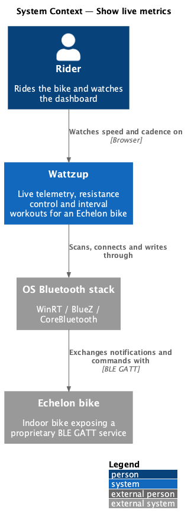
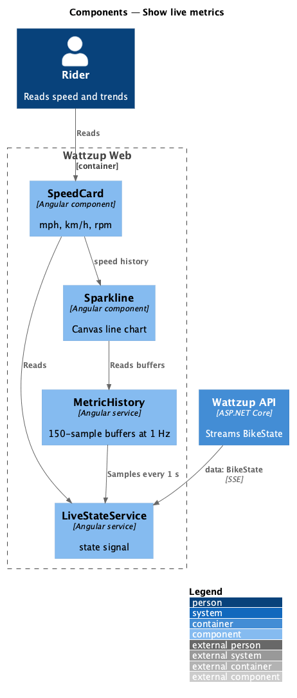
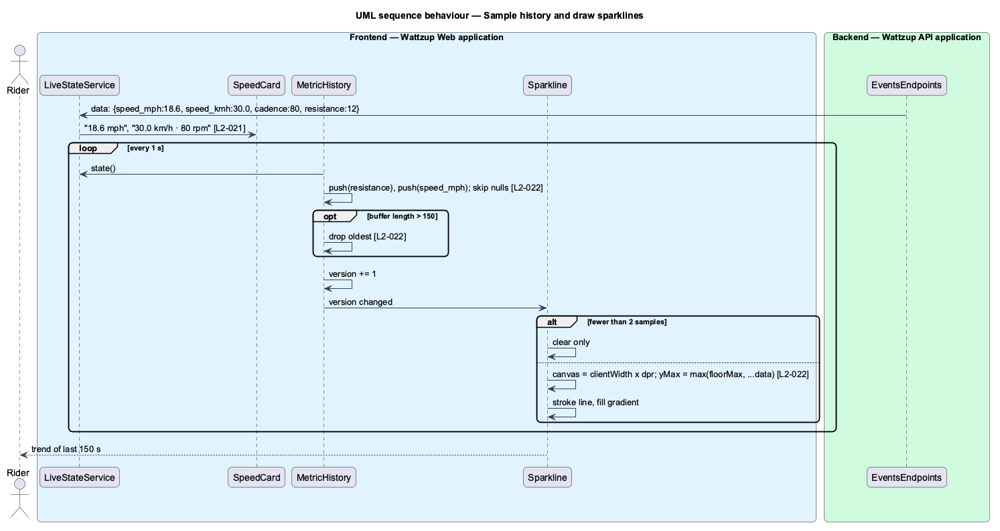

# Show live metrics

## Overview

Riders steer an interval by speed and cadence and want to see how both have moved over the last few minutes. The speed card shows current speed in miles per hour, with kilometres per hour and cadence beneath. Both metric cards carry a sparkline of the last 150 seconds. The resistance sparkline sits on the resistance card, whose other content belongs to `show-resistance`.

**sparkline** — small line chart without axes, drawn on a canvas, with a gradient fill under the line

**history buffer** — fixed-length list of the most recent 150 samples, one taken per second from the latest state

Samples are taken once per second from the current state, not from every message. The sparkline time base therefore stays even when messages arrive in bursts or pause.

## Description

- **`SpeedCard`** — standalone component. It shows `speed_mph` with the unit `mph`, then `speed_kmh` km/h · `cadence` rpm on the line below. Each value shows `--` when null (L2-021).
- **`MetricHistory`** — root service with 2 `RingBuffer<number>(150)` instances, `resistance` and `speedMph`. A 1 s `interval` started outside the Angular zone pushes the current values and skips nulls. When a buffer is full, the oldest sample is removed. It exposes a `version` signal that increments after each push (L2-022).
- **`RingBuffer<T>`** — fixed-capacity array with `push` and `toArray`.
- **`Sparkline`** — standalone component with inputs `data`, `floorMax` and `color`.
  - It sizes the canvas to `clientWidth × devicePixelRatio`, scales the context, and redraws when `version` changes.
  - The y maximum is `max(floorMax, ...data)`: `floorMax` is 32 for resistance and 25 for speed.
  - The x axis spans 150 slots, so a short history starts at the left.
  - Fewer than 2 samples draw nothing.
  - Colours are `#ff5a36` for resistance and `#3d9bff` for speed, with a 33 %-to-0 % alpha gradient fill (L2-022).

## Requirements

| L2 ID | Refines (L1) | Requirement |
|-------|--------------|-------------|
| `L2-021` | `L1-006` | Speed and cadence card. |
| `L2-022` | `L1-006` | Metric history sparklines. Each card must show a sparkline of the last 150 one-second samples. |

## Diagrams

### System context

The rider watches speed and cadence that Wattzup derives from the bike.

### Containers

Wattzup Web renders values streamed by the Wattzup API.

### Components

`SpeedCard` reads the state directly. `MetricHistory` samples it once per second for the 2 `Sparkline` instances.

### Class structure

`MetricHistory` owns 2 fixed-size buffers. `Sparkline` is a reusable presentational component.

### Behaviour — sample and draw

Each second the history takes a sample, drops the oldest beyond 150, and the sparklines redraw at device resolution (L2-022).

