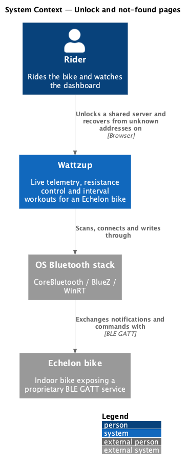
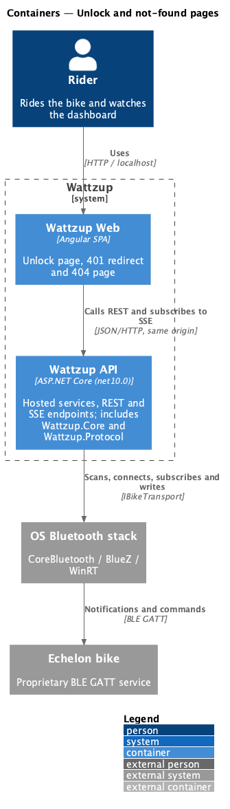
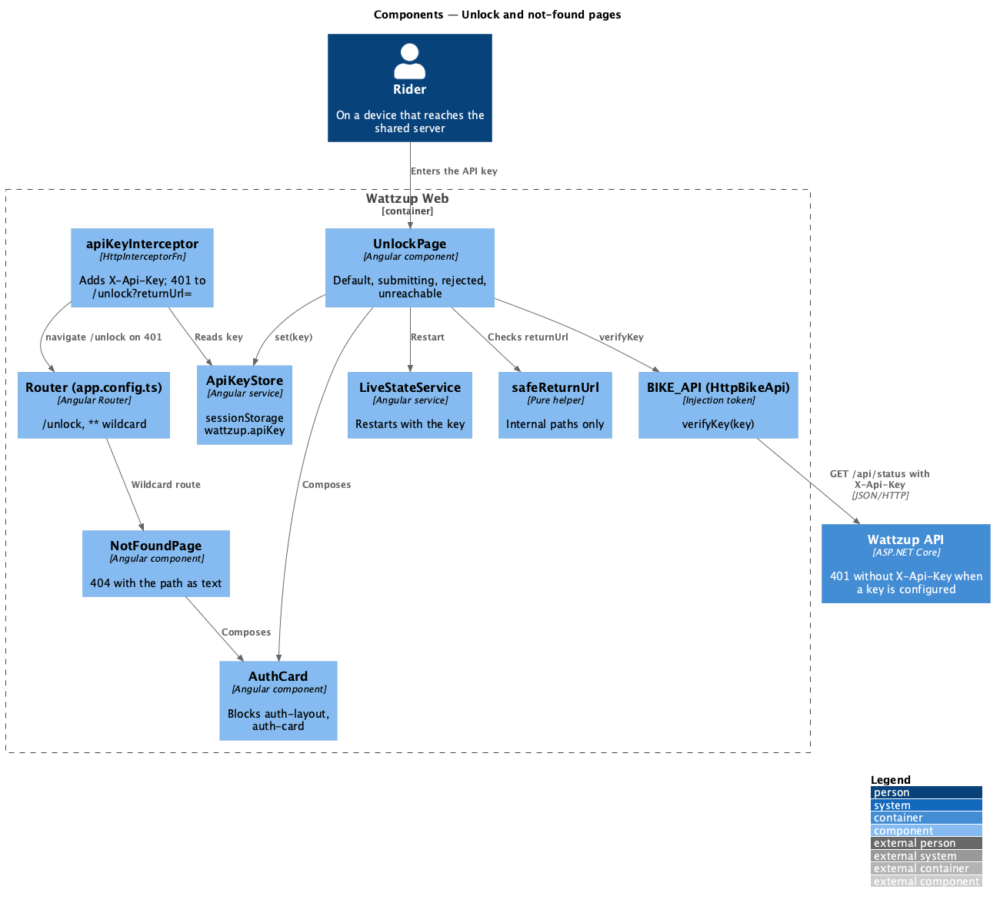
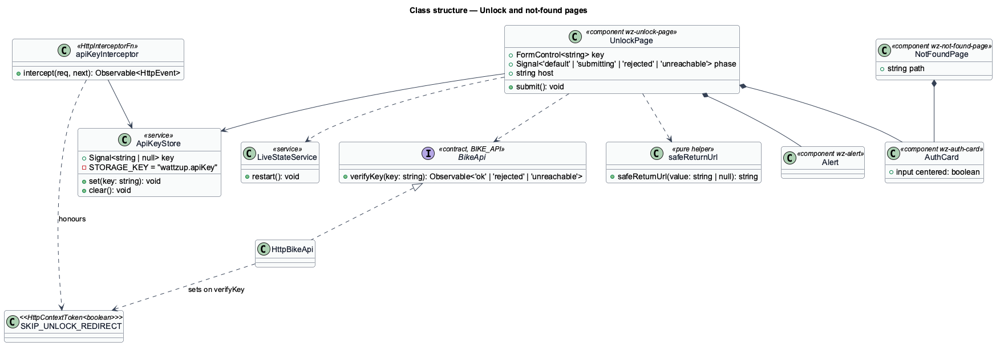
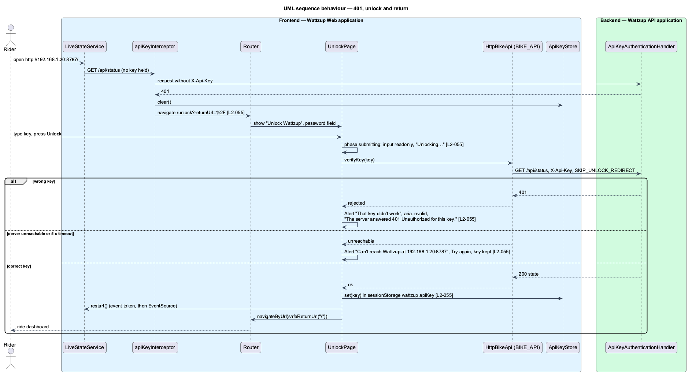
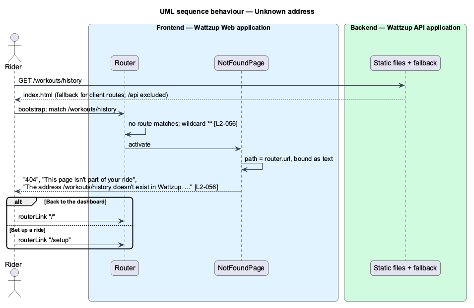

# Unlock and not-found pages

## Overview

Wattzup listens on loopback by default and needs no key there. When the rider shares the server on the home network, every `/api/*` endpoint requires an API key (L2-035), and a browser on another device has to supply it. This feature covers the browser side of that gate: the `/unlock` page where the rider enters the key, the redirect that sends any unauthorised request there, and where the key is kept. It also covers the page shown for an address that is not part of Wattzup. Both pages sit outside the ride dashboard and leave the ride and the bike connection untouched.

**unlock page** — client route `/unlock` with one API-key field and an Unlock button (L2-055)

**return URL** — internal path the rider was on when a request answered 401, carried to `/unlock` in the `returnUrl` query parameter

**session key** — API key held in the browser's session storage under `wattzup.apiKey`, so it lasts for one browser session and no longer

**not-found page** — page shown for any client route the router does not know, such as `/workouts/history` (L2-056)

The server side of the key, including constant-time comparison and event tokens, belongs to `platform/secure-api`. The look and copy come from `docs/mocks/pages/unlock/*.html` (default, submitting, invalid, error) and `docs/mocks/pages/not-found/default.html`.

## Description

Core (`frontend/src/app/core/`):

- **`ApiKeyStore`** — root service holding the session key as a `Signal<string | null>`. `set(key)` writes `sessionStorage['wattzup.apiKey']`, and `clear()` removes it. Every storage access is wrapped in `try`/`catch` and falls back to memory, so a blocked storage still unlocks for the page's lifetime. The store never logs the key.
- **`apiKeyInterceptor`** — functional `HttpInterceptorFn` registered in `app.config.ts`:
  - It adds `X-Api-Key` from `ApiKeyStore` to every same-origin `/api` request that does not already carry the header.
  - On a 401 response it clears the store and calls `router.navigate(['/unlock'], {queryParams: {returnUrl: router.url}})`, unless the request carries the `SKIP_UNLOCK_REDIRECT` `HttpContextToken` (L2-055).
  - It never adds the key to a URL. The event stream uses a single-use token instead (`platform/secure-api`).
- **`safeReturnUrl(value)`** — pure helper that accepts only a path starting with `/` and not with `//`, and returns `/` otherwise, so the redirect cannot leave the origin.
- **`BikeApi.verifyKey(key)`** — sends `GET /api/status` with `X-Api-Key: <key>` and `SKIP_UNLOCK_REDIRECT`. It resolves to `ok`, `rejected` (401) or `unreachable` (status 0, a 5xx from a proxy, or a 5 s timeout).

Components (`frontend/src/app/dashboard/`):

- **`AuthCard`** (`wz-auth-card`, blocks `auth-layout` and `auth-card`) — centred card with the large `lockup`, declaring one default `ng-content` slot. `centered` adds `auth-card--centered`, replacing the inline `text-align: center` of the not-found mock.
- **`UnlockPage`** (`wz-unlock-page`, route `/unlock`) — heading `Unlock Wattzup`, the intro `This Wattzup server is shared on your network, so it asks for its API key. You'll only need it once per browser session.`, and a form with one typed `FormControl<string>`. The phases follow the 4 mocks (L2-055):
  - **Default** — `field` with label `API key`. The input is `type="password"`, `autocomplete="current-password"`, `spellcheck="false"` and autofocused. Its help text reads `Find it in appsettings.json under Wattzup:Security:ApiKey, or in the WATTZUP__SECURITY__APIKEY variable.` The button reads `Unlock`.
  - **Submitting** — `(ngSubmit)` calls `verifyKey`. The input is `readonly`, and the button reads `Unlocking…` with `aria-busy="true"` and `disabled`.
  - **Rejected** — a danger `Alert` reads `That key didn’t work` / `Check the API key and try again.`, where `Check the API key` links to `#key`. The input gets `aria-invalid="true"` and the field error `The server answered 401 Unauthorized for this key.` The button reads `Unlock`.
  - **Unreachable** — a danger `Alert` reads `Can’t reach Wattzup at <host>` / `Check that the Wattzup server is running on that computer, then try again.`, where `<host>` is `location.host`. The typed key is kept, and the button reads `Try again`.
  - **Success** — `ApiKeyStore.set(key)`, `LiveStateService` restarts its connection with the key, and the router navigates to `safeReturnUrl(returnUrl)`.
  The form has no `action` and submits through Angular, so the key never reaches a URL, a query string or a log (L2-055). An empty submit sends no request, and the field reads `Enter the API key.` (L2-055).
- **`NotFoundPage`** (`wz-not-found-page`, route `**`) — inside a centred `AuthCard`:
  - a `numeral` `404` with `aria-hidden="true"`;
  - the heading `This page isn't part of your ride`;
  - the text `The address <path> doesn't exist in Wattzup. Your ride and the bike connection are unaffected.`, where `<path>` is `router.url` bound with interpolation, so markup in the address renders as text;
  - 2 `routerLink`s: `Back to the dashboard` to `/` and `Set up a ride` to `/setup` (L2-056).
  The host serves `index.html` for unknown client routes (`platform/host-and-structure`), so the router, not the server, decides that a path is unknown. The titles are `Unlock · Wattzup` and `Page not found · Wattzup` (L2-041), set through the route `title`.

Tests:

- Unit tests cover `safeReturnUrl` (one case per accepted and rejected form), `ApiKeyStore` (set, clear, blocked storage) and `apiKeyInterceptor` (adds the header, redirects on 401, honours `SKIP_UNLOCK_REDIRECT`).
- Playwright behaviour specs use the `UnlockPage` and `NotFoundPage` page objects. The fixture answers `/api/status` with 401 until the expected key header is present, then with recorded state. The specs assert:
  - the redirect from `/` to `/unlock?returnUrl=%2F`;
  - the submitting, rejected and unreachable phases, the latter from an aborted request;
  - the key kept in session storage and absent from every request URL;
  - the return to the original page;
  - the 404 copy for `/workouts/history` with both links, and the literal rendering of a path containing markup.

## Requirements

| L2 ID | Refines (L1) | Requirement |
|-------|--------------|-------------|
| `L2-055` | `L1-009` | Unlock page. |
| `L2-056` | `L1-011` | Not-found page. |

## Diagrams

### System context

The rider on another device unlocks the shared Wattzup server, or lands on an address Wattzup does not have.

### Containers

Wattzup Web holds the key for the session and sends it to the Wattzup API, which answers 401 without it.

### Components

`apiKeyInterceptor` adds the key and turns a 401 into a redirect. `UnlockPage` verifies a key through `BikeApi` and stores it in `ApiKeyStore`. `NotFoundPage` is the router's wildcard route.

### Class structure

The key handling is split into a store, an interceptor and a pure return-URL check, each with its own unit tests.

### Behaviour — 401, unlock and return

A request without a key answers 401, the rider is sent to `/unlock`, a rejected key shows the field error, and the correct key returns the rider to the page they came from (L2-055).

### Behaviour — unknown address

The host serves the app for an unknown client route, and the router's wildcard route shows the not-found page with the path as text (L2-056).

