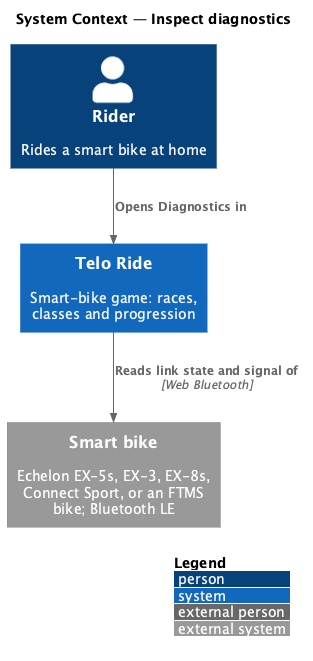
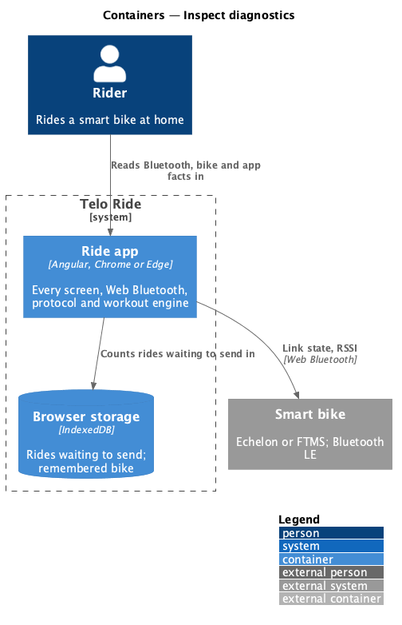
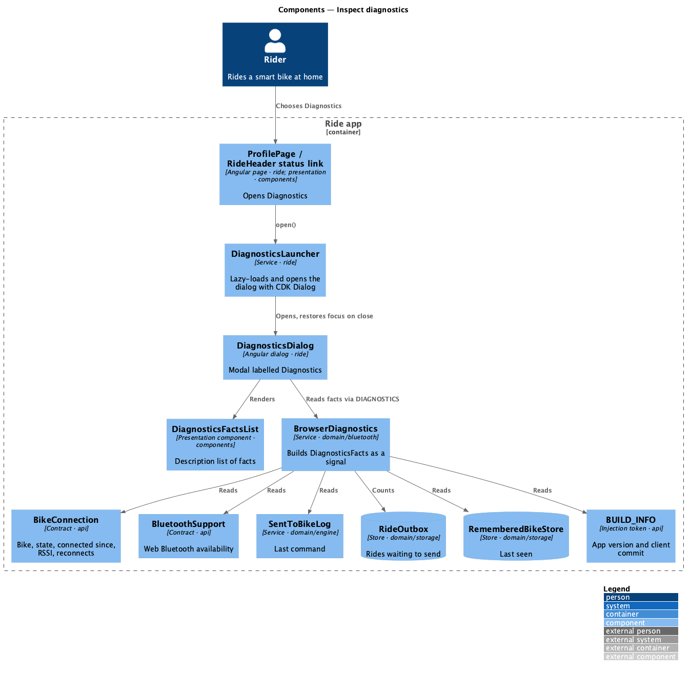
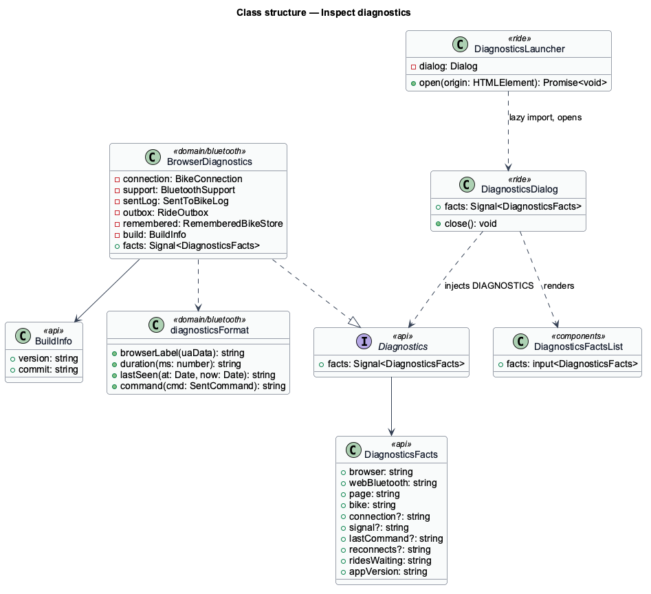
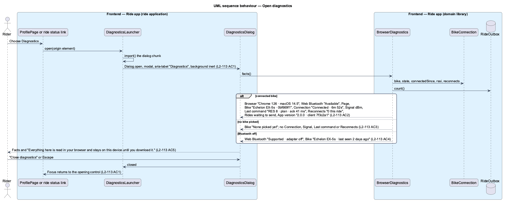

# Inspect diagnostics

## Overview

When a ride goes wrong, the cause usually sits between the browser, the Bluetooth radio and the bike. Telo Ride gives the rider one place to see the state of all three, without a network and without sending anything anywhere. This feature is the Diagnostics dialog: a read-only summary of the browser, Web Bluetooth, the bike link and the app, opened from Profile or from the custom ride's bike status.

The following terms are used in this design:

- **Diagnostics** — modal dialog that lists facts about the browser, Bluetooth, the bike and the app, and holds the packet log controls
- **fact** — one labelled value in the dialog, such as Browser "Chrome 126 · macOS 14.5"
- **RSSI** — received signal strength indicator of the bike's advertisements, in dBm, available only where the browser reports it
- **rides waiting to send** — finished rides kept on the device until the backend has recorded them (`L2-135`)

The dialog's lower half, the packet log switch and download, belongs to [record-the-packet-log](../record-the-packet-log/README.md). Every fact is read in the browser and stays on the device; the only way a fact leaves is in a feedback report the rider sends with diagnostics attached ([feedback/send-feedback](../../feedback/send-feedback/README.md)).

## Description

The slice lives in the Ride app. No backend takes part.

- **`DiagnosticsLauncher`** — service in `ride`. `open(origin)` loads the dialog's chunk with a dynamic `import()` and opens `DiagnosticsDialog` through the CDK `Dialog` service, so the dialog adds nothing to the initial bundle. Profile and the custom ride's bike status link (`aria-label` "Diagnostics: {bike} {state}", [bike/keep-the-bike-connected](../../bike/keep-the-bike-connected/README.md)) both call it.
- **`DiagnosticsDialog`** — dialog component in `ride` (design-system block `diagnostics`). It is modal and labelled "Diagnostics". The CDK dialog makes the page behind inert, traps focus, closes on "Close diagnostics" or Escape, and returns focus to the control that opened it. It renders the facts and the privacy note "Everything here is read in your browser and stays on this device until you download it.".
- **`DiagnosticsFactsList`** — presentation component in `components` (design-system block `description-list`, rendered in `diagnostics__facts`). It renders each present fact as a term and a value; facts are data, rendered as text, never as HTML.
- **`Diagnostics`** — contract in `api` with token `DIAGNOSTICS`, exposing `facts` as a signal of `DiagnosticsFacts`.
- **`BrowserDiagnostics`** — implementation in `domain`'s `bluetooth/` folder, provided with the dialog and released when it closes. It computes `DiagnosticsFacts` from:
  - the browser and platform, from `navigator.userAgentData` where it exists and the user-agent string otherwise ("Chrome 126 · macOS 14.5");
  - `BluetoothSupport`, giving Web Bluetooth "Available" or, with the adapter off, "Supported · adapter off";
  - the page address (`location.href`);
  - `BikeConnection`, giving Bike "Echelon EX-5s · 0bf669f1", Connection "Connected · 6m 52s", Signal in dBm (only where the browser reports RSSI) and Reconnects "0 this ride";
  - `SentToBikeLog.last`, giving Last command "RES 8 · plan · ack 41 ms";
  - `RideOutbox.count()`, giving Rides waiting to send;
  - `BUILD_INFO`, giving App version "2.0.0 · client 7f3c2a1".
  With no bike picked, Bike reads "None picked yet" and Connection, Signal, Last command and Reconnects are absent. With Bluetooth off, Bike reads the remembered bike and its last-seen time from `RememberedBikeStore` ("Echelon EX-5s · last seen 2 days ago"). A read-only FTMS bike carries the "Read only" explanation required by `L2-014`; its wording is `<TO SUPPLY>`.
- **`diagnosticsFormat`** — pure helpers in `domain`'s `bluetooth/` folder, with unit tests: browser label, connection duration ("6m 52s"), last-seen phrase ("2 days ago") and command label.
- **`BUILD_INFO`** — injection token in `api` holding the app version and the client commit, bound in `app.config.ts` from build-time constants.

The diagnostics mock still reads "Rides stored 23 · 418 KB in this browser"; the specs list this as a mock gap to be changed to "Rides waiting to send".

## Requirements

The feature realizes the following level-2 (L2) requirements. Each L2 requirement refines a level-1 (L1) requirement, cited by identifier.

| L2 ID | Refines (L1) | Requirement |
|-------|--------------|-------------|
| `L2-113` | `L1-018` | Diagnostics, opened from Profile or the custom ride's bike status, shall be a modal dialog labelled "Diagnostics"; the page behind shall be inert, and close ("Close diagnostics", or Escape) shall return focus to what opened it. With a connected bike the facts shall read Browser "Chrome 126 · macOS 14.5"; Web Bluetooth "Available"; Page, Bike "Echelon EX-5s · 0bf669f1" and Connection "Connected · 6m 52s"; Signal (RSSI in dBm, where the browser reports it); Last command "RES 8 · plan · ack 41 ms" and Reconnects "0 this ride"; Rides waiting to send, and App version "2.0.0 · client 7f3c2a1". With no bike picked, Bike shall read "None picked yet" and Connection, Signal, Last command and Reconnects shall be absent. With Bluetooth off, Web Bluetooth shall read "Supported · adapter off" and Bike "Echelon EX-5s · last seen 2 days ago". The dialog shall read "Everything here is read in your browser and stays on this device until you download it." |

## Diagrams

### System context

The rider opens Diagnostics in Telo Ride, which reads the bike's link state and signal over Web Bluetooth.

### Containers

Every fact comes from the Ride app, the bike link and browser storage. Nothing reaches the backend.

### Components

The opening control calls `DiagnosticsLauncher`, which lazy-loads and opens `DiagnosticsDialog`. The dialog reads `BrowserDiagnostics` through `DIAGNOSTICS`, which gathers facts from the bike connection, Bluetooth support, the "Sent to bike" log, the outbox, the remembered bike and the build information.

### Class structure

`BrowserDiagnostics` realizes `Diagnostics` and formats its values with `diagnosticsFormat`. `DiagnosticsFacts` marks the four bike-link facts optional, since they are absent with no bike picked.

### Behaviour — open diagnostics

Opening Diagnostics lazy-loads the dialog and makes the page behind inert. The facts depend on the state: connected, no bike picked, or Bluetooth off (`L2-113`). Closing returns focus to the control that opened the dialog.

