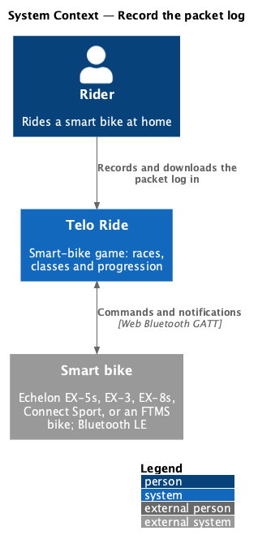
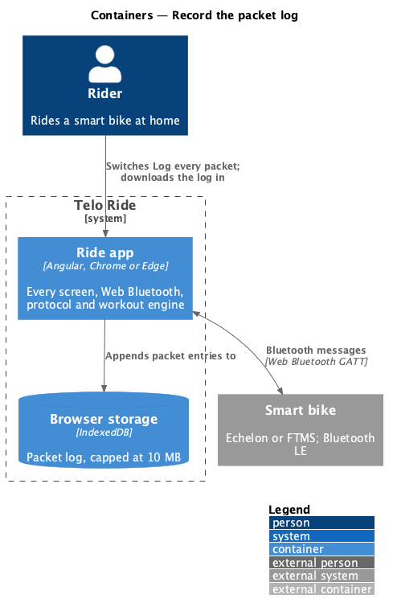
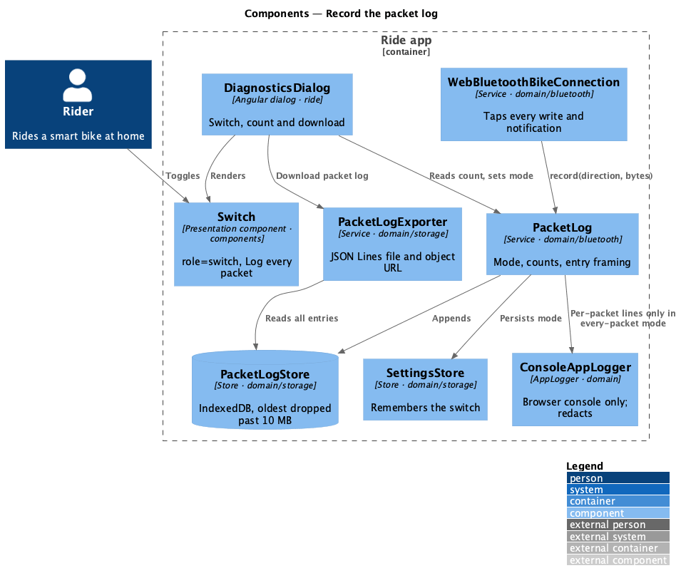
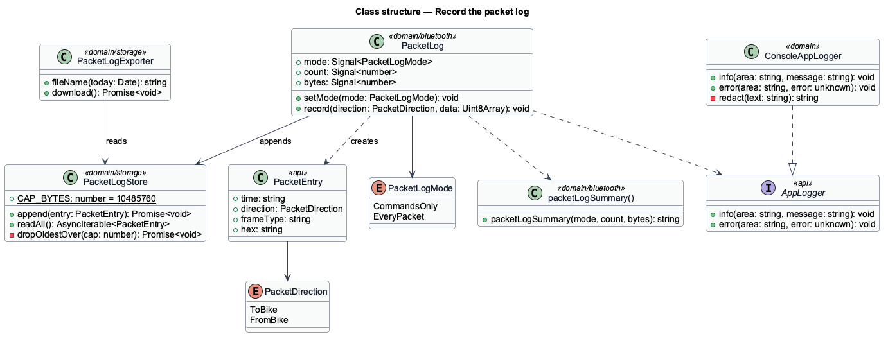
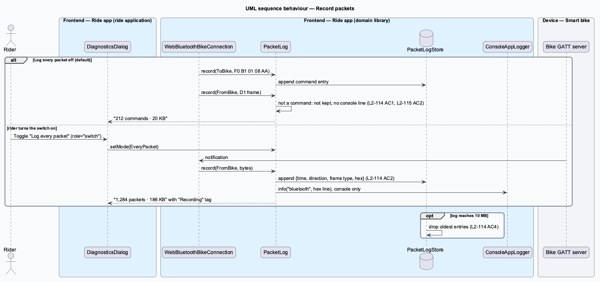
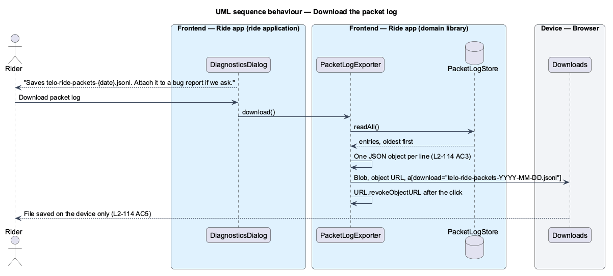
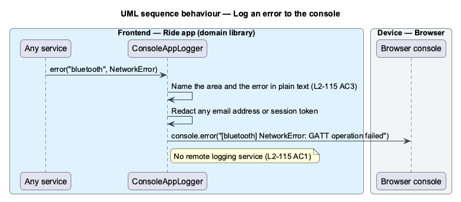

# Record the packet log

## Overview

Some bike problems show only in the bytes: a frame the bike stops sending, a command it never acknowledges, a drop after a particular write. Telo Ride lets the rider record every Bluetooth message while reproducing a problem and download that record as a file. The record stays on the device unless the rider attaches it to a feedback report. This feature is the packet log and its console counterpart.

The following terms are used in this design:

- **packet** — one Bluetooth message between the app and the bike, in either direction: a command written to the bike or a notification from it
- **command** — packet the app writes to the bike, such as set resistance or keepalive
- **packet log** — on-device record of packets: commands only by default, every packet while "Log every packet" is on
- **JSON Lines** — text format with one JSON object per line, used for the downloaded file `telo-ride-packets-{YYYY-MM-DD}.jsonl`
- **console logging** — messages the app writes to the browser's developer console, and nowhere else

The switch, the count and the download sit in the lower half of the Diagnostics dialog ([inspect-diagnostics](../inspect-diagnostics/README.md)). The "Sent to bike" log on Custom ride shows the last 50 commands; older commands remain in the packet log ([bike/control-resistance](../../bike/control-resistance/README.md)). Attaching the log to a report belongs to [feedback/send-feedback](../../feedback/send-feedback/README.md) (`L2-117`).

## Description

The slice lives in the Ride app. No backend takes part.

- **`PacketLog`** — service in `domain`'s `bluetooth/` folder, provided in `root` because the bike connection it taps lives for the whole app. `WebBluetoothBikeConnection` calls `record(direction, bytes)` for every write and every notification. In `CommandsOnly` mode, the default, it keeps commands and drops notifications. In `EveryPacket` mode it keeps every packet in both directions. Each kept packet becomes a `PacketEntry` with an ISO time, a direction, a frame type (`B1`, `D1`, or the FTMS characteristic) and the bytes as hex. It exposes `count` and `bytes` signals for the summary.
- **`PacketLogStore`** — store in `domain`'s `storage/` folder over an IndexedDB object store. It appends entries and drops the oldest once the log reaches 10 MB, so the log is bounded on disk and none of it accumulates in memory during a ride. Whether the log survives a reload is `<TO SUPPLY>`.
- **`packetLogSummary()`** — pure helper with unit tests. It formats the count line: "212 commands · 20 KB" in `CommandsOnly` mode and "1,284 packets · 186 KB" with a "Recording" tag in `EveryPacket` mode.
- **`Switch`** — presentation component in `components` (design-system block `switch`, `role="switch"`) for "Log every packet", with the detail "Records each Bluetooth message, not just the commands we send. Turn on while reproducing a problem — it uses memory." from the mock. The chosen mode persists through `SettingsStore`.
- **`PacketLogExporter`** — service in `domain`'s `storage/` folder. `download()` streams the entries, oldest first, into a JSON Lines `Blob`, triggers a download named `telo-ride-packets-{YYYY-MM-DD}.jsonl` through a temporary object URL, and revokes the URL afterwards. The dialog reads "Saves telo-ride-packets-{date}.jsonl. Attach it to a bug report if we ask." beside the button.
- **`AppLogger`** — contract in `api` with token `APP_LOGGER`.
- **`ConsoleAppLogger`** — implementation in `domain`, bound in `app.config.ts`. It writes to the browser console only; no remote logging service exists. Each error names the area and the error in plain text ("[bluetooth] NetworkError: GATT operation failed"). Before writing, it redacts any email address or session token. Per-packet lines go to the console only while "Log every packet" is on.

The packet log leaves the device only inside a feedback report the rider sends with diagnostics attached.

## Requirements

The feature realizes the following level-2 (L2) requirements. Each L2 requirement refines a level-1 (L1) requirement, cited by identifier.

| L2 ID | Refines (L1) | Requirement |
|-------|--------------|-------------|
| `L2-114` | `L1-018` | With "Log every packet" (`role="switch"`) off, only commands shall be kept and the count shall read "212 commands · 20 KB". With the switch on, every message in both directions shall be kept and the count shall read "1,284 packets · 186 KB" with a "Recording" tag. "Download packet log" shall save `telo-ride-packets-{YYYY-MM-DD}.jsonl` with one JSON object per message (time, direction, frame type, hex bytes), and the dialog shall read "Saves telo-ride-packets-{date}.jsonl. Attach it to a bug report if we ask.". When the log reaches 10 MB, the oldest entries shall be dropped. The packet log shall never leave the device except in a feedback report the rider sends with diagnostics attached (L2-117). |
| `L2-115` | `L1-018` | The app shall log to the browser console only, with no remote logging service. With "Log every packet" off, no per-packet line shall be written to the console. A logged error shall name the area and the error in plain text and hold no email or session token. |

## Diagrams

### System context

The rider records and downloads the packet log in Telo Ride, which captures the commands and notifications it exchanges with the bike.

### Containers

The Ride app appends packet entries to browser storage, capped at 10 MB. The downloaded file is saved on the device.

### Components

`WebBluetoothBikeConnection` passes every packet to `PacketLog`, which keeps it according to the mode and appends it to `PacketLogStore`. `PacketLogExporter` reads the store for the download. `ConsoleAppLogger` receives per-packet lines only in every-packet mode.

### Class structure

`PacketLog` creates `PacketEntry` values and appends them to `PacketLogStore`. `PacketLogExporter` reads the same store. `ConsoleAppLogger` realizes `AppLogger` and redacts before it writes.

### Behaviour — record packets

With the switch off, commands are kept and notifications are not, and the console stays quiet. With it on, every packet is kept and echoed to the console. Past 10 MB, the oldest entries go (`L2-114`, `L2-115`).

### Behaviour — download the packet log

The exporter streams every entry into a JSON Lines file named for the day, triggers the download, and revokes the object URL (`L2-114`).

### Behaviour — log an error to the console

A service reports an error with its area. The logger writes it in plain text to the browser console, with any email address or session token redacted (`L2-115`).

