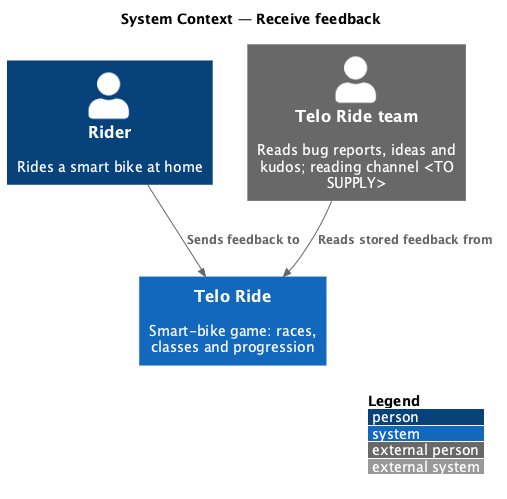
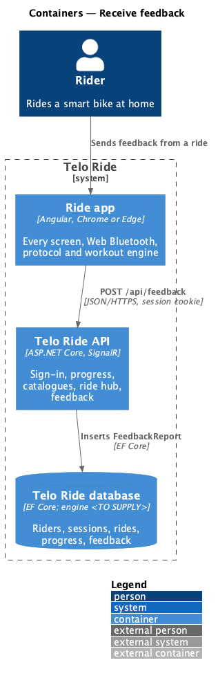
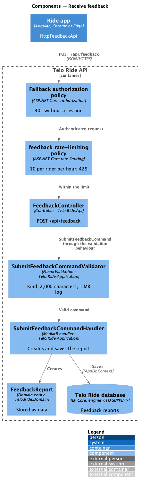
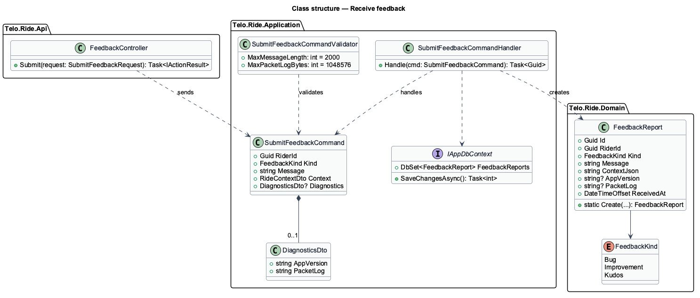
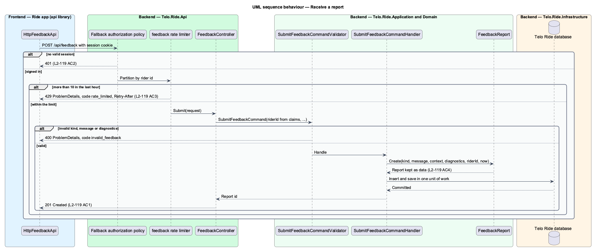

# Receive feedback

## Overview

Feedback a rider sends from a ride (`feedback/send-feedback`) reaches the Telo Ride team through
the backend. This feature covers the backend side: the endpoint that accepts a report, the checks
it applies, and how the report is stored so the team can read it safely.

**feedback report** — stored record of one piece of feedback: its kind, message, ride context,
optional diagnostics, the rider's account and the time it arrived

**rate limit** — cap on how many requests one caller may make in a window; past it the API answers
429

A signed-in rider posts a report to `POST /api/feedback`. The API stores it with its kind,
message, context, optional diagnostics, the rider's account and the time, and answers 201. A
request without a session is refused with 401. A rider who has sent more than 10 reports in an
hour is refused with 429. The message and context are kept as data; nothing in Telo Ride renders
them as HTML. How the team reads stored reports (a tool, an export or a notification) is not
specified: `<TO SUPPLY>`.

## Description

- **`FeedbackController.Submit`** — `Telo.Ride.Api` action for `POST /api/feedback`. It carries no
  `[AllowAnonymous]`, so the fallback authorization policy refuses a request without a valid
  session with 401 (`L2-119` AC2). It carries `[EnableRateLimiting("feedback")]` and a request size
  limit that admits a 1 MB packet log plus the message and context; the exact limit is
  `<TO SUPPLY>`. It sends one `SubmitFeedbackCommand` and returns 201 Created.
- **`feedback` rate-limiting policy** — registered with `AddRateLimiter` in `Telo.Ride.Api`. A
  sliding window of 1 hour permits 10 requests per partition, partitioned by the rider id claim
  (`L2-119` AC3). A refusal is a ProblemDetails with status 429, `code` `rate_limited` and a
  `Retry-After` header. The window lives in process memory; sharing it across API instances is
  `<TO SUPPLY>`, as for the other rate limits (`security/limit-abuse`).
- **`SubmitFeedbackCommand`** — `Telo.Ride.Application` request: `Kind`, `Message`, `Context`
  (`RideContextDto`), optional `Diagnostics` (`AppVersion`, `PacketLog`). The rider id comes from
  the authenticated user, never from the body.
- **`SubmitFeedbackCommandValidator`** — FluentValidation validator. `Kind` is `bug`,
  `improvement` or `kudos`; `Message` is 1 to 2,000 characters after trimming; `Diagnostics` is
  accepted for `bug` only and its `PacketLog` is at most 1 MB; each context field is bounded.
  A breach is a 400 ProblemDetails with `code` `invalid_feedback` and the field errors.
- **`SubmitFeedbackCommandHandler`** — creates a `FeedbackReport` with the rider id and
  `TimeProvider.GetUtcNow()` and saves it through `IAppDbContext` in one unit of work
  (`L2-119` AC1).
- **`FeedbackReport`** — entity in `Telo.Ride.Domain`: `Id`, `RiderId`, `Kind`, `Message`,
  `ContextJson`, `AppVersion`, `PacketLog` (nullable), `ReceivedAt`. Message and context are stored
  as plain text and JSON exactly as received (`L2-119` AC4). Any reader shall encode them as text.
  Retention of reports and packet logs, and their removal when an account is deleted (`L2-006`),
  are `<TO SUPPLY>`.
- **Telemetry** — the handler counts reports by kind on the `Telo.Ride` meter. No log, metric or
  span carries the message, the context, the packet log or the rider's email (`AGENTS.md`).

## Requirements

The feature realizes the following level-2 (L2) requirements. Each L2 requirement refines a
level-1 (L1) requirement, cited by identifier.

| L2 ID | Refines (L1) | Requirement |
|-------|--------------|-------------|
| `L2-119` (AC1) | `L1-019` | When a signed-in rider posts feedback, the backend shall store it with its kind, message, context, optional diagnostics, the rider's account and the time, and the API shall answer 201. |
| `L2-119` (AC2) | `L1-019` | The backend shall refuse feedback posted without a session with 401. |
| `L2-119` (AC3) | `L1-019` | The backend shall refuse a report with 429 when one rider has sent more than 10 reports in an hour. |
| `L2-119` (AC4) | `L1-019` | The backend shall keep a report's message and context as data and shall never render them as HTML anywhere. |

## Diagrams

### System context

The rider's report travels through Telo Ride to the Telo Ride team; the team's way of reading it
is not yet specified.

### Containers

The Ride app posts the report to the Telo Ride API, which stores it in the Telo Ride database.

### Components

Authorization and the rate limiter run before `FeedbackController`; the controller sends one
command, which is validated and then handled.

### Class structure

`SubmitFeedbackCommandHandler` handles `SubmitFeedbackCommand`, validated by
`SubmitFeedbackCommandValidator`, and creates a `FeedbackReport`.

### Behaviour — receive a report

A request is refused with 401 without a session and with 429 past the limit; otherwise it is
validated, stored and answered with 201 (`L2-119`).

