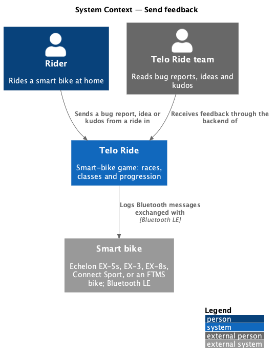
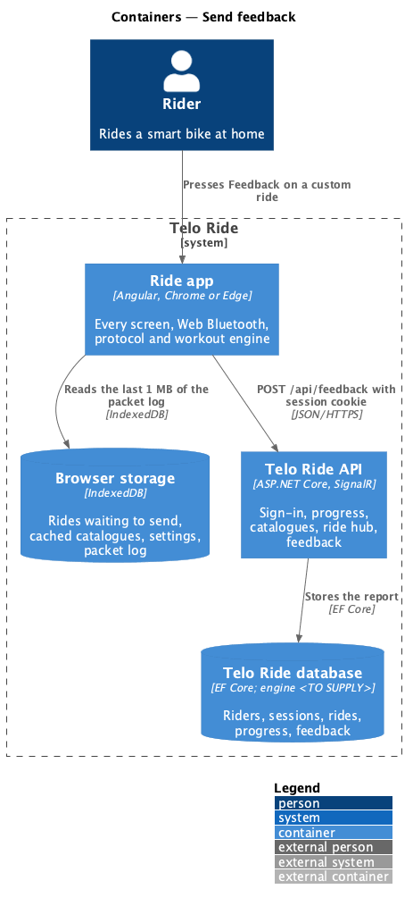
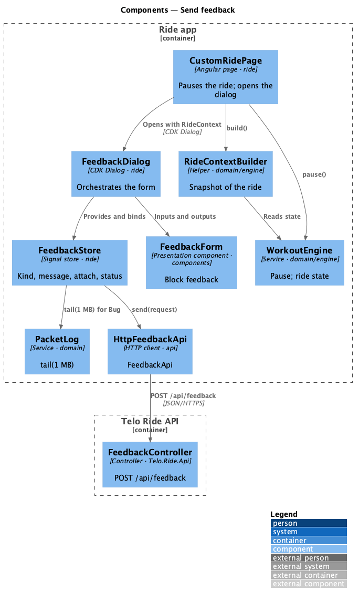
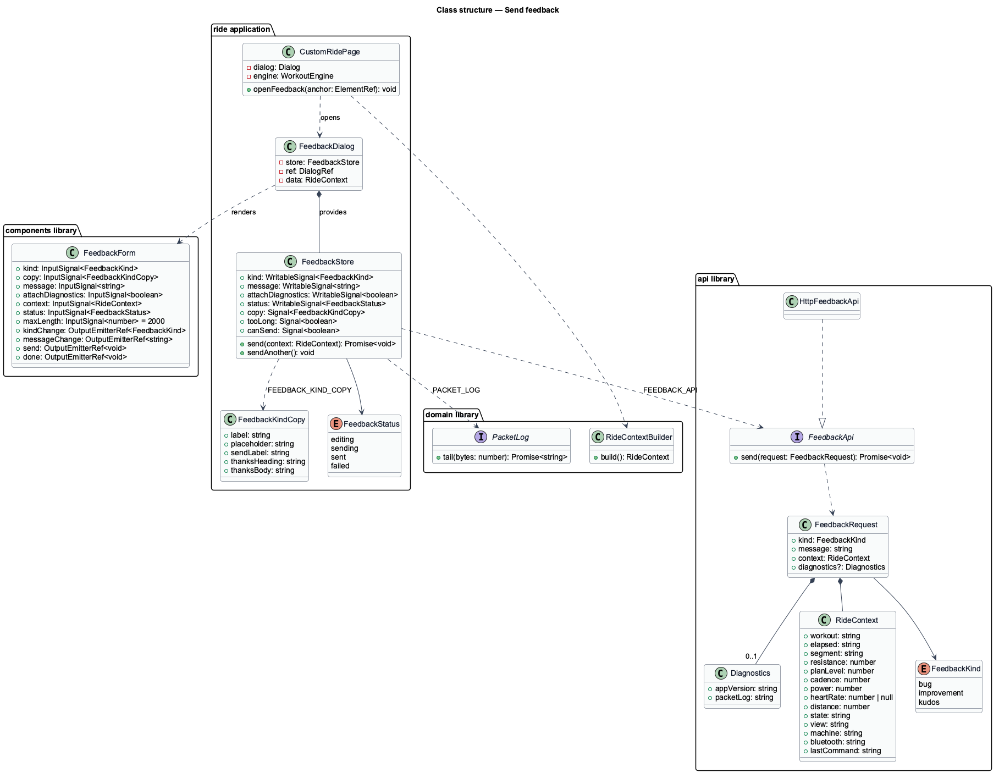
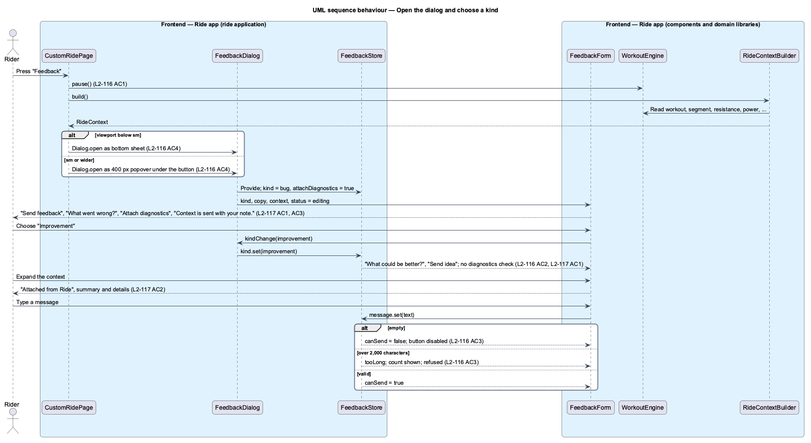
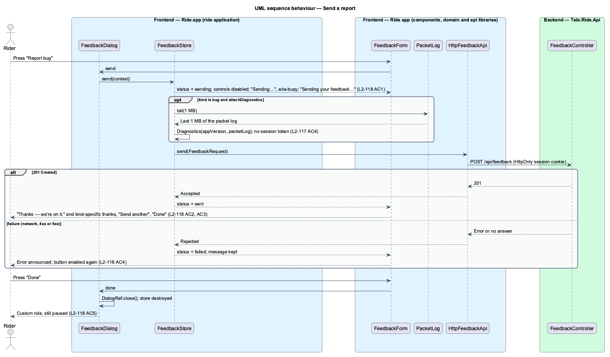

# Send feedback

## Overview

Telo Ride is in active development, and the people riding it see problems and ideas first. This
feature lets a rider send a bug report, an idea or kudos from the middle of a custom ride without
losing their place: the ride pauses, a small dialog takes the note, and the ride stays paused when
the dialog closes.

**feedback** — note from a rider to the Telo Ride team, of one of three kinds: Bug, Improvement or
Kudos

**ride context** — snapshot of the ride's state when the dialog opened: workout, elapsed time,
segment, resistance, plan level, cadence, power, heart rate, distance, state, view, machine,
Bluetooth and last command

**diagnostics** — the last 1 MB of the Bluetooth packet log and the app version, attached to a bug
report so the team can reproduce it

**packet log** — on-device record of every Bluetooth message to and from the bike
(`diagnostics/record-the-packet-log`)

The rider presses "Feedback" in the custom ride header. The ride pauses and the "Send feedback"
dialog opens: a bottom sheet on a phone, a 400 px popover under the button from sm. The rider picks
a kind, writes a message of up to 2,000 characters and sends it. A bug report attaches diagnostics
by default. Every report carries the ride context. The backend side of the slice is
`feedback/receive-feedback`.

## Description

**Frontend (Ride app)**

- **`CustomRidePage`** — `ride` page. Its "Feedback" header action pauses the `WorkoutEngine`,
  builds a `RideContext` with `RideContextBuilder`, and opens `FeedbackDialog` through the CDK
  `Dialog` service (`L2-116` AC1). The position strategy follows the breakpoint from
  `BreakpointObserver`: a bottom sheet below sm, otherwise a `FlexibleConnectedPositionStrategy`
  anchored under the button with a width of 400 px (`L2-116` AC4). Closing the dialog leaves the
  ride paused (`L2-118` AC5).
- **`FeedbackDialog`** — `ride` dialog component. It provides and injects `FeedbackStore`, reads
  the `RideContext` from `DIALOG_DATA`, binds the store to `FeedbackForm`, and closes through
  `DialogRef` on "Close feedback" and "Done".
- **`FeedbackStore`** — signal store provided by `FeedbackDialog`, so its state goes when the
  dialog closes. Signals: `kind` (`bug`, `improvement`, `kudos`; Bug first), `message`,
  `attachDiagnostics` (true; offered for Bug only), `status` (`editing`, `sending`, `sent`,
  `failed`). Computed: `copy` from `FEEDBACK_KIND_COPY`, `tooLong` (more than 2,000 characters),
  `canSend` (non-empty, not too long, not sending). `send()` builds a `FeedbackRequest` and calls
  `FeedbackApi`; on failure it keeps the message and sets `failed` (`L2-118` AC4). `sendAnother()`
  clears the message and returns to `editing`.
- **`FEEDBACK_KIND_COPY`** — table in the `ride` application, one row per kind:

  | Kind | Field label | Send button | Thanks heading |
  |------|-------------|-------------|----------------|
  | Bug | "What went wrong?" | "Report bug" | "Thanks — we’re on it." |
  | Improvement | "What could be better?" | "Send idea" | `<TO SUPPLY>` |
  | Kudos | "What’s working for you?" | "Send kudos" | `<TO SUPPLY>` |

  Each row also holds its example placeholder from the mocks: Bug "e.g. Resistance stayed at L8
  when the video dropped to recovery.", Improvement "e.g. Let me save a custom ride so I don’t
  rebuild it every week." and Kudos "e.g. The resistance landing on the beat makes the HIIT videos
  so much better." The mocks draw the sent state for Bug only, so the thanks for Improvement and
  Kudos is `<TO SUPPLY>`.
- **`FeedbackForm`** — `components` presentation component for the design-system block `feedback`
  (BEM classes as in `docs/mocks/dialogs/feedback/`). Inputs: `kind`, `copy`, `message`,
  `attachDiagnostics`, `context`, `status`, `maxLength`. Outputs: `kindChange`, `messageChange`,
  `attachChange`, `send`, `close`, `sendAnother`, `done`. It renders the kind radio group
  ("Type of feedback"), the textarea with a character count, the "Attach diagnostics" check with
  "Bike connection log and app version, so we can reproduce it." for Bug only (`L2-117` AC1), the
  context disclosure "Attached from Ride" with its summary and detail list (`L2-117` AC2), the
  footer "Context is sent with your note." (`L2-117` AC3), and the sending and sent states
  (`L2-118` AC1, AC2). While sending, every control is disabled, the button reads "Sending…" with
  `aria-busy="true"`, and a visually hidden `role="status"` element reads "Sending your
  feedback…". Message and context values render as text, never as HTML.
- **`RideContextBuilder`** — `domain/engine` helper that reads the `WorkoutEngine` and the
  `BikeConnection` and returns a `RideContext`.
- **`PacketLog`** — `domain` service behind the `PACKET_LOG` token (designed in
  `diagnostics/record-the-packet-log`). `tail(1_048_576)` returns the last 1 MB.
- **`APP_VERSION`** — `api` injection token bound in `app.config.ts` to the build's version.
- **`FeedbackApi`** — `api` contract, token `FEEDBACK_API`, implementation `HttpFeedbackApi`, for
  `POST /api/feedback`. The session travels as the `HttpOnly` cookie, so no token is in the body
  or the packet log (`L2-117` AC4).

## Requirements

The feature realizes the following level-2 (L2) requirements. Each L2 requirement refines a
level-1 (L1) requirement, cited by identifier.

| L2 ID | Refines (L1) | Requirement |
|-------|--------------|-------------|
| `L2-116` | `L1-019` | When the rider presses "Feedback" on a custom ride, the ride shall pause and a dialog shall read "Send feedback", with "Close feedback". "Type of feedback" (Bug, Improvement, Kudos) shall change the field and send button: Bug "What went wrong?", "Report bug"; Improvement "What could be better?", "Send idea"; Kudos "What’s working for you?", "Send kudos"; each with its own example placeholder. The send button shall be disabled for an empty message, and a message over 2,000 characters shall be refused with the count shown. On a phone the dialog shall be a bottom sheet; from sm it shall be a 400 px popover under the button. |
| `L2-117` | `L1-019` | For Bug, "Attach diagnostics" shall be checked, with "Bike connection log and app version, so we can reproduce it."; for Improvement and Kudos it shall be absent. The expanded context disclosure shall read "Attached from Ride" with a summary and list the ride's workout, elapsed, segment, resistance, plan level, cadence, power, heart rate, distance, state, view, machine, Bluetooth and last command. The footer shall read "Context is sent with your note." A report with diagnostics shall carry the last 1 MB of the packet log and the app version, and shall never carry the session token. |
| `L2-118` | `L1-019` | While sending, every control shall be disabled, the button shall read "Sending…" with `aria-busy="true"`, and a hidden status shall read "Sending your feedback…". An accepted bug report shall show "Thanks — we’re on it." and "Bug reports go straight to the team. If we need more detail, we’ll email you.", with "Send another" and "Done"; an accepted idea or kudos shall show thanks that fits its kind. A failed send shall keep the message, announce an error and enable the button again. "Done" shall close the dialog, and the ride shall stay paused. |

## Diagrams

### System context

The rider sends feedback through Telo Ride while riding the smart bike; the team receives it
through the backend.

### Containers

The Ride app reads the packet log from browser storage and posts the report to the Telo Ride API,
which stores it in the Telo Ride database.

### Components

`CustomRidePage` pauses the ride and opens `FeedbackDialog`; the dialog's `FeedbackStore` drives
`FeedbackForm` and sends through `FeedbackApi`.

### Class structure

`FeedbackStore` holds the draft and status, uses `FEEDBACK_KIND_COPY` for its labels and builds a
`FeedbackRequest` with an optional `Diagnostics` part.

### Behaviour — open the dialog and choose a kind

Pressing "Feedback" pauses the ride and opens the dialog in the form the breakpoint calls for; each
kind changes the label, placeholder, button and diagnostics option (`L2-116`, `L2-117` AC1–AC3).

### Behaviour — send a report

Sending disables the form, attaches diagnostics for a bug, and ends in thanks or in a kept message
with an error; "Done" leaves the ride paused (`L2-117` AC4, `L2-118`).

