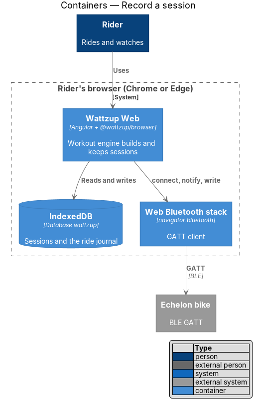
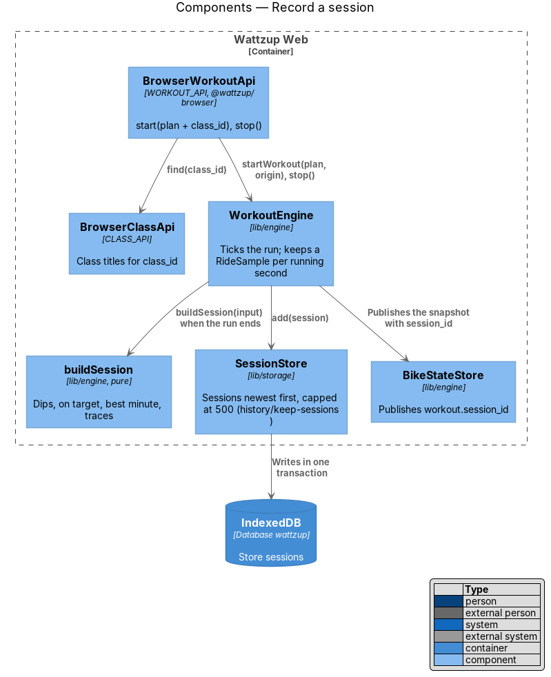
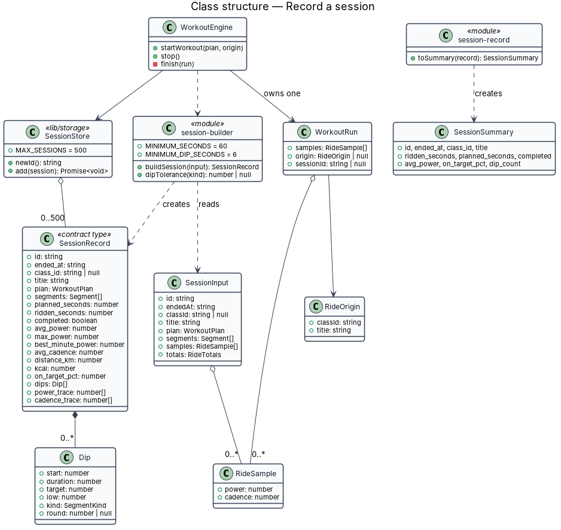
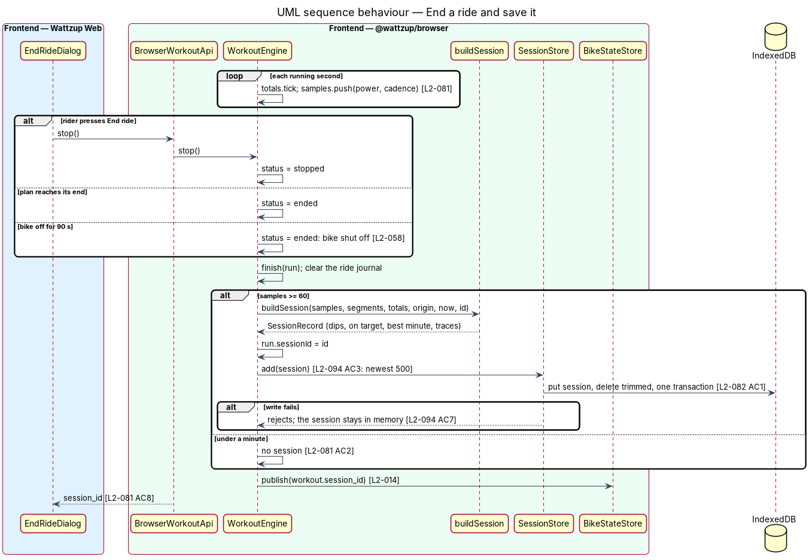

# Record a session

## Overview

Riders come back to a class to see whether they are getting stronger. To show that, Wattzup has to remember each ride after it ends. This feature builds a session from every finished or ended bike ride (L1-015). Keeping the sessions in the browser, and exporting and importing them, belong to `history/keep-sessions`. The pages that show sessions belong to `history/review-session` and `history/track-progress`.

**session** — saved ride: when it ended, which class it was (if any), its plan, how long it ran, its power and cadence figures, its cadence dips and its 5-second traces (L2-081)

**running second** — one tick of the workout engine while the workout's status is `running`; the engine already adds each one to the ride totals (L2-049)

**counted segment** — a `work`, `steady` or `rest` segment, where cadence below the aim counts against the rider; warm-up and cool-down do not count

**under target** — a second whose cadence is below the segment's cadence aim by more than the kind's tolerance: 6 rpm for `work` and `steady`, 12 rpm for `rest`

**cadence dip** — at least 6 consecutive seconds under target within one counted segment

The workout engine in `@wattzup/browser` builds the record at the moment the workout ends, from samples it took itself each running second; a ride cut short by closing or reloading the page is saved from the ride journal on the next load (L2-092 criterion 5, `live-state/run-rides`). The record holds no heart rate, because Wattzup has no heart-rate sensor (ADR 0003).

The feature extends these existing designs:
- `workouts/start-and-stop-workout`: `WORKOUT_API.start` takes an optional `class_id`, and `WORKOUT_API.stop()` answers with the `session_id`.
- `workouts/run-interval-workout`: the engine keeps a sample per running second, and saves the session when the run ends.
- `live-state/run-rides`: `workout` carries `session_id` (L2-014).
- `history/keep-sessions`: stores the session in IndexedDB.

## Description

### Session rules (`@wattzup/browser`, `lib/engine/`)

- **`RideSample`** `{power, cadence}` — one running second as the bike reported it. A missing value is 0.
- **`Dip`** `{start, duration, target, low, kind, round}` — one cadence dip.
- **`SessionRecord`** (`session-record.ts`) — the saved ride, the contract's `SessionDetail` without `previous` and `bests`, with the fields of the L2-081 table: `id`, `ended_at`, `class_id`, `title`, `plan`, `segments`, `planned_seconds`, `ridden_seconds`, `completed`, `avg_power`, `max_power`, `best_minute_power`, `avg_cadence`, `distance_km`, `kcal`, `on_target_pct`, `dips`, `power_trace` and `cadence_trace`, with nulls written (L2-014).
- **`SessionSummary`** — `{id, ended_at, class_id, title, ridden_seconds, planned_seconds, completed, avg_power, on_target_pct, dip_count}`, made by `toSummary(record)`.
- **`buildSession(input)`** (`session-builder.ts`, pure) — builds a `SessionRecord` from the plan, segments, samples, ride totals, origin, end time and id. It applies these rules (L2-081):
  - **Tolerance:** `dipTolerance(kind)` returns `null` for `warmup` and `cooldown` (not counted), 6 for `work` and `steady`, and 12 for `rest`.
  - **Dips:** each second is placed in its segment by `start` and `duration`. A run of under-target seconds closes at the end of its segment, and is kept when it lasts `MINIMUM_DIP_SECONDS` (6 s) or more.
  - **On target:** `on_target_pct` is the round share of counted seconds not under target, and 100 when no second counts.
  - **Best minute:** `best_minute_power` comes from a 60-second sliding window. A ride shorter than 60 s (never saved) would fall back to the mean.
  - **Completed:** `completed` is `ridden ≥ planned − 5`.
  - **Traces:** each trace is the round mean of every 5 samples.
  - **Totals:** `avg_power`, `distance_km` and `kcal` are taken from `RideTotals`, so they equal what the dashboard showed at the end.

### Workout engine (`lib/engine/workout-engine.ts`)

- **`RideOrigin`** `{classId, title}` — what a class start passes. `WorkoutEngine.startWorkout(plan, origin)` stores it on the run. Without an origin, the title is `workout.summary` (L2-060).
- **`WorkoutRun`** carries `samples`, appended on each running second beside `totals.tick`, `origin`, and `sessionId`, which `toSnapshot` publishes as `workout.session_id`.
- **`finish(run)`** — called on the engine loop whenever a run turns `stopped`, `ended` or `ended: bike shut off`. It clears the ride journal. When the run has at least `MINIMUM_SECONDS` (60) samples, it builds the session with an id from `SessionStore.newId()` (12 lowercase hex characters) and `ended_at` from the clock, sets `run.sessionId` before the run is published, so the first state with the terminal status already carries the id, and adds the session to `SessionStore` (L2-081 criteria 1 and 2; `history/keep-sessions`). A failed save keeps the session in memory for the page, so its summary still opens (L2-094 criterion 7). A run is never finished twice.

### Contracts

- **`WORKOUT_API.start`** — accepts an optional `class_id` beside the plan. It must name a class in the catalogue (`BrowserClassApi.find`); otherwise the call is refused with `invalid_workout` and the field `class_id`. A known class gives the run its `RideOrigin` (L2-081 criterion 7).
- **`WORKOUT_API.stop()`** — resolves with the saved session's id, or `null` (L2-081 criterion 8).
- **`WorkoutSnapshot.session_id`** — the field of L2-014.

### Tests

`@wattzup/browser` unit tests:
- `session-builder.spec.ts` has one case per row of both L2-081 tables: tolerance per kind, a 5 s run that is not a dip, a 6 s run that is, a run split by a segment boundary, the `on_target_pct` with no counted segment, `best_minute_power` on a rising ride, `completed` at planned − 5 and planned − 6, and the 5-second traces with a partial last bucket.
- `workout-engine.spec.ts` with `FakeClock`: a ride of a minute that is stopped saves a session and answers its id; a ride under a minute, or no workout, saves none; a plan that runs to its end, and a bike off for 90 seconds, save the ended ride with the first ended state; a running ride's `session_id` is `null`; a class start gives the session the class id and title; a setup ride is titled by the workout summary; an unknown class id is refused naming `class_id`.

Playwright specs end a ride on the fake bike and open its Session Summary (`history/review-session`).

### Open questions

- **Minimum length.** 60 running seconds is chosen so a mistaken start leaves no session. <TO SUPPLY> if riders want short rides kept.
- **The cap.** 500 sessions is more than a year of daily rides at about 8 KB each. Pruning older traces, while keeping their figures, would allow a longer history.
- **Time zone.** Days are the browser's local days (L2-087).

## Requirements

| L2 ID | Refines (L1) | Requirement |
|-------|--------------|-------------|
| `L2-081` | `L1-015` | Session record. When a workout of at least 60 running seconds ends (stopped, plan finished or bike shut off), the workout engine builds a session from its per-second samples, with the fields, dip and on-target rules of its tables, and publishes its id as `workout.session_id`; `WORKOUT_API.start` takes an optional `class_id`, and `WORKOUT_API.stop()` answers the `session_id`. |
| `L2-014` | `L1-005` | State contract. `workout` gains `session_id`, the saved session's id or `null`. |
| `L2-051` | `L1-007` | End-ride dialog. Criterion 2: a successful end leads to the saved session's summary. |

## Diagrams

### System context

The rider rides on the Echelon bike while Wattzup drives it. When the ride ends, Wattzup saves it as a session in the rider's browser.

### Containers

The Wattzup app builds the session and keeps it in IndexedDB. The screens learn the new session's id from the stop answer and from the live state.

### Components

`WorkoutEngine` keeps a `RideSample` per running second. When the run ends, it asks `buildSession` for the record and adds it to `SessionStore`, which writes it to IndexedDB (`history/keep-sessions`).

### Class structure

`SessionRecord` holds its `Dip`s and its traces. `buildSession` makes one from a `SessionInput`. `SessionStore` owns the list. The engine's `WorkoutRun` carries the samples, the `RideOrigin` and the `sessionId`.

### Behaviour — end a ride and save it

The rider ends the ride, or it ends on its own. On the engine loop, the run turns terminal. When it ran at least a minute, the session is built and stored, and its id goes out in the stop answer and the next state (L2-081, L2-082).

