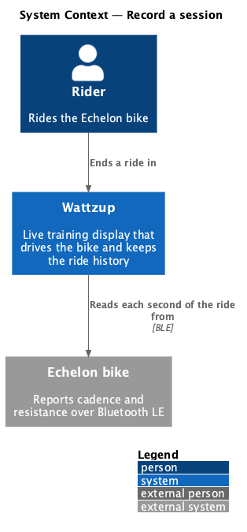
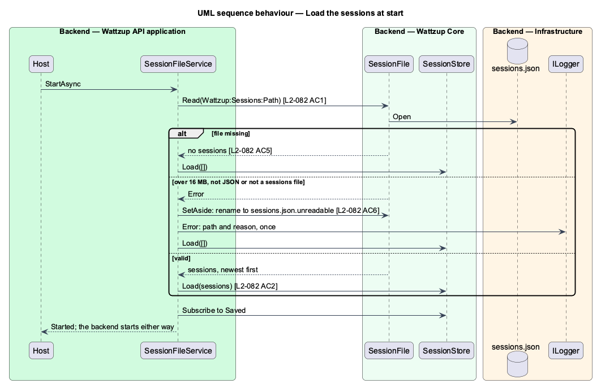

# Record a session

## Overview

Riders come back to a class to see whether they are getting stronger. To show that, Wattzup has to remember each ride after it ends. This feature saves every finished or ended bike ride as a session and keeps the sessions across restarts (L1-015, ADR 0015). The pages that show sessions belong to `history/review-session` and `history/track-progress`.

**session** — saved ride: when it ended, which class it was (if any), its plan, how long it ran, its power and cadence figures, its cadence dips and its 5-second traces (L2-081)

**running second** — one tick of the workout engine while the workout's status is `running`; the engine already adds each one to the ride totals (L2-049)

**counted segment** — a `work`, `steady` or `rest` segment, where cadence below the aim counts against the rider; warm-up and cool-down do not count

**under target** — a second whose cadence is below the segment's cadence aim by more than the kind's tolerance: 6 rpm for `work` and `steady`, 12 rpm for `rest`

**cadence dip** — at least 6 consecutive seconds under target within one counted segment

**sessions file** — JSON file named by `Wattzup:Sessions:Path` (default `sessions.json`) that holds the newest 500 sessions

The prototype built the record in the browser and kept it in `localStorage`. Here the backend builds it in `Wattzup.Core` at the moment the workout ends, from samples the engine took itself, so a closed or reconnecting browser loses nothing. The record holds no heart rate, because Wattzup has no heart-rate sensor (ADR 0003).

The feature extends these existing designs:
- `workouts/start-and-stop-workout`: `POST /api/workout` takes an optional `class_id`, and `POST /api/workout/stop` answers with the `session_id`.
- `workouts/run-interval-workout`: the engine keeps a sample per running second, and saves the session when the run ends.
- `live-state/stream-live-state`: `workout` gains `session_id` (L2-014).
- `platform/host-and-structure`: gains the `Sessions/` folders and the setting.

## Description

### Core (`Wattzup.Core/Sessions/`, new)

- **`RideSample(int Power, int Cadence)`** — one running second as the bike reported it. A missing value is 0.
- **`Dip(int Start, int Duration, int Target, int Low, SegmentKind Kind, int? Round)`** — one cadence dip.
- **`SessionRecord`** — the saved ride, with the fields of the L2-081 table: `Id`, `EndedAt`, `ClassId`, `Title`, `Plan`, `Segments`, `PlannedSeconds`, `RiddenSeconds`, `Completed`, `AvgPower`, `MaxPower`, `BestMinutePower`, `AvgCadence`, `DistanceKm`, `Kcal`, `OnTargetPct`, `Dips`, `PowerTrace` and `CadenceTrace`. It serialises in snake_case with nulls written (L2-014).
- **`SessionSummary`** — `{id, ended_at, class_id, title, ridden_seconds, planned_seconds, completed, avg_power, on_target_pct, dip_count}`, made by `SessionRecord.ToSummary()`.
- **`SessionBuilder.Build(SessionInput input)`** (pure, static) — builds a `SessionRecord` from the plan, segments, samples, ride totals, origin, end time and id. It applies these rules (L2-081):
  - **Tolerance:** `DipTolerance(kind)` returns `null` for `warmup` and `cooldown` (not counted), 6 for `work` and `steady`, and 12 for `rest`.
  - **Dips:** each second is placed in its segment by `Start` and `Duration`. A run of under-target seconds closes at the end of its segment, and is kept when it lasts 6 s or more.
  - **On target:** `OnTargetPct` is the round share of counted seconds not under target, and 100 when no second counts.
  - **Best minute:** `BestMinutePower` comes from a 60-second sliding window. A ride shorter than 60 s (never saved) would fall back to the mean.
  - **Completed:** `Completed` is `ridden ≥ planned − 5`.
  - **Traces:** each trace is the round mean of every 5 samples.
  - **Totals:** `AvgPower`, `DistanceKm` and `Kcal` are taken from `RideTotals`, so they equal what the dashboard showed at the end.
- **`SessionStore`** — the single holder of the sessions, newest first. It holds them under a short lock and publishes the list by reference swap.
  - `Load(IReadOnlyList<SessionRecord>)` fills the store at start.
  - `Add(SessionRecord)` puts the session first, trims the list to `MaxSessions` = 500, and raises `Saved` with the new list.
  - `All` and `Find(id)` read the list without a lock.
- **`SessionFile`** (static) handles reading and writing the file:
  - **`Read(string path)`** returns `SessionFileResult(IReadOnlyList<SessionRecord>? Sessions, string? Error)`. A missing file gives an empty list. A file over 16 MB, or one that is not valid JSON or not `{"sessions":[…]}`, gives an error.
  - **`Write(string path, IReadOnlyList<SessionRecord>)`** writes to `<path>.tmp` in the same folder, then calls `File.Move(tmp, path, overwrite: true)`, which replaces the file atomically on every supported platform (L2-082 criterion 3).
  - **`SetAside(string path)`** renames an unreadable file to `<path>.unreadable`.

### Workout engine (`Wattzup.Core/Workouts/`, changed)

- **`RideOrigin(string ClassId, string Title)`** — what a class start passes. `WorkoutEngine.StartAsync(plan, origin, ct)` stores it on the run. Without an origin, the title is `workout.summary` (L2-060).
- **`WorkoutRun`** gains:
  - `Samples` (a `List<RideSample>`), appended on each running second on the bike, beside `Totals.Tick`;
  - `Origin`;
  - `SessionId`, which `ToSnapshot` publishes as `workout.session_id`.
- **`WorkoutEngine.Finish(run)`** — called on the engine loop whenever a bike run turns `stopped`, `ended` or `ended: bike shut off`. When `run.Elapsed ≥ 60`, it builds the session with an id from `RandomNumberGenerator.GetHexString(12, lowercase: true)` and `EndedAt` from `store.Time.GetUtcNow()`, then calls `SessionStore.Add`. It sets `run.SessionId` before the run is published, so the first state message with the terminal status already carries the id (L2-081 criteria 1 to 3). A run is never finished twice. The treadmill never reaches `Finish`.
- **`WorkoutSnapshot.SessionId`** (`string?`) — the new field of L2-014.

### API (`Wattzup.Api`)

- **`SessionsOptions`** (`WattzupOptions.cs`, new) — `Path` (default `sessions.json`), bound from `Wattzup:Sessions` (environment `WATTZUP__SESSIONS__PATH`). A relative path resolves against the content root. The README documents it.
- **`SessionFileService`** (`Sessions/SessionFileService.cs`, new, hosted service):
  - **Start.** It reads the file through `SessionFile.Read`. On success it calls `SessionStore.Load`. On an error it calls `SetAside`, logs one error naming the path and the reason, and starts empty (L2-082 criteria 2, 5 and 6).
  - **Save.** It subscribes to `SessionStore.Saved` and writes the file with `SessionFile.Write`. An `IOException` or `UnauthorizedAccessException` is logged, and nothing is thrown back into the engine (criterion 7).
- **`WorkoutEndpoints`** changes:
  - **Start.** `StartAsync` reads an optional top-level `class_id`. It must name a class in `ClassCatalogueStore.Current`; otherwise the answer is 422 `invalid_workout` with the field `class_id`. The endpoint passes `RideOrigin(id, entry.Title)` to the engine (L2-081 criterion 7).
  - **Stop.** `POST /api/workout/stop` answers `WorkoutStopped(bool Stopped, string? SessionId)` (criterion 8).
- `GET /api/sessions…` and `GET /api/progress` belong to `history/review-session` and `history/track-progress`.

### Frontend

- **`WorkoutApi.stop()`** now returns `Promise<string | null>`, the `session_id`.
- **`StartPlan`** gains `class_id?: string`, which the class page sends (`classes/ride-a-class`).
- The generated `WorkoutSnapshot` gains `session_id`. The recordings that carry a workout are re-recorded against `--simulate`.

### Acceptance tests

`Wattzup.Api.AcceptanceTests` (`SessionRecordingTests`, `SessionStorageTests`) start the host with `SimulatedBikeTransport` and `FakeTimeProvider`, and set `Wattzup:Sessions:Path` to a file in the factory's per-test folder:
- `Given_a_bike_ride_of_a_minute_when_it_is_stopped_then_a_session_is_saved_and_its_id_answered` (L2-081 AC1, AC8)
- `Given_a_ride_under_a_minute_when_it_is_stopped_then_no_session_is_saved` (AC2)
- `Given_a_class_start_then_the_session_has_the_class_id_and_title` and `Given_an_unknown_class_id_then_the_start_answers_422` (AC7)
- `Given_the_bike_is_off_for_90_seconds_then_the_ended_ride_is_saved` (AC1)
- `Given_a_saved_session_when_the_backend_restarts_then_it_is_still_served` (L2-082 AC2)
- `Given_an_unreadable_file_then_it_is_set_aside_and_the_backend_starts_empty` (AC6)
- `Given_no_setting_then_sessions_json_is_used` (AC1)

`Wattzup.Core.Tests`:
- `SessionBuilderTests` has one case per row of both L2-081 tables: tolerance per kind, a 5 s run that is not a dip, a 6 s run that is, a run split by a segment boundary, the `on_target_pct` with no counted segment, `best_minute_power` on a rising ride, `completed` at planned − 5 and planned − 6, and the 5-second traces with a partial last bucket.
- `SessionFileTests` cover a missing file, a corrupt file, the 500 cap (through `SessionStore`), and a write that leaves no `.tmp` behind.

### Open questions

- **Minimum length.** 60 running seconds is chosen so a mistaken start leaves no session. <TO SUPPLY> if riders want short rides kept.
- **The cap.** 500 sessions is more than a year of daily rides at about 8 KB each. Pruning older traces, while keeping their figures, would allow a longer history.
- **Time zone.** Days are the backend machine's local days (ADR 0015).

## Requirements

| L2 ID | Refines (L1) | Requirement |
|-------|--------------|-------------|
| `L2-081` | `L1-015` | Session record. When a workout of at least 60 running seconds ends on the bike (stopped, plan finished or bike shut off), Core builds a session from the engine's per-second samples, with the fields, dip and on-target rules of its tables, and publishes its id as `workout.session_id`; `POST /api/workout` takes an optional `class_id`, and `POST /api/workout/stop` answers `{stopped, session_id}`. |
| `L2-082` | `L1-015` | Session storage. Sessions are kept in the JSON file named by `Wattzup:Sessions:Path` (default `sessions.json`), written atomically, capped at the newest 500; a missing file starts empty, an unreadable one is set aside as `<file>.unreadable`, a failed write is logged and never blocks the end of a ride. |
| `L2-014` | `L1-005` | State contract. `workout` gains `session_id`, the saved session's id or `null`. |
| `L2-051` | `L1-007` | End-ride dialog. Criterion 2: on the bike, a successful end leads to the saved session's summary. |

## Diagrams

### System context

The rider rides on the Echelon bike while Wattzup drives it. When the ride ends, Wattzup saves it as a session on the machine next to the bike.

### Containers

The Wattzup API builds the session and writes the sessions file. Wattzup Web learns the new session's id from the stop answer and from the state stream.

### Components

`WorkoutEngine` keeps a `RideSample` per running second. When the run ends, it asks `SessionBuilder` for the record and adds it to `SessionStore`. `SessionFileService` writes the store to the file after each save, and loads the file at start.

### Class structure

`SessionRecord` holds its `Dip`s and its traces. `SessionBuilder` makes one from a `SessionInput`. `SessionStore` owns the list, and `SessionFile` reads and writes it. The engine's `WorkoutRun` carries the samples, the `RideOrigin` and the `SessionId`.

### Behaviour — end a ride and save it

The rider ends the ride, or it ends on its own. On the engine loop, the run turns terminal. When it ran at least a minute, the session is built, stored and written, and its id goes out in the stop answer and the next state message (L2-081, L2-082).

### Behaviour — load the sessions at start

At start the service reads the file. A missing file means no sessions yet. An unreadable file is set aside, so the next save cannot overwrite it, and the backend starts empty (L2-082 criteria 2, 5 and 6).

