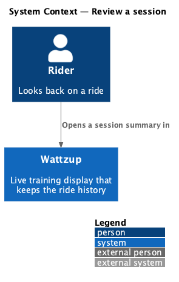
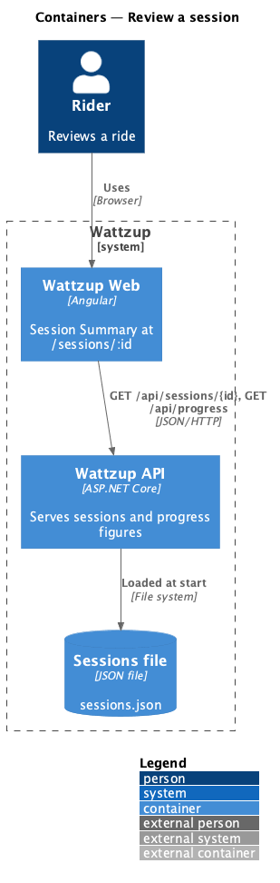
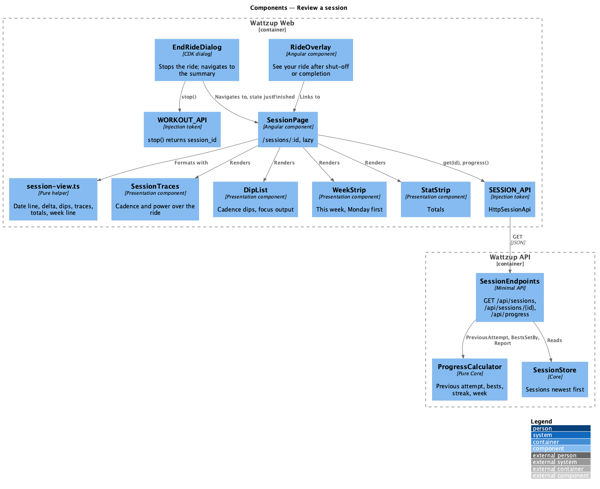
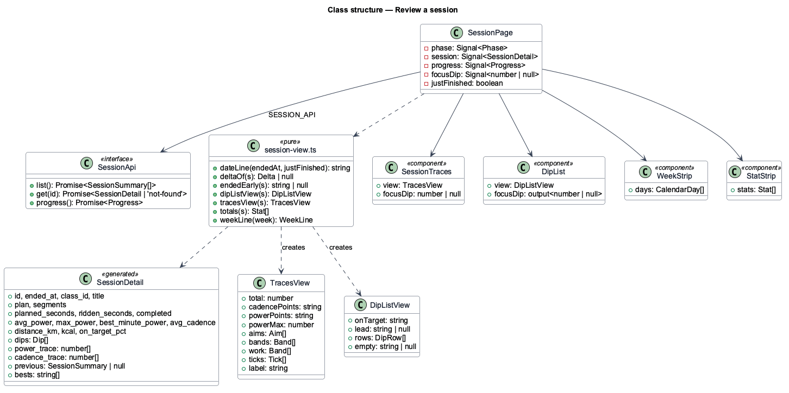
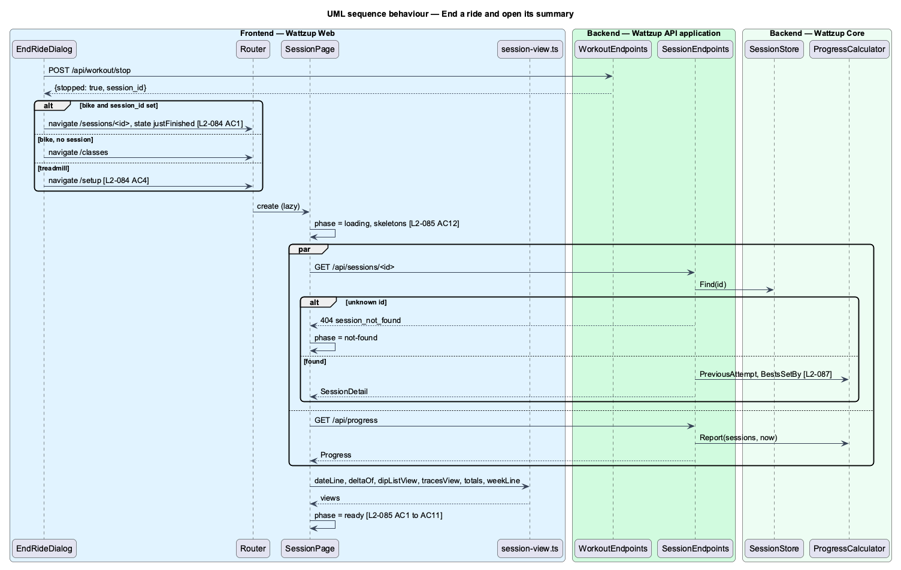
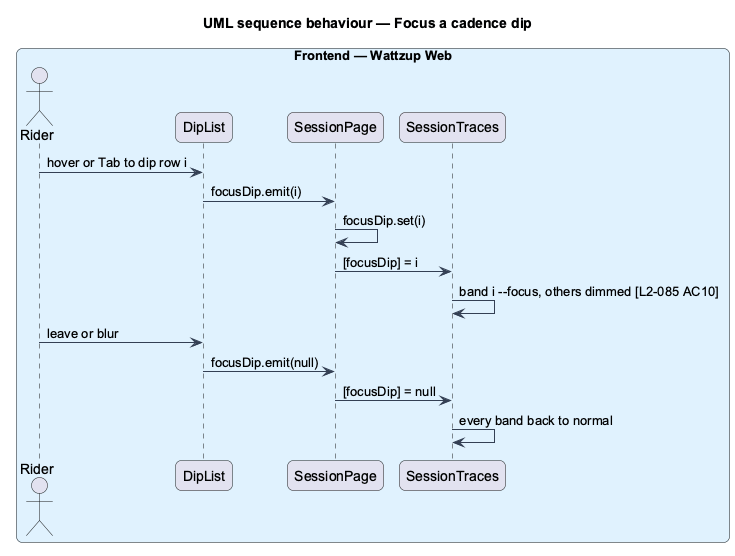

# Review a session

## Overview

After a ride, the rider wants to know how it went and whether it beat the last time. This feature is the Session Summary page at `/sessions/:id`, where the rider lands when a bike ride ends (L2-084, L2-085). It shows the average power, the change since the previous attempt at the same class, the personal bests, the streak, the power and cadence traces against the plan, the cadence dips and the totals of one session (`history/record-session`).

**Session Summary** — page at `/sessions/:id` that shows one session

**just finished** — the summary opened from the end of a ride; it reads `Ride saved · …` and `Done`; opened any other way it reads `All sessions`

**previous attempt** — the latest finished attempt at the same class that ended before this session (L2-087); rides from `/setup` have none

**personal best** — `Best 1-minute power`, `Best average on this class` or `No cadence dips`, as L2-087 sets them

**delta** — the change of average power from the previous attempt, written with its sign (`+12 W`, `−4 W`, `0 W`), so colour only adds to it

The figures that compare sessions (previous attempt, bests, streak, weekly count) are computed in `Wattzup.Core` and served (ADR 0015); the page computes none of them. It only formats them and draws the traces.

The feature extends these existing designs:
- `dashboard/dialogs-and-notifications`: `End ride` on the bike goes to `/sessions/<session_id>`.
- `dashboard/show-connection-status`: the bike-shut-off overlay offers `See your ride`, and a new `Ride complete` overlay appears when the plan ends.
- `platform/host-and-structure`: gains the lazy route, the components and the endpoints.

## Description

### Core (`Wattzup.Core/Sessions/ProgressCalculator.cs`, shared with `history/track-progress`)

- **`ProgressCalculator.PreviousAttempt(sessions, session)`** — the latest `completed` session with the same non-null `ClassId` and an earlier `EndedAt`, or `null` (L2-087).
- **`ProgressCalculator.BestsSetBy(sessions, session)`** — the bests of the L2-087 table, in its order. The comparison uses only sessions that ended earlier, so a first ride sets no `Best 1-minute power`.

### API (`Wattzup.Api/Endpoints/SessionEndpoints.cs`, new)

These endpoints are mapped on the `/api` group, so the API key applies when one is set (L2-083 criterion 5). They are reads, so no control rate limit applies. Only `GET` is mapped, so any other method answers 405.
- **`GET /api/sessions`** → `SessionListResponse { sessions: [SessionSummary] }`, newest first (L2-083 criterion 1).
- **`GET /api/sessions/{id}`** → `SessionDetailResponse`, the record's fields plus `previous: SessionSummary | null` and `bests: string[]` (criterion 2).
  - The id must match `^[a-f0-9]{12}$` and name a session in `SessionStore`. Otherwise the answer is `Problems.WithCode(404, "session_not_found", …)` (criterion 3).
- Both declare `.Produces<…>()`, and the detail endpoint also `.ProducesProblem(404)`, so the OpenAPI document carries the shapes. `GET /api/progress` (`history/track-progress`) supplies the streak panel.

### Frontend

**API library.**
- **`SessionApi`** (`src/lib/session-api.ts`, new) has three methods:
  - `list(): Promise<SessionSummary[]>`;
  - `get(id): Promise<SessionDetail | 'not-found'>`;
  - `progress(): Promise<Progress>`.

  The token is `SESSION_API`, implemented by `HttpSessionApi`, and `app.config.ts` binds it. The types are generated.

**Presentation components (`projects/components/src/lib/`, new).** Each keeps the mock's BEM block and injects nothing.
- **`SessionTraces`** (`session-traces/`, `wz-session-traces`) — two SVGs on one time axis:
  - `Cadence` draws the cadence polyline, the dashed aim of each counted segment, and one `session-traces__dip` band per dip. The band of `focusDip` is marked `--focus`, and the others are dimmed while one is focused.
  - `Power` draws the power polyline over shaded work segments.
  - The section's `aria-label` is the text alternative of L2-085 criterion 8.
  - Inputs: `view: TracesView` (precomputed points, bands, aims and ticks) and `focusDip: number | null`.
- **`DipList`** (`dip-list/`, `wz-dip-list`) — `Cadence dips` with `<n>% on target`, the lead line, and a button per dip that emits `focusDip` on enter, focus, leave and blur. With no dips it shows the no-dips line. Inputs: `view: DipListView`.
- **`WeekStrip`** (`week-strip/`, `wz-week-strip`) — seven days, Monday first. Each `li` is named `<Weekday> <d> <Mon>, ridden|not ridden`; a ridden day carries `--ridden` and today carries `--today`. Inputs: `days: CalendarDay[]`.
- **`StatStrip`** (`stat-strip/`, `wz-stat-strip`) — a `dl` of label, value and unit. Inputs: `stats: Stat[]`.

**App.**
- **`session-view.ts`** (`core/`, new, pure, with its spec) builds the page's text and drawing data:
  - `dateLine(endedAt, justFinished)` reads `Ride saved · Tuesday 17 Nov at 18:10`.
  - `deltaOf(session)` reads `{text: '+12 W', direction: 'up' | 'down' | 'same', since: 'vs last time, 12 Nov'}`, or `null`.
  - `endedEarly(session)` gives the `Ended early · …` line.
  - `dipListView(session)` gives the lead line, the rows and the no-dips line.
  - `tracesView(session)` gives the points, bands, aims and ticks as `trace-geometry` does for the live trace.
  - `totals(session)` gives the six stats.
  - `weekLine(week)` gives `<n> of 4 rides this week. <m> more to hit your goal.`, or `Weekly goal hit — …`.
  - `streakDays(progress)` gives the week strip from `ride_days` and `today`, through `calendarOf` in `progress-view.ts`.
- **`SessionPage`** (`dashboard/session-page/`, new; route `sessions/:id`, lazy `loadComponent`; title `Your ride · Wattzup`):
  - **Data.** It reads `SESSION_API.get(id)` and `SESSION_API.progress()` together. `phase` is `loading`, `ready`, `not-found` or `error`.
  - **Just finished.** `justFinished` comes from `history.state.justFinished`, which `EndRideDialog` and the ride overlays set through `Router.navigate(…, {state})`. It is lost on reload, so a reload reads `All sessions` (L2-085 criterion 2).
  - **Header.** The back link (`Done` or `All sessions`) goes to `/progress`. `Ride this again` links to `/classes/<class_id>` when there is one.
  - **Dip focus.** The page holds `focusDip` in a signal, which joins `DipList` to `SessionTraces` (criterion 10).
  - **Treadmill.** `bikeOnly()` sends the treadmill to `/setup` (criterion 13).
- **`EndRideDialog`** (changed) — after `stop()` it navigates to `/sessions/<id>` with `{state: {justFinished: true}}` on the bike when an id came back, else to `/classes`. The treadmill still goes to `/setup` (L2-084 criterion 1).
- **`RideOverlay`** and `ride-view-state.ts` (changed):
  - The `bike-shut-off` overlay shows `See your ride` and `Ride another class` when `workout.session_id` is set.
  - A new `ride-complete` overlay (`Ride complete`) shows for `ended` on the bike with a `session_id`, with `See your ride` focused (L2-084 criteria 2 and 3).

### Screen states

| Mock | State |
|---|---|
| `pages/session/default` | Just finished: `Ride saved · …`, `Done`, `Ride this again`, `+12 W vs last time`, two bests, 3 dips, 3 of 4 rides this week |
| `pages/session/from-list` | The same session opened from the list: `All sessions`, no `Ride saved` |
| `pages/session/ended-early` | `Ended early · 18:40 of 30:00` |
| `pages/session/first-ride` | A ride from `/setup`: no delta, no bests, no `Ride this again`, streak 1 |
| `pages/session/no-dips` | `Cadence held at target for the whole ride. Nothing to fix.` and `No cadence dips` |
| `pages/session/goal-hit` | `Weekly goal hit — 4 rides this week.` |
| `pages/session/loading` | Skeletons |
| `pages/session/not-found` | `We can't find that ride` with `All sessions` |
| `pages/session/error` | `Couldn't load this ride` with `Try again` |
| `pages/ride/complete` | `Ride complete` with `See your ride` |
| `pages/ride/ended` | Bike shut off, with `See your ride` and `Ride another class` |

### Acceptance tests

`Wattzup.Api.AcceptanceTests` (`SessionEndpointsTests`):
- `Given_sessions_then_GET_sessions_lists_their_summaries_newest_first` (L2-083 AC1)
- `Given_a_session_id_then_GET_session_answers_the_session_with_previous_and_bests` (AC2)
- `Given_an_unknown_id_then_GET_session_answers_404_session_not_found` (AC3)
- `Given_POST_or_no_API_key_then_405_or_401` (AC5)
- `The_session_endpoints_are_in_the_OpenAPI_document` (AC6)

`Wattzup.Core.Tests` (`ProgressCalculatorTests`) has one case per row for the previous attempt and the bests (L2-087).

Playwright (`e2e/session.spec.ts`, page object `e2e/pages/session-summary.page.ts`, with `/api/sessions/*` and `/api/progress` answered from recordings):
- `ending a bike ride opens its summary as just finished` (L2-084 AC1, L2-085 AC2)
- `shows the headline, delta, bests, streak, dips, totals and Ride this again` (L2-085 AC1, AC3 to AC9, AC11)
- `highlights a dip on the trace when its row is focused` (AC10)
- `shows the first-ride, ended-early and no-dips states` (AC4 to AC6, AC9)
- `shows not-found and error with Try again` (AC12)
- `the bike-shut-off and ride-complete overlays open the summary` (L2-084 AC2, AC3)
- `redirects the treadmill to setup` (AC13)

The existing `dialogs.spec.ts` expectation of `/classes` after End ride becomes `/sessions/<id>`. The treadmill case still expects `/setup`. `session-view.spec.ts` covers each formatter.

### Open questions

- **Where `Done` goes.** The prototype sends both `Done` and `All sessions` to Progress, and this design follows it. <TO SUPPLY> if `Done` should return to the class library instead.
- **Heart rate.** The design's `Avg heart rate` stat is left out (ADR 0003, ADR 0015).

## Requirements

| L2 ID | Refines (L1) | Requirement |
|-------|--------------|-------------|
| `L2-083` | `L1-005` | Sessions API. `GET /api/sessions` (summaries, newest first), `GET /api/sessions/{id}` (the session with `previous` and `bests`, 404 `session_not_found`) and `GET /api/progress`, read-only, behind the API key, in the OpenAPI document. |
| `L2-084` | `L1-015` | Ending a ride opens its summary. On the bike, `End ride`, the bike-shut-off overlay and a new `Ride complete` overlay lead to `/sessions/<session_id>`; the treadmill is unchanged. |
| `L2-085` | `L1-015` | Session Summary page. The headline, delta, ended-early line, bests, streak panel, traces, dips with highlight and totals of one session, with `Done` / `All sessions`, `Ride this again`, and loading, not-found, error and treadmill states. |
| `L2-087` | `L1-015` | Streaks, weekly goal, previous attempt, bests and achievements, computed in Core in the backend's local time. |
| `L2-051` | `L1-007` | End-ride dialog. Criterion 2: the bike goes to the saved session's summary. |
| `L2-058` | `L1-006` | Ride dashboard states. Criterion 6: the bike-shut-off overlay offers `See your ride`. |

## Diagrams

### System context

The rider reviews a ride in Wattzup straight after it ends, or later from Progress.

### Containers

Wattzup Web asks the Wattzup API for one session and for the progress figures. The API reads both from the sessions it loaded from the sessions file.

### Components

`SessionPage` calls `SESSION_API` and formats the result with `session-view.ts`. It renders `SessionTraces`, `DipList`, `WeekStrip` and `StatStrip`. On the backend, `SessionEndpoints` reads `SessionStore` and asks `ProgressCalculator` for the previous attempt, the bests and the figures.

### Class structure

The generated `SessionDetail` carries the record, `previous` and `bests`. The pure `session-view.ts` turns it into the views that the presentation components take.

### Behaviour — end a ride and open its summary

`End ride` stops the workout. The answer carries the session's id, and the dialog navigates to the summary as just finished. The page loads the session and the figures, then lays them out (L2-084, L2-085).

### Behaviour — focus a cadence dip

Hovering or focusing a dip row sets the page's `focusDip`. The traces highlight that band and dim the others until the row is left (L2-085 criterion 10).

