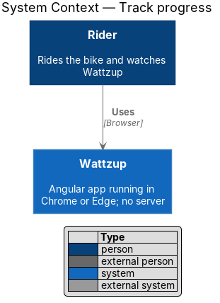
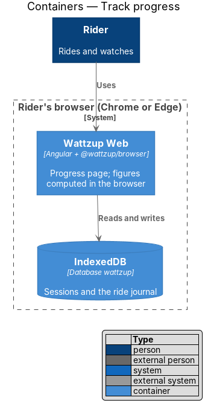
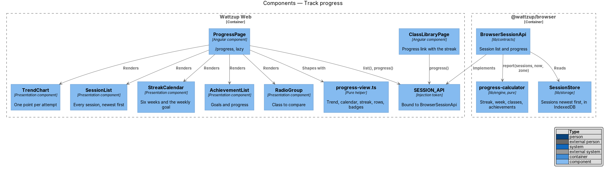
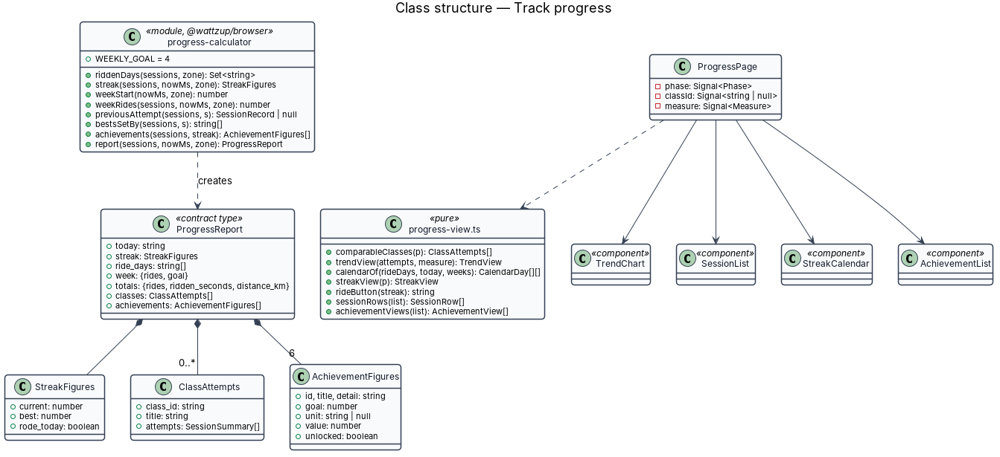
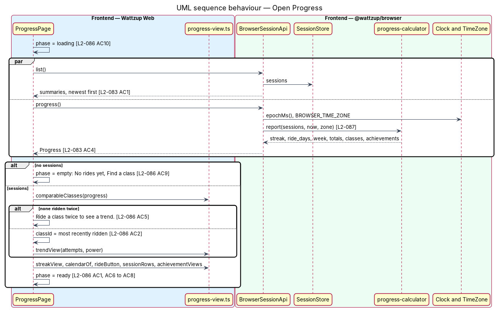
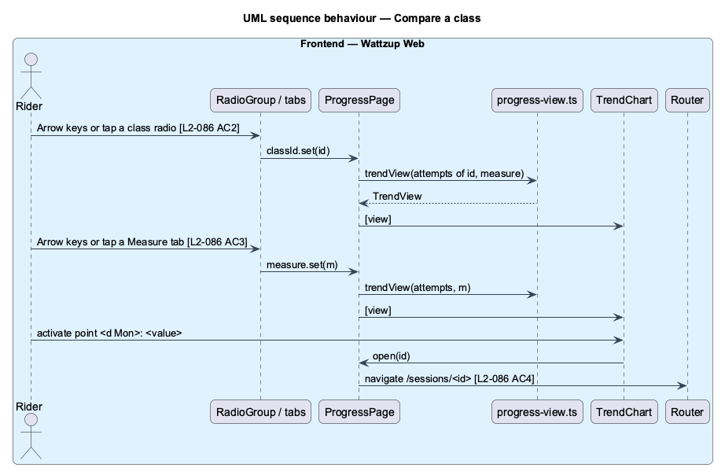

# Track progress

## Overview

A rider who repeats a class wants to see the trend. They also want a reason to ride tomorrow. This feature is the Progress page at `/progress` (L2-086). It shows what changed on each class ridden at least twice, every saved session, the streak of days ridden, the weekly goal and the achievements. It also adds the `Progress` link, with the streak, to the class library (L2-079 criterion 13).

**ridden day** — a local date on which a session ended

**streak** — the number of consecutive ridden days ending today, or ending yesterday when today has not been ridden yet; a streak survives until the end of today (L2-087)

**weekly goal** — 4 rides between Monday 00:00 and the end of Sunday

**finished attempt** — a `completed` session of a class; the trend compares the finished attempts at one class, oldest first

**measure** — what the trend charts: `Average power`, `Cadence on target` or `Cadence dips`

**achievement** — a goal measured over all sessions, such as `Seven straight` or `Century`, expressed by plan properties and never by a class id (ADR 0014, L2-087)

Every figure here is computed in `@wattzup/browser` from the real sessions and the time now (L2-087). The page has honest empty states and shows no seeded history: no sessions yet, no class ridden twice yet, and no streak.

## Description

### Figures (`@wattzup/browser`, `lib/engine/progress-calculator.ts`, pure)

Every function takes the sessions (newest first), the time now in epoch milliseconds and a `TimeZone` (`BROWSER_TIME_ZONE`, from `Date.getTimezoneOffset`; a fixed offset in tests). Each row of the L2-087 tables has a unit test.
- **`riddenDays(sessions, zone)`** — the set of local days (`YYYY-MM-DD`) on which a session ended.
- **`streak(sessions, nowMs, zone)`** returns `{current, best, rode_today}`:
  - **Current.** Count back from today when today was ridden, else from yesterday, while each day is ridden.
  - **Best.** The longest run of consecutive days, and never less than `current`.
- **`weekStart(nowMs, zone)`** returns Monday 00:00 of the local week. **`weekRides`** counts the sessions that ended at or after it. `WEEKLY_GOAL` is 4.
- **`achievements(sessions, streak)`** — the six rows of the L2-087 table as `{id, title, detail, goal, unit, value, unlocked}`, ordered unlocked first, then by `value ÷ goal` descending, then by table order.
- **`report(sessions, nowMs, zone)`** returns the contract's `ProgressReport` with `today`, `streak`, `ride_days` (the ridden days in this week and the five before it, oldest first), `week {rides, goal}`, `totals {rides, ridden_seconds, distance_km}`, `classes` (one `{class_id, title, attempts}` per class with a finished attempt, titled by its latest attempt, attempts oldest first) and `achievements`.

### Contract

- **`SESSION_API.progress()`** (`BrowserSessionApi`) resolves `report(SessionStore's sessions, the clock's now, BROWSER_TIME_ZONE)`, with `today` and `ride_days` as `YYYY-MM-DD` (L2-083 criterion 4).

### Frontend

**Presentation components (`projects/components/src/lib/`, new).**
- **`TrendChart`** (`trend-chart/`, `wz-trend-chart`):
  - It shows the latest value and unit, and the change line with `since your first ride on <d Mon> · <k> rides`.
  - Three gridlines with labels, and the polyline, are drawn in a 100 × 100 SVG.
  - One link per attempt (`href` `/sessions/<id>`) is named `<d Mon>: <value>` and positioned by percentage. The latest point is larger.
  - Inputs: `view: TrendView`. Output: `open(id)`.
- **`SessionList`** (`session-list/`, `wz-session-list`) — `Sessions` with `<n> saved`, then a row link per session to `/sessions/<id>`, and `Show all <n>` / `Show fewer`. Under 576 px a row shows the title with the date and time beneath, `Avg` and `On target`. Inputs: `rows: SessionRow[]`, `total`, `expanded` and `foldable`; outputs `toggleAll` and `open`. Like `ClassCard`, each row is a plain `href`, and a plain click emits `open(id)` for the page to route, so the library never touches the router.
- **`StreakCalendar`** (`streak-calendar/`, `wz-streak-calendar`):
  - It shows `Streak`, the number, `Best`, the message, and a grid of six weeks (each day named and marked `--ridden`, `--today` or `--future`).
  - `This week` shows `<n> of 4 rides` with a meter (`role="meter"`, `aria-valuenow`), followed by the `All time` line.
  - Inputs: `view: StreakView`.
- **`AchievementList`** (`achievement-list/`, `wz-achievement-list`) — `Achievements` with `<k> of 6`. Each badge shows a check or a percentage, the title, the detail, `<value> / <goal> <unit>` and a progress bar (`role="progressbar"`). Inputs: `items: AchievementView[]`.
- The class radio group reuses `RadioGroup` (`radio-group/`), and the measure tabs reuse the roving-tab pattern of `MainViewTabs`.

**App.**
- **`progress-view.ts`** (`core/`, new, pure, with its spec):
  - **Classes.** `comparableClasses(progress)` gives the classes with 2 or more attempts, most recently ridden first.
  - **Trend.** `trendView(attempts, measure)` gives the values, the change text (`+18 W`, `−3%`, `2 fewer`, `No change`), the scale with its padding (as the frame: a quarter of the range, at least 2, or 1 for dips) and the point positions.
  - **Calendar.** `calendarOf(progress, 6)` from `session-view.ts` gives the Monday-first grid.
  - **Streak.** `streakView(progress)` gives the number, the message and the `beats your best` line.
  - **Ride button.** `rideButton(streak)` reads `Ride to make it <n+1>` or `Ride again`.
  - **Sessions.** `sessionRows(summaries)` gives the list's rows.
  - **Achievements.** `achievementViews(achievements)` gives the badges, with floored values.
- **`ProgressPage`** (`dashboard/progress-page/`, new; route `progress`, lazy `loadComponent`; title `Progress · Wattzup`):
  - **Data.** It reads `SESSION_API.list()` and `SESSION_API.progress()` together. `phase` is `loading`, `ready`, `empty` or `error`.
  - **Signals.** It holds `classId`, set on load to the most recently ridden comparable class, and `measure`.
  - **Navigation.** A chart point opens `/sessions/<id>`. The header button goes to `/classes`.
- **`ClassLibraryPage`** (changed) — it reads `SESSION_API.progress()` beside the catalogue for the `Progress` link and its `<n>d` badge. A failure leaves the link without the badge and never affects the library (L2-079 criterion 13).

### Screen states

| Mock | State |
|---|---|
| `pages/progress/default` | Two comparable classes. `30 Minute HIIT Cardio` is selected with 5 attempts and `+18 W since your first ride`. 10 sessions, `Show all 10`. Streak 3 (not ridden today, `Ride to make it 4`). 2 of 6 achievements |
| `pages/progress/measure-dips` | The `Cadence dips` tab: `1 dip`, `3 fewer` |
| `pages/progress/rode-today` | `Ride again`, `Today's done. See you tomorrow.` |
| `pages/progress/no-trend` | Two sessions on different classes: `Ride a class twice to see a trend.` |
| `pages/progress/empty` | `No rides yet` with `Find a class` |
| `pages/progress/loading` | Skeletons |
| `pages/progress/error` | `Couldn't load your progress` with `Try again` |
| `pages/class-library/*` | The header gains `Progress` and the `3d` badge |

### Acceptance tests

`progress-calculator.spec.ts` (`@wattzup/browser`), with the time and a fixed UTC−5 zone set by each test, has one case per row of the three L2-087 tables. These include the 23:59 / 00:01 boundary, yesterday-only, two days ago, two rides on one day, a Sunday versus the Monday week start, each achievement at goal − 1 and at goal, the ordering, and no sessions at all (L2-087 AC3).

Playwright (`e2e/progress.spec.ts`, page object `e2e/pages/progress.page.ts`), one test per behaviour of L2-086: the header and `Ride to make it <n>` or `Ride again` (AC1); the class radios and measure tabs by click and arrow keys (AC2, AC3); the chart's points as links, the latest larger (AC4); dips counted down as better (AC3); no trend (AC5); the newest 8 sessions and `Show all` (AC6); the streak messages, the six-week calendar, this week and all time (AC7); the achievements (AC8); `No rides yet` (AC9); loading and error (AC10).

`e2e/class-library.spec.ts` covers the library's `Progress` link: its name and `<n>d` badge, the filled badge when ridden today, and no badge with no streak or when progress fails (L2-079 AC13).

### Open questions

- **Weekly goal.** It is fixed at 4. A configurable goal is out of scope (L2-087).
- **Classes renamed in the catalogue.** A class keeps its id, and the trend shows the latest attempt's title. Removing a class from the catalogue keeps its sessions, but `Ride this again` would then open a not-found class page. <TO SUPPLY> if that link should be hidden for a class no longer in the catalogue.

## Requirements

| L2 ID | Refines (L1) | Requirement |
|-------|--------------|-------------|
| `L2-086` | `L1-015` | Progress page. `Getting stronger` with a class radio group, `Measure` tabs and a trend chart, the session list, the streak calendar, the weekly goal and the achievements, with the ride button, and no-trend, empty, loading and error states. |
| `L2-087` | `L1-015` | Streaks, weekly goal, previous attempt, bests and achievements: the rules as tables, computed in `@wattzup/browser` from the sessions and the time now in the browser's time zone. |
| `L2-083` | `L1-005` | Session contract. Criterion 4: `SESSION_API.progress()`. |
| `L2-079` | `L1-014` | Class library page. Criterion 13: the `Progress` link with the streak. |

## Diagrams

### System context

The rider checks their progress in Wattzup and goes back to the class library to keep the streak going.

### Containers

Wattzup Web reads the session summaries and the progress figures from the Wattzup API. The API computes the figures from the sessions it loaded from the sessions file.

### Components

`ProgressPage` calls `SESSION_API`, shapes the answer with `progress-view.ts`, and renders `TrendChart`, `SessionList`, `StreakCalendar` and `AchievementList`. `ClassLibraryPage` also reads the streak for its link. `BrowserSessionApi` asks `report` for the figures.

### Class structure

`report` returns a `ProgressReport` made of the streak, the week, the totals, the class attempts and the achievement figures. In the app, `progress-view.ts` turns the contract's `Progress` into the views that the components take.

### Behaviour — open Progress

The page loads the sessions and the figures together, then picks the most recently ridden class with two attempts. It draws the trend for `Average power` and lays out the side column. With no sessions it shows `No rides yet` (L2-086).

### Behaviour — compare a class

Choosing a class or a measure recomputes the trend from the attempts already loaded, with no request. A point opens that session's summary (L2-086 criteria 2 to 4).

