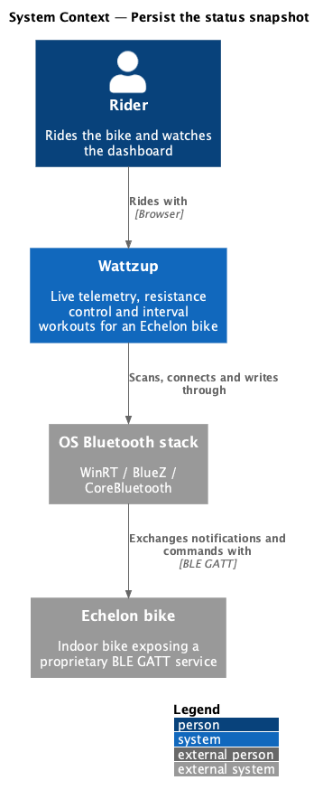
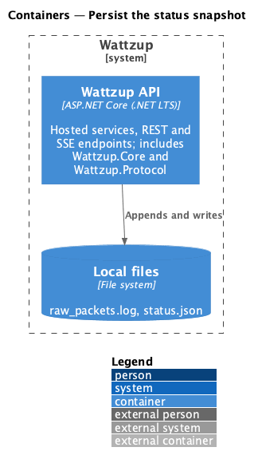
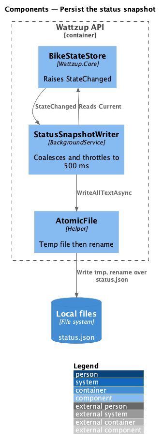
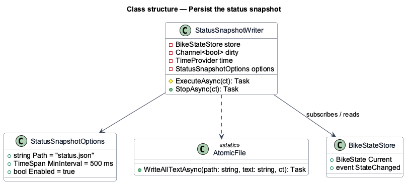
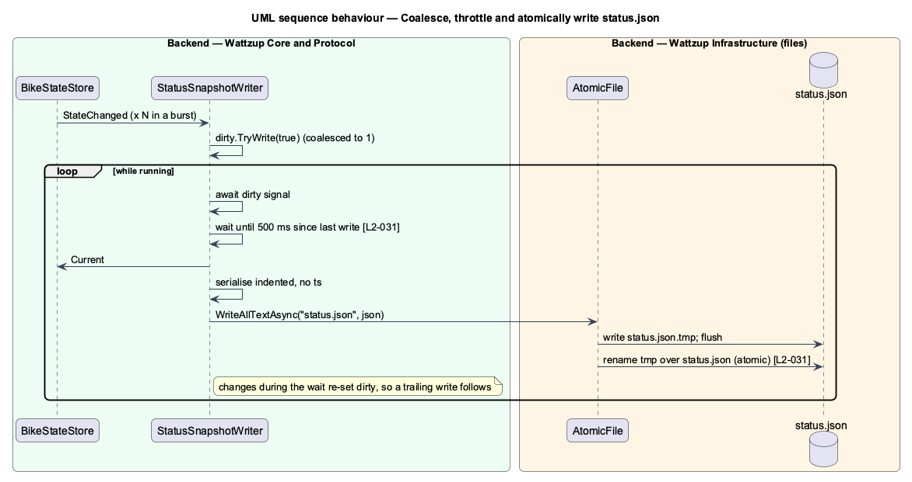

# Persist the status snapshot

## Overview

Besides streaming state to browsers, the backend keeps the latest bike state in a file, `status.json`, beside the executable. External tools read it without opening an HTTP connection: shell scripts, a status-bar widget, or an AI agent checking whether a ride is in progress. The prototype rewrote the file synchronously on every broadcast, several times per second, and a reader could catch it half-written. This design throttles writes and makes each write atomic.

**status snapshot** — `status.json`: indented JSON of the bike state using the full L2-014 contract (including `workout` with its segments, `commands` and the power and ride-total fields), without the stream-only `ts` field

**atomic replace** — writing a complete temporary file and renaming it over the target, so readers see either the old file or the new one, never a mix

**trailing write** — final write that runs after a burst of changes, so the file always ends up matching the last state

## Description

- **`StatusSnapshotWriter`** (`Wattzup.Core`) — `BackgroundService`. It subscribes to `BikeStateStore.StateChanged` and sets a dirty flag through a `Channel<bool>` (capacity 1, `DropWrite`), which coalesces bursts. Its loop waits for the dirty signal, then waits until at least `MinInterval` (500 ms) has passed since the previous write. It then serialises `BikeStateStore.Current` and writes it. A change during the wait sets the flag again, so a trailing write always follows (L2-031).
- **`AtomicFile.WriteAllTextAsync(path, text)`** — writes to `status.json.tmp` in the same directory, flushes to disk, then calls `File.Move(tmp, path, overwrite: true)`. That call maps to an atomic rename on Linux and macOS and to `MoveFileEx` with `MOVEFILE_REPLACE_EXISTING` on Windows (L2-031).
- **`StatusSnapshotOptions`** — `Path` (default `status.json` under the content root), `MinInterval` (500 ms) and `Enabled` (`true`).
- **Serialisation** — the same `BikeStateJsonContext` options as `stream-live-state` (snake_case, nulls written), with `WriteIndented = true`, so the file and `GET /api/status` carry the same fields. The `ts` field is not part of `BikeState` and is not written (L2-031).

The writer runs once more on shutdown, so the file reflects the final state. Write failures log at Warning level and are retried on the next change. They never affect broadcasting.

## Requirements

| L2 ID | Refines (L1) | Requirement |
|-------|--------------|-------------|
| `L2-031` | `L1-008` | Persisted status snapshot. The backend must write the current state to `status.json` (indented JSON, same contract as L2-014 without `ts`). |

## Diagrams

### System context

Wattzup records its state on the host so local tools can read it.

### Containers

The Wattzup API container writes `status.json` to the local file store.

### Components

`StatusSnapshotWriter` coalesces `StateChanged` events and writes through `AtomicFile`.

### Class structure

The writer depends on the store and a small atomic-write helper.

### Behaviour — coalesce, throttle and replace atomically

A burst of changes produces at most 2 writes per second, including a trailing write of the final state. Each write replaces the file atomically (L2-031).

