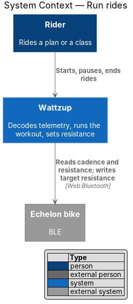
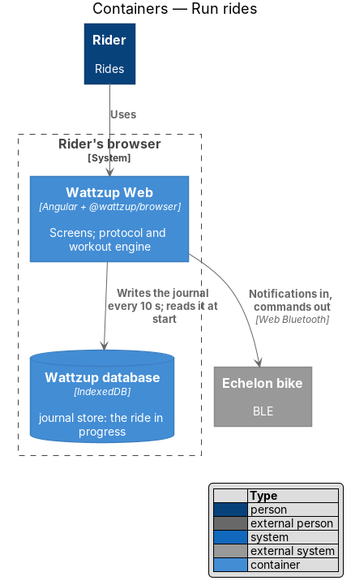
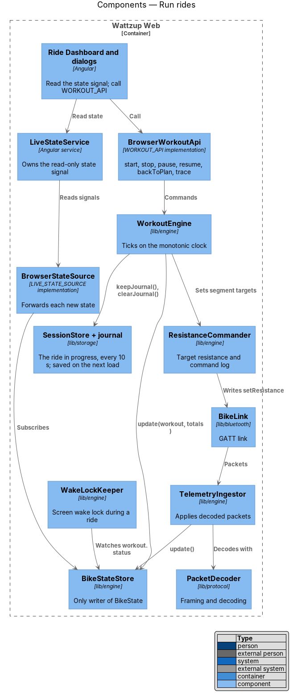
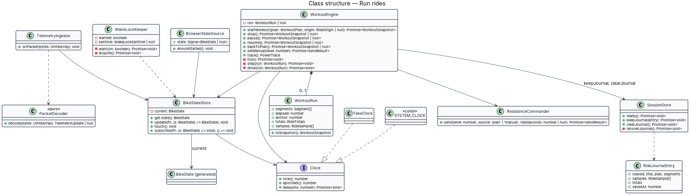
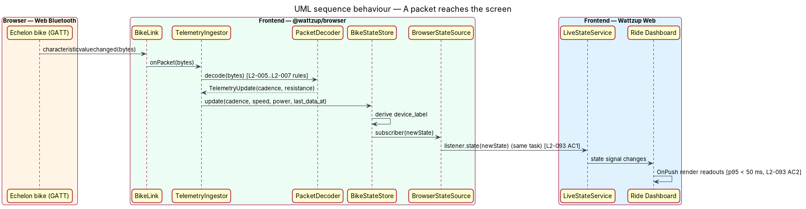
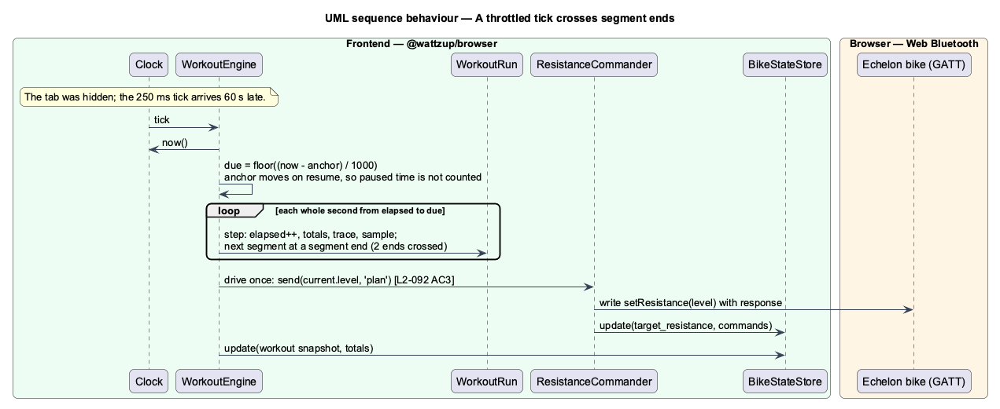
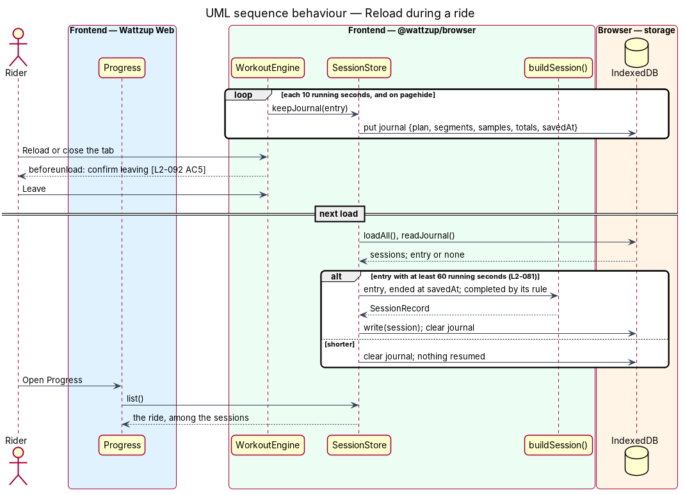

# Run rides

## Overview

Wattzup decodes the bike's packets, holds the live state, sets resistance and runs the workout engine inside the page, in `@wattzup/browser`. This feature describes the protocol and engine modules, how they feed `LiveStateService`, how the workout clock survives a throttled tab, and how a ride survives the screen sleeping or the page being reloaded (L2-092, L2-093, L2-050).

**monotonic clock** — `performance.now()`, a clock that never jumps back with the wall clock and keeps counting while timers are throttled

**throttled tab** — hidden tab whose timers Chromium delays, to once a second at first and to once a minute after 5 minutes hidden

**wake lock** — Screen Wake Lock API sentinel (`navigator.wakeLock.request('screen')`) that keeps the screen on while held

**ride journal** — IndexedDB record of the ride in progress, rewritten at least every 10 s, from which a reloaded page saves the ride as a session

## Description

Modules (`@wattzup/browser`):

| `lib/` folder | Module | Rules |
|---|---|---|
| `protocol/` | `EchelonUuids`, `EchelonCommands`, `EchelonDeviceFilter` | service and characteristic UUIDs, command bytes, checksum, device filter (L2-001, L2-008) |
| `protocol/` | `PacketDecoder`, `SpeedCalculator`, `TelemetryUpdate` | framing, counting, resistance and workout packets, km/h per rpm (L2-005 to L2-007) |
| `engine/` | `BikeStateStore`, `CommandLog` | only writer of `BikeState`, `device_label`, command log (L2-014, L2-048) |
| `engine/` | `TelemetryIngestor`, `PowerEstimator` | apply decoded packets; estimated power and ride totals (L2-049) |
| `engine/` | `ResistanceCommander` | target vs. reported resistance, override until the next segment (L2-009, L2-047) |
| `engine/` | `WorkoutPlanValidator`, `PlanExpander`, `WorkoutEngine`, `WorkoutRun`, `PowerTraceHistory` | plans, segments, stepping, waiting, pause, replacement, trace (L2-010 to L2-013, L2-045, L2-046, L2-050) |

- The modules use the contract types from `@wattzup/api` (`BikeState`, `WorkoutSnapshot`, `Segment`, `CommandEntry`, `StartPlan`, kept in `projects/api/src/contract/schema.d.ts`), so the state has exactly the shape of L2-014 and every screen reads it unchanged.
- Wattzup drives the bike only and has no machine choice (ADR 0016).
- **Unit tests** — each module's unit tests restate every row of the tables of cases in its requirements, 1 case per row (L2-092 criterion 1). They are the reference for the rules.

Clock and loop:

- **`Clock`** (`lib/bluetooth/`, token `CLOCK`) — `now()` (monotonic ms), `epochMs()` (Unix ms, for `ended_at` and timestamps) and `delay(ms)`. `SYSTEM_CLOCK` uses `performance.now()`, `Date.now()` and `setTimeout`; `FakeClock` drives the tests, with `advance(ms)` for time passing and `jump(ms)` for a throttled tab whose overdue timers fire late, once.
- **`WorkoutEngine`** — looks at the clock every 250 ms (`Clock.delay`). A tick never adds a fixed step: it computes the whole running seconds due as `(now − anchor) / 1000`, where `anchor` moves on each resume so paused and disconnected time is not counted, and steps the run once per second due (totals, power trace, sample, segment change). Only after the last step does it drive the bike, so a tick that arrives 60 s late lands in the right segment and writes 1 `plan` command however many segment ends it crossed (L2-092 criterion 3). Commands and ticks run one at a time on one promise queue, so only the engine loop touches the run state. `BIKE_API.setResistance` goes through `WorkoutEngine.setManual`, so a manual level during a ride sets the `manual` mode (L2-047).
- **`TelemetryIngestor`** — runs on each notification from `BikeLink`, decodes with `PacketDecoder` and updates the store in 1 `update`.

Live state:

- **`BikeStateStore`** — holds the current `BikeState`, applies each change and derives `device_label` synchronously, and notifies subscribers with the new reference. There is no lock: the page is single-threaded.
- **`BrowserStateSource`** — implements `LIVE_STATE_SOURCE`. `ensureStarted()` sets `state` to the store's current state, then sets `state` (and `lastStateAt`) on each change on the same task, so a notification reaches the signal with no serialisation and no network hop (L2-093 criteria 1 and 2).
- **`LiveStateService`** (app, `core/`) — owns the state signal and is the only reader of `LIVE_STATE_SOURCE`.
- **Power trace history** — `PowerTraceHistory` keeps 1 `[ride_seconds, power]` sample per running second, at most 10,800; `WORKOUT_API.trace()` answers it, so the dashboard redraws the actual line when the rider comes back to it mid-ride (L2-050, L2-026 criterion 5).

Long rides and leaving:

- **`WakeLockKeeper`** (`lib/engine/`, started by an environment initializer) — an effect on the state store's `workout.status`: while a ride is on (running, paused or waiting for the bike) it holds a screen wake lock from `SCREEN_WAKE_LOCK` (`navigator.wakeLock.request('screen')`); when the tab is visible again after the browser let the lock go, it requests it again; when the ride ends or stops it releases it. A refused request is left until the tab is next visible. Without the API, `SCREEN_WAKE_LOCK` is null and it does nothing (L2-092 criterion 4).
- **Leaving during a ride** — while a ride is running, paused or waiting, `WorkoutEngine` answers `beforeunload` by asking the browser to confirm leaving (L2-092 criterion 5). The engine owns the listener because it alone knows whether a ride is active; it removes it when its injector is destroyed.
- **Ride journal** (`lib/storage/ride-journal.ts`, the `journal` store of `SessionDatabase`) — a `RideJournalEntry` `{classId, title, plan, segments, samples, totals, savedAt}`. `WorkoutEngine` writes it through `SessionStore.keepJournal` whenever a tick crosses a multiple of 10 running seconds, and on `pagehide`; it clears it when the ride ends or is replaced. `SessionStore.ready()`, run at start by an environment initializer and before every read of the sessions, reads the journal: an entry of at least 60 running seconds (`MINIMUM_SECONDS`, L2-081) is built by `buildSession` as an ended session ending at `savedAt`, with `completed` by its rule, and saved; a shorter one is dropped. The journal is then cleared, except when the save fails, so the next load tries again. The ride is not resumed (L2-092 criterion 5).
- Resource bounds — the store keeps 1 state object; `PowerTraceHistory` and the samples are bounded by the plan's length; the trace keeps L2-038's frame rate because it is unchanged. Measured on 2026-11-19 for L2-093 criterion 3, on demand and not as a CI gate. The setup: a development build with `?simulate` in headless Chromium, the page's clock fast-forwarded with Playwright's `page.clock`, and a 180-minute flat ride followed by a 60-minute one in the same page, 4 hours in all. The JS heap was read after a forced garbage collection every 30 minutes. It grew by 1.2 MB from minute 1 to minute 241, peaking 4.3 MB above the start, against a limit of 50 MB. Afterwards the trace drew at 62 fps in real time, against L2-038's 55. Fast-forwarding feeds the page the same 4 hours of packets, ticks and samples, but in seconds; a real-time run on a mid-range laptop remains the reference if the numbers are ever in doubt.

Verification: unit tests per module, one per table row, with `FakeClock`; engine tests for a 60 s gap crossing 2 segment ends (1 command, correct segment, samples filled); `BrowserStateSource` ordering; `WakeLockKeeper` with a fake `SCREEN_WAKE_LOCK` (held across a pause, released at each end, taken again when visible, nothing without the API); `wake-lock.spec.ts` against a fake `navigator.wakeLock`; engine tests that the journal is written every 10 running seconds and cleared at the end and that `beforeunload` is answered only during a ride; `SessionStore` tests that a journal of 60 s or more is saved as an ended session, `completed` by its rule, a shorter one dropped, and a failed save kept; Playwright specs that reload mid-ride and find the ride on Progress, and that push notifications through the fake `navigator.bluetooth` and assert the dashboard readouts, the countdown, an automatic resistance write at a segment change and the summary after reload.

## Requirements

| L2 ID | Refines (L1) | Requirement |
|-------|--------------|-------------|
| `L2-092` | `L1-004` | Workout clock, wake lock and leaving during a ride. The rules of L2-005 to L2-013 and L2-045 to L2-049 shall run in `@wattzup/browser`, with a unit test per table row; segment times shall come from a monotonic clock so a throttled tab lands in the current segment and applies a skipped change once; a ride shall hold a screen wake lock where offered; closing or reloading during a ride shall ask to confirm, and a ride L2-081 would save shall be saved as ended from samples kept at least every 10 s, without resuming. |
| `L2-093` | `L1-005` | Live state. `LiveStateService` shall expose the read-only state signal, fed from the in-browser bike connection and engine, with no component reading Bluetooth; a notification shall reach the screen within 50 ms (p95), measured on demand; a 4-hour ride shall grow tab memory by no more than 50 MB and keep L2-038's frame rate. |
| `L2-014` | `L1-005` | State model contract. The live state shall keep the prototype's snake_case field names, write nulls rather than leave fields out, and be typed once in `schema.d.ts`. |
| `L2-038` | `L1-010` | Resource use over long rides. A 4-hour session shall grow tab memory by no more than 50 MB, hold at least 55 fps, and stop or reduce animation frames while the tab is hidden. |
| `L2-050` | `L1-005` | Power trace history. `WORKOUT_API.trace()` shall answer 1 sample per running second, oldest first, at most 10,800, and `[]` with no workout. |

## Diagrams

### System context

The rider rides; Wattzup reads the bike, runs the workout and sets resistance, all on the rider's device.

### Containers

The app holds the protocol and the workout engine. IndexedDB keeps the ride journal. Nothing runs on a server.

### Components

`BikeLink` hands packets to `TelemetryIngestor`, which writes `BikeStateStore`. `WorkoutEngine` ticks on `Clock` and sets resistance through `ResistanceCommander`. `BrowserStateSource` forwards each new state to `LiveStateService`.

### Class structure

The engine and store depend on `Clock`; the source depends on the store; the journal depends on the engine's `WorkoutRun`. Every state type comes from `@wattzup/api`.

### Behaviour — a packet reaches the screen

A notification is decoded, applied to the store and forwarded to the signal on the same task (L2-092, L2-093).

### Behaviour — a throttled tick crosses segment ends

A late tick computes the time from the monotonic clock, lands in the current segment and sets its target resistance once (L2-092 criterion 3).

### Behaviour — reload during a ride

The journal written during the ride lets the next load save it as an ended session (L2-092 criterion 5).

